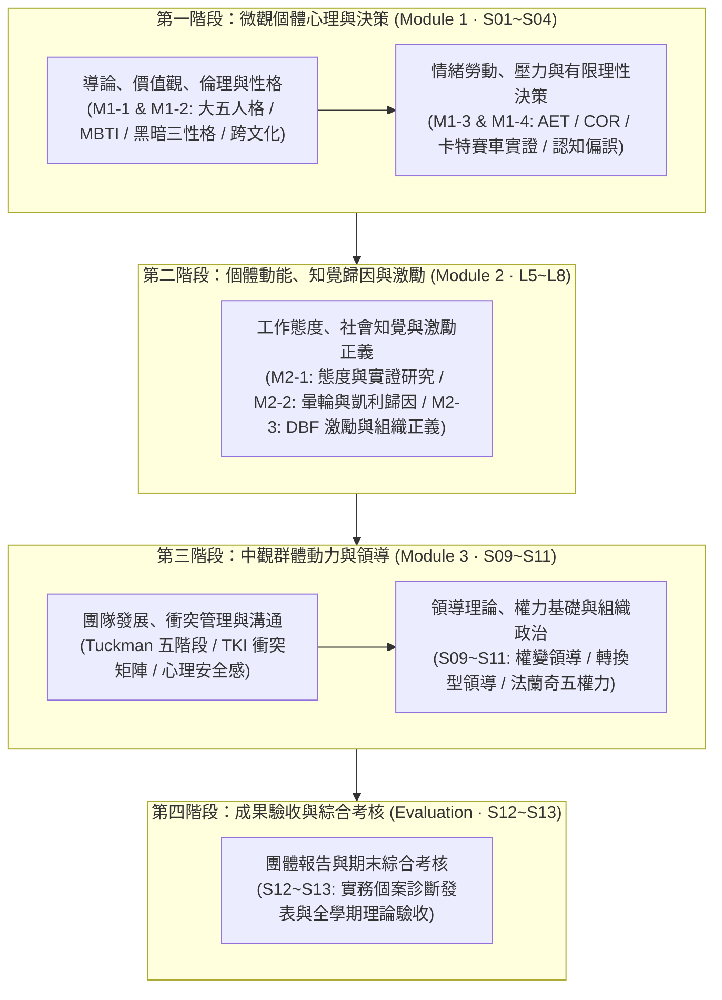

---
{"dg-publish":true,"permalink":"/02/03/moc/","title":"組織行為 MOC (課程總覽地圖)","tags":["PMBA","核心必修","組織行為","OB","領導力","團隊動力","MOC","知識地圖"],"dg-note-properties":{"title":"組織行為 MOC (課程總覽地圖)","course":"組織行為","category":"02_核心必修","type":"moc","tags":["PMBA","核心必修","組織行為","OB","領導力","團隊動力","MOC","知識地圖"],"aliases":["組織行為","組織行為 MOC","組織行為學 MOC","Organizational Behavior MOC"]}}
---

# 👥 組織行為 MOC (Organizational Behavior)

> **課程定位**：國立臺灣大學 PMBA 核心必修核心模組  
> **授課教師**：臺大工商管理學系暨商學研究所 戚樹誠 教授  
> **研究核心**：以心理學、社會學與管理學為基石，穿透**個體（Individual）➔ 群體（Group）➔ 組織系統（Organization）**三層次之人性行為規律與領導治理能耐  
> **進度追蹤看板**：[[02_核心必修/03_組織行為/00_課程導航與進度/progress_📊 課程與筆記進度追蹤\|📊 課程與筆記進度追蹤看板]]  
> **學程總覽**：[[00_學程修課地圖 & 進度追蹤\|返回 PMBA 學程修課地圖與進度追蹤]]  

---

## 🧭 組織行為三層次分析架構與決策脈絡圖

組織行為（OB）旨在協助高階經理人「**理解人性、預測行為、驅動賦能**」。本學期課程沿著**微觀個體到中觀群體與領導，並貫通至成果驗收**之路徑展開：

---

## 📅 課程進度與時程規劃總覽

| 上課日期 | 堂次 | 授課主題 | 核心範疇與理論對接 | 模組主筆記對接 | 狀態 |
| :---: | :---: | :--- | :--- | :---: | :---: |
| **10/04** | Session 1 | **導論、價值觀** | OB 本質、循證管理 (EBM)、Rokeach 終極/工具價值、Schwartz 圓環、Hofstede 六維度、安靜離職 | [[02_核心必修/03_組織行為/02_模組筆記/Module_1_個體行為與心理機制/M1-1_組織行為導論與跨文化價值觀\|M1-1 導論與跨文化價值觀]] | 🟢 已完成 |
| **10/04** | Session 2 | **倫理、性格** | 商業倫理決策、大五人格特質 (Big Five)、MBTI、特質激化理論 (TAT)、性格可塑性 | [[02_核心必修/03_組織行為/02_模組筆記/Module_1_個體行為與心理機制/M1-2_商業倫理決策與性格特質模型\|M1-2 商業倫理與性格特質]] | 🟢 已完成 |
| **10/24 & 11/07** | Session 3 | **性格、情緒、壓力** | 情緒勞動、情感事件理論 (AET)、資源保存理論 (COR)、不確定性容忍度、職場霸凌防禦 | [[02_核心必修/03_組織行為/02_模組筆記/Module_1_個體行為與心理機制/M1-3_情緒勞動情感事件與職場壓力管理\|M1-3 情緒勞動與職場壓力]] | 🟢 已完成 |
| **10/24 & 11/07** | Session 4~6 | **決策偏誤與性格深化** | 有限理性、卡特賽車實證、NASA 挑戰者號揭密、遺漏未故障數據偏誤、黑暗三性格 | [[02_核心必修/03_組織行為/02_模組筆記/Module_1_個體行為與心理機制/M1-4_管理決策偏誤有限理性與卡特賽車實證\|M1-4 管理決策偏誤實證]] | 🟢 已完成 |
| **11/21** | L5 (AM1) | **工作態度與實證研究** | 工作滿意度與幸福感、工作-家庭衝突、組織公平、社會期許偏差、配對問卷與統計顯著性 | [[02_核心必修/03_組織行為/02_模組筆記/Module_2_個體動能_知覺歸因與激勵/M2-1_工作態度滿意度與組織研究方法論\|M2-1 工作態度與研究方法論]] | 🟢 已完成 |
| **11/21** | L6 (AM2/PM1) | **社會知覺與歸因理論** | 六大知覺偏誤（暈輪/投射/刻板印象）、展望理論、凱利共變模型、跨文化 FAE 與雙重文化認同、比馬龍效應 | [[02_核心必修/03_組織行為/02_模組筆記/Module_2_個體動能_知覺歸因與激勵/M2-2_社會知覺偏誤與跨文化歸因理論\|M2-2 社會知覺與跨文化歸因]] | 🟢 已完成 |
| **11/21** | L8 (PM2) | **激勵機制與組織正義** | DBF 律師事務所薪酬沙盤、量化與質性指標、反激勵效應、年資價值辯證、內外部公平與組織正義 | [[02_核心必修/03_組織行為/02_模組筆記/Module_2_個體動能_知覺歸因與激勵/M2-3_績效激勵機制與組織正義個案_DBF律師事務所\|M2-3 DBF 激勵與組織正義]] | 🟢 已完成 |
| **12/12** | Session 9 | **領導** | 特質論、行為論、費德勒權變領導、赫塞-布蘭查德情境領導 (SLT) | [[02_核心必修/03_組織行為/02_模組筆記/S09_領導\|S09 領導]] | ⚪ 未開始 |
| **12/12** | Session 10 | **權力、政治** | 法蘭奇與雷文五大權力基礎、建設性組織政治、跨部門影響力與向上管理 | [[02_核心必修/03_組織行為/02_模組筆記/S10_權力與政治\|S10 權力與政治]] | ⚪ 未開始 |
| **12/26** | Session 11 | **領導、課程總結** | 轉換型領導、僕人式領導、敏捷教練型領導與全課程全景脈絡總結 | [[02_核心必修/03_組織行為/02_模組筆記/S11_領導與課程總結\|S11 領導與課程總結]] | ⚪ 未開始 |
| **01/09** | Session 12 | **團體報告** | 實務商業個案／組織診斷專案小組成果發表（第一階段） | [[02_核心必修/03_組織行為/01_個案與實務討論/S12_團體報告\|S12 團體報告]] | ⚪ 未開始 |
| **01/09** | Session 13 | **團體報告、期末考** | 小組成果發表（第二階段）與組織行為學期末綜合評量考核 | [[02_核心必修/03_組織行為/01_個案與實務討論/S13_團體報告與期末考\|S13 團體報告與期末考]] | ⚪ 未開始 |

---

## 📚 課程模組規劃與學習進度看板

### 模組一：個體行為與心理機制 (`Module_1_個體行為與心理機制` · 10/04~11/07)
- [x] **[[02_核心必修/03_組織行為/02_模組筆記/Module_1_個體行為與心理機制/M1-1_組織行為導論與跨文化價值觀\|M1-1_組織行為導論與跨文化價值觀 (10/04)]]**
- [x] **[[02_核心必修/03_組織行為/02_模組筆記/Module_1_個體行為與心理機制/M1-2_商業倫理決策與性格特質模型\|M1-2_商業倫理決策與性格特質模型 (10/04 & 11/07)]]**
- [x] **[[02_核心必修/03_組織行為/02_模組筆記/Module_1_個體行為與心理機制/M1-3_情緒勞動情感事件與職場壓力管理\|M1-3_情緒勞動情感事件與職場壓力管理 (10/24 & 11/07)]]**
- [x] **[[02_核心必修/03_組織行為/02_模組筆記/Module_1_個體行為與心理機制/M1-4_管理決策偏誤有限理性與卡特賽車實證\|M1-4_管理決策偏誤有限理性與卡特賽車實證 (10/24 & 11/07)]]**

### 模組二：個體動能：知覺、歸因與激勵 (`Module_2_個體動能_知覺歸因與激勵` · 11/21)
- [x] **[[02_核心必修/03_組織行為/02_模組筆記/Module_2_個體動能_知覺歸因與激勵/M2-1_工作態度滿意度與組織研究方法論\|M2-1_工作態度滿意度與組織研究方法論 (11/21)]]**  
  *工作滿意度與人生幸福感、工作-家庭衝突轉向、組織公平與離職傾向、社會期許偏差與配對問卷設計、統計顯著性與研究局限。*
- [x] **[[02_核心必修/03_組織行為/02_模組筆記/Module_2_個體動能_知覺歸因與激勵/M2-2_社會知覺偏誤與跨文化歸因理論\|M2-2_社會知覺偏誤與跨文化歸因理論 (11/21)]]**  
  *選擇性知覺、知覺防衛、刻板印象、投射、暈輪效應、近期偏誤、展望理論延伸、凱利共變歸因模型、跨文化基本歸因謬誤與雙重文化認同實驗、自利偏差與比馬龍效應。*
- [x] **[[02_核心必修/03_組織行為/02_模組筆記/Module_2_個體動能_知覺歸因與激勵/M2-3_績效激勵機制與組織正義個案_DBF律師事務所\|M2-3_績效激勵機制與組織正義個案_DBF律師事務所 (11/21)]]**  
  *DBF 律師事務所合夥人分潤模擬、可計帳工時與創始業績爭議、透明與公平兩難、反激勵效應、平均型 vs. 抓大放小型激勵、年資價值辯證、內外部公平與組織正義。*

### 模組三：群體動力、團隊協作與領導 (`Module_3_群體動力_團隊協作與溝通衝突` · 12/12~12/26)
- [ ] **S09_領導 (12/12)**
- [ ] **S10_權力與政治 (12/12)**
- [ ] **S11_領導與課程總結 (12/26)**

### 模組四：成果驗收、實務個案與評量考核 (01/09)
- [ ] **S12_團體報告 (01/09)**
- [ ] **S13_團體報告與期末考 (01/09)**

---

## 💎 推薦關聯之 **98 商業概念庫** 原子卡片

- **學科核心**：[[98_商業概念庫/organizational-behavior_組織行為\|organizational-behavior_組織行為]]
- **價值觀、性格與情緒壓力 (Module 1)**：
  - [[98_商業概念庫/Terminal_and_Instrumental_Values_終極與工具性價值觀\|Terminal_and_Instrumental_Values_終極與工具性價值觀]] · [[98_商業概念庫/Schwartz_Value_Theory_施瓦茨價值觀十構面模型\|Schwartz_Value_Theory_施瓦茨價值觀十構面模型]] · [[98_商業概念庫/Hofstede_Cultural_Dimensions_霍夫斯泰德文化六維度\|Hofstede_Cultural_Dimensions_霍夫斯泰德文化六維度]] · [[98_商業概念庫/Quiet_Quitting_安靜離職與組織公民行為\|Quiet_Quitting_安靜離職與組織公民行為]]
  - [[98_商業概念庫/Big_Five_Personality_Traits_大五人格特質模型\|Big_Five_Personality_Traits_大五人格特質模型]] · [[98_商業概念庫/MBTI_Personality_Framework_邁爾斯布里格斯性格類型\|MBTI_Personality_Framework_邁爾斯布里格斯性格類型]] · [[98_商業概念庫/Trait_Activation_Theory_特質激化理論\|Trait_Activation_Theory_特質激化理論]] · [[98_商業概念庫/Dark_Triad_黑暗三性格模型\|Dark_Triad_黑暗三性格模型]]
  - [[98_商業概念庫/AET_Affective_Events_Theory_情感事件理論\|AET_Affective_Events_Theory_情感事件理論]] · [[98_商業概念庫/Emotional_Dissonance_情緒失調與情緒勞動\|Emotional_Dissonance_情緒失調與情緒勞動]] · [[98_商業概念庫/COR_Theory_資源保存理論\|COR_Theory_資源保存理論]] · [[98_商業概念庫/Carter_Racing_NASA_Challenger_卡特賽車與挑戰者號決策個案\|Carter_Racing_NASA_Challenger_卡特賽車與挑戰者號決策個案]]
- **態度、知覺、歸因與激勵正義 (Module 2)**：
  - [[98_商業概念庫/three-components-of-attitude_態度三要素\|three-components-of-attitude_態度三要素]] · [[98_商業概念庫/job-satisfaction_工作滿意度\|job-satisfaction_工作滿意度]] · [[98_商業概念庫/social-desirability-bias_社會期許偏差與實證研究設計\|social-desirability-bias_社會期許偏差與實證研究設計]]
  - [[98_商業概念庫/halo-effect-and-projection_暈輪效應與投射偏誤\|halo-effect-and-projection_暈輪效應與投射偏誤]] · [[98_商業概念庫/kelley-covariation-model_凱利共變歸因模型\|kelley-covariation-model_凱利共變歸因模型]] · [[98_商業概念庫/fundamental-attribution-error_基本歸因謬誤\|fundamental-attribution-error_基本歸因謬誤]] · [[98_商業概念庫/self-serving-bias_自利偏誤\|self-serving-bias_自利偏誤]] · [[98_商業概念庫/self-fulfilling-prophecy_自我實現預言與比馬龍效應\|self-fulfilling-prophecy_自我實現預言與比馬龍效應]]
  - [[98_商業概念庫/incentive-distortion-and-organizational-justice_激勵扭曲與組織正義\|incentive-distortion-and-organizational-justice_激勵扭曲與組織正義]] · [[98_商業概念庫/equity-theory_公平理論\|equity-theory_公平理論]] · [[98_商業概念庫/justice-view_正義觀點\|justice-view_正義觀點]] · [[98_商業概念庫/intrinsic-vs-extrinsic-motivation_內在激勵與外在激勵\|intrinsic-vs-extrinsic-motivation_內在激勵與外在激勵]]
