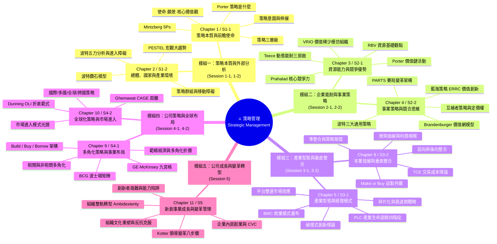

---
{"dg-publish":true,"permalink":"/02/04/00/mindmap/","title":"策略管理 心智圖導航","dg-note-properties":{"title":"策略管理 心智圖導航"}}
---

# 🧠 策略管理 全景心智圖導航 (Strategic Management Mindmap)

> **導航定位**：[[02_核心必修/04_策略管理/_策略管理 MOC\|返回策略管理 MOC]] ｜ [[02_核心必修/04_策略管理/00_課程導航與進度/progress_📊 課程與筆記進度追蹤\|進度看板]]  
> **核心用途**：本心智圖整合策略管理 5 大堂次、9 大核心章節與 5 大模組，協助經理人建立由外至內、由事業至公司、由本業至全球與轉型的宏觀思維框架。

---

