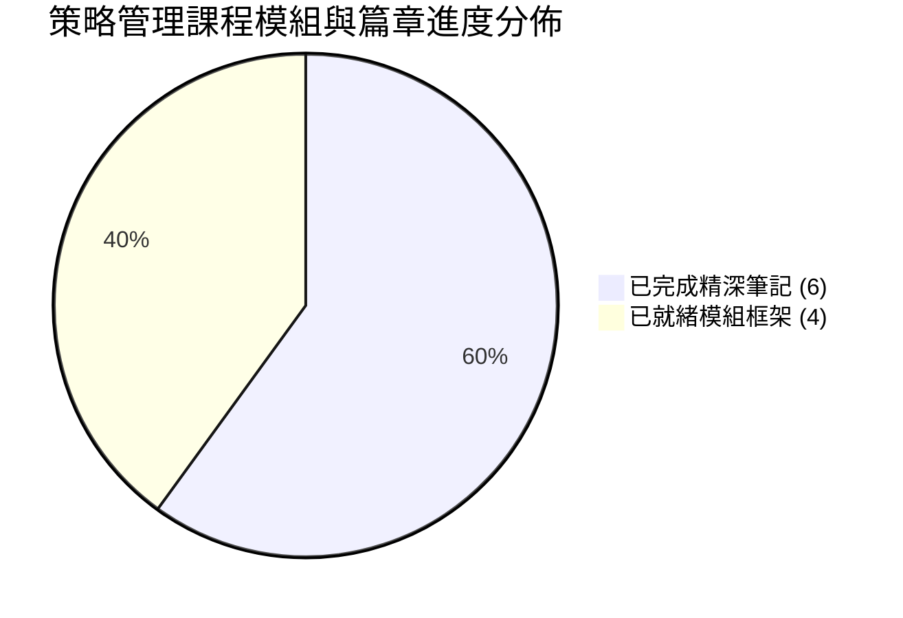

---
{"dg-publish":true,"permalink":"/02/04/00/progress/","title":"課程與筆記進度追蹤","dg-note-properties":{"permalink":"/notes/strategy/progress/","title":"課程與筆記進度追蹤"}}
---

# 📊 課程與筆記進度追蹤看板

> **課程名稱**：國立臺灣大學進修推廣學院（NTU SPECS）PMBA 核心必修「策略管理」 (Strategic Management)   
> **授課堂次**：全學期 5 大 Session（含 9 大核心主題章節）   
> **授課教師**：國立臺灣大學國際企業學系特聘教授 吳學良 博士  
> **學程定位**：高階商管（PMBA / EMBA）策略決策與競爭優勢整合樞紐（Capstone Course）   
> **知識架構**：五大核心模組 × 理論模型剖析 × 跨國與台灣標竿企業個案 × 商業概念庫穿透   
> **導航定位**：本看板為全課程知識庫的頂層導航核心，記錄堂次進度、雲端原稿連結、個案時事沉澱與筆記重整狀態。

---

## 📌 狀態標記圖例 (Legend)

| 圖示 | 狀態說明 | 處理指引 |
| :---: | :--- | :--- |
| 🟢 | **已完成 (Completed)** | 該堂筆記已結構化重整、雙向鏈結完畢，並整合至核心模組庫。 |
| 🟡 | **整理中 (In Progress)** | 正在進行逐字稿校對、白板推導圖解化或案例歸檔。 |
| ⚪ | **待重整 (To Reorganize)** | 已有雲端原稿或舊筆記，待依全新四維模組規格進行深度重構。 |
| ⚪ | **未開始 (Not Started)** | 課程尚未進行，預先鎖定主題大綱與骨架節點。 |

---

## 📈 總覽指標與進度統計



| 總堂次 | 涵蓋章節 | 規劃模組 | 筆記已落實篇數 | 知識庫穿透狀態 |
| :---: | :---: | :---: | :---: | :---: |
| **5 大 Session** | 9 大核心章節 | 5 大核心模組 | **6 篇深度筆記完成** (S1 & S2 全面就緒) | 100% 知識骨架與 16 張核心概念卡就緒 |

---

## 📅 課程進度與章節模組對照總表

| 堂次 (Session) | 課堂主題 | 對應教材章節 (Chapter) | 歸屬模組 (Module) | 模組筆記檔案與連結 | 核心理論、分析工具與案例關鍵詞 | 狀態 |
| :--- | :--- | :--- | :--- | :---: | :--- | :---: |
| **Session 1-1** (10/18) | **策略導論** | **Chapter 1**<br>導論：策略本質與前瞻使命 | **Module 1**<br>策略本質與外部分析 | [[M1-1_策略本質與前瞻使命]] | • 策略源起：希臘 Strategos、高家米拉大戰、戰場無底線 vs 商場有底線<br>• 三大適配性 (Fitness)：外部適配、內部適配 (魔球)、動態適配<br>• 前瞻思維：以終為始 (和泰末日思考/海盜分鑽石)、大谷翔平九宮格<br>• 願景真諦：葛斯納反對空洞口號、迂迴指北針<br>• 間接路線：李德哈特、李安劇本迂迴成導、瞪羚跳躍訊號<br>• 戰役 vs 戰爭：太平洋戰爭飛行員消耗、可口可樂 vs 百事可樂 | 🟢 已完成<br>(⭐⭐⭐) |
| **Session 1-2** (10/18) | **外部環境分析** | **Chapter 2**<br>外部分析：總體、國家與產業環境 | **Module 1**<br>策略本質與外部分析 | [[M1-2_總體國家與產業環境分析]] | • 趨勢洞察：超越第一層思考、弱訊號捕捉 (珠三角辣椒指數/口紅指數)<br>• 深度推演：少子化精緻客單價、小家庭大冰箱囤貨採購<br>• 批判性思考：聯發科併晨星人才流失、張忠謀春天的燕子客戶核心網絡<br>• 技術決策：台積電自主研發 vs 聯電外購 IBM Turnkey 0.13微米<br>• 策略定位：通才 vs 專才、賣軍火 (De Beers 抽水幫浦)、拼多多 vs 淘寶 | 🟢 已完成<br>(⭐⭐⭐) |
| **Session 1 (個案)** (10/18) | **哈菲自行車個案** | **Chapter 1 & 2**<br>個案討論：定位與轉型 | **Module 1**<br>策略本質與外部分析 | [[M1-3_哈菲自行車個案與策略定位決策]] | • 哈菲自行車 (Huffy Bicycles) 面對 Walmart 巨額微利訂單決策兩難<br>• 費茲傑羅第一流智慧、艾森豪退後十步看全貌<br>• 功能性決策 (財務不接) vs 策略性決策 (執行長藉機全面轉型規模代工)<br>• 雙重定位陷阱：既做品牌又做代工的資源內耗與客戶信任崩潰<br>• 台灣科技大分拆印證：宏碁/緯創、華碩/和碩歷史必然 | 🟢 已完成<br>(⭐⭐⭐) |
| **Session 2-1** (11/01) | **競爭優勢與企業能耐** | **Chapter 3**<br>內部分析：資源、能力與競爭優勢 | **Module 2**<br>企業能耐與事業策略 | [[M2-1_資源能力與競爭優勢]] | • 競爭優勢動態本質：近憂 (當下配適) vs 遠慮 (防範組織剛性)<br>• 衡量指標與盲點：ROE局限、SHEIN未上市高估值虛火、品牌價值為落後指標 (柯達/諾基亞衰亡)<br>• 成功學批判：追求卓越迷思、生存者偏差 (10%成功出書 vs 90%失敗沉默)<br>• 成本四大鐵律：規模經濟、範疇經濟、經驗曲線與瑞士 Swatch 塑膠一體化重組<br>• RBV 與 VRIO 模型：歷史路徑、因果模糊、社會複雜性四重防護壁壘 | 🟢 已完成<br>(⭐⭐⭐) |
| **Session 2-2** (11/01) | **事業策略與競合思維** | **Chapter 4**<br>事業策略與競合思維 | **Module 2**<br>企業能耐與事業策略 | [[M2-2_事業策略與競合思維]] | • 波特三大策略與夾在中間教條破除：組織雙巧性 (Ambidexterity 左右開弓)<br>• 台積電終極印證：極致 Cost-down 兼顧先進製程創新 Value-up<br>• 前台後台商業模式：前台 Value-up (右腦/創意/B2C) vs 後台 Cost-down (左腦/效率/B2B 台灣DNA)<br>• 價值的本質深度思辨：功能價值 vs 情緒價值 (Labubu 盲盒現象、DT Swiss 輪組、小資族心理補償)<br>• 競合理論與價值網 (Value Net)：互補者策略 (Wintel 聯盟)、PARTS 賽局變革槓桿 | 🟢 已完成<br>(⭐⭐⭐) |
| **Session 2 (個案)** (11/01) | **SHEIN快時尚個案** | **Chapter 3 & 4**<br>個案討論：小單快反與數位轉型 | **Module 2**<br>企業能耐與事業策略 | [[M2-3_SHEIN快時尚小單快反與數位轉型]] | • SHEIN vs. Zara 快時尚模式對決：年推 15 萬款、超越 Amazon 下載第一<br>• 核心優勢解構：小單快反 (首批100件以下/7天上架/2,000家工廠打款互信/零庫存)<br>• 成長瓶頸與制度成本重擊：美歐取消小額包裹免稅，按件處理費對 $10 洋裝致命侵蝕<br>• 成長路徑四大辯證：維持低價 vs 開放第三方 vs 實體門市 vs 向上延伸中高價副品牌<br>• 收購 Everlane 策略省思：買得到形象但買不到敏捷供應鏈；雙重定位紅線防範 | 🟢 已完成<br>(⭐⭐⭐) |
| **Session 3-1** | **企業成長** | **Chapter 5**<br>產業型態與經營模式 | **Module 3**<br>產業型態與垂直整合 | [[02_模組筆記/Module_3_產業型態與垂直整合/M3-1_產業型態與經營模式|M3-1 產業型態與經營模式]] | • 產業生命週期 (PLC) 四階段特徵與策略<br>• 碎片化產業整合、成熟期防禦與衰退期四重戰略<br>• Christensen 破壞式創新理論<br>• 商業模式畫布 (BMC)、雙邊市場平台網絡效應 | ⚪ 待開始 |
| **Session 3-2** | **垂直整合** | **Chapter 8**<br>本業發展與垂直整合策略 | **Module 3**<br>產業型態與垂直整合 | [[02_模組筆記/Module_3_產業型態與垂直整合/M3-2_本業發展與垂直整合策略|M3-2 本業發展與垂直整合策略]] | • 前向整合 vs. 後向整合、完全整合 vs. 準整合<br>• 自製或外購 (Make or Buy) 決策決策樹<br>• Coase & Williamson 交易成本理論 (TCE)<br>• 微笑曲線 (Smile Curve)、產業價值咽喉防禦 | ⚪ 待開始 |
| **Session 4-1** | **多角化策略** | **Chapter 9**<br>多角化策略與事業布局 | **Module 4**<br>公司策略與全球布局 | [[02_模組筆記/Module_4_公司策略與全球布局/M4-1_多角化策略與事業布局|M4-1 多角化策略與事業布局]] | • 相關多角化 vs. 非相關多角化<br>• 範疇經濟、核心能耐轉移與內部資本市場<br>• BCG 波士頓矩陣、GE 九宮格矩陣<br>• 成長三路徑：Build / Buy / Borrow | ⚪ 待開始 |
| **Session 4-2** | **全球化策略** | **Chapter 10**<br>全球化策略與市場進入模式 | **Module 4**<br>公司策略與全球布局 | [[02_模組筆記/Module_4_公司策略與全球布局/M4-2_全球化策略與市場進入模式|M4-2 全球化策略與市場進入模式]] | • Ghemawat CAGE 距離框架<br>• Bartlett & Ghoshal 國際競爭策略四大象限<br>• 市場進入模式光譜 (出口 ➔ 授權 ➔ 合資 ➔ 獨資)<br>• Dunning OLI 折衷範式 | ⚪ 待開始 |
| **Session 5** | **公司成長與轉型** | **Chapter 11**<br>新創事業、成長發展與變革管理 | **Module 5**<br>公司成長與變革轉型 | [[02_模組筆記/Module_5_公司成長與變革轉型/M5-1_新創事業成長發展與變革管理|M5-1 新創事業成長發展與變革管理]] | • 企業內部創業、企業創投 (CVC) 與新創孵化機制<br>• 雙軌轉型 (Ambidexterity：本業卓越 × 新創探索)<br>• 創新者兩難、能力陷阱與組織結構性慣性<br>• John Kotter 領導變革八步驟 | ⚪ 待開始 |

---

## 🔍 Dataview 狀態過濾

```dataview
TABLE 模組編號, 章節編號, 主題, 對應週次, 狀態
FROM "PMBA/PMBA_Note/02_核心必修/04_策略管理/02_模組筆記"
SORT 章節編號 ASC
```