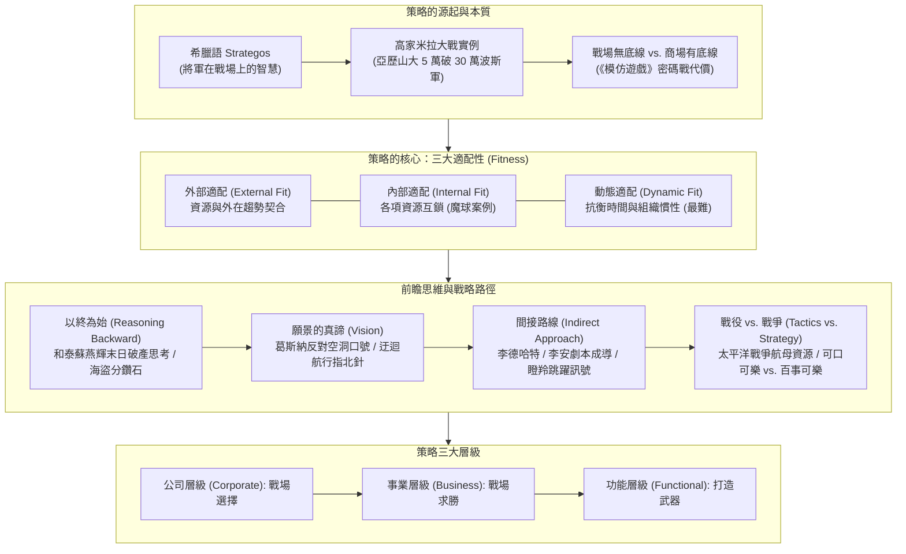
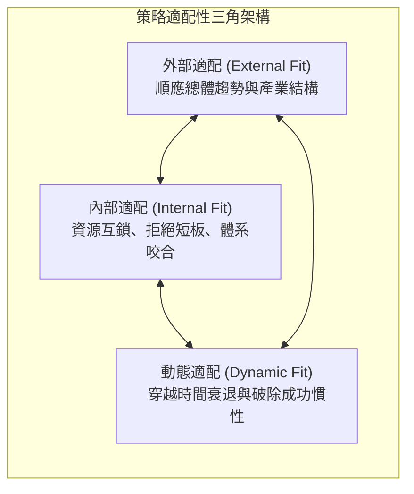
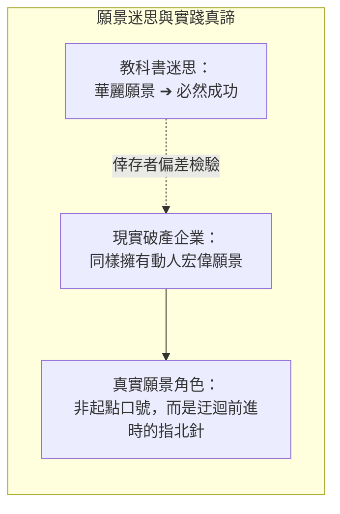
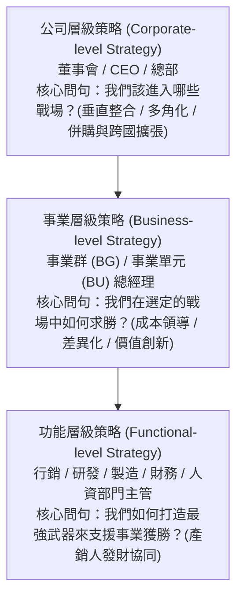

---
{"dg-publish":true,"permalink":"/02/04/02/module-1/m1-1/","tags":["課程筆記","PMBA","核心必修","策略管理","策略本質","策略適配","以終為始","間接路線"],"dg-note-properties":{"類別":"課程筆記","課程名稱":"[[策略管理]]","模組編號":"Module 1","模組名稱":"策略本質與外部分析","章節編號":"M1-1","主題":"策略本質與前瞻使命 (Strategic Foundations & Forward-looking Mission)","對應週次":"2026-10-18 課堂","狀態":"🟢 已完成","tags":["課程筆記","PMBA","核心必修","策略管理","策略本質","策略適配","以終為始","間接路線"],"aliases":["M1-1 策略本質與前瞻使命","策略本質與前瞻使命"]}}
---

# ⚔️ M1-1 策略本質與前瞻使命

> **導讀與對接**：  
> - **上級地圖**：[[02_核心必修/04_策略管理/_策略管理 MOC\|策略管理 MOC 全景地圖]]  
> - **進度看板**：[[05_AI選修/10_AiX/00_課程導航與進度/progress_📊 課程與筆記進度追蹤\|課程與筆記進度追蹤看板]]  
> - **核心概念庫**：[[98_商業概念庫/strategic-fitness_策略適配性理論\|Strategic_Fitness_策略適配性理論]] · [[98_商業概念庫/Reasoning_Backward_以終為始與逆向推導\|Reasoning_Backward_以終為始與逆向推導]] · [[98_商業概念庫/Indirect_Approach_間接路線戰略\|Indirect_Approach_間接路線戰略]] · [[98_商業概念庫/Tactics_vs_Strategy_戰術戰役與戰略戰爭\|Tactics_vs_Strategy_戰術戰役與戰略戰爭]]  
> **授課教師**：國立臺灣大學國際企業學系特聘教授 吳學良 博士  
> **課堂時間**：2026-10-18 (Session 1-1)  

---

## 🎯 本章視覺化知識脈絡圖

---

## 一、 策略的源起與本質：將軍在戰場上的智慧

### 1. 語源考證：希臘語 *Strategos*
- 吳學良教授指出，現代人朗朗上口的「策略（Strategy）」，源自希臘文 *Strategos*（或 *Stratego*），意指「**將軍在戰場上的智慧**」。
- 該詞彙的歷史具象化代表為**亞歷山大大帝（Alexander the Great）**。面對殘酷的以寡擊眾局面，將軍必須在極度混亂、瞬息萬變且資源極度有限的情境中做出決定勝負的謀略。

### 2. 經典戰例深度剖析：高家米拉大戰（Battle of Gaugamela，前 331 年）
- **兵力對比**：亞歷山大率領 5 萬馬其頓聯軍，深入中亞平原，迎戰波斯帝國大流士三世（Darius III）親率的 30 萬大軍。
- **戰略抉擇一：該不該夜襲？（換位思考的辯證）**
  - 部屬見波斯大軍連綿數里、灶煙蔽天，紛紛建議趁黑夜突襲。
  - **亞歷山大斷然拒絕**：「我們能想到夜襲，對方身為征戰多年的大帝豈會想不到？敵軍此刻必定全副武裝戒備。盲目夜襲等於自投羅網。」
  - *策略意涵*：策略分析極重「**換位思考（Perspective Taking）**」，永遠不要單向假設對手是笨蛋。
- **戰略抉擇二：白天決戰的佯攻與間接穿透**
  - 面對波斯數倍於己、橫向展開極寬的戰線，亞歷山大親率精銳騎兵**刻意往右側斜向奔馳**。
  - 波斯大流士誤判其意圖包抄，急令波斯騎兵平行跟進並拉開陣型阻截。
  - **戰略奇兵**：亞歷山大在騎兵身後暗藏了無重武裝的「輕步兵」。在雙方騎兵高速奔馳拉扯之際，輕裝步兵突然持投石器衝出纏鬥波斯騎兵；此時馬其頓騎兵突然勒馬掉頭，朝波斯因陣線拉開而暴露出的巨大中央空檔**全速穿透**，直逼大流士的戰車！
  - 大流士驚恐後撤，引發全軍潰敗。這就是將軍在戰場上「**佯攻調動、製造對手失衡、擊其要害**」的經典智慧。

### 3. 戰場謀略 vs. 商場策略的關鍵界線
- **戰場謀略「沒有底線」**：
  - 核心目標是不擇手段求勝。
  - 課堂案例《模仿遊戲》（The Imitation Game）：英國數學家圖靈破譯德軍 Enigma 密碼後，情報單位**不能每次都攔截德軍轟炸**，甚至必須忍痛犧牲部分護航艦隊與城鎮，目的是防止德軍察覺密碼被破。
- **商場策略「必須有底線」**：
  - 商場競爭受制於法律、主管機關監管、ESG 與社會公序良俗；超越底線的策略（如惡性詐欺、造假財報）終將遭遇系統性滅頂。

---

## 二、 策略的核心命題：三大適配性（Fitness）

吳學良教授強調，策略就是創造「**適配（Fit）**」。企業未必要在每項指標上做到世界第一，但內部各項活動與外部環境必須達到極高的契合狀態。

### 1. 外部適配（External Fit）
- **意涵**：企業的資源配置與定位，必須精準契合外部環境變數、產業結構與總體大趨勢。
- **商場意涵**：在衰退萎縮的產業中做極致的努力，往往事倍功半；順風航行才能創造超額利潤。

### 2. 內部適配（Internal Fit）
- **意涵**：企業內部各項資源（研發、製造、行銷、組織文化、薪酬體系）彼此之間高度互鎖（Interlocking），不出現互相抵觸的矛盾。
- **經典案例《魔球》（Moneyball）**：
  - 奧克蘭運動家隊在預算僅有紐約洋基隊三分之一的極端困境下，不盲目砸錢爭奪全能球星；
  - 透過統計數據專門挑選「上壘率高、但因外型或防守瑕疵而被市場低估」的球員，搭配「少盜壘、重視選球與四壞保送」的戰術體系，在有限資源下達成極致的內部適配。

### 3. 動態適配（Dynamic Fit）——最艱鉅的考驗
- **意涵**：環境在變、競爭對手在學、內部資源會老化與變質（例如創業初期同心協力，IPO 致富後開始爭權奪利）。
- **成功是失敗之母**：過去成功的經驗往往轉化為思維慣性（Cognitive Inertia），使企業在面臨典範轉移時動彈不得。持續在變局中維持動態適配，是高階經理人真正的修煉。

---

## 三、 前瞻思維模型：以終為始（Reasoning Backward）

華人通俗文化受《三國演義》影響，常神化諸葛亮能「掐指一算預知天命」。吳教授直言，真實商業世界從不存在水晶球，卓越的戰略家依循的是「**以終為始（Reasoning Backward）**」的嚴密逆向推導。

### 1. 和泰汽車（Toyota 台灣總代理）前董事長蘇燕輝的「末日思考」
- **背景**：台灣消費者極度偏愛 Toyota，和泰汽車連年蟬聯市占冠軍，獲利創歷史新高，全體主管沉浸於極度樂觀之中。
- **震撼提問**：蘇燕輝董事長在高階會議上突然要求全員思考：
  > 「假設我們公司在三年之內宣告破產倒閉，那個致命的原因會是什麼？」
- **逆推出的核心危機**：在汽車代理業，賣不好會倒閉，**但「賣得太好」同樣存在滅頂危機**！
  - 日本豐田總公司會認為：台灣市場既然如此成熟、利潤如此豐厚，為何要讓代理商抽一手？不如直接收回代理權、在台設立 100% 獨資子公司。
  - *策略行動*：唯有預先做末日逆推，和泰才能提早深化價值鏈服務（成立和潤融資、和運租車、自建經銷網絡），將自己嵌入豐田不可分割的生態系中。

### 2. 賽局分析經典：海盜分鑽石（Pirate Game）
- **情境**：5 個極度理性且殘忍的海盜要分配 100 顆鑽石，抽籤由 1 號提方案，需獲半數或以上（含自己）同意，否則被扔入海中處死；接著由 2 號繼續。
- **順推思考（Looking Forward）的盲點**：直覺認為應平分 20 顆，或 1 號給自己 50 顆以求自保。
- **逆推思考（Reasoning Backward）的精準解答**：
  - 倒推至剩 4 號與 5 號時：4 號提案只要自己投自己（佔 50%），就能拿走 100 顆，5 號得 0 顆。
  - 倒推至剩 3、4、5 號時：5 號知道若 3 號死掉自己將一無所有，故 3 號只需給 5 號 1 顆即可獲得同意（方案：3 號 99 顆，4 號 0 顆，5 號 1 顆）。
  - 依此類推回 5 人局：1 號只需給「在 2 號局中會拿 0 顆」的 3 號與 5 號各 **1 顆鑽石**，即可獲得 3 票半數支持！
  - **最終結果**：1 號獨得 **97 顆鑽石**！
  - *結論*：順推容易陷入情緒直覺；以終為始逆推，才能穿透賽局結構的底層邏輯。

### 3. 大谷翔平的曼陀羅九宮格（Mandala Chart）
- 高中時期即將「成為 8 球團第一指名」置於九宮格正核心（終極目標），向外倒推 8 大次級目標（體格、控球、球質、球速 160km、心智、人品、運氣、球隊信任），再進一步倒推至日常掃廁所、撿垃圾等具體微觀行動。

---

## 四、 願景（Vision）的迷思與真諦

許多商管教科書常落入「**倖存者偏差（Survivorship Bias）**」，宣稱卓越企業必定始於宏大願景。

- **葛斯納（Lou Gerstner）的名言**：
  - 1993 年葛斯納接任瀕臨破產分拆的 IBM 時，面對媒體追問，毅然說出：「**IBM 現在最不需要的就是願景（The last thing IBM needs right now is a vision）**。」
  - 他專注於止血、整合跨國服務能耐與滿足客戶需求，救活了巨人。
- **願景的真實定位**：
  - 企業創立初期，首要任務是「活下去」；
  - 願景的真正價值，是在企業經歷一系列局部戰術成功（如達成 IPO、營收破百億）後，**指引團隊「下一步往何處去」，防止組織在富裕中迷航或自滿停滯**。

---

## 五、 戰略路徑：間接路線（The Indirect Approach）

### 1. 李德·哈特（B. H. Liddell Hart）的戰略論
- 剖析西方歷史自希波戰爭至二戰共 30 場重大戰爭、280 次戰役，得出震撼結論：
  - **直接路線**：正面強攻對手，往往是對手早有防備的路線，代價最慘烈、成效最低。
  - **間接路線**：看似迂迴繞遠，實則是**「為對手創造弱點、攻其不備、以最小代價獲得最大戰果」**的最經濟戰略。

### 2. 李安導演的「迂迴前進」
- 早期李安在美毫無好萊塢人脈與資金，若走直接路線到處拜託當導演，絕無勝算。
- 他選擇間接路線：先在家中閉門苦熬寫劇本，《推手》、《喜宴》連獲台灣新聞局劇本大獎第一名。李安堅持「中影買劇本的前提，必須由我親自執導」，以極低預算完成拍攝，一舉敲開國際影壇大門。

### 3. 生物學的戰略訊號：非洲瞪羚的原地跳躍（Stotting）
- 當鄧羚（Gazelle）發現獵豹（Cheetah）靠近時，第一反應並非奪路狂奔，而是**原地高高垂直彈跳**。
- *戰略解讀*：向掠食者釋放強烈且不可偽造的訊號（Credible Signal）——「我體能極佳、敏捷無比，追我極不划算」。獵豹接收到訊號後多半放棄轉移目標，達成「**不戰而屈人之兵**」。

### 4. AI 時代的間接競爭思維
- 當生成式 AI 將文字流暢度、程式編碼等直接技能門檻徹底拉平後，個人與企業若僅在「產出速度」等直接維度火拼，終將陷入內捲；必須透過獨特體驗、深度產業洞察與跨界整合，走出一條**不可替代的間接路線**。

---

## 六、 戰術（戰役） vs. 戰略（戰爭）的格局跨越

「**積小勝為大勝**」的前提是環境完全靜態。但在動態競爭中，**戰術天才極可能成為戰略白癡**！

| 歷史與商業案例 | 局部戰役思維 (Tactics / Battles) | 全局戰爭思維 (Strategy / War) | 終局勝負關鍵 |
| :--- | :--- | :--- | :--- |
| **二戰美日太平洋戰爭** | **日軍**：執著於每一場海戰的戰術交換比，計算「沉一艘換兩艘」，前四場贏了三場。 | **美軍**：戰略核心在於「保護熟練飛行員」與「後方造船工業動員」。美軍飛行員輪調回國擔任教官培育新血。 | 1945年日軍王牌飛行員耗盡、航母全滅；美軍服役 **120 艘航母**，徹底贏得戰爭。 |
| **可口可樂 vs. 百事可樂 (PepsiCo)** | **可樂單一品類**：可口可樂在經典碳酸飲料市場始終保持全球第一市占。 | **百事可樂**：不與可口可樂在可樂單點死磕，大舉佈局非碳酸飲品與零食點心（Frito-Lay 樂事洋芋片）。 | 百事可樂在「整體企業市值與營收規模」的全局戰爭中，多次超車可口可樂！ |

---

## 七、 策略三大層級架構

---

## 💡 經理人管理實務反思與行動指引

1. **落實末日思考**：每季召集核心經營團隊，逆向推導「若三年後公司倒閉，核心原因是什麼？」預先斬斷致命隱患。
2. **檢視三大適配性**：警惕「單點突破」迷思，確保行銷、研發與激勵機制緊密互鎖，防範被同質化複製。
3. **區分戰役與戰爭**：不要為了一次非關鍵的單點勝負，耗盡團隊最珍貴的核心戰略資源。

---

## 🔗 模組導航與延伸閱讀

- ⬅️ **前置總覽**：[[_策略管理 MOC|策略管理 MOC 全景地圖]]
- ➡️ **下一章節**：[[M1-2_總體國家與產業環境分析|M1-2 總體、國家與產業環境分析]]
- 🎯 **精選個案**：[[M1-3_哈菲自行車個案與策略定位決策|M1-3 哈菲自行車個案與策略定位決策]]
- 💎 **本章關聯概念卡片**：
  - [[strategic-fitness_策略適配性理論|Strategic_Fitness_策略適配性理論]]
  - [[Reasoning_Backward_以終為始與逆向推導]]
  - [[Indirect_Approach_間接路線戰略]]
  - [[Tactics_vs_Strategy_戰術戰役與戰略戰爭]]