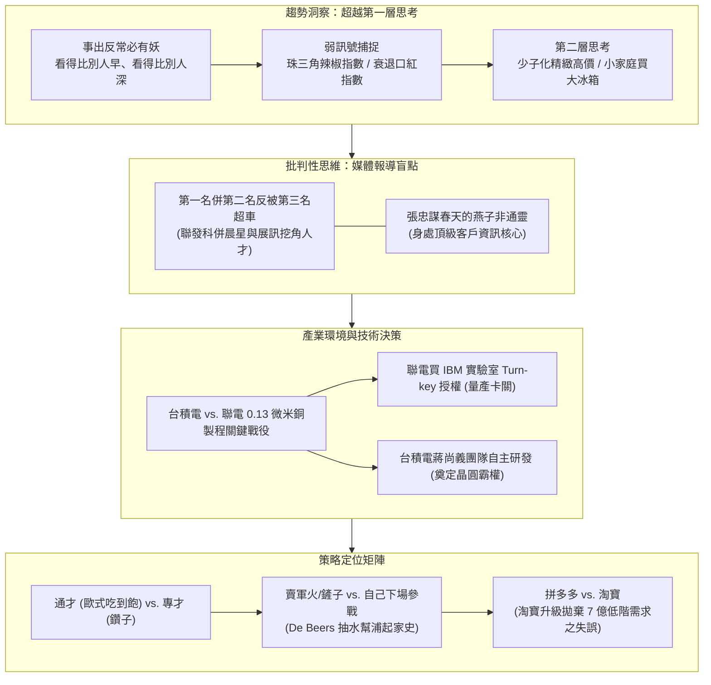
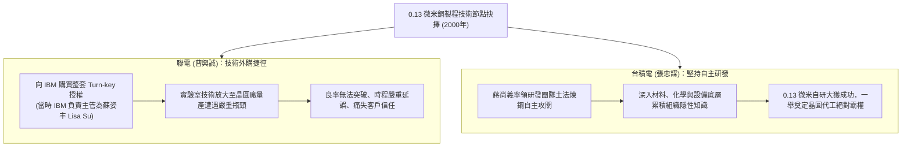

---
{"dg-publish":true,"permalink":"/02/04/02/module-1/m1-2/","tags":["課程筆記","PMBA","核心必修","策略管理","外部分析","弱訊號","策略定位","賣軍火策略","自主研發抉擇"],"dg-note-properties":{"類別":"課程筆記","課程名稱":"[[策略管理]]","模組編號":"Module 1","模組名稱":"策略本質與外部分析","章節編號":"M1-2","主題":"總體國家與產業環境分析 (External, National & Industry Analysis)","對應週次":"2026-10-18 課堂","狀態":"🟢 已完成","tags":["課程筆記","PMBA","核心必修","策略管理","外部分析","弱訊號","策略定位","賣軍火策略","自主研發抉擇"],"aliases":["M1-2 總體國家與產業環境分析","總體國家與產業環境分析"]}}
---

# 🌐 M1-2 總體、國家與產業環境分析

> **導讀與對接**：  
> - **上級地圖**：[[02_核心必修/04_策略管理/_策略管理 MOC\|策略管理 MOC 全景地圖]]  
> - **進度看板**：[[05_AI選修/10_AiX/00_課程導航與進度/progress_📊 課程與筆記進度追蹤\|課程與筆記進度追蹤看板]]  
> - **核心概念庫**：[[98_商業概念庫/Weak_Signals_弱訊號與小趨勢辨識\|Weak_Signals_弱訊號與小趨勢辨識]] · [[98_商業概念庫/Turnkey_vs_Internal_RD_技術授權與自主研發抉擇\|Turnkey_vs_Internal_RD_技術授權與自主研發抉擇]] · [[98_商業概念庫/Selling_Shovels_Strategy_賣軍火與賣鏟人策略\|Selling_Shovels_Strategy_賣軍火與賣鏟人策略]] · [[98_商業概念庫/strategic-fitness_策略適配性理論\|Strategic_Fitness_策略適配性理論]]  
> **授課教師**：國立臺灣大學國際企業學系特聘教授 吳學良 博士  
> **課堂時間**：2026-10-18 (Session 1-2)  

---

## 🎯 本章視覺化知識脈絡圖

---

## 一、 趨勢辨識的深度：超越第一層思考（First-order Thinking）

吳學良教授指出，卓越的策略家在面對總體環境時，關鍵在於「**看得比別人早**」以及「**看得比別人深**」。

### 1. 捕捉弱訊號（Weak Signals）與小趨勢（Microtrends）
- 大趨勢全面爆發前，邊緣市場早已釋放出微弱的異常訊號：
  - **珠三角「辣椒指數」（Pepper Index）**：早期研究深圳、東莞製造業景氣，不必向幾萬家工廠發問卷，只要看當地農產市場的辣椒批發行情！因外省農民工多來自川湘贛等嗜辣省份。工廠接單爆滿大量招工時，辣椒需求暴增；景氣轉冷工廠停工返鄉時，辣椒價格瞬間暴跌。
  - **經濟景氣「口紅指數」（Lipstick Index）**：經濟衰退時，女性延緩購買數萬元名牌包，轉而購買口紅作為心理撫慰，口紅銷量逆勢大增成為景氣反轉指標。

### 2. 深度趨勢推演：第一層 vs. 第二層思考
- **案例一：少子化衝擊**
  - *第一層思考*：出生人口暴跌，兒科與婦產科萎縮，兒童相關生意必然完蛋。
  - *第二層思考（策略家視角）*：父母與祖父母的資源集中於單一子女（分子除以分母），平均每個兒童獲得的資源急遽暴增！高端精緻教育、頂級母嬰用品具備極高溢價空間。
- **案例二：小家庭與單身化（Household Size 縮小）**
  - *第一層思考*：單身獨居吃得少，家電廠商應該主打小冰箱。
  - *第二層思考（採購行為深度洞察）*：單身與雙薪家庭平日工作忙碌，採購頻率由「每天買菜」降至「每週大賣場採購一次」，反而極度需要**超大容量冷凍庫**來囤積一整週的冷藏食材！

---

## 二、 批判性思維：解構商業媒體的盲點與迷思

策略分析不能輕信商業雜誌（如《商業周刊》、《天下》）為了銷量而創作的公關神話。

### 1. 迷思一：第一名與第二名合併，組成「超級台灣隊」必勝？
- **聯發科併購晨星（MStar）的深層代價**：
  - 媒體盛讚聯發科併購晨星後將形成無敵巨無霸，徹底甩開第三名。
  - **真實的組織動態**：兩家龍頭產品線與工程師人力高度重疊（Overlap），合併後必然引發劇烈的人事整併與權力摩擦。
  - **第三名的戰略收割**：大批心灰意冷的晨星核心幹部與研發骨幹出走，隨即被第三名（展訊 Spreadtrum）以高薪重金全數吸收，展訊趁勢在低階 3G/4G 晶片快速崛起逼宮聯發科！

### 2. 迷思二：張忠謀總能在金融海嘯看到「春天的燕子」，全憑通靈直覺？
- 2008-2009 全球金融海嘯，張忠謀領先全球宣告半導體「春天的燕子來了」。
- **真相**：台積電身為全球純晶圓代工龍頭（Foundry No. 1），位居全球半導體價值網絡的神經中樞。當蘋果、高通評估景氣落底、準備開發下一代旗艦晶片時，必須**提前 6 至 9 個月**與台積電討論產能排程與設計規格。張忠謀是因為站在全球頂級客戶的資訊匯流核心，才能最早感知景氣春燕。

---

## 三、 產業環境與關鍵技術路徑決策：台積電 vs. 聯電 0.13 微米銅製程

台積電與聯電早期原本平分秋色，為何在 2000 年後拉開天壤之別的差距？核心關鍵在於 **0.13 微米製程技術節點**的世紀抉擇。

- **深度決策啟示**：
  - 買技術（Buy）看似省時省力走捷徑，但跳過了最艱苦的量產工程試錯過程，無法累積關鍵的**組織隱性知識（Tacit Knowledge）**；
  - 自主研發（Build）雖然初期充滿不確定性，但一旦攻克，所建立的技術專屬性壁壘將成為對手不可踰越的護城河。

---

## 四、 策略定位光譜：在趨勢中選擇你的生存之道

定位不是空泛的口號，而是選擇一條通往成功的路徑。

### 1. 通才（吃到飽） vs. 專才（鑽子）
- 通才也是一種定位（如歐式 Buffet 餐廳滿足全家各取所需的需求）。
- 重點不在於聚焦或多元，而在於**企業內部資源能否與該定位產生適配**。
- **跨界適配的失敗教訓**：成衣廠在疫情期間見口罩大缺貨，直覺認為「大家都是做布料」，企圖轉產口罩；結果在無塵機台、醫療認證、原料熔噴布採購及客戶品牌認知上全面水土不服。

### 2. 賣軍火/鏟子 vs. 自己下場參戰
- 「**淘金熱時，真正發大財的是賣鏟子的人**」。
- **De Beers 鑽石帝國的抽水幫浦起家史**：
  - 19 世紀末南非掀起淘金與採鑽熱潮，無數個體戶湧入挖礦。挖到一定深度地下水必定滲出，不抽水就無法開採。
  - De Beers 創辦人沒有盲目跳下去挖鑽石，而是進口**抽水幫浦**！
  - 買不起幫浦的礦工？**提供按日租賃**；連租金都付不起的窮礦工？**簽訂抽成分潤合約**，以幫浦入股未來的鑽石收成。
  - 隨著長年在礦區歷練，De Beers 累積了無可比擬的辨礦眼光，低風險逐步掌控了南非最優質的鑽石礦脈，最終登頂全球鑽石帝國。
- **台灣企業的智慧**：台積電不與客戶競爭終端品牌，甘做全球算力軍火庫，正是賣鏟人策略的極致演繹。

### 3. 拼多多 vs. 淘寶：下沉市場定位轉換的致命空檔
- **淘寶的定位迷航**：淘寶赴美上市後，為符合海外投資人期待與 ESG 形象，全面推動「消費升級」，對平台上的廉價品、低階供應鏈實施降權、限流與嚴苛懲罰。
- **策略盲點**：中國人均所得雖突破萬美元，但誠如李克強總理所言，**「中國仍有 6 億至 7 億人口月收入在 1000 元人民幣以下」**！低階需求並未消失。
- **拼多多的戰略接收**：淘寶主動拋棄的低階供應鏈與數億下沉市場買家，被拼多多以農產品拼團、極致性價比全盤接收，以農村包圍城市之勢迅速崛起撼動電商霸主。

---

## 💡 經理人管理實務反思與行動指引

1. **建立弱訊號雷達**：不要只看主計處的落後統計數字，從第一線工廠加班燈火、員工消費習慣發掘景氣反轉端倪。
2. **警惕外購技術陷阱**：涉及企業生死存亡的核心競爭力，切忌貪圖便利買 Turn-key，必須深耕自主工程能力。
3. **定位必須承載取捨**：若選擇做品牌就必須承擔高額行銷與客戶心智建立；若選擇做軍火供應商就必須極致壓低成本並堅持不與客戶爭利。

---

## 🔗 模組導航與延伸閱讀

- ⬅️ **上一章節**：[[M1-1_策略本質與前瞻使命|M1-1 策略本質與前瞻使命]]
- ➡️ **下一章節**：[[M1-3_哈菲自行車個案與策略定位決策|M1-3 哈菲自行車個案與策略定位決策]]
- 💎 **本章關聯概念卡片**：
  - [[Weak_Signals_弱訊號與小趨勢辨識]]
  - [[Turnkey_vs_Internal_RD_技術授權與自主研發抉擇]]
  - [[Selling_Shovels_Strategy_賣軍火與賣鏟人策略]]
  - [[strategic-fitness_策略適配性理論|Strategic_Fitness_策略適配性理論]]