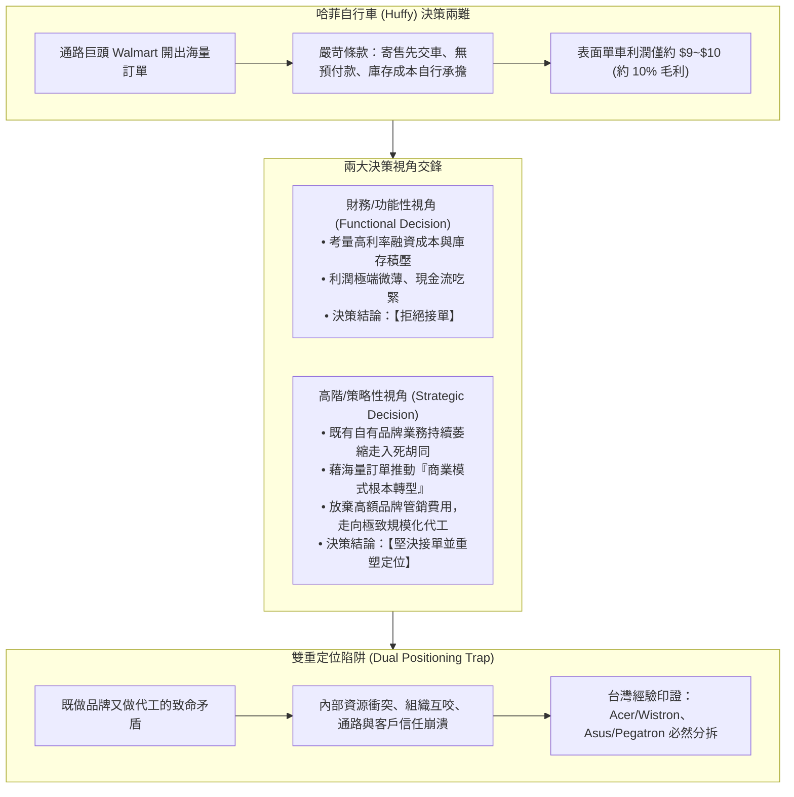

# 🚲 M1-3 哈菲自行車個案與策略定位決策

> **導讀與對接**：  
> - **上級地圖**：[[02_核心必修/04_策略管理/_策略管理 MOC\|策略管理 MOC 全景地圖]]  
> - **進度看板**：[[05_AI選修/10_AiX/00_課程導航與進度/progress_📊 課程與筆記進度追蹤\|課程與筆記進度追蹤看板]]  
> - **核心概念庫**：[[98_商業概念庫/Dual_Positioning_Trap_雙重定位陷阱與品牌代工衝突\|Dual_Positioning_Trap_雙重定位陷阱與品牌代工衝突]] · [[98_商業概念庫/strategic-fitness_策略適配性理論\|Strategic_Fitness_策略適配性理論]] · [[98_商業概念庫/Selling_Shovels_Strategy_賣軍火與賣鏟人策略\|Selling_Shovels_Strategy_賣軍火與賣鏟人策略]]  
> **授課教師**：國立臺灣大學國際企業學系特聘教授 吳學良 博士  
> **課堂時間**：2026-10-18 (個案討論)  

---

## 🎯 個案決策核心脈絡

---

## 一、 個案背景與經理人的決策陷阱

### 1. 個案情境：接單還是不接單？
- **背景**：哈菲自行車（Huffy Bicycles）原本定位為美國歷史悠久的自有品牌單車製造商，但近年面臨進口平價單車競爭，品牌吸引力下滑，產能利用率偏低，業績每況愈下。
- **外部機會**：全美零售巨頭（Walmart / Kmart 等 Mass Retailer）主動找上門，開出規模極其龐大的大單，但採購條件極端苛刻：
  - **寄售模式（Consignment）**：必須預先生產大量自行車堆放在通路商倉庫中，等到消費者買走才結帳；
  - **零預付款與高存貨成本**：未結帳前的存貨成本與跌價風險全由哈菲承擔；
  - **微薄利潤**：表面精算每台車毛利僅約 9 至 10 美元（毛利率約 10%），在高利率時代，若計入借貸利息與倉儲費用，實質淨利近乎於零。

### 2. 經理人的心智修煉：跳脫問題層次
吳學良教授特別贈送 PMBA 學員三句決策名言：
1. **愛因斯坦**：「當你發現思考問題的答案仍停留在『問題本身所在的層次』時，這個答案通常好不到哪裡去。你必須想辦法跳脫出問題的層次。」
2. **艾森豪將軍**：「當面臨糾結至極的戰術難題時，我習慣**往後退十步**，退後才能看到問題的全局全貌；若急著往前湊近看，只會深陷泥淖。」
3. **費茲傑羅（F. Scott Fitzgerald）**：「**第一流的智慧，是心中同時抱持兩種相互衝突的觀念，卻依然能夠悠然自得地運作。**」

---

## 二、 功能性決策 vs. 策略性決策的本質分野

哈菲自行車個案最精彩的啟示，在於揭示了「財務長決策」與「執行長決策」的思維鴻溝：

| 評估維度 | 功能性決策 (財務/採購部門) | 策略性決策 (董事會/執行長) |
| :--- | :--- | :--- |
| **關注焦點** | 單一訂單的短期損益表（P&L）與現金流安全。 | 企業中長期的商業模式轉型與生存定位。 |
| **成本結構計算** | 將表面 10% 利潤扣除資金借貸利息、倉儲租金與存貨滯銷風險後，判定為「不具經濟效益」。 | 看到訂單背後的**龐大產能規模效應**，以及放棄品牌業務後可**砍除的巨額管銷與廣告宣傳費用**。 |
| **競爭定位假設** | 假設公司依然維持原本的「自有品牌製造商」定位。 | 將此訂單視為「**徹底揚棄衰退品牌、轉型為純 OEM/ODM 規模代工商**」的歷史契機。 |
| **最終決策結論** | **【不接單】**（回歸本業，大家繼續做原來的苦日子）。 | **【接單】**（前提是同步啟動組織架構與定位大手術）。 |

- **吳學良教授深度點評**：
  - 如果把這個個案交給財務部門，標準答案一定是「不接」；
  - 但高階領導者必須看到，哈菲原本的品牌定位已經走入死胡同；這張 Walmart 訂單雖然利潤微薄且條件霸道，卻是公司唯一能救活工廠、實現產能極致規模化並攤提固定資產折舊的救命稻草。

---

## 三、 雙重定位的陷阱（Dual Positioning Trap）

課堂討論中，許多同學會直覺提出「兩全其美」的折衷方案：**我們能不能既保留既有的高單價品牌業務，又同時接 Walmart 的代工訂單？**

### 1. 雙重定位（Double Positioning）的致命代價
吳教授直言，雙重定位往往是一廂情願的災難：
- **內部資源爭奪**：工廠產能吃緊時，到底先生產毛利高但量小的自有品牌車，還是先生產量大但得罪不起的 Walmart 代工車？研發設計專利到底該給誰用？
- **組織文化精神分裂**：品牌需要精緻慢工、巨額行銷廣告與客戶體驗；代工需要極致成本控制、標準化良率與嚴酷交期。同一個管理團隊很難同時駕馭兩種互斥的思維。
- **客戶嚴重懷疑**：Walmart 會嚴密提防：「哈菲會不會拿我的代工生產數據與規模經濟，去暗中補貼你自家品牌的成本？你是不是在拿我的技術資源打你自己的品牌？」

### 2. 台灣科技業的歷史血淚印證
台灣是全球代工之島，無數電子巨擘都曾試圖兼顧「品牌」與「代工」，最終無一例外走向**決絕分拆**：
- **宏碁（Acer）分拆緯創（Wistron）**：施振榮早期推動「養虎計畫」，但只要宏碁自有品牌筆電越成功，國際客戶（如 IBM、Dell、HP）就越不敢將代工訂單交給宏碁；2000 年宏碁毅然分拆，緯創專注代工，雙方才各自破繭重生。
- **華碩（Asus）分拆和碩（Pegatron）**：同樣為了消除 Dell 等客戶對技術外洩與資源偏袒的疑慮，2008 年華碩正式進行品牌與代工分家。

---

## 💡 經理人管理實務反思與行動指引

1. **認清定位本質**：策略定位是「你選擇放棄什麼」，而不是「你什麼都想兼得」。
2. **警惕功能性偏狹**：重大決策若僅由單一功能部門（如財務或業務）主導，極易做出局部最優卻扼殺企業長期生機的短視決策。
3. **及早斬斷雙重矛盾**：當企業必須同時跨足相斥的業務模式時，應儘早進行事業群獨立運作或股權分拆，建立嚴格的防火牆與互信機制。

---

## 🔗 模組導航與延伸閱讀

- ⬅️ **上一章節**：[[M1-2_總體國家與產業環境分析|M1-2 總體、國家與產業環境分析]]
- ➡️ **下一模組預覽**：[[02_模組筆記/Module_2_企業能耐與事業策略/M2-1_資源能力與競爭優勢|Module 2 企業能耐與事業策略]]
- 💎 **本章關聯概念卡片**：
  - [[Dual_Positioning_Trap_雙重定位陷阱與品牌代工衝突]]
  - [[Selling_Shovels_Strategy_賣軍火與賣鏟人策略]]
  - [[strategic-fitness_策略適配性理論|Strategic_Fitness_策略適配性理論]]