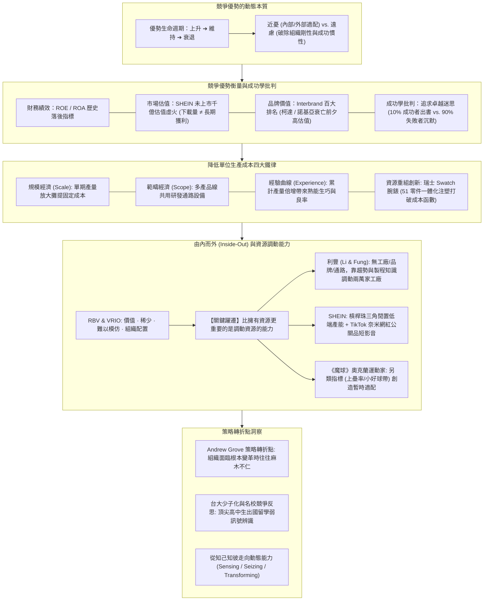

---
{"dg-publish":true,"permalink":"/02/04/02/module-2/m2-1/","tags":["課程筆記","PMBA","核心必修","策略管理","競爭優勢","RBV","VRIO","資源調動能力","虛擬整合","利豐個案","魔球適配","策略轉折點"],"dg-note-properties":{"類別":"課程筆記","課程名稱":"[[策略管理]]","模組編號":"Module 2","模組名稱":"企業能耐與事業策略","章節編號":"M2-1","主題":"資源能力與競爭優勢 (Resources, Capabilities & Competitive Advantage)","對應週次":"2026-11-08 課堂 (融合 11-01 與 11-08 全域重構)","狀態":"🟢 已完成","tags":["課程筆記","PMBA","核心必修","策略管理","競爭優勢","RBV","VRIO","資源調動能力","虛擬整合","利豐個案","魔球適配","策略轉折點"],"aliases":["M2-1 資源能力與競爭優勢","資源能力與競爭優勢"]}}
---

# 💎 M2-1 資源、能力與競爭優勢：由內而外視角、資源調動能力與動態適配進化

> [!abstract] 導讀與對接
> - **上級地圖**：[[02_核心必修/04_策略管理/_策略管理 MOC\|策略管理 MOC 全景地圖]] ➔ **Module 2 企業能耐與事業策略** ➔ M2-1
> - **進度看板**：[[05_AI選修/10_AiX/00_課程導航與進度/progress_📊 課程與筆記進度追蹤\|課程與筆記進度追蹤看板]]
> - **核心概念庫**：[[98_商業概念庫/In_Search_of_Excellence_Myth_追求卓越的迷思與成功學批判\|成功學批判]] · [[98_商業概念庫/brand-equity-lagging-indicator_品牌價值落後指標論\|品牌價值落後指標論]] · [[98_商業概念庫/Economies_of_Scale_Scope_Experience_規模範疇與經驗曲線\|規模範疇與經驗曲線]] · [[98_商業概念庫/Virtual_Integration_虛擬整合與資源槓桿\|虛擬整合與資源槓桿]] · [[98_商業概念庫/Turnkey_vs_Internal_RD_技術授權與自主研發抉擇\|自研與授權]]
> - **授課教師**：國立臺灣大學國際企業學系特聘教授 吳學良 博士
> - **本章脈絡**：本篇筆記全面融合 11-01 與 11-08 兩次課堂精華。從古典產業結構（Outside-In）走向企業內部資源基礎觀（Inside-Out RBV），深入辨析競爭優勢的動態生命週期、成功學批判與四大成本鐵律；更在 11-08 課堂中迎來關鍵昇華——**「比擁有資源更重要的是調動資源（Leveraging Resources）的能耐」**。完整納入利豐（Li & Fung）成衣供應鏈虛擬整合、希音（SHEIN）低端產能與社群微網紅槓桿、《魔球》（Moneyball）奧克蘭運動家隊的另類指標適配與動態能力演進，以及台大面對少子化競爭的「策略轉折點」深層反思。

---

## 🧭 本章視覺化知識脈絡圖 (Mindmap)

---

## 一、 競爭優勢的本質：從暫時優勢走向持續優勢（SCA）

吳學良教授指出，策略的終極目標是達成「**競爭優勢（Competitive Advantage）**」，但經理人必須深刻理解優勢的生命週期：
- **短暫優勢 vs. 持續競爭優勢（Sustainable Competitive Advantage, SCA）**：
  - 短暫優勢往往只需踩中風口、取得早鳥紅利，或達成當下的「外部適配」與「內部適配」即可實現；
  - 但任何優勢都會隨著時間推移被對手模仿、超越或被新技術顛覆。
- **近憂 vs. 遠慮的辯證**：
  - **近憂**：來自於組織當下是否達到內部與外部適配；
  - **遠慮**：恰恰來自於「過去的成功」。成功時間越長，組織建立的常規（Routines）與思維定勢越深，進而轉化為致命的**組織剛性（Core Rigidity）**。
  - 卓越的策略家即使當下貴為行業霸主（無近憂），也必須具備「遠慮」——思考如何透過**動態適配（Dynamic Fit）**打破自身成功慣性。

---

## 二、 競爭優勢的衡量指標與三大盲點

企業宣稱自身具備競爭優勢，究竟能表現在哪些客觀指標上？吳教授引導同學進行了嚴密剖析：

### 1. 財務績效指標（ROE / ROA）的侷限
- 財務指標（如股東權益報酬率 ROE）是最直觀的表現，但會計數字易受資本結構、槓桿高低與折舊認列方式影響，且屬於**歷史落後指標**。

### 2. 市場估值（Market Valuation）的虛火：以 SHEIN 為例
- 快時尚電商巨頭 SHEIN 在尚未掛牌上市、甚至未正式對外披露損益表前，市場給予其高達千億美元的瘋狂估值，一度超越騰訊與阿里巴巴！
- **估值推動力**：純粹因為其在全球 App Store 的下載量與活躍用戶數勇奪第一。但市場估值往往蘊含極大的情緒預期泡沫，下載量並不直接等同於可持續的長期獲利能力。

### 3. 品牌價值（Brand Equity）是落後指標
- Interbrand 等顧問機構每年評選全球百大高價值品牌。
- **策略警語**：品牌價值是「過去行銷與市場投入的累積成果（落後指標）」，絕不能作為「未來競爭力保證（領先指標）」。
  - *歷史血淚*：**柯達（Kodak）**與**諾基亞（Nokia）**在被數位相機與智慧型手機淘汰前夕，長年高居全球最有價值品牌榜單前列；若經理人誤將品牌光環當作免死金牌，必將死於溫水煮青蛙。

---

## 三、 《追求卓越》的迷思：成功學批判與生存者偏差

管理學界在探討持續競爭優勢時，最具代表性的著作是 1982 年 Peters & Waterman 出版的《追求卓越》（In Search of Excellence）。該書歸納出一批卓越企業的共同特質，宣稱只要照做就能成功。

- **吳學良教授的批判性洞察**：
  1. **生存者偏差（Survivorship Bias）**：坊間充斥成功學書籍，是因為失敗者沒有話語權。10% 成功者出書演講，90% 失敗者默默退場。
  2. **因果倒置**：成功者在成名後接受採訪或撰寫回憶錄時，往往會美化其決策歷程，將當初的隨機運氣、矇中風口或逼不得已的妥協，包裝成精心策劃的高瞻遠矚。
  3. **追蹤驗證的打臉**：多年後學者追蹤《追求卓越》書中盛讚的 43 家卓越企業，發現超過三分之二在十年間陷入嚴重虧損、被併購或破產。策略管理必須建立在科學因果分析上，切忌盲信成功學神話。

---

## 四、 降低單位生產成本的經濟學四大鐵律

在討論成本領導（Cost Leadership）時，吳教授帶領學員重溫古典經濟學降低單位成本的三大機制，並延伸出第四種「資源重組」路徑：

| 成本降低機制 | 核心定義與驅動因子 | 經理人管理意涵與實證 |
| :--- | :--- | :--- |
| **規模經濟 (Economies of Scale)** | 隨單一產品**單一期間生產規模放大**，固定資產折舊與研發成本被大量產品攤提，使平均單位成本遞減。 | 盲目擴產可能引發產能過剩；必須確認市場吸收量足以支撐大型工廠運轉。 |
| **範疇經濟 (Economies of Scope)** | 隨**產品種類多樣化**，多條產品線共同分享同一套核心資產（共通設備、研發平台、經銷網絡），使聯合生產成本低於分開生產。 | 總成本必定增加，但「各產品的平均分攤成本」下降；如可口可樂利用既有車隊兼送多品類飲料。 |
| **經驗曲線 (Experience Curve)** | 隨**歷史累計產量（Cumulative Volume）倍增**，工人生產技術純熟、管理流程優化、材料良率提升，使單位成本呈現固定比例下降。 | 「熟能生巧」的數學體現；早期激進降價搶占份額者，能率先沿著經驗曲線下滑建立成本護城河。 |
| **資源重組與商業模式創新 (Restructuring Innovation)** | 打破既有工程結構，透過跨界資源整合、簡化零件設計或收購不良資產重構成本函數。 | **瑞士 Swatch 腕錶傳奇**：70年代受日本石英錶毀滅打擊，瑞士銀行接收大量倒閉機械錶廠；海耶克（Hayek）大膽將 91 個以上零件簡化為 51 個，直接用塑膠注塑成型，創造低成本高時尚的 Swatch 奇蹟。 |

---

## 五、 由內而外（Inside-Out）與資源調動能力（11/08 課堂旗艦昇華）

在 11-08 課堂中，吳教授將 RBV 理論推進至全新高度：**「財大氣粗、口袋很深，凡事都自己擁有，並不代表有競爭優勢。真正的策略高手，在於以創意的能耐『調動他人的資源（Leveraging Resources）』為我所用！」**

### 1. 資源與能力的本質差異
- **資源（Resource）**：企業「擁有什麼（What a firm has）」，如專利、廠房、現金、品牌；
- **能力（Capability）**：企業「能做什麼（What a firm can do）」，如敏捷研發、供應鏈調度、精準行銷；
- **VRIO 模型檢驗**：價值性（Value）、稀缺性（Rarity）、不可模仿性（Inimitability：歷史路徑依賴、因果模糊性、社會複雜性）、組織配置（Organization）。

### 2. 利豐集團（Li & Fung）成衣供應鏈的「虛擬整合」傳奇
- **背景**：香港曾有超過兩萬家成衣貿易商，在資訊透明化時代，買方（歐美百貨）與賣方（亞洲工廠）逐步對接，貿易商面臨全面邊緣化危機。
- **利豐的生存奇蹟**：利豐**不擁有工廠、不擁有品牌、不擁有實體店面**，卻能統御全球供應鏈，其核心競爭力在於掌握了不可替代的**兩端深度知識**：
  1. *前台客戶端知識*：大賣場（Walmart、Target）沒有專屬服裝設計師。利豐憑藉敏銳的全球時尚潮流觀察，主動替大賣場規劃下一季款式與定價；
  2. *後台製造端知識*：工廠雖然想跳過利豐直簽客戶，但工廠缺乏製程工程訣竅。利豐精通面料織法、染料化學與機台參數調校，能派遣工程師進駐工廠指導生產；
- **策略啟示**：透過資訊系統與跨界知識網絡，實現**「虛擬垂直整合（Virtual Integration）」**——不揹負數百億重資產，卻能調動兩萬家工廠隨傳隨到。

### 3. 希音（SHEIN）的資源槓桿：低端產能 + 奈米網紅
- SHEIN 同樣不自建大型工廠，其成功在於：
  - 後台調動廣州番禺被主流大牌淘汰的「低端中小成衣產能」，以準時打款建立極高互信；
  - 前台打破傳統時尚巨頭花數千萬找明星代言、買巨幅看板的重資產模式，而是調動新興的 TikTok 短影音平台，免費寄送公關品給成千上萬名只有幾百個粉絲的「微網紅／奈米網紅」，引爆低成本高轉換的裂變穿搭流量。

### 4. 《魔球》（Moneyball）奧克蘭運動家隊的適配與衰退警示
- **另類指標創造適配**：在預算極度拮据、留不住明星球員的劣勢下，球隊經理比利·比恩（Billy Beane）放棄傳統安打王與全壘打王，開創新指標——**「上壘率（On-base Percentage）」與「四壞球保送」**。利用身材矮小但好球帶極小的冷門球員，以極低成本組建出連勝球隊。
- **競爭對手學習後的優勢稀釋**：
  - 當豪門球隊（如紅襪、洋基）回過神來，也開始導入數據統計模型，並以五倍高薪直接收購高上壘率球員時，奧克蘭運動家隊的撿漏空間瞬間消失。
  - **策略深刻反思**：單純靠某一項「創新的適配方法」只能獲得暫時優勢。一旦競爭者準備好，優勢便會被資金更雄厚者徹底抹平。企業必須具備**持續自我顛覆的「動態能力（Dynamic Capabilities）」**，否則高光時刻過後就是無盡衰落。

---

## 六、 策略轉折點與高階經理人盲點

吳教授引述安迪·葛洛夫（Andy Grove）在《10倍速時代》提出的**「策略轉折點（Strategic Inflection Point）」**，並以台灣高等教育龍頭台灣大學進行深刻省思：

### 1. 溫水煮青蛙的麻木不仁
- 組織在接近其必須轉型的關鍵轉折點時，往往是麻木不仁的。因為現有的財務報表依然漂亮、過往的聲譽光環依舊耀眼，使高階層看不見底層結構的裂縫。

### 2. 台大面對少子化與國際名校競爭的弱訊號
- 傳統觀念認為，台大作為台灣第一志願，即便少子化到全台只剩 10 個高中生，也是這 10 個人進台大；
- 但真正的危機在於**「策略轉折點的弱訊號」**：以往各類組榜首非台大不讀，近年來國企、電機、醫學系錄取榜首，開始出現 1 個、3 個、甚至 7 個學生「直接放棄報到、轉赴國外名校就讀」；
- 當最頂尖的核心顧客群開始用腳投票時，正是組織霸權動搖的起點。高階經理人必須超越眼前的市占率假象，對微弱的流失訊號保持高度戒備。

---

## 🔗 相關筆記與關聯地圖

- 上層模組 MOC：[[02_核心必修/04_策略管理/_策略管理 MOC\|_策略管理 MOC]]
- 模組後續主筆記：[[02_核心必修/04_策略管理/02_模組筆記/Module_2_企業能耐與事業策略/M2-2_事業策略與競合思維\|M2-2_事業策略與競合思維]] · [[02_核心必修/04_策略管理/02_模組筆記/Module_2_企業能耐與事業策略/M2-3_SHEIN快時尚小單快反與數位轉型\|M2-3_SHEIN快時尚小單快反與數位轉型]]
- 下一模組主筆記：[[02_核心必修/04_策略管理/02_模組筆記/Module_3_產業型態與垂直整合/M3-2_本業發展與垂直整合策略\|M3-2 垂直整合交易成本與企業邊界]] · [[02_核心必修/04_策略管理/02_模組筆記/Module_3_產業型態與垂直整合/M3-3_可口可樂北美重組與再特許經營策略\|M3-3 可口可樂北美重組與再特許經營策略]]
- 核心概念原子卡片：
  - [[98_商業概念庫/Virtual_Integration_虛擬整合與資源槓桿\|Virtual_Integration_虛擬整合與資源槓桿]]
  - [[98_商業概念庫/Economies_of_Scale_Scope_Experience_規模範疇與經驗曲線\|Economies_of_Scale_Scope_Experience_規模範疇與經驗曲線]]
  - [[98_商業概念庫/In_Search_of_Excellence_Myth_追求卓越的迷思與成功學批判\|In_Search_of_Excellence_Myth_追求卓越的迷思與成功學批判]]
  - [[Dynamic_Capabilities_動態能力\|Dynamic_Capabilities_動態能力]]
