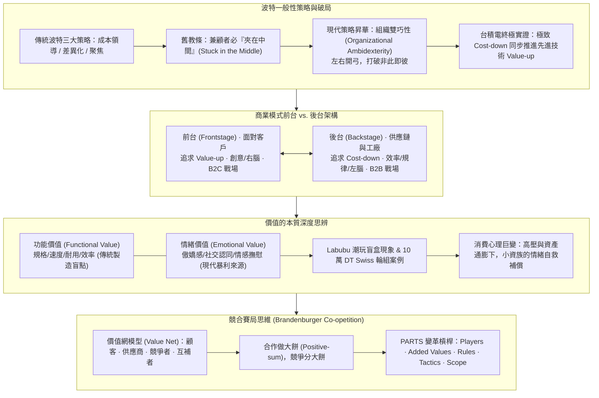
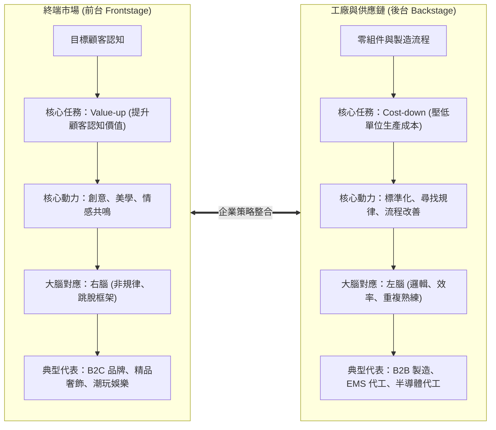
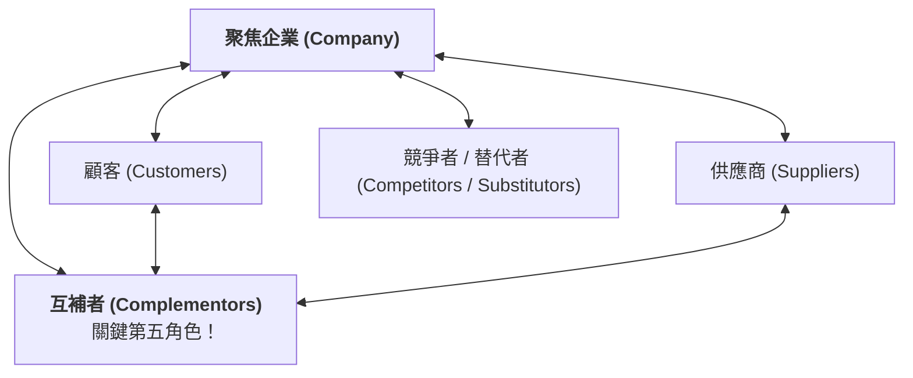

---
{"dg-publish":true,"permalink":"/02/04/02/module-2/m2-2/","tags":["課程筆記","PMBA","核心必修","策略管理","通用策略","組織雙巧性","前台後台架構","功能價值與情緒價值","Labubu現象","競合理論"],"dg-note-properties":{"類別":"課程筆記","課程名稱":"[[策略管理]]","模組編號":"Module 2","模組名稱":"企業能耐與事業策略","章節編號":"M2-2","主題":"事業策略與競合思維 (Business Strategy, Value Creation & Coopetition)","對應週次":"2026-11-01 課堂","狀態":"🟢 已完成","tags":["課程筆記","PMBA","核心必修","策略管理","通用策略","組織雙巧性","前台後台架構","功能價值與情緒價值","Labubu現象","競合理論"],"aliases":["M2-2 事業策略與競合思維","事業策略與競合思維"]}}
---

# ♟️ M2-2 事業策略與競合思維

> **導讀與對接**：  
> - **上級地圖**：[[02_核心必修/04_策略管理/_策略管理 MOC\|策略管理 MOC 全景地圖]]  
> - **進度看板**：[[05_AI選修/10_AiX/00_課程導航與進度/progress_📊 課程與筆記進度追蹤\|課程與筆記進度追蹤看板]]  
> - **核心概念庫**：[[98_商業概念庫/Organizational_Ambidexterity_組織雙巧性\|Organizational_Ambidexterity_組織雙巧性]] · [[98_商業概念庫/Functional_vs_Emotional_Value_功能價值與情緒價值\|Functional_vs_Emotional_Value_功能價值與情緒價值]] · [[98_商業概念庫/Frontstage_Backstage_Strategy_前台價值與後台成本架構\|Frontstage_Backstage_Strategy_前台價值與後台成本架構]] · [[98_商業概念庫/Dual_Positioning_Trap_雙重定位陷阱與品牌代工衝突\|Dual_Positioning_Trap_雙重定位陷阱與品牌代工衝突]]  
> **授課教師**：國立臺灣大學國際企業學系特聘教授 吳學良 博士  
> **課堂時間**：2026-11-01 (Session 2-2)  

---

## 🎯 本章視覺化知識脈絡圖

---

## 一、 波特一般性策略與「夾在中間」的思維演進

### 1. 麥可·波特的三大一般性策略（Generic Strategies，1980）
波特認為，跨越不同產業，企業在事業單元層級求勝的定位路線不外乎三種：
1. **全面成本領導（Cost Leadership）**：鎖定主流大眾市場，將全產業鏈營運成本壓至最低。
2. **差異化策略（Differentiation）**：鎖定主流大眾市場，提供顧客高度認同的獨特價值以獲取超額溢價。
3. **聚焦策略（Focus）**：深耕特定利基市場（Niche Market），分為成本聚焦或差異聚焦。

### 2. 「夾在中間」（Stuck in the Middle）教條的破除
- **波特 1980 年的絕對斷言**：
  - 企業必須「吾道一以貫之」。追求成本領導需要極致嚴酷的成本控制心態（Cost-down Mindset），追求差異化需要揮灑創意的溢價心態。任何企圖同時兼顧兩者的企業，必然落入「夾在中間」的平庸泥淖。
- **40 年後的典範轉移：組織雙巧性（Organizational Ambidexterity）**：
  - 90 年代起，策略學者與企業實務紛紛證實：**卓越企業能夠同時追求成本與差異化**！
  - *Ambidextrous* 英文原意為「左右開弓（左右手皆能靈巧作戰）」。
- **台積電（TSMC）的終極印證**：
  - 台積電的晶圓代工製造具備全球無人能及的極致產能利用率與成本控制（Cost-down）；
  - 同時其每年投入數十億美元研發，在 3 奈米、2 奈米等先進製程與 CoWoS 封裝上保持全球唯一領先（Value-up），使蘋果、NVIDIA 願意支付高額溢價。台積電以事實打破了波特的「夾在中間」舊教條！

---

## 二、 商業模式的前台與後台架構：左腦 vs. 右腦

吳學良教授提出極具洞見的商業模式前台（Frontstage）與後台（Backstage）分析架構：

- **台灣企業的深層基因診斷**：
  - 吳教授直言，**Cost-down（後台思維）早已寫在台灣企業的 DNA 裡**，尋找規律、壓榨良率、降低成本完全不需要教；
  - 台灣企業真正需要刻意學習的，是**前台的 Value-up 思維**——如何跳脫純硬體規格競爭，透過設計、品牌與情感敘事，引導顧客為更高的認知價值買單。

---

## 三、 價值的本質深度思辨：功能價值 vs. 情緒價值

在探討前台 Value-up 時，吳教授帶領學員切入近年商業競爭最核心的維度轉換——**從賣功能走向賣情緒**。

### 1. 兩大價值維度對比
- **功能價值（Functional Value）**：
  - 聚焦於產品物理規格、運算速度、耐用度、省油、省電或任務完成效率。
  - *困境*：極易陷入邊際效用遞減與同質化「紅海價格戰」（如中國大陸供應鏈將各項硬體製造成本壓縮至極致）。
- **情緒價值（Emotional Value）**：
  - 聚焦於產品為顧客帶來的優越感、自我投射、傲嬌感、同溫層歸屬、懷舊安全感與心理治癒。
  - *優勢*：定價完全脫離物料成本（BOM Cost），享有極高毛利空間與排他性忠誠度。

### 2. 課堂震撼實證案例
- **潮玩盲盒「拉布布（Labubu）」現象**：
  - 一隻掛在包包上的毛茸茸公仔，沒有任何機械或通訊功能，卻炒作至數千甚至上萬元，引發全球瘋搶。其核心賣點純粹是年輕世代的「情緒撫慰」與「社交展演貨幣」。
- **自行車碳纖輪組的傲嬌心理學**：
  - 明明市場上有 2 萬元性能相差無幾的國產優質碳纖輪組，資深車友卻偏偏要花 10 萬元購買瑞士 DT Swiss 等頂級環法選手指定品牌。
  - 騎車到達景點咖啡館時，刻意把輪圈標籤轉正朝外讓旁人欣賞，買的就是這份**「油然而生的驕傲感與專業認同」**。

### 3. 時代消費心理巨變：為什麼小資族更渴望情緒價值？
- **歷史常規**：過去情緒價值是富豪的專利，有錢人吃飽穿暖、滿足功能價值後，才進一步花大錢購買藝術品、名錶與俱樂部會員。
- **現代反轉**：當代年輕小資族即使面臨低薪、吃不飽、買不起房的巨大痛苦指數，反而極度願意掏錢購買盲盒、昂貴手搖飲或演唱會門票。
  - *深層心理機制*：面對階級流動停滯與沉重的都市生存壓力，小資族需要透過**高頻次、可負擔的「微小情緒補償」**來治癒日常焦慮，實現短暫的自我掌控與精神救贖。

---

## 四、 競合理論與價值網模型（Co-opetition & Value Net）

商場競爭不是非生即死的你死我活，Adam Brandenburger & Barry Nalebuff 提出著名的**競合理論（Co-opetition）**，將視角由單純的波特對抗延伸至價值網生態。

### 1. 關鍵第五角色：互補者（Complementors）
- **定義**：當顧客同時擁有你的產品與對方的產品時，顧客獲得的總價值高於分別擁有的總和；或當供應商同時供貨給你與對方時，供應商的供貨意願更高。
- **經典實證**：**Intel 與 Microsoft 的 Wintel 聯盟**。硬體算力提升推動微軟 Windows 升級，軟體功能肥大倒逼用戶更換 Intel 高階處理器，攜手壟斷 PC 產業三十年利潤池。

### 2. 合作做大餅，競爭分大餅
- **合作（Cooperation）**：與互補者、甚至是競爭同業聯手制定行業標準、推動法規鬆綁，擴大整體產業市場餅（Positive-sum Game）；
- **競爭（Competition）**：在分配大餅時，依據自身的**附加價值（Added Value）**與定價權獲取最大份額。

### 3. PARTS 賽局變革五大槓桿
- **P - Players（參與者）**：引進新買方或扶植第二供應商以制衡獨大勢力。
- **A - Added Values（附加價值）**：提升自身無可替代性（$$	ext{自身附加價值} = 	ext{有我時的總體大餅} - 	ext{無我時的總體大餅}$$）。
- **R - Rules（規則）**：利用最惠國條款（MFN）或長期保證合約重塑賽局規則。
- **T - Tactics（戰術與訊號）**：透過可信承諾（Credible Commitments）影響對手的心理預期。
- **S - Scope（範疇）**：擴大或限縮市場邊界，連結不同市場形成交叉掩護。

---

## 💡 經理人管理實務反思與行動指引

1. **重構事業單元價值主張**：全面檢視產品線，辨識自己究竟在賣「功能」還是「情緒」；若是功能性產品，設法注入文化敘事與歸屬感以提升溢價。
2. **鍛造組織雙巧性能耐**：不要落入成本與創新的非此即彼思維；前台建立敏捷探索團隊追求高附加價值，後台落實精實六標準差壓低成本。
3. **主動盤點互補者網絡**：在生態系中積極尋找能放大自身價值的戰略互補者，透過正和博弈共同做大市場。

---

## 🔗 模組導航與延伸閱讀

- ⬅️ **上一章節**：[[02_核心必修/04_策略管理/02_模組筆記/Module_2_企業能耐與事業策略/M2-1_資源能力與競爭優勢\|M2-1 資源、能力與競爭優勢]]
- ➡️ **下一章節**：[[02_核心必修/04_策略管理/02_模組筆記/Module_2_企業能耐與事業策略/M2-3_SHEIN快時尚小單快反與數位轉型\|M2-3 SHEIN快時尚小單快反與數位轉型]]
- 💎 **本章關聯概念卡片**：
  - [[98_商業概念庫/Organizational_Ambidexterity_組織雙巧性\|Organizational_Ambidexterity_組織雙巧性]]
  - [[98_商業概念庫/Functional_vs_Emotional_Value_功能價值與情緒價值\|Functional_vs_Emotional_Value_功能價值與情緒價值]]
  - [[98_商業概念庫/Frontstage_Backstage_Strategy_前台價值與後台成本架構\|Frontstage_Backstage_Strategy_前台價值與後台成本架構]]
  - [[98_商業概念庫/Dual_Positioning_Trap_雙重定位陷阱與品牌代工衝突\|Dual_Positioning_Trap_雙重定位陷阱與品牌代工衝突]]