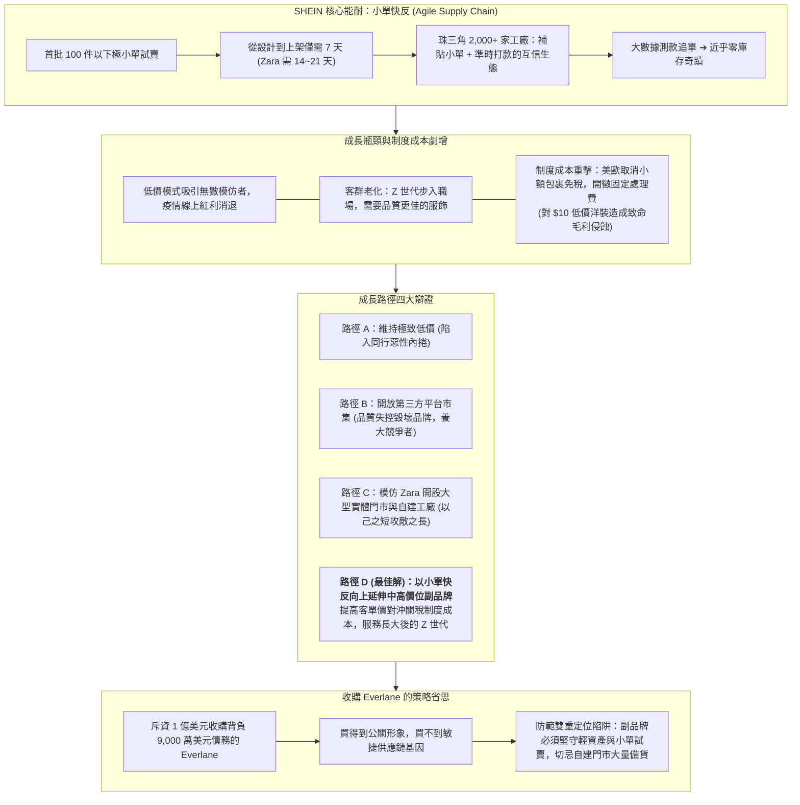

# 👗 M2-3 SHEIN 快時尚小單快反與數位轉型

> **導讀與對接**：  
> - **上級地圖**：[[02_核心必修/04_策略管理/_策略管理 MOC\|策略管理 MOC 全景地圖]]  
> - **進度看板**：[[05_AI選修/10_AiX/00_課程導航與進度/progress_📊 課程與筆記進度追蹤\|課程與筆記進度追蹤看板]]  
> - **核心概念庫**：[[98_商業概念庫/Small_Order_Quick_Response_小單快反供應鏈\|Small_Order_Quick_Response_小單快反供應鏈]] · [[98_商業概念庫/Institutional_Cost_Tariff_Threshold_制度成本與小額關稅門檻\|Institutional_Cost_Tariff_Threshold_制度成本與小額關稅門檻]] · [[98_商業概念庫/Dual_Positioning_Trap_雙重定位陷阱與品牌代工衝突\|Dual_Positioning_Trap_雙重定位陷阱與品牌代工衝突]] · [[98_商業概念庫/Frontstage_Backstage_Strategy_前台價值與後台成本架構\|Frontstage_Backstage_Strategy_前台價值與後台成本架構]]  
> **授課教師**：國立臺灣大學國際企業學系特聘教授 吳學良 博士  
> **課堂時間**：2026-11-01 (個案研討)  

---

## 🎯 個案核心架構與成長路徑抉擇

---

## 一、 個案背景：從跨境婚紗到全球快時尚巨獸

### 1. 顛覆傳統服裝產業的商業奇蹟
- **崛起歷程**：SHEIN（希音）從早期跨境銷售婚紗起家，迅速轉型為超快時尚（Ultra-Fast Fashion）平台。
- **震撼數據**：
  - 2020 年全年推出超過 **15 萬款新品**，款式數量約為西班牙快時尚霸主 Zara 的 **10 倍**；
  - 2021 年 5 月，SHEIN 超越亞馬遜（Amazon），躍居全美下載次數最多的購物類 App；
  - 估值一度飆升至 1,000 億美元，超越歐美老牌快時尚 H&M 與 Zara 市值總和。

### 2. 核心競爭優勢解構：極致柔性供應鏈「小單快反」
服裝行業數百年來最致命的殺手始終是「**庫存積壓（Inventory Markdown）**」。SHEIN 透過數位化技術徹底重構了產業底層邏輯：
- **傳統服裝業**：提前 6 至 9 個月預測流行趨勢，單款起訂量數千件，預測失誤即面臨毀滅性打折清倉。
- **Zara 模式**：歐洲與北非近岸工廠生產，首批 300 至 500 件，從打樣到門市上架需 2 至 3 週。
- **SHEIN 小單快反（Small-order, Rapid-response）**：
  1. **首批訂單極小化**：每款新品僅生產 **100 件以下**直接上架官網測款。
  2. **演算法即時監控**：即時追蹤全球消費者的點擊率、加入購物車次數與轉換率。
  3. **自動化追單反應**：一旦數據顯示爆款跡象，演算法自動向工廠下達數千件追單；若反應平淡則立刻下架停止生產。
  4. **工廠端互信網絡**：在廣州番禺聚集了 2,000 多家中小服裝廠。SHEIN 主動補貼工廠打樣成本，堅持**每週或雙週準時結算貨款（絕不拖欠押款）**，打破了傳統服裝業長達數月票期的惡習，換取工廠隨傳隨到、甘願承接小單的深層忠誠度。

---

## 二、 成長瓶頸與制度成本上升的結構性危機

然而，在狂飆突進之後，SHEIN 於 2024 至 2025 年面臨嚴峻的成長天花板：

### 1. 內部需求端瓶頸
- **Z 世代客群長大**：核心客群（15 至 25 歲女性）步入職場，需要出席正式社交場合與通勤服裝，對面料質感與版型要求提升，不再滿足於「穿兩次就扔」的 10 美元化纖洋裝。
- **同行低價模仿與內捲**：Temu、TikTok Shop 等巨頭跟進低價全託管模式，掀起更慘烈的補貼戰。

### 2. 外部制度成本（Institutional Costs）的毀滅性打擊
吳學良教授在課堂中特別提醒學員關注**制度環境對商業模式的決定性影響**：
- **小額免稅政策取消（De Minimis Rule）**：
  - 過去美國允許 800 美元以下進口包裹免關稅，歐盟允許 150 歐元以下免關稅；
  - 隨著西方政府防堵跨境電商，美國與歐盟陸續取消小額免稅，並對每個低價包裹開徵 **固定處理費（如每件 3 歐元）與報關行政費**。
- **制度成本的非對稱衝擊數學**：
  - 若一條洋裝售價 **10 美元**，固定處理費加關稅約佔 **30%~40%**，足以吃光所有利潤；
  - 若一條洋裝售價提升至 **30 至 50 美元**，固定行政成本佔比立刻下降至 **6%~10%**！
  - *策略啟示*：**提高客單價（Trade-up），本身就是化解制度成本危機的最優解！**

---

## 三、 成長路徑大辯證：經理人的四條十字路口

面對個案中提出的轉型難題，小組與課堂研討深入權衡了四條擴張路徑：

| 成長策略路徑 | 執行內容與吸引力 | 潛在致命風險與評估 | 策略推薦結論 |
| :--- | :--- | :--- | :---: |
| **路徑 A：維持極致低價擴張** | 推出更多海量廉價款式，向中東、拉美等新興市場擴張。 | 陷入同行低價泥淖，無法回應長大客群，制度成本侵蝕利潤。 | ❌ 否決 |
| **路徑 B：開放第三方平台市場 (Marketplace)** | 仿效 Amazon 讓第三方商家入駐，利用 SHEIN 流量抽成。 | 第三方商品品質無法控制，假貨與侵權毀壞商譽；且有**養大外部競爭對手**之風險（如法國因違法商品啟動暫停平台調查）。 | ❌ 否決 |
| **路徑 C：模仿 Zara 開設大型實體門市與垂直整合** | 在全球精華地段開設實體旗艦店，自建大型工廠。 | 放棄自身最擅長的輕資產彈性，以己之短攻敵之長，承擔巨額租金與庫存風險。 | ❌ 否決 |
| **路徑 D：以小單快反向上延伸中高價位副品牌** | **沿用最強的小單快反能力，挑選優質合作工廠提供技術輔導，推出「品質比 SHEIN 好、價格比 Zara 便宜」的獨立中高價副品牌。** | 必須嚴守輕資產與小單測試模式，切忌為新品牌自建門市或大量備貨。 | 🏆 **本組首選** |

---

## 四、 收購 Everlane 策略省思與雙重定位防範

### 1. 收購 Everlane 的策略代價
- 2026 年 5 月，SHEIN 以約 1 億美元收購了背負 9,000 萬美元債務的美國永續服飾品牌 **Everlane**。
- **吳學良教授點評**：
  - 收購確實是獲取「永續、透明、中高階形象」最快的手法；
  - 但收購買得到品牌外殼，**買不到 SHEIN 自己的研發基因與供應鏈默契**。外購品牌往往面臨文化整合摩擦與價值主張錯位的深層風險。

### 2. 嚴格防範「雙重定位陷阱（Dual Positioning Trap）」
- **為什麼推出中高價副品牌不屬於雙重定位陷阱？**
  - 雙重定位陷阱是指「在同一組織內部同時運作兩套互相衝突的模式（如兼顧品牌與代工、兼顧重資產與輕資產）」。
  - 若新副品牌**依然沿用小單快反、大數據測款與既有工廠網絡**，僅將布料材質與品檢標準提高，其底層運作邏輯完全一致，便不會產生組織精神分裂。
  - **紅線警告**：一旦團隊開始為副品牌「重金自建門市、大規模提前批量備貨」，便會立刻踩入雙重定位陷阱，毀滅原有競爭優勢！

---

## 💡 經理人管理實務反思與行動指引

1. **守住核心能耐（Core Competence）**：企業尋求新成長時，必須以自身最具排他性的能力（如小單快反）為圓心向外畫圓，切忌進入對手的主場硬碰硬。
2. **算清制度成本帳**：在全球地緣政治與貿易壁壘抬頭的時代，單純拼低製造成本已無生存空間；提升產品溢價與客單價是沖抵關稅壁壘的必修課。
3. **區分真假雙重定位**：副品牌擴張應共用底層供應鏈基礎設施，避免在同一組織中建立互相打架的營運邏輯。

---

## 🔗 模組導航與延伸閱讀

- ⬅️ **上一章節**：[[M2-2_事業策略與競合思維|M2-2 事業策略與競合思維]]
- ➡️ **下一模組預覽**：[[02_模組筆記/Module_3_產業型態與垂直整合/M3-1_產業型態與經營模式|Module 3 產業型態與垂直整合]]
- 💎 **本章關聯概念卡片**：
  - [[Small_Order_Quick_Response_小單快反供應鏈]]
  - [[Institutional_Cost_Tariff_Threshold_制度成本與小額關稅門檻]]
  - [[Dual_Positioning_Trap_雙重定位陷阱與品牌代工衝突]]
  - [[Frontstage_Backstage_Strategy_前台價值與後台成本架構]]