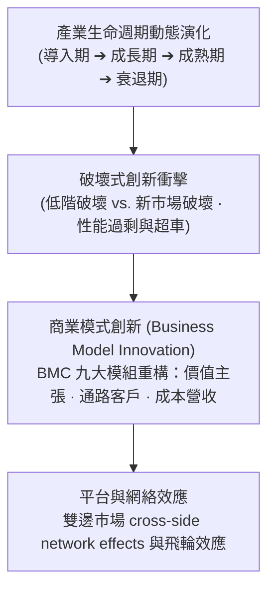

---
{"dg-publish":true,"permalink":"/02/04/02/module-3/m3-1/","tags":["PMBA","核心必修","策略管理","PLC","破壞式創新","商業模式","平台雙邊市場"],"dg-note-properties":{"aliases":["產業型態與經營模式","企業成長","產業生命週期","破壞式創新","商業模式創新"],"tags":["PMBA","核心必修","策略管理","PLC","破壞式創新","商業模式","平台雙邊市場"],"category":"02_核心必修","course":"策略管理","session":"Session 3-1","chapter":"Chapter 5"}}
---

# 🚀 M3-1 產業型態與經營模式 (Industry Types & Business Models)

> **導航索引**：[[05_AI選修/10_AiX/00_課程導航與進度/progress_📊 課程與筆記進度追蹤\|進度看板]] ｜ [[02_核心必修/04_策略管理/00_課程導航與進度/mindmap_策略管理_心智圖導航\|全課程心智圖]] ｜ [[02_核心必修/04_策略管理/_策略管理 MOC\|返回策略管理 MOC]]  
> **課程堂次**：Session 3-1 企業成長  
> **教材章節**：Chapter 5 產業型態與經營模式  
> **銜接上一堂**：[[02_核心必修/04_策略管理/02_模組筆記/Module_2_企業能耐與事業策略/M2-2_事業策略與競合思維\|M2-2 事業策略與競合思維]]  
> **前往下一堂**：[[02_核心必修/04_策略管理/02_模組筆記/Module_3_產業型態與垂直整合/M3-2_本業發展與垂直整合策略\|M3-2 本業發展與垂直整合策略]]  
> **商管核心價值**：沒有一成不變的成功模式。隨著產業從萌芽到成熟與衰退，競爭規則發生根本性改變。本篇探討產業生命週期（PLC）各階段策略、Clayton Christensen 破壞式創新機制、商業模式畫布（BMC）九大模組，以及數位時代下的雙邊平台與網絡效應。

---

## 一、視覺化知識脈絡圖 (Mermaid Context)

---

## 二、核心理論與架構詳解

### 1. 產業生命週期 (PLC) 與策略適配
- **導入期（Introduction）**：產品標準未定、研發投入大、市場教育成本高。策略焦點在於技術研發、制定主導設計（Dominant Design）。
- **成長期（Growth）**：需求爆發、進入者湧入。策略焦點在於建立品牌、搶佔通路與產能擴張。
- **成熟期（Maturity）**：市場飽和、價格競爭白熱化。策略焦點在於營運效益、防禦市占、產品線微幅延伸與成本控制。
- **衰退期（Decline）**：需求萎縮、技術替代。四大應對策略：
  1. **Leadership（領導）**：收購弱勢對手成為最後贏家。
  2. **Niche（利基）**：退守高利潤穩定需求區塊。
  3. **Harvest（收割）**：停止資本支出，最大化榨取剩餘現金流。
  4. **Divest（撤資退場）**：儘早變現資產。

### 2. Clayton Christensen [[98_商業概念庫/Performance_Oversupply_性能過剩與破壞性創新\|破壞式創新理論]]
- **延續性創新（Sustaining Innovation）**：為現有高端主流客戶提供性能更好的產品。
- **破壞性創新（Disruptive Innovation）**：
  - **低階破壞（Low-end Disruption）**：主流產品性能超越普羅大眾需求（性能過剩），新進者以簡單、便宜、便利的產品從低階切入。
  - **新市場破壞（New-market Disruption）**：服務以往負擔不起或無能力使用的「非消費者（Non-consumers）」。

### 3. 商業模式畫布 (BMC) 與平台網絡效應
- **價值主張（Value Proposition）**：為誰解決什麼核心痛點？
- **平台經濟機制**：直接網絡效應（Direct Network Effects）與跨邊間接網絡效應（Cross-side Network Effects），使平台具備贏者通吃（Winner-takes-most）特徵。

---

## 三、標竿實務案例剖析
- **比亞迪在新能源車的低階到主流破壞**：從早期的平價電池與平價車切入，逐步建立刀片電池與垂直整合優勢，最終在主流市場超越傳統合資燃油車品牌。

---

## 四、推薦關聯之 [[98_商業概念庫\|98_商業概念庫]] 原子卡片
- [[98_商業概念庫/PLC_產業生命週期模型 Product Life Cycle\|產業生命週期模型 (PLC)]]
- [[98_商業概念庫/Performance_Oversupply_性能過剩與破壞性創新\|性能過剩與破壞性創新]]
- [[98_商業概念庫/Double_Helix_產業雙螺旋演化模型\|產業雙螺旋演化模型 (Double Helix)]]
- [[02_核心必修/04_策略管理/_策略管理 MOC\|返回策略管理 MOC]]
