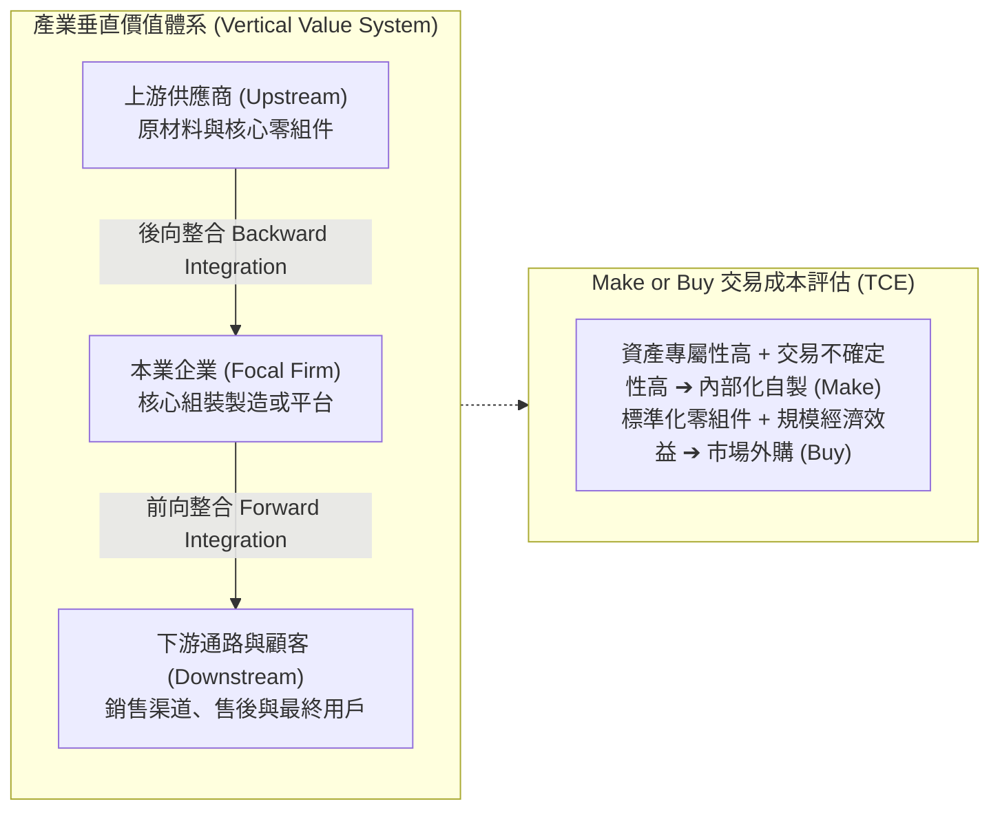

---
{"dg-publish":true,"permalink":"/02/04/02/module-3/m3-2/","tags":["PMBA","核心必修","策略管理","垂直整合","TCE","交易成本","微笑曲線"],"dg-note-properties":{"aliases":["垂直整合策略","本業發展與垂直整合","交易成本理論","自製或外購","微笑曲線"],"tags":["PMBA","核心必修","策略管理","垂直整合","TCE","交易成本","微笑曲線"],"category":"02_核心必修","course":"策略管理","session":"Session 3-2","chapter":"Chapter 8"}}
---

# 🔗 M3-2 本業發展與垂直整合策略 (Vertical Integration & Firm Boundaries)

> **導航索引**：[[05_AI選修/10_AiX/00_課程導航與進度/progress_📊 課程與筆記進度追蹤\|進度看板]] ｜ [[02_核心必修/04_策略管理/00_課程導航與進度/mindmap_策略管理_心智圖導航\|全課程心智圖]] ｜ [[02_核心必修/04_策略管理/_策略管理 MOC\|返回策略管理 MOC]]  
> **課程堂次**：Session 3-2 垂直整合  
> **教材章節**：Chapter 8 本業發展與垂直整合策略  
> **銜接上一堂**：[[02_核心必修/04_策略管理/02_模組筆記/Module_3_產業型態與垂直整合/M3-1_產業型態與經營模式\|M3-1 產業型態與經營模式]]  
> **前往下一堂**：[[02_核心必修/04_策略管理/02_模組筆記/Module_4_公司策略與全球布局/M4-1_多角化策略與事業布局\|M4-1 多角化策略與事業布局]]  
> **商管核心價值**：企業的邊界應該劃在哪裡？究竟該自製（Make）還是外購（Buy）？本篇深入剖析前向與後向垂直整合、Ronald Coase 與 Oliver Williamson 的交易成本理論（TCE）、資產專屬性（Asset Specificity）對敲竹槓（Hold-up）風險的防禦，以及施振榮微笑曲線在產業價值鏈中的利潤重分配。

---

## 一、視覺化知識脈絡圖 (Mermaid Context)

---

## 二、核心理論與架構詳解

### 1. 垂直整合的類型與維度
- **後向整合（Backward Integration）**：向產業鏈上游延伸，掌控核心原材料、零部件或技術研發（如特斯拉自研晶片與自造電池）。
- **前向整合（Forward Integration）**：向產業鏈下游延伸，掌控銷售通路、物流直營店或終端服務（如蘋果開設 Apple Store 直營零售）。
- **完全整合 vs. 準整合（Taper Integration）**：部分零組件內部自製，其餘向外採購；或部分產品自營通路，其餘委託第三方經銷。保留產能彈性並獲取真實成本資訊。

### 2. 交易成本理論 (Transaction Cost Economics, TCE)
決定「市場交易」還是「企業階層組織內部化」的核心標準在於**交易成本**：
- **交易成本構成**：搜尋與資訊成本、議價與合約成本、監督與履約成本。
- **驅動內部整合的三大條件**：
  1. **資產專屬性（Asset Specificity）**：實體專屬、場地專屬、人力資本專屬或特定用途專屬。專屬性極高時，易引發對手惡意「敲竹槓（Hold-up）」。
  2. **不確定性與有限理性**：外界環境不可預測，合約無法涵蓋所有情境（不完全契約）。
  3. **機會主義（Opportunism）**：交易對手在利益驅使下違背誠信。

### 3. 微笑曲線 (Smile Curve) 與利潤咽喉
- 宏碁創辦人施振榮提出的微笑曲線表明，在產業鏈中：
  - **左端研發與智財（R&D/IP）**：高附加價值。
  - **中段製造與組裝（Manufacturing）**：附加價值最低，利潤受壓抑。
  - **右端品牌與通路服務（Brand/Service）**：高附加價值。
- **垂直整合策略反思**：垂直整合不是全鏈條盲目擴張，而是為了卡位「高附加價值的兩端」與「產業價值咽喉（Value Chokepoints）」。

---

## 三、標竿實務案例剖析
- **比亞迪的超高垂直整合**：從動力電池（刀片電池）、IGBT半導體、車載晶片到車身模具幾乎全部自研自製，在供應鏈危機中展現強大抗震力與成本優勢。
- **波音 787 客機過度外包之痛**：波音過度依賴全球一級供應商將設計與製造大幅外包，導致資產專屬性與介面協同失控，造成交機嚴重延遲與數十億美元損失。

---

## 四、推薦關聯之 [[98_商業概念庫]] 原子卡片
- [[Added_Value_附加價值與定價權|附加價值與定價權 (Added Value)]]
- [[value-net-model_價值網絡模型|價值網絡模型 (Value Net)]]
- [[Smile_Curve_微笑曲線|微笑曲線 (Smile Curve)]]
- [[_策略管理 MOC|返回策略管理 MOC]]
