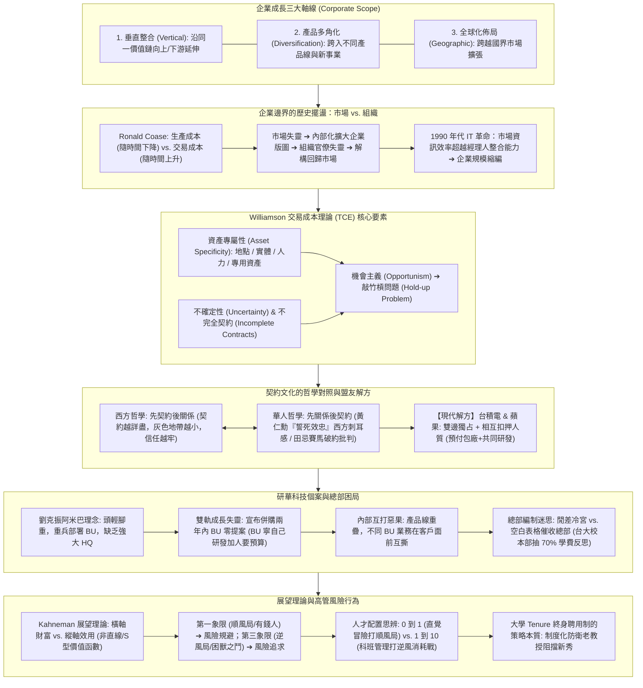
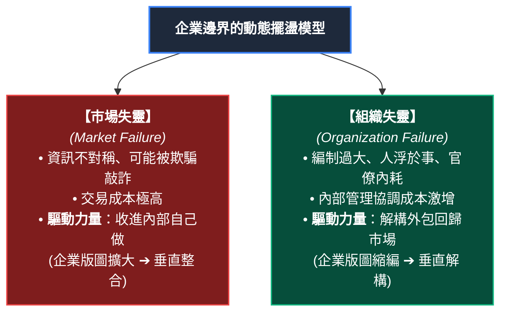
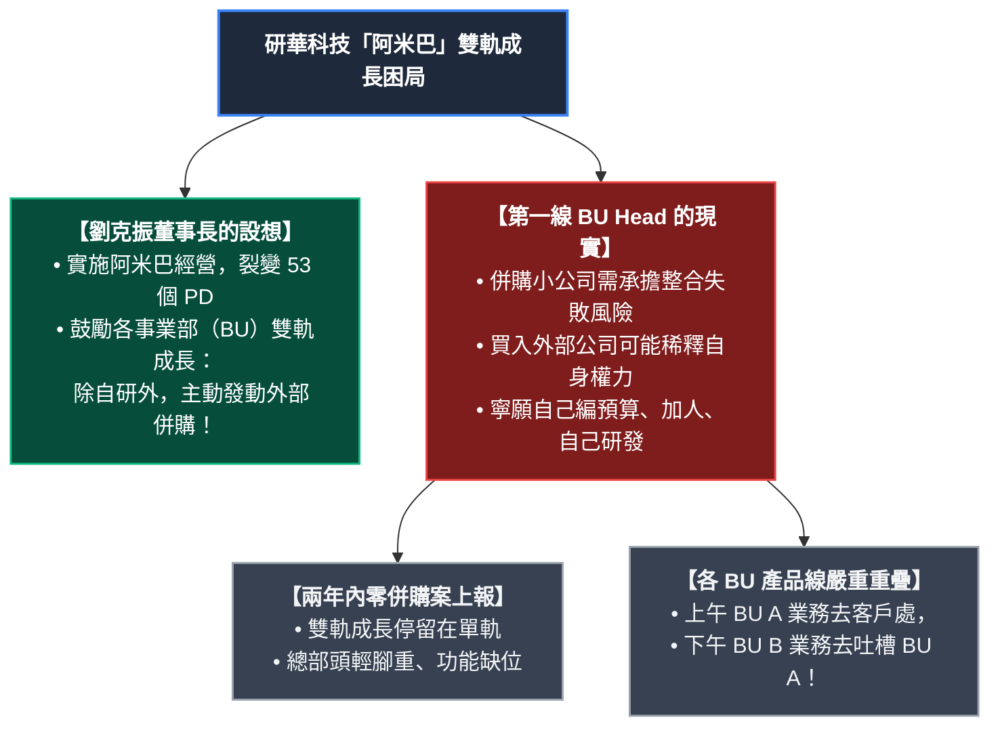

---
{"dg-publish":true,"permalink":"/02/04/02/module-3/m3-2/","tags":["課程筆記","PMBA","核心必修","策略管理","垂直整合","交易成本","TCE","資產專屬性","套牢問題","研華科技","企業總部","展望理論"],"dg-note-properties":{"類別":"課程筆記","課程名稱":"[[策略管理]]","模組編號":"Module 3","模組名稱":"產業型態與垂直整合","章節編號":"M3-2","主題":"垂直整合交易成本與企業邊界 (Vertical Integration, Transaction Cost Economics & Firm Boundaries)","對應週次":"2026-11-08 課堂","狀態":"🟢 已完成","tags":["課程筆記","PMBA","核心必修","策略管理","垂直整合","交易成本","TCE","資產專屬性","套牢問題","研華科技","企業總部","展望理論"],"aliases":["M3-2 垂直整合交易成本與企業邊界","垂直整合交易成本與企業邊界","M3-2 本業發展與垂直整合策略"]}}
---

# ⛓️ M3-2 垂直整合交易成本與企業邊界：Coase 與 Williamson 理論體系、研華總部困境與高管風險決策

> [!abstract] 導讀與對接
> - **上級地圖**：[[02_核心必修/04_策略管理/_策略管理 MOC\|策略管理 MOC 全景地圖]] ➔ **Module 3 產業型態與垂直整合** ➔ M3-2
> - **進度看板**：[[05_AI選修/10_AiX/00_課程導航與進度/progress_📊 課程與筆記進度追蹤\|課程與筆記進度追蹤看板]]
> - **核心概念庫**：[[98_商業概念庫/TCE_Transaction_Cost_Economics_交易成本理論\|交易成本理論 (TCE)]] · [[98_商業概念庫/Asset_Specificity_Hold_up_資產專屬性與套牢問題\|資產專屬性與套牢問題]] · [[98_商業概念庫/Bilateral_Monopoly_Hostage_Taking_雙邊獨占與相互扣押人質\|雙邊獨占與相互扣押人質]] · [[98_商業概念庫/Corporate_Headquarters_Role_企業總部定位與母體能耐\|企業總部定位]] · [[98_商業概念庫/Prospect_Theory_Executive_Risk_展望理論與高管風險決策\|展望理論與高管風險]]
> - **授課教師**：國立臺灣大學國際企業學系特聘教授 吳學良 博士
> - **本章脈絡**：本篇筆記為 2026-11-08 策略管理課程（AM3、PM1、PM2）的旗艦核心。聚焦於**總體策略（Corporate Strategy）之戰場選擇與企業邊界劃定**。完整解析：企業成長三大軸線、Ronald Coase《企業的本質》與 Oliver Williamson 交易成本經濟學（TCE）、資產專屬性四類型與敲竹槓（Hold-up）風險、契約文化的哲學對照（西方先契約 vs 華人先關係，黃仁勳誓死效忠論與田忌賽馬批判）、台積電與蘋果「相互扣押人質」的戰略同盟、吳教授親撰之研華科技（Advantech）總部與阿米巴 BU 雙軌成長併購困局，以及 Kahneman 展望理論對高管由冒險轉趨避與 0 到 1 vs. 1 到 10 人才之深度思辨。

---

## 🧭 本章視覺化知識脈絡圖 (Mindmap)

---

## 一、 企業成長的三大軸線與總體策略視角

策略管理分為事業部策略（Business Strategy：在既有戰場打贏對手）與總體策略（Corporate Strategy：決定企業版圖與戰場選擇）。吳學良教授指出，企業展開成長的傳統三條軸線為：
1. **垂直整合（Vertical Integration）**：在同一個產業鏈中，向原材料供應端（後向整合）或通路顧客端（前向整合）延伸；
2. **多角化（Diversification）**：從現有核心業務跨入不同產品線或新事業領域；
3. **國際化／全球化（Geographic Expansion）**：將業務版圖跨越國界，佈局全球市場。

---

## 二、 企業邊界的歷史擺盪：市場機制 vs. 組織內部化

為什麼世界上會有「企業」這種組織？為什麼所有經濟活動不能直接透過市場買賣完成？

### 1. Ronald Coase《企業的本質》（1937）
- 諾貝爾經濟學獎得主 Ronald Coase 在其博士論文《企業的本質》中直指：世界並非只存在「生產成本」，更充斥著龐大的**「交易成本（Transaction Costs）」**。
- **兩大成本的歷史演進軌跡**：
  - **生產成本（Production Cost）**：隨著科技進步、規模經濟、範疇經濟與經驗曲線，**隨時間必然越來越低**；
  - **交易成本（Transaction Cost）**：尋找合適交易對象（協調成本）與確保對方認真履約不偷懶（監督成本），**隨時間越來越昂貴**！

### 2. 1990 年代企業規模的反轉縮編
- 歷史數據顯示，全球企業平均規模在 1990 年代前穩步攀升，但 1991 年後卻呈現規律性下降：
- **核心成因**：資通訊科技（ICT / 網際網路）爆炸性普及，大幅消除了資訊不對稱與搜尋成本，**市場機制的效率全面超越了經理人的內部整合能力**。企業紛紛剝離非核心部門，走向精實與專業化分工。

---

## 三、 Williamson 交易成本經濟學（TCE）核心理論體系

Oliver Williamson 將交易成本理論操作化，提煉出決定「自製（Make）還是外購（Buy）」的三大關鍵維度：

### 1. 資產專屬性（Asset Specificity）——最核心驅動力
指一項投資一旦為了特定交易而投入，若交易中斷，該資產轉作其他用途時價值大幅縮水甚至歸零的程度。Williamson 將其細分為四種類型：
- **地點專屬性（Site Specificity）**：為了節省運費而緊挨著特定客戶設廠（如高爐煉鋼旁設立焦炭廠、發電廠旁建煤礦）；
- **實體資產專屬性（Physical Asset Specificity）**：專門為特定產品開模的機器設備（如可口可樂專用玻璃瓶模具、台積電特定極紫外光 EUV 產線）；
- **人力資產專屬性（Human Asset Specificity）**：員工長年累積僅適用於特定組織的專門技能與工作常規（Routines）；
- **專用資產（Dedicated Assets）**：為單一特定客戶所進行的大規模額外產能擴充。

### 2. 環境不確定性與不完全契約（Incomplete Contracts）
- 外界環境充滿未知（技術突變、政策翻轉），受限於人類的有限理性，法律契約不可能窮盡未來所有可能的情境。

### 3. 機會主義（Opportunism）與敲竹槓問題（Hold-up Problem）
- **機會主義**：將自己的快樂建築在對方的痛苦之上，巧取豪奪。
- **套牢／敲竹槓問題（Hold-up Problem）**：
  - 當買方（或賣方）投入了高度不可逆的「專屬性資產」後，另一方利用契約未寫明的漏洞，威脅終止合作、要求重新議價或索取不合理讓步，逼迫投資方就範的現象。
  - **預防 Hold-up 的傳統解答**：將業務完全收歸內部自己做（垂直整合）。

---

## 四、 契約文化哲學反思與盟友戰略解方

在探討組織邊界的灰色地帶（介於完全自製與隨機市場交易之間的「策略夥伴聯盟」）時，吳教授帶領學員切入深層的文化對比：

### 1. 西方哲學 vs. 華人哲學
- **西方思維：先契約後關係**
  - 西方人認為人性必然自利且存在機會主義。合約訂得越詳細，灰色地帶越小，事後相互猜忌與投機空間就越少。**嚴密詳盡的契約才是長治久安、維繫良好關係的基石**。
- **華人思維：先關係後契約**
  - 華人社會習慣「講關係、講人情、重承諾」，認為合約簽得太細代表「不信任對方、傷感情」。
  - **黃仁勳 vs. 張忠謀的誓死效忠論**：黃仁勳在 Podcast 強調 NVIDIA 與台積電之間「憑張忠謀一句話雙方誓死效忠、不需花時間定詳細合約」。吳教授直言：這句話在華人社會被傳為美談，但**在西方契約法治聽起來極為刺耳**——忽視制度規範而訴諸個人情懷，在現代跨國治理中蘊含巨大的制度風險。
  - **田忌賽馬的故事反思**：孫臏用「下等馬對上等馬」策動三戰兩勝，華人傳為智謀最高境界；西方學者卻認為這是**公然破壞口頭契約精神的欺詐行為**，根本不具備商業倫理美德。

### 2. 現代高科技產業克服 Hold-up 的典範：台積電與蘋果
台積電與蘋果之間存在驚人的雙向資產專屬性：
- 台積電投入數百億美元建置 3 奈米晶圓廠（實體與專用資產專屬性極高）；
- 蘋果將最核心的 A/M 系列晶片設計全部交由台積電獨家代工。
- **克服 Hold-up 的機制：雙邊獨占與相互扣押人質（Hostage Taking）**
  - 雙方沒有走向重度垂直整合（蘋果沒買晶圓廠，台積電不做晶片設計）；
  - 而是透過「先進製程共同研發（Co-development）+ 提前預付數十億美元產能定金（Pre-payment / Capacity Reservation）」的長期信任機制，結成**「你離不開我，我也離不開你」的雙向人質戰略聯盟**，兼顧了專業分工彈性與供應鏈安全！

---

## 五、 企業總部（HQ）定位與研華科技（Advantech）個案深度剖析

企業規模擴大後，到底需要怎樣的企業總部？吳教授以其親撰之**《研華科技：組織成長與精實》**經典個案，展開組織人性的殘酷解剖：

### 1. 誰負責看企業的第二成長曲線？
- 研華科技在工業電腦（IPC）領域長年享有 40% 高毛利與 15% 淨利率。劉克振董事長於 2016 年推動雙軌成長，要求各 BU 主動物色外部物聯網（IoT）新創標的進行併購；
- **結果兩年內沒有任何 BU 報上一個併購案**！
  - *原因解剖*：BU Head 視野本位主義。併購成功功勞歸技術團隊，一旦整合失敗責任由 BU Head 承擔；且 BU Head 習慣「工程師思維」，寧可向總部多要研發預算與編制自己做，也不願引入外部團隊稀釋自身控制權。
- **組織互踩悲劇**：總部權力過弱、缺乏頂層節制，導致 53 個產品部門各自狂飆，出現產品線嚴重重疊；甚至發生同屬研華的不同 BU 業務員在同一個客戶面前互相攻擊、搶單的醜聞。

### 2. 總部編制的兩大極端迷思
- **迷思一：總部淪為「犯錯老臣的冷宮」**：在台灣部分集團，失勢高管被調回總部擔任「研考會委員」，無實權無秘書，僅為逼退的過渡手段；
- **迷思二：總部淪為「填報空白表格中心」**：
  - 吳教授生動吐槽台大校本部：「學院學費 70% 上繳校本部，校本部卻未提供前線實質指導，每天只會製作空白表格催各學院三日內填報 USR 大學社會責任報告，彙總後宣稱自己的政績。」
  - **管理學啟示**：企業總部若不能在前瞻願景、資源調配與跨事業綜效上提供不可替代的**母體能耐（Parenting Advantage）**，就純粹是寄生在第一線 BU 身上的官僚負擔！

---

## 六、 展望理論（Prospect Theory）與高管風險決策

吳教授將諾貝爾經濟學獎得主 Daniel Kahneman & Amos Tversky 的**展望理論（Prospect Theory）**導入總體策略，深度解釋高階經理人的風險行為扭曲：

### 1. S 型價值函數與高管心理轉向
- **橫軸財富（客觀得失） vs. 縱軸效用（主觀快樂）**：
  - **第一象限（獲利領域／順風局）**：曲線呈凹函數，邊際效用遞減。年輕時敢闖敢拚的高管，隨著事業成功、身居高位（處於「穩贏局」），**必然轉向風險規避（Risk Averse）**，追求不出錯與保住既有成果；
  - **第三象限（虧損領域／逆風局）**：曲線呈凸函數，損失厭惡。當企業陷入危機或賭徒欠債時，個體會轉向**極端風險追求（Risk Seeking）**，寧願孤注一擲賭一把。

### 2. 0 到 1 人才 vs. 1 到 10 人才：希特勒與曼施坦因的歷史鏡子
- **矽谷連環創業家 Peter Thiel《從 0 到 1》的迷思**：坊間盲目推崇從 0 到 1 的開拓者，鄙視從 1 到 10 的守成者。
- **歷史軍事實證思辨**：
  - **希特勒（0 到 1 開拓型）**：並非科班軍事出身，憑藉野性直覺與賭徒心態，在二戰初期對手毫無防備的「順風局」中發動閃電戰一戰成名；但在對手全面備戰的「逆風局」，賭徒心態直接將德軍推入毀滅深淵；
  - **曼施坦因（1 到 10 專業型）**：頂尖科班軍官，擅長精密計算、後勤補給與殘酷的逆風消耗戰。
- **管理啟示**：順風局靠直覺冒險撿漏，逆風局靠科班專業管理。企業創立初期需要 0 到 1 的闖將，但在規模化競爭與逆風週期中，必須由擅長 1 到 10 的專業經理人掌舵。

### 3. 大學 Tenure 終身聘用制的策略本質
- 為什麼頂尖大學不對老教授實施「末位淘汰制」？
- **防禦人性阻撓的制度設計**：若採取嚴格末位淘汰，資深教授為了自保，在招聘委員會上必然動用投票權封殺所有科研產力超越自己的年輕學者；給予副教授以上終身職保障（Tenure），徹底消除其失業恐懼，老教授才願意大度引進比自己更優秀的年輕新秀，維持學術活力。

---

## 🔗 相關筆記與關聯地圖

- 上層模組 MOC：[[_策略管理 MOC]]
- 前置模組主筆記：[[M2-1_資源能力與競爭優勢]] · [[02_模組筆記/Module_3_產業型態與垂直整合/M3-1_產業型態與經營模式|M3-1 產業型態與經營模式]]
- 本模組旗艦個案：[[02_模組筆記/Module_3_產業型態與垂直整合/M3-3_可口可樂北美重組與再特許經營策略|M3-3 可口可樂北美重組與再特許經營策略]]
- 核心概念原子卡片：
  - [[TCE_Transaction_Cost_Economics_交易成本理論]]
  - [[Asset_Specificity_Hold_up_資產專屬性與套牢問題]]
  - [[Bilateral_Monopoly_Hostage_Taking_雙邊獨占與相互扣押人質]]
  - [[Corporate_Headquarters_Role_企業總部定位與母體能耐]]
  - [[Prospect_Theory_Executive_Risk_展望理論與高管風險決策]]
