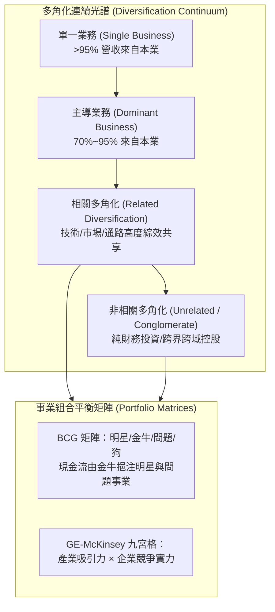

---
{"dg-publish":true,"permalink":"/02/04/02/module-4/m4-1/","tags":["PMBA","核心必修","策略管理","多角化","BCG矩陣","GE矩陣","併購綜效"],"dg-note-properties":{"aliases":["多角化策略","多角化策略與事業布局","BCG矩陣","GE矩陣","企業併購"],"tags":["PMBA","核心必修","策略管理","多角化","BCG矩陣","GE矩陣","併購綜效"],"category":"02_核心必修","course":"策略管理","session":"Session 4-1","chapter":"Chapter 9"}}
---

# 🌳 M4-1 多角化策略與事業布局 (Diversification Strategy & Corporate Portfolio)

> **導航索引**：[[05_AI選修/10_AiX/00_課程導航與進度/progress_📊 課程與筆記進度追蹤\|進度看板]] ｜ [[02_核心必修/04_策略管理/00_課程導航與進度/mindmap_策略管理_心智圖導航\|全課程心智圖]] ｜ [[02_核心必修/04_策略管理/_策略管理 MOC\|返回策略管理 MOC]]  
> **課程堂次**：Session 4-1 多角化策略  
> **教材章節**：Chapter 9 多角化策略與事業布局  
> **銜接上一堂**：[[02_核心必修/04_策略管理/02_模組筆記/Module_3_產業型態與垂直整合/M3-2_本業發展與垂直整合策略\|M3-2 本業發展與垂直整合策略]]  
> **前往下一堂**：[[02_核心必修/04_策略管理/02_模組筆記/Module_4_公司策略與全球布局/M4-2_全球化策略與市場進入模式\|M4-2 全球化策略與市場進入模式]]  
> **商管核心價值**：多角化是公司層級策略（Corporate Strategy）最核心的考驗。企業進入全新行業，究竟是能創造 $1+1 > 2$ 的綜效，還是落入「多角化折價（Conglomerate Discount）」的價值毀滅陷阱？本篇剖析多角化動機與類型、BCG 波士頓矩陣與 GE-McKinsey 九宮格資產配置，以及 Build-Borrow-Buy 成長路徑決策。

---

## 一、視覺化知識脈絡圖 (Mermaid Context)

---

## 二、核心理論與架構詳解

### 1. 多角化的類型與綜效來源
- **相關多角化（Related Diversification）**：
  - **範疇經濟（Economies of Scope）**：共用研發設施、物流體系或品牌知名度。
  - **核心能耐轉移（Core Competence Transfer）**：將本業所擅長的關鍵技術或經營 know-how 複製至新業務。
- **非相關多角化（Unrelated Diversification）**：
  - 建立內部資本市場（Internal Capital Market），平衡景氣循環週期。
  - 易產生官僚失靈與多角化折價（市場給予多元控股公司比分開估值更低的倍數）。

### 2. 事業組合評估工具：BCG 與 GE-McKinsey 矩陣
- **[[98_商業概念庫/BCG_Matrix_波士頓矩陣與動態現金流\|BCG 波士頓矩陣]]**：
  - **明星（Stars）**：高成長、高市占。需要重金投資以保持領先，未來轉為金牛。
  - **現金牛（Cash Cows）**：低成長、高市占。產生豐沛正向現金流，支撐全公司擴張。
  - **問號／問題業務（Question Marks）**：高成長、低市占。需決定是否大舉注資扶植為明星，或及早停損。
  - **瘦狗（Dogs）**：低成長、低市占。微幅獲利或虧損，應予以重整或處分。
- **[[98_商業概念庫/GE_McKinsey_Matrix_通用奇異矩陣\|GE-McKinsey 九宮格矩陣]]**：以「產業吸引力」與「企業競爭實力」雙軸，指導投資/選擇性投資/收割退場之資源配置。

### 3. 多角化實施的三大途徑：Build, Borrow, or Buy
- **Build（自建）**：內部研發與有機成長。文化契合度高，但速度慢、承擔市場不確定性。
- **Borrow（借用）**：策略聯盟或合資。風險分散、保留彈性，但存在合夥摩擦與協調成本。
- **Buy（購買）**：企業併購（M&A）。快速取得市場與技術，但面臨高溢價（Winner's Curse）與文化整合挑戰。

---

## 三、標竿實務案例剖析
- **迪士尼（Disney）的高協同相關多角化**：以內容 IP 為核心，橫向貫穿動畫電影、迪士尼樂園主題公園、周邊商品授權、串流影音 Disney+，實現一份內容創造四重收入的綜效極致。

---

## 四、推薦關聯之 [[98_商業概念庫\|98_商業概念庫]] 原子卡片
- [[98_商業概念庫/BCG_Matrix_波士頓矩陣與動態現金流\|BCG 波士頓矩陣與動態現金流]]
- [[98_商業概念庫/GE_McKinsey_Matrix_通用奇異矩陣\|GE-McKinsey 通用奇異矩陣]]
- [[98_商業概念庫/SOTP_零件加總估值法 Sum of the Parts\|零件加總估值法 (SOTP)]]
- [[02_核心必修/04_策略管理/_策略管理 MOC\|返回策略管理 MOC]]
