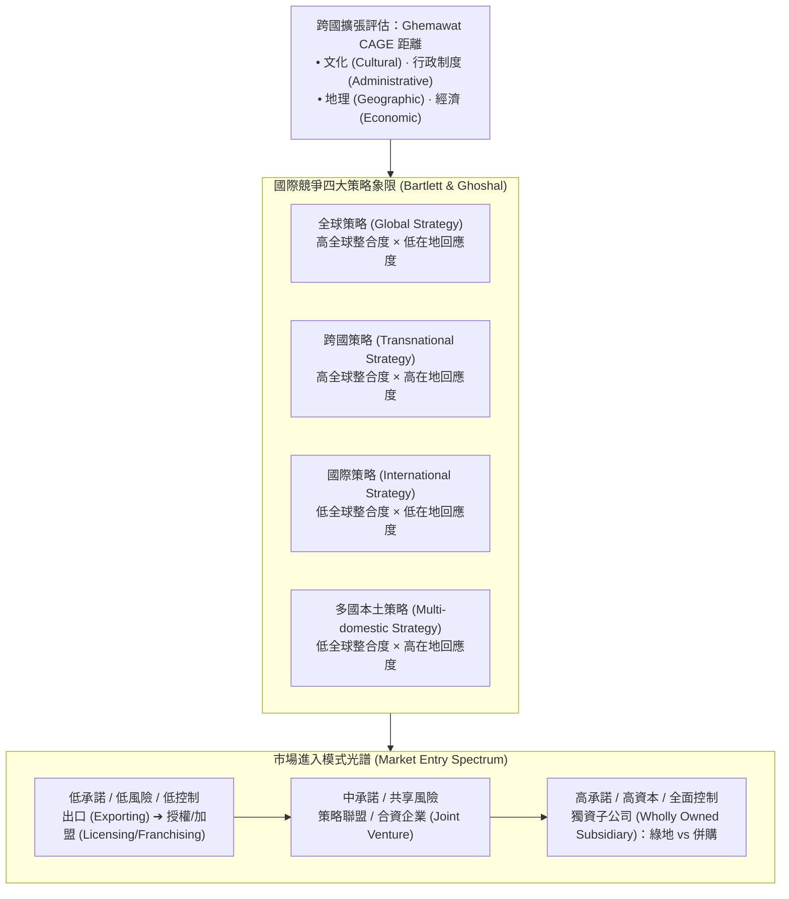

---
{"dg-publish":true,"permalink":"/02/04/02/module-4/m4-2/","tags":["PMBA","核心必修","策略管理","全球化","CAGE距離","國際化策略","進入模式","OLI"],"dg-note-properties":{"aliases":["全球化策略","全球化策略與市場進入模式","CAGE框架","跨國策略","OLI折衷範式"],"tags":["PMBA","核心必修","策略管理","全球化","CAGE距離","國際化策略","進入模式","OLI"],"category":"02_核心必修","course":"策略管理","session":"Session 4-2","chapter":"Chapter 10"}}
---

# 🌏 M4-2 全球化策略與市場進入模式 (Global Strategy & Market Entry Modes)

> **導航索引**：[[05_AI選修/10_AiX/00_課程導航與進度/progress_📊 課程與筆記進度追蹤\|進度看板]] ｜ [[02_核心必修/04_策略管理/00_課程導航與進度/mindmap_策略管理_心智圖導航\|全課程心智圖]] ｜ [[02_核心必修/04_策略管理/_策略管理 MOC\|返回策略管理 MOC]]  
> **課程堂次**：Session 4-2 全球化策略  
> **教材章節**：Chapter 10 全球化策略與市場進入模式  
> **銜接上一堂**：[[02_核心必修/04_策略管理/02_模組筆記/Module_4_公司策略與全球布局/M4-1_多角化策略與事業布局\|M4-1 多角化策略與事業布局]]  
> **前往下一堂**：[[02_核心必修/04_策略管理/02_模組筆記/Module_5_公司成長與變革轉型/M5-1_新創事業成長發展與變革管理\|M5-1 新創事業成長發展與變革管理]]  
> **商管核心價值**：走向國際市場是企業突破本土天花板的必經之路。然而，許多跨國擴張因忽視文化與制度距離而慘遭滑鐵盧。本篇探討 Ghemawat CAGE 距離框架、Bartlett & Ghoshal 國際化競爭策略四大象限、市場進入模式光譜（出口到獨資），以及 John Dunning 的 OLI 折衷理論。

---

## 一、視覺化知識脈絡圖 (Mermaid Context)

---

## 二、核心理論與架構詳解

### 1. 跨國距離分析：Ghemawat CAGE 距離框架
國際化擴張不能單看目標市場的 GDP 規模，必須衡量「雙邊距離」：
- **Cultural（文化距離）**：語言、宗教、社會價值規範、消費偏好的差異。
- **Administrative（行政/制度距離）**：法治完善度、殖民歷史關聯、貿易協定與關稅壁壘。
- **Geographic（地理距離）**：實體物理距離、時差、氣候條件與運輸物流成本。
- **Economic（經濟距離）**：消費者人均購買力、要素成本（工資、土地）與基礎建設水平。

### 2. 國際競爭四大策略 (Bartlett & Ghoshal)
- **全球策略（Global Strategy）**：追求極致的全球成本效益與標準化產品，研發與決策高度集中於總部。
- **多國本土策略（Multi-domestic Strategy）**：因應各國市場差異，將產品設計與行銷高度在地化，各國子企業高度自治。
- **國際策略（International Strategy）**：將母國的核心技術與產品直接轉移至海外市場，適應程度較低。
- **跨國策略（Transnational Strategy）**：最理想亦最複雜的型態，同時追求全球規模效益、在地化靈活回應與全球知識雙向學習。

### 3. 市場進入模式光譜 (Market Entry Modes)
| 進入模式 | 資本投入 | 控制程度 | 承擔風險 | 關鍵優點 | 主要潛在劣勢 |
| :--- | :---: | :---: | :---: | :--- | :--- |
| **出口 (Exporting)** | 最低 | 低 | 最低 | 規避在地建廠風險、規模經濟 | 關稅與運輸成本、受制於代理商 |
| **授權與加盟 (Licensing/Franchising)** | 低 | 中低 | 低 | 快速擴張、利用合夥人資本 | 失去核心技術控制、品質難控 |
| **合資 (Joint Venture)** | 中等 | 中等 | 中等 | 共享在地資源與政商人脈 | 利益衝突、文化磨合、決策緩慢 |
| **跨國併購 (Cross-border M&A)** | 高 | 高 | 高 | 瞬間取得現有營運、品牌與通路 | 溢價過高、跨國文化融合困難 |
| **綠地投資 (Greenfield)** | 最高 | 最高 | 最高 | 完全掌控流程與企業文化 | 建設週期長、沉沒成本極高 |

### 4. Dunning OLI 折衷範式 (Eclectic Paradigm)
企業走向海外直接投資（FDI）必須具備三項優勢：
- **Ownership（所有權優勢）**：具備不可替代的專利、商標或專門技術。
- **Location（區位優勢）**：目標國具備低要素成本或龐大市場。
- **Internalization（內部化優勢）**：將交易內部化比委外授權更能防範知識外洩與交易成本。

---

## 三、標竿實務案例剖析
- **台積電的全球化布局**：因應地緣政治與客戶供應鏈安全要求，台積電於美國亞利桑那、日本熊本（JASM合資）、德國德勒斯登設廠，展現從純出口到多元在地化海外布局之躍遷。

---

## 四、推薦關聯之 [[98_商業概念庫\|98_商業概念庫]] 原子卡片
- [[Industry_Alliance_同業合作三大動機\|同業合作三大動機]]
- [[98_商業概念庫/Double_Helix_產業雙螺旋演化模型\|產業雙螺旋演化模型]]
- [[02_核心必修/04_策略管理/_策略管理 MOC\|返回策略管理 MOC]]
