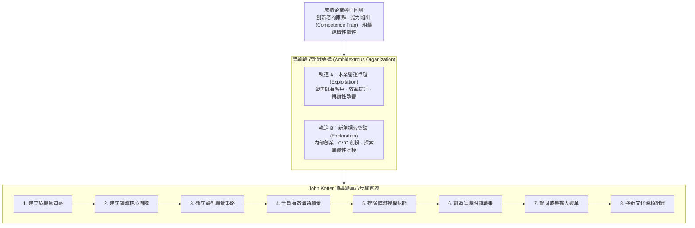

---
{"dg-publish":true,"permalink":"/02/04/02/module-5/m5-1/","tags":["PMBA","核心必修","策略管理","變革管理","雙軌轉型","CVC","組織轉型"],"dg-note-properties":{"aliases":["新創事業成長與變革管理","公司成長與轉型","雙軌轉型","領導變革八步驟","組織慣性"],"tags":["PMBA","核心必修","策略管理","變革管理","雙軌轉型","CVC","組織轉型"],"category":"02_核心必修","course":"策略管理","session":"Session 5","chapter":"Chapter 11"}}
---

# 🔄 M5-1 新創事業、成長發展與變革管理 (Corporate Entrepreneurship, Growth & Change Management)

> **導航索引**：[[05_AI選修/10_AiX/00_課程導航與進度/progress_📊 課程與筆記進度追蹤\|進度看板]] ｜ [[02_核心必修/04_策略管理/00_課程導航與進度/mindmap_策略管理_心智圖導航\|全課程心智圖]] ｜ [[02_核心必修/04_策略管理/_策略管理 MOC\|返回策略管理 MOC]]  
> **課程堂次**：Session 5 公司成長與轉型  
> **教材章節**：Chapter 11 新創事業、成長發展與變革管理  
> **銜接上一堂**：[[02_核心必修/04_策略管理/02_模組筆記/Module_4_公司策略與全球布局/M4-2_全球化策略與市場進入模式\|M4-2 全球化策略與市場進入模式]]  
> **前往下一堂**：全課程圓滿結業（進入主題選修實戰對接）  
> **商管核心價值**：卓越策略的最終考驗在於「執行」與「轉型」。許多昔日巨頭並非死於無知，而是死於組織結構性慣性與拒絕變革。本篇探討成熟企業如何推動內部創業與企業創投（CVC）、組織雙軌轉型（Ambidexterity），並以 John Kotter 領導變革八步驟為框架，破除轉型阻力，實現企業長青。

---

## 一、視覺化知識脈絡圖 (Mermaid Context)

---

## 二、核心理論與架構詳解

### 1. 成熟企業面臨的成長陷阱與組織慣性
- **能力陷阱（Competence Trap）**：企業越擅長某項舊技術與成功路徑，就越傾向在該領域投入資源，從而忽視外部環境的範式轉移。
- **組織慣性（Structural Inertia）**：既有的資源分配流程、KPI 考核體系與權力結構形成強大阻力，壓制任何可能自蝕本業（Cannibalization）的創新。

### 2. 組織雙軌轉型 (Organizational Ambidexterity)
成熟企業必須像「左右開弓（雙手靈巧）」一樣運作：
- **Exploitation（利用與深化）**：在核心成熟業務追求營運效率、降低成本、持續優化現有產品線。
- **Exploration（探索與突破）**：在探索性新興業務擁抱高風險、試驗全新商業模式與技術。
- **組織設計原則**：新興事業應具備獨立的組織架構、靈活的激勵制度與不同的決策文化，但透過高層經理人鏈結共享核心母體資產。

### 3. 企業創投 (Corporate Venture Capital, CVC)
- 相較於傳統財務型創投（IVC）只追求回報率，CVC 具備**策略性目標**：
  - 作為企業探索前沿技術的雷達。
  - 建立未來收購（M&A）或策略聯盟的期權管線。
  - 防範技術突襲，為母體轉型爭取時間。

### 4. John Kotter 領導變革八步驟
變革失敗往往源於跳過步驟或過早宣告勝利：
1. **建立危機急迫感（Establish a Sense of Urgency）**：用客觀數據與競爭衝擊撼動安逸感。
2. **成立強而有力的領導團隊（Form a Powerful Guiding Coalition）**：集結具備公信力與影響力的關鍵領導人。
3. **確立願景與策略（Create a Vision & Strategy）**：清晰描繪變革後的未來圖像。
4. **有效溝通願景（Communicate the Vision）**：言行一致，以十倍於以往的頻率向全員宣導。
5. **授權賦能排除障礙（Empower Broad-Based Action）**：掃除阻礙變革的制度流程與絆腳石。
6. **創造短期戰果（Generate Quick Wins）**：在 6~12 個月內打造可量化的具體勝績，振奮士氣。
7. **鞏固成效擴大變革（Consolidate Gains & Produce More Change）**：不鬆懈，乘勝追擊推動深層體制改革。
8. **將新做法深植於組織文化（Anchor New Approaches in Culture）**：透過人事升遷與考核，將新行為模式制度化。

---

## 三、標竿實務案例剖析
- **微軟（Microsoft）Satya Nadella 的文化與策略變革**：從以往閉門造車、派系內耗的 Windows 優先思維，果斷轉向「雲端優先、AI優先（Cloud-first, Mobile-first）」，並將企業文化從「無所不知（Know-it-all）」徹底轉變為「無所不學（Learn-it-all）」，帶領微軟重返全球市值巔峰。
- **富士軟片（Fujifilm）的雙軌轉型奇蹟**：面對數位相機對底片產業的毀滅性打擊，富士利用其在化學與膠原蛋白沉澱的深厚技術，成功切入高階醫療生技與化妝品護膚領域，避開了柯達破產的命運。

---

## 四、推薦關聯之 [[98_商業概念庫\|98_商業概念庫]] 原子卡片
- [[98_商業概念庫/CVC_企業創投 Corporate Venture Capital\|企業創投 (CVC)]]
- [[98_商業概念庫/Performance_Oversupply_性能過剩與破壞性創新\|性能過剩與破壞性創新]]
- [[98_商業概念庫/Real_Options_實質選擇權估值模型\|實質選擇權估值模型]]
- [[02_核心必修/04_策略管理/_策略管理 MOC\|返回策略管理 MOC]]
