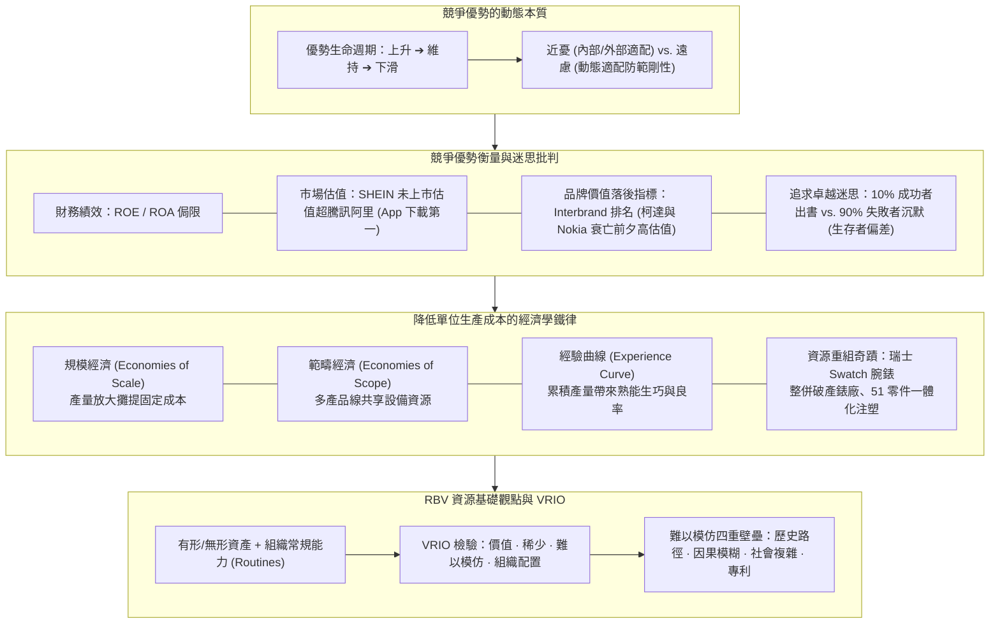
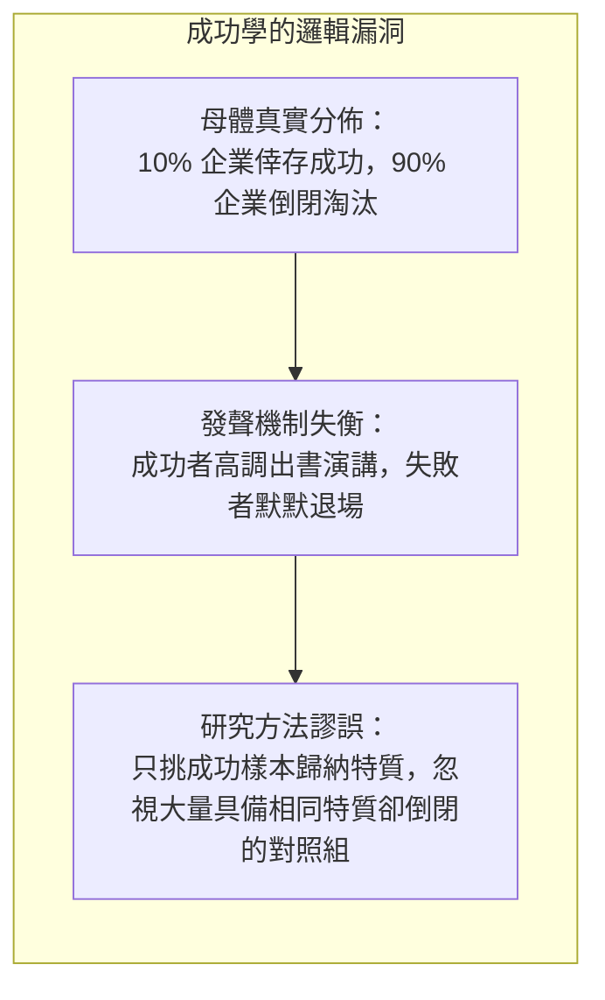

---
{"dg-publish":true,"permalink":"/02/04//m2-1-prev-20261108/","tags":["課程筆記","PMBA","核心必修","策略管理","競爭優勢","RBV","VRIO","成功學批判","規模經濟","Swatch案例"],"dg-note-properties":{"類別":"課程筆記","課程名稱":"[[策略管理]]","模組編號":"Module 2","模組名稱":"企業能耐與事業策略","章節編號":"M2-1","主題":"資源能力與競爭優勢 (Resources, Capabilities & Competitive Advantage)","對應週次":"2026-11-01 課堂","狀態":"🟢 已完成","tags":["課程筆記","PMBA","核心必修","策略管理","競爭優勢","RBV","VRIO","成功學批判","規模經濟","Swatch案例"],"aliases":["M2-1 資源能力與競爭優勢","資源能力與競爭優勢"]}}
---

# 💎 M2-1 資源、能力與競爭優勢

> **導讀與對接**：  
> - **上級地圖**：[[02_核心必修/04_策略管理/_策略管理 MOC\|策略管理 MOC 全景地圖]]  
> - **進度看板**：[[05_AI選修/10_AiX/00_課程導航與進度/progress_📊 課程與筆記進度追蹤\|課程與筆記進度追蹤看板]]  
> - **核心概念庫**：[[98_商業概念庫/In_Search_of_Excellence_Myth_追求卓越的迷思與成功學批判\|In_Search_of_Excellence_Myth_追求卓越的迷思與成功學批判]] · [[98_商業概念庫/brand-equity-lagging-indicator_品牌價值落後指標論\|Brand_Equity_Lagging_Indicator_品牌價值落後指標論]] · [[98_商業概念庫/Economies_of_Scale_Scope_Experience_規模範疇與經驗曲線\|Economies_of_Scale_Scope_Experience_規模範疇與經驗曲線]] · [[98_商業概念庫/Turnkey_vs_Internal_RD_技術授權與自主研發抉擇\|Turnkey_vs_Internal_RD_技術授權與自主研發抉擇]]  
> **授課教師**：國立臺灣大學國際企業學系特聘教授 吳學良 博士  
> **課堂時間**：2026-11-01 (Session 2-1)  

---

## 🎯 本章視覺化知識脈絡圖

---

## 一、 競爭優勢的本質：從暫時優勢走向持續優勢（SCA）

吳學良教授指出，策略的終極目標是達成「**競爭優勢（Competitive Advantage）**」，但經理人必須深刻理解優勢的生命週期：
- **短暫優勢 vs. 持續競爭優勢（Sustainable Competitive Advantage, SCA）**：
  - 短暫優勢往往只需踩中風口、取得早鳥紅利，或達成當下的「外部適配」與「內部適配」即可實現；
  - 但任何優勢都會隨著時間推移被對手模仿、超越或被新技術顛覆。
- **近憂 vs. 遠慮的辯證**：
  - **近憂**：來自於組織當下是否達到內部與外部適配；
  - **遠慮**：恰恰來自於「過去的成功」。成功時間越長，組織建立的常規（Routines）與思維定勢越深，進而轉化為致命的**組織剛性（Core Rigidity）**。
  - 卓越的策略家即使當下貴為行業霸主（無近憂），也必須具備「遠慮」——思考如何透過**動態適配（Dynamic Fit）**打破自身成功慣性。

---

## 二、 競爭優勢的衡量指標與三大盲點

企業宣稱自身具備競爭優勢，究竟能表現在哪些客觀指標上？吳教授引導同學進行了嚴密剖析：

### 1. 財務績效指標（ROE / ROA）的侷限
- 財務指標（如股東權益報酬率 ROE）是最直觀的表現，但會計數字易受資本結構、槓桿高低與折舊認列方式影響，且屬於**歷史落後指標**。

### 2. 市場估值（Market Valuation）的虛火：以 SHEIN 為例
- 快時尚電商巨頭 SHEIN 在尚未掛牌上市、甚至未正式對外披露損益表前，市場給予其高達千億美元的瘋狂估值，一度超越騰訊與阿里巴巴！
- **估值推動力**：純粹因為其在全球 App Store 的下載量與活躍用戶數勇奪第一。但市場估值往往蘊含極大的情緒預期泡沫，下載量並不直接等同於可持續的長期獲利能力。

### 3. 品牌價值（Brand Equity）是落後指標
- Interbrand 等顧問機構每年評選全球百大高價值品牌。
- **策略警語**：品牌價值是「過去行銷與市場投入的累積成果（落後指標）」，絕不能作為「未來競爭力保證（領先指標）」。
  - *歷史血淚*：**柯達（Kodak）**與**諾基亞（Nokia）**在被數位相機與智慧型手機淘汰前夕，長年高居全球最有價值品牌榜單前列；若經理人誤將品牌光環當作免死金牌，必將死於溫水煮青蛙。

---

## 三、 《追求卓越》的迷思：成功學批判與生存者偏差

管理學界在探討持續競爭優勢時，最具代表性的著作是 1982 年 Peters & Waterman 出版的《追求卓越》（In Search of Excellence）。該書歸納出一批卓越企業的共同特質，宣稱只要照做就能成功。

- **吳學良教授的批判性洞察**：
  1. **生存者偏差（Survivorship Bias）**：坊間充斥成功學書籍，是因為失敗者沒有話語權。
  2. **因果倒置**：成功者在成名後接受採訪或撰寫回憶錄時，往往會美化其決策歷程，將當初的隨機運氣、矇中風口或逼不得已的妥協，包裝成精心策劃的高瞻遠矚。
  3. **追蹤驗證的打臉**：多年後學者追蹤《追求卓越》書中盛讚的 43 家卓越企業，發現超過三分之二在十年間陷入嚴重虧損、被併購或破產。策略管理必須建立在科學因果分析上，切忌盲信成功學神話。

---

## 四、 降低單位生產成本的經濟學四大鐵律

在討論成本領導（Cost Leadership）時，吳教授帶領學員重溫古典經濟學降低單位成本的三大機制，並延伸出第四種「資源重組」路徑：

| 成本降低機制 | 核心定義與驅動因子 | 經理人管理意涵與實證 |
| :--- | :--- | :--- |
| **[[Economies_of_Scale_Scope_Experience_規模範疇與經驗曲線#1-規模經濟-economies-of-scale|規模經濟]] (Economies of Scale)** | 隨單一產品**單一期間生產規模放大**，固定資產折舊與研發成本被大量產品攤提，使平均單位成本遞減。 | 盲目擴產可能引發產能過剩；必須確認市場吸收量足以支撐大型工廠運轉。 |
| **[[Economies_of_Scale_Scope_Experience_規模範疇與經驗曲線#2-範疇經濟-economies-of-scope|範疇經濟]] (Economies of Scope)** | 隨**產品種類多樣化**，多條產品線共同分享同一套核心資產（共通設備、研發平台、經銷網絡），使聯合生產成本低於分開生產。 | 總成本必定增加，但「各產品的平均分攤成本」下降；如可口可樂利用既有車隊兼送多品類飲料。 |
| **[[Economies_of_Scale_Scope_Experience_規模範疇與經驗曲線#3-經驗曲線-experience-curve|經驗曲線]] (Experience Curve)** | 隨**歷史累計產量（Cumulative Volume）倍增**，工人生產技術純熟、管理流程優化、材料良率提升，使單位成本呈現固定比例下降。 | 「熟能生巧」的數學體現；早期激進降價搶占份額者，能率先沿著經驗曲線下滑建立成本護城河。 |
| **資源重組與商業模式創新 (Restructuring Innovation)** | 打破既有工程結構，透過跨界資源整合、簡化零件設計或收購不良資產重構成本函數。 | **瑞士 Swatch 腕錶傳奇**：70年代受日本石英錶毀滅打擊，瑞士銀行接收大量倒閉機械錶廠；海耶克（Hayek）大膽將 91 個以上零件簡化為 51 個，直接用塑膠注塑成型，創造低成本高時尚的 Swatch 奇蹟。 |

---

## 五、 資源基礎觀點（RBV）與 VRIO 檢驗矩陣

外部分析（Outside-in）決定了產業的吸引力，而**資源基礎觀點（Resource-Based View, Inside-out）**則決定了企業能否在既定產業中贏得超額報酬。

### 1. 資源（Resources） vs. 能力（Capabilities）
- **資源**：企業擁有的資產（有形：廠房、設備、現金；無形：品牌、專利、商譽）。
- **能力（Capabilities / Routines）**：將各項資源動態協調、整合並投入營運的組織慣例與專門知識（如台積電高良率製程微調能耐、SHEIN 小單快反演算法協同）。

### 2. Jay Barney 的 VRIO 競爭優勢檢驗模型

| 檢驗維度 | 核心提問 | 否則結果 |
| :---: | :--- | :--- |
| **V - 價值 (Valuable)** | 這項資源/能力能否協助企業把握市場機會或化解威脅？ | ❌ 否 ➔ **競爭劣勢 (Disadvantage)** |
| **R - 稀少 (Rare)** | 目前是否僅有極少數現有或潛在競爭者擁有此資源？ | ❌ 否 ➔ **競爭均勢 (Parity)** |
| **I - 難以模仿 (Inimitable)** | 未擁有的企業若想取得或複製該資源，是否面臨巨大的成本劣勢？ | ❌ 否 ➔ **暫時性優勢 (Temporary Advantage)** |
| **O - 組織妥善配置 (Organized)** | 企業的組織架構、考核制度與流程是否具備充分變現此資源的能力？ | ❌ 否 ➔ **未實現之優勢 (Unexploited Advantage)** |
| **全部滿足 (V+R+I+O)** | 達成四項條件的卓越能力 | 🏆 ➔ **持續性競爭優勢 (Sustained Advantage, SCA)** |

### 3. 難以模仿（Inimitability）的四重深層壁壘
1. **獨特歷史條件（Unique Historical Conditions / Path Dependency）**：在特定歷史時空節點累積形成的資產（如台積電創立時獲得台灣政府全力奧援與飛利浦專利授權）。
2. **因果模糊性（Causal Ambiguity）**：連企業自身高管也說不清楚「成功到底是哪幾個微觀因素的綜效」，對手無從抄襲。
3. **社會複雜性（Social Complexity）**：深植於組織內部的人際信任、團隊協作默契與企業文化，無法用金錢在市場上直接購買。
4. **法律保護（Legal / Patents）**：專利權、版權與營業秘密保護。

---

## 💡 經理人管理實務反思與行動指引

1. **破除單點優勢幻覺**：檢視自家公司的競爭力是源於短暫的「先行紅利」，還是具備 VRIO 檢驗的深層「持續性優勢」。
2. **審視品牌真實健康度**：切勿將 Interbrand 排名或過去的品牌知名度當作護城河；必須時刻檢驗該品牌在當前顧客心中是否依然具備強大定價權。
3. **善用三大成本鐵律**：在規律性重複生產（左腦/後台）的業務中，嚴格追蹤經驗曲線良率與規模攤提，建立極致成本底線。

---

## 🔗 模組導航與延伸閱讀

- ⬅️ **上一模組回顧**：[[M1-3_哈菲自行車個案與策略定位決策|M1-3 哈菲自行車個案與策略定位決策]]
- ➡️ **下一章節**：[[M2-2_事業策略與競合思維|M2-2 事業策略與競合思維]]
- 🎯 **精選個案**：[[M2-3_SHEIN快時尚小單快反與數位轉型|M2-3 SHEIN快時尚小單快反與數位轉型]]
- 💎 **本章關聯概念卡片**：
  - [[In_Search_of_Excellence_Myth_追求卓越的迷思與成功學批判]]
  - [[brand-equity-lagging-indicator_品牌價值落後指標論|Brand_Equity_Lagging_Indicator_品牌價值落後指標論]]
  - [[Economies_of_Scale_Scope_Experience_規模範疇與經驗曲線]]
  - [[Turnkey_vs_Internal_RD_技術授權與自主研發抉擇]]