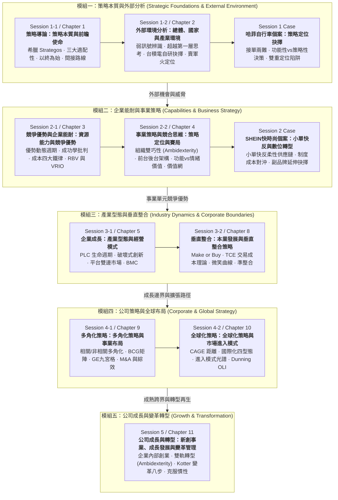

---
{"dg-publish":true,"permalink":"/02/04//moc-backup-20261108/","title":"策略管理 MOC (課程總覽地圖)","tags":["PMBA","核心必修","策略管理","競爭優勢","公司策略","垂直整合","多角化","全球化","變革管理","MOC","知識地圖"],"dg-note-properties":{"title":"策略管理 MOC (課程總覽地圖)","course":"策略管理","category":"02_核心必修","type":"moc","tags":["PMBA","核心必修","策略管理","競爭優勢","公司策略","垂直整合","多角化","全球化","變革管理","MOC","知識地圖"],"aliases":["策略管理","策略管理 MOC","Strategic Management MOC"]}}
---

# ⚔️ 策略管理 MOC (Strategic Management)

> **課程定位**：國立臺灣大學 PMBA 核心必修頂層整合模組（Capstone Course）   
> **授課教師**：國立臺灣大學國際企業學系特聘教授 吳學良 博士  
> **決策主軸**：以「**建立與維持可持續競爭優勢（SCA）**」為核心，貫通**策略本質 ➔ 外部分析 ➔ 內部分析 ➔ 事業策略與競合 ➔ 垂直整合 ➔ 多角化 ➔ 全球化 ➔ 組織變革與轉型**之全景高階經營決策鏈   
> **進度追蹤看板**：[[05_AI選修/10_AiX/00_課程導航與進度/progress_📊 課程與筆記進度追蹤\|📊 課程與筆記進度追蹤看板]]   
> **案例庫樞紐**：[[02_核心必修/04_策略管理/01_策略總經與個案/cases_策略管理案例庫\|🏢 標竿企業案例庫]] ｜ [[02_核心必修/04_策略管理/01_策略總經與個案/macro_總體策略與產業環境時事\|🌐 總體策略與產業時事]]   
> **學程總覽**：[[00_學程修課地圖 & 進度追蹤\|返回 PMBA 學程修課地圖與進度追蹤]]  

---

## 🧭 快速導航與核心樞紐 (Hub Navigation)

本課程已建置深度模組化知識庫，可直接透過以下核心看板穿透全局：

| 核心樞紐 | 檔案路徑與功能 | 重點內容 |
| :--- | :--- | :--- |
| 🗺️ **架構導航** | **[[02_核心必修/04_策略管理/00_課程導航與進度/mindmap_策略管理_心智圖導航\|心智圖全景導航]]** | 策略層級、五力分析、VRIO、事業策略、垂直整合、多角化、全球化與變革之全景心智圖 |
| 📊 **進度追蹤** | **[[05_AI選修/10_AiX/00_課程導航與進度/progress_📊 課程與筆記進度追蹤\|進度與檢核追蹤表]]** | 5 大 Session 堂次與 9 大章節進度檢核、模組里程碑與筆記產出狀態 |
| 💼 **案例庫** | **[[02_核心必修/04_策略管理/01_策略總經與個案/cases_策略管理案例庫\|策略管理案例庫]]** | SHEIN vs Zara（小單快反）、哈菲自行車（定位衝突）、台積電（雙巧性）、Swatch（重組） |
| 📈 **總經與時事** | **[[02_核心必修/04_策略管理/01_策略總經與個案/macro_總體策略與產業環境時事\|總體策略與產業環境時事]]** | 地緣政治、科技冷戰、小額免稅取消制度成本、供應鏈重組（China+1）、AI 工業革命 |

---

## 🏛️ 策略管理五大模組演進與決策邏輯架構

---

## 📚 完整模組筆記體系

### 🔹 模組一：策略本質與外部分析 (Strategic Foundations & External Environment)
- **[[M1-1_策略本質與前瞻使命|M1-1 策略本質與前瞻使命 (Ch01 / Session 1-1)]]** 🟢
  - 策略語源：希臘語 *Strategos*、高家米拉大戰（亞歷山大破波斯軍兵力部署與換位思考）。
  - 策略三大適配性（Fitness）：外部適配、內部適配（《魔球》數據契合）、動態適配（穿越時間與慣性）。
  - 前瞻決策模型：以終為始（Reasoning Backward）vs. 向前看；和泰汽車蘇燕輝董事長「末日破產思考」、海盜分鑽石逆推賽局、大谷翔平曼陀羅九宮格。
  - 願景真諦：葛斯納「IBM 現在最不需要的就是願景」、迂迴前進時的指北針。
  - 間接路線戰略：李德·哈特戰略論、李安寫劇本迂迴執導、瞪羚跳躍（Stotting）不可偽造訊號。
  - 戰役 vs. 戰爭：美日太平洋空母飛行員消耗戰、可口可樂 vs. 百事可樂多角化市值戰爭。
  - 策略三大層級：公司層級（戰場選擇）、事業層級（戰場求勝）、功能層級（武器打造）。
- **[[M1-2_總體國家與產業環境分析|M1-2 總體、國家與產業環境分析 (Ch02 / Session 1-2)]]** 🟢
  - 趨勢洞察：超越第一層思考（First-order thinking）。
  - 弱訊號捕捉：珠三角「辣椒指數」領先指標、景氣衰退「口紅指數」、少子化集中消費、單身小家庭買大冰箱。
  - 媒體報導盲點檢驗：聯發科併晨星人才外溢效應、張忠謀看到「春天的燕子」背後的頂級客戶神經中樞網絡。
  - 技術決策世紀對決：台積電自主研發 vs. 聯電外購 IBM Turn-key 0.13 微米銅製程。
  - 策略定位光譜：通才（吃到飽）vs. 專才（鑽子）、成衣廠跨產口罩之適配障礙、賣軍火/鏟子（De Beers 抽水幫浦租賃抽成起家）、拼多多精準接收淘寶拋棄之 7 億低階需求。
- **[[M1-3_哈菲自行車個案與策略定位決策|M1-3 哈菲自行車個案與策略定位決策 (Case Study / Session 1)]]** 🟢
  - 哈菲自行車面對 Walmart 巨額微利訂單的接單困局。
  - 費茲傑羅第一流智慧（包容矛盾理念）、艾森豪退後十步看全貌。
  - 功能性決策（財務部門精算利息與庫存判定不接）vs. 策略性決策（執行長推動組織定位根本轉型）。
  - 雙重定位陷阱（Dual Positioning Trap）：既做品牌又做代工的內部資源互咬與客戶信任崩潰；台灣宏碁/緯創、華碩/和碩大分拆之歷史印證。

---

### 🔹 模組二：企業能耐與事業策略 (Internal Capabilities & Business Strategy)
- **[[M2-1_資源能力與競爭優勢|M2-1 資源能力與競爭優勢 (Ch03 / Session 2-1)]]** 🟢
  - 競爭優勢的動態生命週期：近憂（當下配適）vs. 遠慮（破除組織成功慣性與剛性）。
  - 衡量指標盲點：ROE局限、SHEIN 未上市估值超騰訊阿里（App 下載第一）、品牌價值為落後指標（柯達/諾基亞衰亡前夕高估值）。
  - 成功學批判：追求卓越迷思、生存者偏差（10% 成功者出書 vs. 90% 失敗者沉默）。
  - 降低單位成本的經濟學四大鐵律：規模經濟、範疇經濟、經驗曲線與瑞士 Swatch 腕錶塑膠一體化重組奇蹟。
  - RBV 資源基礎觀點與 VRIO 檢驗矩陣：歷史路徑依賴、因果模糊性、社會複雜性四重防護壁壘。
- **[[M2-2_事業策略與競合思維|M2-2 事業策略與競合思維 (Ch04 / Session 2-2)]]** 🟢
  - 波特三大通用策略與夾在中間教條破除：**組織雙巧性（Organizational Ambidexterity，左右開弓）**。
  - 台積電終極印證：極致 Cost-down 兼顧先進製程創新 Value-up。
  - 商業模式前台 vs. 後台架構：前台 Value-up（右腦/創意/B2C）vs. 後台 Cost-down（左腦/效率/B2B 台灣企業 DNA）。
  - 價值的本質深度思辨：功能價值 vs. 情緒價值（Labubu 潮玩盲盒現象、DT Swiss 環法輪組傲嬌感、小資族高壓下的心理補償）。
  - 競合理論（Co-opetition）與價值網模型（Value Net）：互補者策略（Wintel 聯盟）、PARTS 賽局變革五大槓桿。
- **[[M2-3_SHEIN快時尚小單快反與數位轉型|M2-3 SHEIN快時尚小單快反與數位轉型 (Case Study / Session 2)]]** 🟢
  - SHEIN vs. Zara 快時尚模式對決：年推 15 萬款新品、超越 Amazon 成美區下載第一購物 App。
  - 核心優勢解構：**小單快反（Small-order, Rapid-response）**柔性供應鏈（首批 100 件以下/7 天上架/2,000 家工廠準時打款互信/零庫存奇蹟）。
  - 成長瓶頸與制度成本重擊：美歐取消小額包裹免稅，固定處理費對 10 美元低價洋裝造成致命毛利侵蝕。
  - 成長路徑四大辯證：維持低價 vs. 開放第三方平台 vs. 實體門市垂直整合 vs. **向上延伸中高價副品牌（首選）**。
  - 收購 Everlane 策略省思：買得到形象但買不到敏捷供應鏈；雙重定位紅線防範。

---

## 🧮 策略管理經典理論矩陣與經理人工具箱

| 分析層次 | 理論 / 模型名稱 | 代表學者 / 實踐 | 經理人管理意涵與分析工具箱 | 實務應用情境 |
| :--- | :--- | :--- | :--- | :--- |
| **策略本質** | **[[strategic-fitness_策略適配性理論|策略適配性 (Fitness)]]** | Porter / 吳學良 | 外部適配、內部活動互鎖（魔球案例）、動態適配。 | 檢視企業各部門活動咬合度，防止單點被同質化複製。 |
| | **[[Reasoning_Backward_以終為始與逆向推導|以終為始 (Backward)]]** | 蘇燕輝 / 賽局論 | 從極端倒閉或終極目標逆向推導當前必要條件與防範措施。 | 企業年度策略營、顛峰時期的第二曲線布局與防禦。 |
| | **[[Indirect_Approach_間接路線戰略|間接路線 (Indirect)]]** | 李德·哈特 | 避免正面硬碰硬，為對手創造弱點、擊其防備空檔。 | 資源有限的新創事業突圍、AI時代個人不可替代性打造。 |
| **環境與定位** | **[[Weak_Signals_弱訊號與小趨勢辨識|弱訊號辨識 (Signals)]]** | 吳學良 / 實務觀察 | 超越第一層思考，從辣椒指數、採購行為發掘微觀異變。 | 景氣轉折點預判、邊緣市場新興商機捕捉。 |
| | **[[Turnkey_vs_Internal_RD_技術授權與自主研發抉擇|自研 vs 外購 (R&D)]]** | 張忠謀 / 蔣尚義 | 核心能耐不可外購，自主試錯累積組織隱性知識。 | 關鍵製程突破、核心專利布局與技術自主權捍衛。 |
| | **[[Selling_Shovels_Strategy_賣軍火與賣鏟人策略|賣軍火策略 (Shovels)]]** | De Beers / 台積電 | 不參與終端混戰，佔據產業價值鏈中所有參與者必需之咽喉。 | 淘金浪潮中的平臺建設、關鍵零組件與基礎設施供應。 |
| | **[[Dual_Positioning_Trap_雙重定位陷阱與品牌代工衝突|雙重定位陷阱 (Trap)]]** | 哈菲 / 台灣科技業 | 品牌與代工並存必致資源互咬，分拆建立防火牆方能破局。 | 代工轉品牌面臨客戶抽單疑慮、多元事業群架構重組。 |
| **能耐與價值** | **[[Organizational_Ambidexterity_組織雙巧性|組織雙巧性 (Ambidextrous)]]** | 吳學良 / 台積電 | 打破波特夾在中間教條，左右開弓兼顧效率與創新。 | 企業成熟業務精進與新興業務探索雙軌推進。 |
| | **[[Frontstage_Backstage_Strategy_前台價值與後台成本架構|前台後台架構 (Front/Back)]]** | 吳學良教授 | 前台 Value-up (右腦/創意) vs 後台 Cost-down (左腦/效率)。 | 台灣製造業從 OEM 轉向 OBM 品牌之組織思維再造。 |
| | **[[Functional_vs_Emotional_Value_功能價值與情緒價值|功能 vs 情緒價值 (Values)]]** | 吳學良 / 泡泡瑪特 | 規格戰走向邊際遞減，情感投射與社交認同創造極致溢價。 | 消費品定價脫離物料成本、打造現象級爆品與生活風格。 |
| | **[[Small_Order_Quick_Response_小單快反供應鏈|小單快反 (Quick Response)]]** | SHEIN / 柔性供應鏈 | 首批極小單測款、數據演算法追單、準時結算信任生態。 | 徹底消除時尚與消費品產業的庫存折價頑疾。 |
| | **[[Economies_of_Scale_Scope_Experience_規模範疇與經驗曲線|規模/範疇/經驗曲線]]** | 經濟學 / Swatch | 產量攤提、多品類共享資源、累計學習效應與架構重組。 | 製造業單位成本函數優化、跨產品線綜效盤點。 |
| | **[[In_Search_of_Excellence_Myth_追求卓越的迷思與成功學批判|成功學批判 (Excellence)]]** | 吳學良 / Peters | 識別生存者偏差，避免盲目複製成功者事後美化的教條。 | 企業戰略評估去偽存真、建立基於因果分析的科學決策。 |
| | **[[brand-equity-lagging-indicator_品牌價值落後指標論|品牌落後指標論 (Brand)]]** | 柯達 / 諾基亞 | 品牌價值只能反映過去，無法抵禦典範轉移之墜落。 | 警惕老牌企業自滿情緒、推動第二曲線數位轉型。 |
| | **[[Institutional_Cost_Tariff_Threshold_制度成本與小額關稅門檻|制度成本門檻 (Tariffs)]]** | SHEIN / 貿易壁壘 | 小額包裹免稅取消，以提高客單價對沖固定行政合規成本。 | 跨國跨境電商定價策略重塑、因應地緣關稅壁壘。 |

---

## 💎 推薦關聯之 **98 商業概念庫** 原子卡片

- **策略思維與架構**：
  - [[Reasoning_Backward_以終為始與逆向推導]] · [[Indirect_Approach_間接路線戰略]] · [[strategic-fitness_策略適配性理論|Strategic_Fitness_策略適配性理論]] · [[Tactics_vs_Strategy_戰術戰役與戰略戰爭]]
- **環境、技術與定位**：
  - [[Weak_Signals_弱訊號與小趨勢辨識]] · [[Turnkey_vs_Internal_RD_技術授權與自主研發抉擇]] · [[Selling_Shovels_Strategy_賣軍火與賣鏟人策略]] · [[Dual_Positioning_Trap_雙重定位陷阱與品牌代工衝突]]
- **企業能耐與事業策略**：
  - [[Organizational_Ambidexterity_組織雙巧性]] · [[Functional_vs_Emotional_Value_功能價值與情緒價值]] · [[Frontstage_Backstage_Strategy_前台價值與後台成本架構]] · [[Small_Order_Quick_Response_小單快反供應鏈]] · [[Economies_of_Scale_Scope_Experience_規模範疇與經驗曲線]] · [[In_Search_of_Excellence_Myth_追求卓越的迷思與成功學批判]] · [[brand-equity-lagging-indicator_品牌價值落後指標論|Brand_Equity_Lagging_Indicator_品牌價值落後指標論]] · [[Institutional_Cost_Tariff_Threshold_制度成本與小額關稅門檻]]