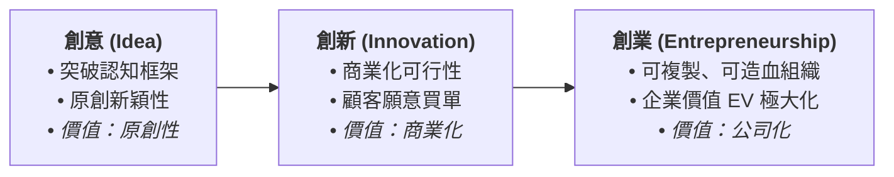

---
{"dg-publish":true,"permalink":"/04/10/02/module-1/m1-1/","tags":["創業概論","創業精神","肥尾理論","熊彼得","創造性破壞"],"dg-note-properties":{"類別":"課程筆記","課程名稱":"創業與企業財務策略_心智圖導航","模組編號":"Module 1","模組名稱":"創新思維與商業模式","章節編號":"M1-1","主題":"創業本質與創業家精神 (Entrepreneurial Essence & Entrepreneurial Spirit)","對應週次":"Week 1 (2026-09-08)","狀態":"🟢 已完成","tags":["創業概論","創業精神","肥尾理論","熊彼得","創造性破壞"]}}
---

# 🚀 M1-1 創業本質與創業家精神：從破壞性創新到非對稱風險承擔

> **導讀與對接**：  
> 本筆記為《創業與企業財務策略》第一週核心理論之一，系統性解構「創業 (Entrepreneurship)」的學術定義、歷史理論演進、創業者特質光譜，並深入剖析經理人與創業家在風險曲線上的本質差異——**常態分佈 vs. 肥尾理論 (Fat Tail)**。  
> - 上級地圖：[[04_主題選修/10_創業與企業財務策略/00_課程導航與進度/mindmap_創業與企業財務策略_心智圖導航\|全課程心智圖導航]]  
> - 進度看板：[[04_主題選修/12_產業分析與投資策略/00_課程導航與進度/progress_📊 課程與筆記進度追蹤\|progress_📊 課程與筆記進度追蹤]]  
> - 核心概念庫：[[98_商業概念庫/schumpeter_熊彼得\|xiong-bi-de_熊彼得]] ｜ [[98_商業概念庫/fat-tail-theory_肥尾理論\|fei-wei-theory_肥尾理論]] ｜ [[98_商業概念庫/3F法則\|3F法則]]

---

## 🏛️ 一、 核心理論本質：學派演進與價值遞進

### 1. 創業研究的四大奠基學派演進
在管理學與經濟學的發展歷程中，不同學派對「創業家（Entrepreneur）」與「創業活動（Entrepreneurship）」賦予了不同維度的深刻定義：

| 學派代表學者 | 年代 | 核心理論範式 | 創業之本質定義與功能 |
| :--- | :---: | :--- | :--- |
| **熊彼得 (Joseph Schumpeter)** | 1934 | **創造性破壞 (Creative Destruction)** | 創業家是破壞舊市場均衡、建立新生態的發動機。透過引進**五種「新組合」**（新產品、新製程、新市場、新原料、新組織），打破沉睡經濟，推動產業升級。 |
| **范卡塔拉曼 (S. Venkataraman)** | 2000 | **創業機會核心論 (Opportunity Discovery)** | 創業研究的邏輯樞紐是「機會」。研究焦點不是創業者個人心理，而是**「獲利機會如何產生、如何被特定主體發掘、評估並加以具體利用」**的完整歷程。 |
| **多林傑 (Marc J. Dollinger)** | 2003 | **資源整合組織化觀點 (RBV Dynamic Assembly)** | 創業是在高風險與高度不確定性的環境下，將分散且異質的內外部資源，以創新手法進行**動態整合並組織化為經濟實體**的過程。 |
| **提蒙斯 (Jeffry Timmons & Spinelli)** | 2007 | **三要素動態平衡模型 (Timmons Model)** | 創業是一場「機會導向、整體取向、領導驅動」的動態冒險。核心在於**創業機會 (Opportunity)、創業團隊 (Team) 與資源配置 (Resources)** 三者的動態適應與槓桿平衡。 |

> 📌 **本課程整合性定義**：  
> **創業（Entrepreneurship）** 係指在**高度不確定性與風險**的情境下，透過發掘、評估、利用創業機會，結合內外部資源、設計商業模式，建立新的經濟性組織，並為創業家、團隊成員與股東持續創造經濟利潤與企業價值的動態歷程。創業是現代資本主義與企業制度的**「房角基石（Cornerstone）」**。

### 2. 三創價值演進鏈：Idea ➔ Innovation ➔ Entrepreneurship
課堂特別強調，商業世界的價值躍遷並非一步到位，而是經歷嚴格的三部曲轉化：

### 3. 迷思三：開公司不等於建立企業（法人登記 vs. 經濟實體）
- **開公司 (Company / Corporation)**：花幾千元找代書設立登記、租借資本額驗資，只是取得法律上的法人資格。
- **建立企業 (Enterprise)**：必須建立具備自我造血機能的商業模式，整合人才、技術與供應鏈，並為市場創造不可替代的經濟剩餘。
- **早期融資的「3F 原則」**：
  新創初期在尚未達到機構投資人驗證門檻前，主要資金來源往往是：
  1. **Family (家人)**
  2. **Friends (朋友)**
  3. **Fools (信任創辦人的熱心非專業天使)**

---

## 📚 四、 案例深度映射與雙向鏈結

### 1. 代表性實務個案對標
- **張忠謀與台積電 (TSMC)**：高齡成熟創業之典範，證明深厚產業洞見與商業信用足以擊穿技術進入障礙。
- **輝達 (NVIDIA) 早期逆轉勝**：1990 年代初期因晶片架構判斷失誤瀕臨破產，靠創辦人堅毅特質 (Grit) 與台灣供應鏈策略聯盟挺過危機，迎來第二次與第三次成長曲線。
- **家族企業之二代接班傳承困境**：傳統產業具備豐沛現金流與成熟優勢，但面臨少子化與兩代思維斷層（一代堅持代工製造，二代欲導入生成式 AI 與數位行銷），成為現代創業生態鏈的獨特現象。

### 2. 跨模組雙向鏈結網絡
- ◀️ 上級架構：[[mindmap_創業與企業財務策略_心智圖導航|全課程心智圖導航]]
- 📊 進度追蹤：[[04_主題選修/12_產業分析與投資策略/00_課程導航與進度/progress_📊 課程與筆記進度追蹤|progress_📊 課程與筆記進度追蹤]]
- 🌐 時事收納：[[macro_資本市場與創投總經時事|資本市場與創投總經時事庫]]
- 🏢 個案庫對接：[[cases_新創與企業融資案例庫#^友達光電|新創與企業融資案例庫 (台積電)]]
- 📚 概念庫對接：[[schumpeter_熊彼得|xiong-bi-de_熊彼得]] ｜ [[fat-tail-theory_肥尾理論|fei-wei-theory_肥尾理論]] ｜ [[3F法則]]
