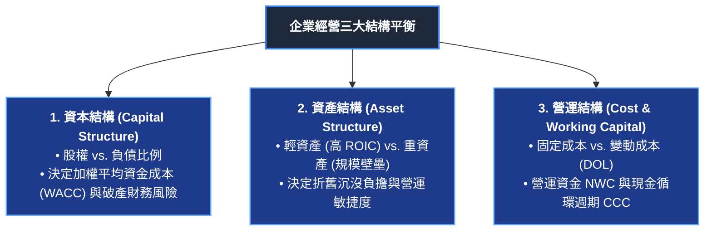

---
{"dg-publish":true,"permalink":"/04/10/02/module-1/m1-2/","tags":["白板決策鏈","財務價值三角","PEST","VRIO","SWOT","杜邦分析","永續成長率","內部成長率","AFN模型","損益兩平點","總槓桿度","DTL","企業三大結構","實質選擇權","Real_Options","價值投資三層模型","Greenwald","EPV","SOTP","BCG矩陣","GE矩陣","企業價值","台積電vs鴻海"],"dg-note-properties":{"類別":"課程筆記","課程名稱":"[[創業與企業財務策略]]","模組編號":"Module 1","模組名稱":"創新思維與商業模式","章節編號":"M1-2","主題":"白板決策鏈與財務價值三角 (Decision Chain & Corporate Value Triangle)","對應週次":"Week 1 ~ Week 8 全域深化 (2026-10-27 跨堂旗艦重構)","狀態":"🟢 已完成","tags":["白板決策鏈","財務價值三角","PEST","VRIO","SWOT","杜邦分析","永續成長率","內部成長率","AFN模型","損益兩平點","總槓桿度","DTL","企業三大結構","實質選擇權","Real_Options","價值投資三層模型","Greenwald","EPV","SOTP","BCG矩陣","GE矩陣","企業價值","台積電vs鴻海"]}}
---


# 📐 M1-2 白板決策鏈與財務價值三角：從總體戰略、價值投資到總槓桿度與實質選擇權

> [!abstract] 導讀與對接
> 本筆記為《創業與企業財務策略》最核心之跨堂白板推導全域旗艦筆記。貫穿「外部環境分析 ➔ 內部資源檢驗 ➔ 策略交叉矩陣 ➔ 商業決策四階躍遷」，並全面融合 Class 5、Class 6、Class 7 與 Class 8/9 最新白板深化推導：
> 1. **杜邦公式拆解與永續成長率 ($g=b\times ROE$)**；
> 2. **策略投資矩陣（Ansoff + BCG + GE）之動態現金流傳導**；
> 3. **Bruce Greenwald 價值投資三層估值模型（AV vs. EPV vs. GV）之白板三大情境判讀**；
> 4. **張忠謀台積電三大經營指標與台積電 vs. 鴻海實算對標**；
> 5. **外部融資需求模型（AFN Equation）與銷售額百分比法**；
> 6. **內部成長率（IGR）vs. 永續成長率（SGR）之雙極限數學證明與超速成長陷阱**；
> 7. **三大損益兩平點（會計／現金／財務 BEP）與營運／財務雙槓桿（DOL $\times$ DFL）連動**；
> 8. **新創總槓桿度（DTL）斜率矩陣與新創經營風險非線性放大機制**；
> 9. **企業三大結構（財務結構、資本結構、股權結構）動態平衡**；
> 10. **實質選擇權（Real Options）估值模型與退場價值核心定理**。
> - **上級地圖**：[[04_主題選修/10_創業與企業財務策略/_歷史版本封存/_創業與企業財務策略 MOC\|全課程 MOC 導航總圖]] ｜ [[04_主題選修/10_創業與企業財務策略/00_課程導航與進度/mindmap_創業與企業財務策略_心智圖導航\|心智圖全景導航]]
> - **進度看板**：[[05_AI選修/10_AiX/00_課程導航與進度/progress_📊 課程與筆記進度追蹤\|📊 課程與筆記進度追蹤看板]]
> - **關聯模組**：[[04_主題選修/10_創業與企業財務策略/02_模組筆記/Module_1_創新思維與商業模式/M1-1_創業本質與創業家精神\|M1-1 創業本質]] ｜ [[04_主題選修/10_創業與企業財務策略/02_模組筆記/Module_1_創新思維與商業模式/M1-10_七大市場力量與商業戰略價值公式\|M1-10 七大市場力量]] ｜ [[04_主題選修/10_創業與企業財務策略/02_模組筆記/Module_2_產品創新與精實驗證/M2-1_精實產品開發與服務創新驗證\|M2-1 精實產品開發]] ｜ [[04_主題選修/10_創業與企業財務策略/02_模組筆記/Module_2_產品創新與精實驗證/M2-3_創業行銷策略與全能屋模型\|M2-3 創業行銷策略]] ｜ [[04_主題選修/10_創業與企業財務策略/02_模組筆記/Module_2_產品創新與精實驗證/M2-4_新創財務預測與外部融資需求模型\|M2-4 新創財務預測與外部融資]] ｜ [[04_主題選修/10_創業與企業財務策略/02_模組筆記/Module_2_產品創新與精實驗證/M2-5_創業投資與私募股權運作機制\|M2-5 創業投資與私募股權]]
> - **核心概念庫**：[[98_商業概念庫/AFN_外部融資需求模型 Additional Funds Needed\|AFN 外部融資模型]] ｜ [[98_商業概念庫/IGR_內部成長率 Internal Growth Rate\|IGR 內部成長率]] ｜ [[98_商業概念庫/BEP_三大損益兩平點分析 Breakeven Analysis\|BEP 三大損益兩平點]] ｜ [[98_商業概念庫/dtl-matrix_總槓桿度與新創雙槓桿矩陣\|DTL 總槓桿度]] ｜ [[98_商業概念庫/real-options_實質選擇權\|Real Options 實質選擇權]] ｜ [[98_商業概念庫/Davis_Double_Play_戴維斯雙擊與雙殺\|Davis Double Play 戴維斯雙擊雙殺]] ｜ [[98_商業概念庫/EPV_盈餘能力價值模型 Earnings Power Value\|EPV 盈餘能力價值]] ｜ [[98_商業概念庫/SOTP_零件加總估值法 Sum of the Parts\|SOTP 零件加總法]] ｜ [[98_商業概念庫/BCG_Matrix_波士頓矩陣與動態現金流\|BCG 波士頓矩陣]] ｜ [[98_商業概念庫/GE_McKinsey_Matrix_通用奇異矩陣\|GE 奇異矩陣]] ｜ [[98_商業概念庫/ROIC_投入資本報酬率 Return on Invested Capital\|ROIC 投入資本報酬率]]

---

## 🏛️ 一、 核心理論本質：白板戰略決策全景鏈

```text
[總體超環境] PESTEL 分析 (政治地緣、利率通膨、社會人口、科技變革)
│
▼
[產業環境]   Porter 五力分析 (既有競爭、進入障礙、替代威脅、買賣方議價力)
│
▼
[企業內部]   價值鏈活動 (Value Chain) ──▶ VRIO 核心能耐檢驗 (V-R-I-O)
│
▼
[策略交叉]   SWOT 四象限決策矩陣 (Maxi-Maxi / Maxi-Mini / Mini-Maxi / Mini-Mini)
│
▼
[商業模式]   商業模式畫布 (BMC) ＋ 兩全思維 (Trade-On Thinking)
│
▼
[價值實現]   營業活動 (ROE) ＋ 融資結構 (Debt/Equity) ＋ 雙槓桿 (DTL) ＋ 實質選擇權 ──▶ 企業價值 EV
```

### 商業決策四階段躍遷 (The 4-Stage Leap)
1. **好點子 (Good Idea)**：突破傳統的創意發想，但尚未經過市場驗證；
2. **好事業 (Good Business)**：透過商業模式畫布（BMC），確立價值主張、通路與成本收益對稱性，具備市場生存力；
3. **好公司 (Good Company)**：具備健全內部控制、團隊分工、文化凝聚力與公司治理結構；
4. **好投資 (Good Investment)**：能為股東與資本市場創造實質資本利得與超額回報（$\text{ROIC} > \text{WACC}$），具備流動性與退出選擇權溢價。

---

## 🛠️ 二、 分析工具與關鍵維度

### 1. 內外部環境評估與交叉工具
#### (1) 超環境與總體環境：PESTEL 分析
- **P (Political 政治與地緣)**：外銷禁令、美中晶片科技戰、關稅壁壘。
- **E (Economic 經濟與利率)**：景氣週期、通膨水準、無風險利率高低、K 型經濟走向。
- **S (Social 社會與人口)**：少子化、高齡銀髮化、勞動力短缺、二代傳承斷層。
- **T (Technological 科技變革)**：生成式 AI、大型語言模型（LLM）、先進封裝技術。

#### (2) 內部資源與能耐：VRIO 檢驗矩陣
| 檢驗構面 | 核心問題 | 競爭意涵 |
| :--- | :--- | :--- |
| **V (Value 價值性)** | 能否掌握市場機會或消除外部威脅？ | 否則處於**競爭劣勢 (Disadvantage)** |
| **R (Rarity 稀缺性)** | 是否僅為市場少數競爭者所擁有？ | 具備**競爭均勢 (Parity)** |
| **I (Inimitability 難以模仿)** | 對手模仿該能耐是否面臨巨額成本或時間壁壘？ | 具備**暫時性競爭優勢 (Temporary Advantage)** |
| **O (Organization 組織能力)** | 企業組織架構、激勵機制能否充分變現此項能耐？ | 達成**持續性競爭優勢 (Sustained Advantage)** |

#### (3) 戰略交叉：SWOT 四向行動策略矩陣
| 矩陣象限 | 策略代號 | 策略類型與具體行動 |
| :---: | :---: | :--- |
| **S - O** | **Maxi-Maxi** | **擴張成長型策略**：傾全力利用核心內部優勢，全面搶攻外部重大機遇。 |
| **S - T** | **Maxi-Mini** | **差異化防禦策略**：善用核心優勢構築護城河，化解或抵禦外部競爭威脅。 |
| **W - O** | **Mini-Maxi** | **轉機轉型型策略**：藉由外部龐大機會，透過併購、策略聯盟或合資克服內部短板。 |
| **W - T** | **Mini-Mini** | **風控退守型策略**：縮小防守戰線、停損切割非核心業務，將下檔破產風險降至最低。 |

---

## 📈 三、 課堂白板推導專題一：杜邦公式拆解與永續成長率公式 (Class 5 深度深化)

### 3.1 經典杜邦三因子拆解
$$\text{ROE} = \frac{\text{稅後淨利}}{\text{營業收入}} \times \frac{\text{營業收入}}{\text{總資產}} \times \frac{\text{總資產}}{\text{股東權益}} = \text{純益率} \times \text{總資產週轉率} \times \text{權益乘數}$$
- **台積電（2330）**：典型的「高毛利溢價型」（純益率達 40% 以上、資產週轉率約 0.5~0.6、權益乘數約 1.4~1.5），靠極致技術定價權與先進製程護城河拉動 ROE；
- **鴻海（2317）**：典型的「高週轉薄利型」（純益率僅 2%~3%、資產週轉率達 1.5~2.0、權益乘數約 2.5~3.0），靠全球供應鏈整合能力、極限採購規模與運算翻桌率撬動 ROE。

---

## 🧭 四、 課堂白板推導專題二：策略投資矩陣與動態現金流傳導 (Class 6 核心)

### 4.1 BCG 矩陣之動態現金流循環閉環
- **明星業務 (Stars)**：高成長、高份額，需大量資金再投資以維持份額；
- **金牛業務 (Cash Cows)**：低成長、高份額，自由現金流噴發，作為全集團孵化新事業的提款機；
- **問題業務 (Question Marks)**：高成長、低份額，需大筆研發資金驗證市場；
- **老狗業務 (Dogs)**：低成長、低份額，消耗管理資源，應果斷剝離退場。

### 4.2 SOTP 零件加總估值法 (Sum of the Parts)
$$\text{Enterprise Value (EV)} = \sum_{i=1}^{n} (\text{Segment EBITDA}_i \times \text{Multiple}_i) - \text{Net Debt}$$

---

## 💎 五、 課堂白板推導專題三：Bruce Greenwald 價值投資三層估值模型 (Class 6 核心)

1. **$AV > EPV$（資產未充分利用 / 價值毀滅狀態）**：投入重資本，但常態利潤資本化後低於資產重置成本；
2. **$AV = EPV$（無競爭壁壘 / 完全競爭均衡）**：充分競爭紅海，$\text{ROIC} = \text{WACC}$，企業只值重置成本；
3. **$AV < EPV$（享有特許權護城河 / 超額價值創造）**：**特許經營溢價 (Franchise Value) $= EPV - AV > 0$**。

---

## 🧮 六、 課堂白板推導專題四：外部融資需求模型 (AFN) 與銷售百分比法 (Class 7 核心)

$$\text{AFN} = \underbrace{\left(\frac{A^*}{S_0}\right)\Delta S}_{\text{資產擴張需求}} - \underbrace{\left(\frac{L^*}{S_0}\right)\Delta S}_{\text{自發性負債融通}} - \underbrace{S_1 \times M \times b}_{\text{內部留存盈餘供給}}$$
- $\text{AFN} < 0$：內部現金充沛，可自主消化擴張；
- $\text{AFN} > 0$：必須啟動啄食理論（Pecking Order）排程，優先動用債權、次選可轉債、最後發行新股。

---

## 🚀 七、 課堂白板推導專題五：內部成長率 (IGR) vs. 永續成長率 (SGR) 雙極限推導 (Class 7 核心)

- **內部成長率（IGR）**：$$\text{IGR} = \frac{\text{ROA} \times b}{1 - (\text{ROA} \times b)}$$
- **永續成長率（SGR）**：$$\text{SGR} = \frac{\text{ROE} \times b}{1 - (\text{ROE} \times b)}$$
- 警示「超速成長（Over-trading）」黑字倒閉陷阱：實際成長率 $g_{\text{actual}} > \text{SGR}$ 時，應收帳款與存貨吸乾現金導致跳票。

---

## ⚖️ 八、 課堂白板推導專題六：新創總槓桿度（DTL）斜率矩陣與風險放大 (Class 8/9 深化)

```mermaid
flowchart LR
    Rev["<b>營業收入 (Sales)</b>"]
    EBIT["<b>息稅前利潤 (EBIT)</b>"]
    EPS["<b>每股盈餘 (EPS)</b>"]

    Rev -->|<b>營運槓桿度 (DOL)</b><br>固定營運成本放大| EBIT
    EBIT -->|<b>財務槓桿度 (DFL)</b><br>固定利息費用放大| EPS
    Rev -.->|<b>總槓桿度 (DTL = DOL × DFL)</b><br>雙重非線性風險共振| EPS
```

### 8.1 總槓桿度數理代數推導
$$\text{DOL} = \frac{\% \Delta \text{EBIT}}{\% \Delta Q} = \frac{Q(P - V)}{Q(P - V) - FC}$$
$$\text{DFL} = \frac{\% \Delta \text{EPS}}{\% \Delta \text{EBIT}} = \frac{\text{EBIT}}{\text{EBIT} - I}$$
$$\text{DTL} = \text{DOL} \times \text{DFL} = \frac{\% \Delta \text{EPS}}{\% \Delta Q} = \frac{Q(P - V)}{Q(P - V) - FC - I}$$

### 8.2 新創 vs. 產業平均之槓桿斜率風險判讀
- **白板斜率分析**：將 DOL 設為縱軸、DFL 設為橫軸，新創事業的風險線往往大幅陡峭於產業平均線；
- **經營啟示**：新創事業初期尚未達成經濟規模，單位固定成本高（DOL 極大）；若此時貿然引進高利息負債（拉高 DFL），總槓桿 DTL 將發生幾何級數飆升，營業收入哪怕僅下滑 5%，EPS 就可能腰斬甚至引發破產清算。

---

## 🏛️ 九、 課堂白板推導專題七：企業經營三大結構動態平衡 (Class 8/9 深化)

課堂白板特別強調，企業在進行籌資與資本配置時，必須同時調控三大核心結構：



---

## 🎯 十、 課堂白板推導專題八：實質選擇權（Real Options）在投資決策與退場價值之應用 (Class 8/9 深化)

```text
【實質選擇權決策樹 (Real Options Decision Tree)】

                           ┌──▶ [情境 A: 市場大好] ──▶ 執行【擴張選擇權 (Expansion)】(加碼投資機隊/產線)
                           │
  初始專案評估 (NPV 決策) ──┼──▶ [情境 B: 遭遇黑天鵝] ──▶ 執行【時機/延遲選擇權 (Timing)】(如星宇疫情延遲進機隊)
                           │
                           └──▶ [情境 C: 模式驗證失敗] ──▶ 執行【放棄/退出選擇權 (Abandonment)】(資產清算或轉讓)
```

### 10.1 實質選擇權價值模型
傳統 DCF / NPV 方法假定管理層在投資後「被動接受現金流結果」，忽略了經理人具備動態調整的「經營彈性（Managerial Flexibility）」。現代創投將實質選擇權納入估值：

$$\text{專案真實總價值 (Expanded NPV)} = \text{靜態淨現值 (Static NPV)} + \text{實質選擇權溢價 (Real Option Value)}$$

### 10.2 三大核心實質選擇權
1. **時機選擇權（Timing / Delay Option）**：保留「延遲投資」的權利。不確定性越高，等待取得更多市場數據再決策的價值越大；
2. **擴張選擇權（Expansion Option）**：先投入小額資本建立灘頭堡（MVP），若市場反響超預期，再依約快速加碼擴產；
3. **退出選擇權（Abandonment / Exit Option）**：若市場惡化，果斷止損退出並處分專案資產以回收殘值。
- **白板名言警句**：
  **「如果沒有退出的機制，對於新創而言就沒有投資的價值！」** 退場機制賦予了創投在下檔風險中的實質賣權（Put Option），是投資人敢於承擔高風險的前提。

---

## 📚 十一、 案例對標與跨模組雙向鏈結網絡

### 11.1 課堂逐字稿實證案例對標
1. **OpenAI 估值調整與戴維斯效應**：融資 300 億美元，投後估值下修至 1.25 兆美元，年化營收 500 億美元對應 P/S 25 倍，揭示營收增長與倍數聯動的「戴維斯雙擊與雙殺」。對標 [[cases_新創與企業融資案例庫#OpenAI|案例 16]]。
2. **星宇航空實質選擇權實務**：疫情期間因無貨運機隊，果斷延遲兩年引進客機（時機選擇權），解封後航線大幅擴張（擴張選擇權）。對標 [[cases_新創與企業融資案例庫#星宇航空|案例 18]]。
3. **SpaceX 400 億美元算力融資**：透過阿波羅（Apollo）進行大型資產抵押借貸採購 GPU，對標 [[cases_新創與企業融資案例庫#SpaceX|案例 17]]。
4. **CoreWeave 借貸成本飆升**：11% 高收益科技債利率加計 5% 美債殖利率，實質融資成本高達 16%。對標 [[macro_資本市場與創投總經時事#2026-10-27|2026-10-27 總經時事]]。

### 11.2 跨模組雙向鏈結網絡
- **前序模組**：[[M1-1_創業本質與創業家精神|M1-1 創業本質]] ｜ [[M1-10_七大市場力量與商業戰略價值公式|M1-10 七大市場力量]] ｜ [[M2-1_精實產品開發與服務創新驗證|M2-1 精實產品開發]] ｜ [[M2-3_創業行銷策略與全能屋模型|M2-3 創業行銷策略]] ｜ [[M2-4_新創財務預測與外部融資需求模型|M2-4 新創財務預測]] ｜ [[M2-5_創業投資與私募股權運作機制|M2-5 創業投資與私募股權]]
- **概念庫對接**：
  - [[dtl-matrix_總槓桿度與新創雙槓桿矩陣|DTL 總槓桿度與新創雙槓桿矩陣]]
  - [[real-options_實質選擇權|Real Options 實質選擇權估值模型]]
  - [[Davis_Double_Play_戴維斯雙擊與雙殺|Davis Double Play 戴維斯雙擊與雙殺]]
  - [[AFN_外部融資需求模型 Additional Funds Needed|AFN 外部融資需求模型]]
  - [[IGR_內部成長率 Internal Growth Rate|IGR 內部成長率]]
  - [[BEP_三大損益兩平點分析 Breakeven Analysis|BEP 三大損益兩平點分析]]
  - [[LP_GP_有限合夥人與普通合夥人架構|LP vs. GP 有限合夥架構]]
  - [[Carried_Interest_創投績效獎金與2_20法則|Carried Interest 績效獎金]]
  - [[CVC_企業創投 Corporate Venture Capital|CVC 企業創投]]
  - [[LBO_槓桿收購與併購基金機制|LBO 槓桿收購與併購基金機制]]
  - [[Term_Sheet_創投投資意向書核心條款|Term Sheet 核心條款]]