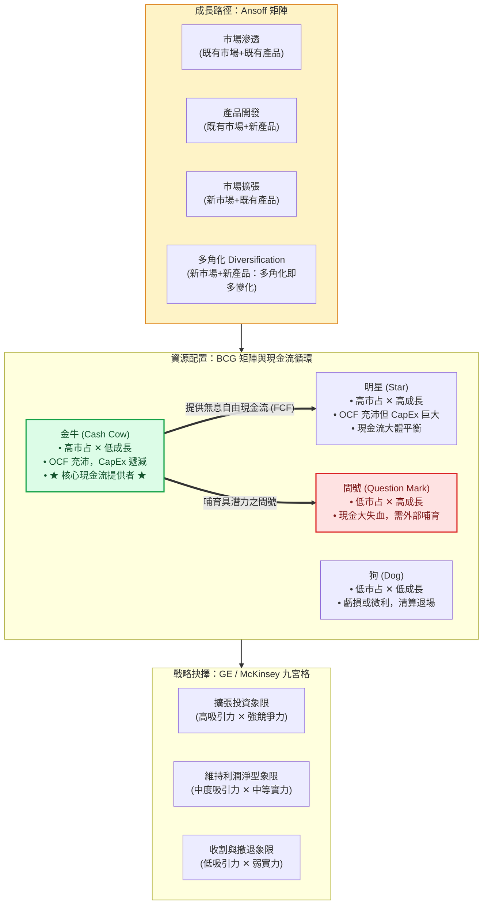

---
{"dg-publish":true,"permalink":"/04/10/02/module-1/m1-2/","tags":["白板決策鏈","財務價值三角","PEST","VRIO","SWOT","杜邦分析","永續成長率","價值投資三層模型","Greenwald","EPV","SOTP","BCG矩陣","GE矩陣","企業價值","折舊回沖","台積電vs鴻海"],"dg-note-properties":{"類別":"課程筆記","課程名稱":"[[創業與企業財務策略]]","模組編號":"Module 1","模組名稱":"創新思維與商業模式","章節編號":"M1-2","主題":"白板決策鏈與財務價值三角 (Decision Chain & Corporate Value Triangle)","對應週次":"Week 1 ~ Week 6 全域深化 (2026-10-13 跨堂重構)","狀態":"🟢 已完成","tags":["白板決策鏈","財務價值三角","PEST","VRIO","SWOT","杜邦分析","永續成長率","價值投資三層模型","Greenwald","EPV","SOTP","BCG矩陣","GE矩陣","企業價值","折舊回沖","台積電vs鴻海"]}}
---


# 📐 M1-2 白板決策鏈與財務價值三角：從總體戰略、折舊回沖到 Greenwald 價值投資三層估值模型

> [!abstract] 導讀與對接
> 本筆記為《創業與企業財務策略》最核心之跨堂白板推導全域旗艦筆記。貫穿「外部環境分析 ➔ 內部資源檢驗 ➔ 策略交叉矩陣 ➔ 商業決策四階躍遷」，並全面融合 Class 5 與 Class 6 最新白板深化推導：**杜邦公式拆解與永續成長率 ($g=b\times ROE$)**、**策略投資矩陣（Ansoff + BCG + GE）之動態現金流傳導**、**SOTP（零件加總估值法）**、**Bruce Greenwald 價值投資三層估值模型（AV vs. EPV vs. GV）之白板三大情境判讀**，以及**張忠謀台積電三大經營指標與台積電 vs. 鴻海實算對標**。
> - **上級地圖**：[[04_主題選修/10_創業與企業財務策略/00_課程導航與進度/mindmap_創業與企業財務策略_心智圖導航\|全課程心智圖導航]]
> - **進度看板**：[[04_主題選修/10_創業與企業財務策略/00_課程導航與進度/progress_📊 課程與筆記進度追蹤\|📊 課程與筆記進度追蹤看板]]
> - **關聯模組**：[[04_主題選修/10_創業與企業財務策略/02_模組筆記/Module_1_創新思維與商業模式/M1-1_創業本質與創業家精神\|M1-1 創業本質與創業家精神]] ｜ [[04_主題選修/10_創業與企業財務策略/02_模組筆記/Module_1_創新思維與商業模式/M1-10_七大市場力量與商業戰略價值公式\|M1-10 七大市場力量與商業戰略價值公式]] ｜ [[04_主題選修/10_創業與企業財務策略/02_模組筆記/Module_2_產品創新與精實驗證/M2-1_精實產品開發與服務創新驗證\|M2-1 精實產品開發]] ｜ [[04_主題選修/10_創業與企業財務策略/02_模組筆記/Module_2_產品創新與精實驗證/M2-3_創業行銷策略與全能屋模型\|M2-3 創業行銷策略]]
> - **核心概念庫**：[[98_商業概念庫/EPV_盈餘能力價值模型 Earnings Power Value\|EPV 盈餘能力價值]] ｜ [[98_商業概念庫/SOTP_零件加總估值法 Sum of the Parts\|SOTP 零件加總法]] ｜ [[98_商業概念庫/BCG_Matrix_波士頓矩陣與動態現金流\|BCG 波士頓矩陣]] ｜ [[98_商業概念庫/GE_McKinsey_Matrix_通用奇異矩陣\|GE 奇異矩陣]] ｜ [[98_商業概念庫/ROIC_投入資本報酬率 Return on Invested Capital\|ROIC 投入資本報酬率]]

---

## 🏛️ 一、 核心理論本質：白板戰略決策全景鏈

教授於課堂白板推導出創業家與高階經理人從宏觀環境審視到微觀落地的完整思維鏈條：

```text
[總體超環境] PESTEL 分析 (政治地緣、利率通膨、社會人口、科技變革)
       │
       ▼
[產業環境]   Porter 五力分析 (既有競爭、進入障礙、替代威脅、買賣方議價力)
       │
       ▼
[企業內部]   價值鏈活動 (Value Chain) ──▶ VRIO 核心能耐檢驗 (V-R-I-O)
       │
       ▼
[策略交叉]   SWOT 四象限決策矩陣 (Maxi-Maxi / Maxi-Mini / Mini-Maxi / Mini-Mini)
       │
       ▼
[商業模式]   商業模式畫布 (BMC) ＋ 兩全思維 (Trade-On Thinking)
       │
       ▼
[價值實現]   營業活動 (ROE) ＋ 融資結構 (Debt/Equity) ＋ 投資成長率 (g = b × ROE) ──▶ 企業價值 EV
```

### 商業決策四階段躍遷 (The 4-Stage Leap)
1. **策略規劃 (Strategic Planning)**：透過 PESTEL、五力分析與 SWOT 辨識市場機會與威脅，確立長青願景；
2. **商業模式 (Business Model)**：透過價值主張畫布（VPC）與 BMC 九宮格設計顧客獲利方程式；
3. **戰術執行 (Tactical Operations)**：平衡計分卡（BSC）與全能屋模型（Omnihouse）落地，將策略轉化為領先與落後 KPI；
4. **財務衡量 (Financial Metrics)**：透過自由現金流（FCFF/FCFE）、杜邦分析、ROIC、EPV 與永續成長率檢驗最終真實價值。

---

## 🛠️ 二、 課堂白板推導專題一：杜邦公式拆解與永續成長率公式

### 2.1 杜邦三因子拆解 (The DuPont Identity)
$$\text{ROE (股東權益報酬率)} = \frac{\text{淨利 (Net Income)}}{\text{股東權益 (Equity)}} = \underbrace{\frac{\text{淨利}}{\text{營業收入}}}_{\text{營業利益率 (Profitability)}} \times \underbrace{\frac{\text{營業收入}}{\text{總資產}}}_{\text{資產週轉率 (Efficiency)}} \times \underbrace{\frac{\text{總資產}}{\text{股東權益}}}_{\text{財務槓桿 (Financial Leverage)}}$$

* **獲利能力維度（營業利益率）**：取決於產品差異化定價權與成本結構控制；
* **營運效率維度（資產週轉率）**：取決於一塊錢資產能夠驅動多少營收，反映產能利用率與存貨管理效率；
* **財務槓桿維度（權益乘數）**：取決於資本結構中負債的佔比，槓桿能放大收益，但亦同向放大破產風險。

---

### 2.2 永續成長率公式數理推導 (Sustainable Growth Rate, SGR)
新創企業在不發行新股稀釋股權、且維持固定財務結構與股利政策的前提下，僅憑**自身盈餘保留轉增資**所能支撐的最高年化營收成長率：

$$g = b \times ROE = (1 - d) \times ROE$$

其中：
* $b = \text{盈餘保留率 (Retention Rate)} = 1 - d$；
* $d = \text{股利發放率 (Dividend Payout Ratio)} = \frac{\text{現金股利}}{\text{稅後淨利}}$。

若實際營收成長率遠超 $g$（$\text{Actual Growth} > g$），企業將面臨營運資金（NWC）嚴重抽乾與黑字倒閉風險。

---

## 📊 三、 課堂白板推導專題二：策略投資矩陣與動態現金流傳導 (Class 6 深度融合)

在 Class 6 課堂白板上，教授將三大經典策略矩陣與企業現金流循環進行深度聯動：



### 3.1 現金流動態循環機制
* **金牛（Cash Cow）**：處於成熟期，產能早已折舊完畢，營業現金流（OCF）源源不絕，而投資現金流（ICF / CapEx）大幅遞減，釋放出充沛的**自由現金流（FCF = OCF - ICF）**；
* **問號（Question Mark）與明星（Star）**：處於導入與成長期，需大量消耗金牛產生的自由現金流進行擴產與行銷投入；
* **SOTP（零件加總估值法, Sum of the Parts）**：
  $$\text{企業價值 (EV)} = \sum_{i=1}^{n} \text{事業部}_i \text{ 之估值} = \sum_{i=1}^{n} \left[ \text{EBITDA}_i \times \left(\frac{\text{EV}}{\text{EBITDA}}\right)_i \right]$$
  多角化集團必須將不同矩陣象限中的事業部獨立衡量，避免內部交叉補貼掩蓋了「狗」的價值毀滅或低估了「明星」的成長潛力。

---

## 💎 四、 課堂白板推導專題三：Bruce Greenwald 價值投資三層估值模型 (Class 6 核心)

哥倫比亞大學商學院 Bruce Greenwald 教授提出的「三層價值評估體系」，在白板上被精準拆解為檢驗企業真實內在價值的核心試金石：

```text
                  【Bruce Greenwald 價值投資三層評估體系】
                  
      ▲ 價值規模 (Value)
      │                                                     ┌──────────────────────┐
      │                                                     │ 3. 成長價值 (GV)     │
      │                                                     │ (Growth Value)       │
      │                                                     ├──────────────────────┤
      │                                                     │ 2. 獲利能力價值 (EPV) │
      │                                                     │ (Earnings Power)     │
      │                                                     ├──────────────────────┤
      │                                                     │ 1. 資產重置價值 (AV) │
      │                                                     │ (Asset Value)        │
      └─────────────────────────────────────────────────────┴──────────────────────┘
```

### 4.1 三層價值架構解構
1. **第一層：資產重置價值 (Asset Value, AV / Reproduction Cost)**：
   若潛在競爭對手要建立一個與現有企業規模、產能、通路與技術完全相同的公司，所需投入的**當前重置總成本**（資產負債表實體資產與無形資產按市價重估，扣除總負債）。
2. **第二層：獲利能力價值 (Earnings Power Value, EPV)**：
   **完全不考慮未來營收成長**（Growth = 0），僅以企業當前既有資產與常態化可持續營運利潤，經稅率調節後資本化的內在價值：
   $$\text{EPV} = \frac{\text{Adjusted EBIT} \times (1 - t)}{\text{WACC (加權平均資本成本)}}$$
   *註：Adjusted EBIT 必須剔除一次性非經常性損益，並將研發費用中屬於實質資產構建的部分進行資本化還原。*
3. **第三層：成長價值 (Growth Value, GV)**：
   企業擴張投資所創造的未來附加現值。**關鍵定理：只有在企業享有可持續護城河、且 $\text{ROIC} > \text{WACC}$ 時，成長才具備正向價值（GV > 0）；否則盲目成長只會加速毀滅價值！**

---

### 4.2 課堂白板三大情境深度判讀 (AV vs. EPV)

教授於 Class 6 白板現場推導了資產價值（AV）與獲利能力價值（EPV）之三種極端關係：

| 數理關係 | 商業本質判定 | 產業競爭特徵與實例 | 經理人與投資人決策方針 |
| :---: | :--- | :--- | :--- |
| **$AV > EPV$** | **資產未充分利用<br>(價值毀滅狀態)** | • 傳統老牌重工業、產能過剩之鋼鐵水泥、管理不善之代工廠。<br>• 投入巨額資本，但創造的常態利潤資本化後低於設備重置成本。 | • 經理人：應處分閒置資產、關閉低效產線、啟動資產重組。<br>• 投資人：若無外部催化劑（如激進投資人介入改組），切忌落入「價值陷阱」。 |
| **$AV = EPV$** | **無競爭壁壘<br>(完全競爭均衡)** | • 充分競爭之餐飲、大宗零組件、標準品組裝。<br>• 資本回報剛好等於資金成本（$\text{ROIC} = \text{WACC}$），經濟利潤為零。 | • 經理人：成長不創造額外價值溢價，應極限控制成本與費用。<br>• 投資人：企業僅值重置成本，合理股價應等於資產淨值。 |
| **$AV < EPV$** | **享有特許權護城河<br>(超額價值創造)** | • **台積電**、**Apple**、**Coca-Cola**、**NVIDIA**。<br>• 具備專利壁壘、頂級品牌權益、高轉換成本或網絡效應。 | • **特許經營溢價 (Franchise Value) $= EPV - AV > 0$**！<br>• 經理人：應全力捍衛競爭壁壘，大舉注資於研發與擴產以釋放成長價值 (GV)。 |

---

## 📊 五、 課堂白板推導專題四：利潤矩陣與台積電三大經營指標

```text
  差異化程度 (Differentiation)
      ▲
      │  【高利潤長期護城河區】
  高  │  • 台積電 (TSMC)：先進製程技術壁壘，對手難以模仿
      │  • 享有高毛利率 (~54%) 與超額自由現金流
      │
      │  【微利短期紅海區】
  低  │  • 同質化代工、容易被低價複製
      │  • 利潤迅速遭競爭對手與新進入者侵蝕
      └─────────────────────────────────────────────────────────────►
      低                                 高 (Imitation Difficulty)
                                         模仿難易度
```

### 張忠謀談台積電三大頂層經營指標
1. **資產負債表經營品質**：財務結構穩健，應收帳款與存貨控制嚴格，流動比率充沛；
2. **結構性獲利能力 (Structural Profitability)**：台積電長年將研發費用率嚴格錨定在**營業收入的 8% 左右**，以制度化資本持續壓制追隨者，確保每一代製程技術皆享有結構性高毛利；
3. **風險控制與公司治理**：嚴格隔離地緣政治與客戶利益衝突（堅守純代工，絕不自研晶片與客戶競爭）。

---

## 📚 六、 案例對標與跨模組雙向鏈結網絡

### 6.1 課堂逐字稿實證案例對標
1. **台積電 (TSMC)**：$AV < EPV$ 之特許護城河典範；8% 研發費用率驅動結構性獲利能力。
2. **台塑化 (6505)**：原油裂解價差與存貨評價回升之週期性金牛運作。
3. **記憶體產業 (三星 / 海力士 / 美光)**：高集中度（CR4=87%）下之 BCG 明星（HBM）與金牛（DDR4/5）動態資本配置。

### 6.2 跨模組雙向鏈結網絡
- **前序模組**：[[04_主題選修/10_創業與企業財務策略/02_模組筆記/Module_1_創新思維與商業模式/M1-1_創業本質與創業家精神\|M1-1 創業本質]] ｜ [[04_主題選修/10_創業與企業財務策略/02_模組筆記/Module_1_創新思維與商業模式/M1-10_七大市場力量與商業戰略價值公式\|M1-10 七大市場力量]]
- **後續模組**：[[04_主題選修/10_創業與企業財務策略/02_模組筆記/Module_2_產品創新與精實驗證/M2-1_精實產品開發與服務創新驗證\|M2-1 精實產品開發]] ｜ [[04_主題選修/10_創業與企業財務策略/02_模組筆記/Module_2_產品創新與精實驗證/M2-3_創業行銷策略與全能屋模型\|M2-3 創業行銷策略]]
- **概念庫對接**：[[98_商業概念庫/EPV_盈餘能力價值模型 Earnings Power Value\|EPV 盈餘能力價值]] ｜ [[98_商業概念庫/SOTP_零件加總估值法 Sum of the Parts\|SOTP 零件加總法]] ｜ [[98_商業概念庫/BCG_Matrix_波士頓矩陣與動態現金流\|BCG 波士頓矩陣]] ｜ [[98_商業概念庫/GE_McKinsey_Matrix_通用奇異矩陣\|GE 奇異矩陣]]