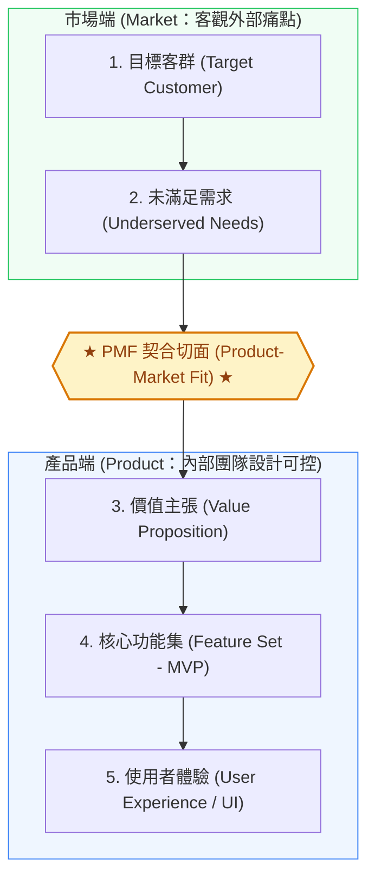
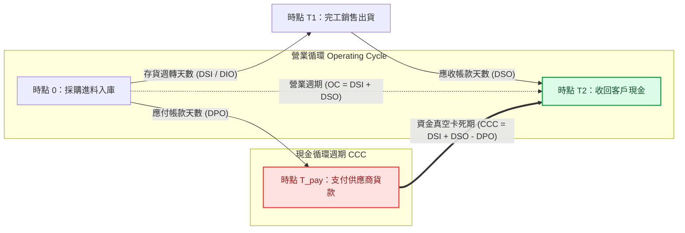

---
{"dg-publish":true,"permalink":"/04/10/02/module-2/m2-1/","tags":["PMBA","精實創業","產品與服務創新","MVP","假說驗證","PMF","白板推導","營運資金","NWC","CCC","ROIC"],"dg-note-properties":{"類別":"課程筆記","課程名稱":"[[創業與企業財務策略]]","模組編號":"Module 2","模組名稱":"產品創新與精實驗證","章節編號":"M2-1","主題":"精實產品開發與服務創新驗證 (Lean Product Development & Service Innovation)","對應週次":"Week 5 (2026-10-06)","狀態":"🟢 已完成","tags":["PMBA","精實創業","產品與服務創新","MVP","假說驗證","PMF","白板推導","營運資金","NWC","CCC","ROIC"]}}
---


# 🚀 M2-1 精實產品開發與服務創新驗證：從假說迴圈到營運資本閉環

> [!abstract] 導讀與對接
> 本筆記為《創業與企業財務策略》第五週（Class 5，2026-10-06）核心模組旗艦筆記。本篇系統化解構新創企業如何將商業模式轉化為可測試的「假說體系」，透過最小可行產品（MVP）敏捷閉環驗證產品市場契合度（PMF），並深入探討課堂白板核心推導——投入資本結構、淨營運資本（NWC）與現金循環週期（CCC）對新創存亡的關鍵傳導機制，最終對接 ROIC 競爭矩陣以確立企業之結構性獲利定位。
> - **上級地圖**：[[04_主題選修/10_創業與企業財務策略/00_課程導航與進度/mindmap_創業與企業財務策略_心智圖導航\|全課程心智圖導航]]
> - **進度看板**：[[04_主題選修/10_創業與企業財務策略/00_課程導航與進度/progress_📊 課程與筆記進度追蹤\|📊 課程與筆記進度追蹤看板]]
> - **前序模組**：[[04_主題選修/10_創業與企業財務策略/02_模組筆記/Module_1_創新思維與商業模式/M1-9_商業模式畫布架構與價值主張設計\|M1-9 商業模式畫布架構與價值主張設計]] ｜ [[04_主題選修/10_創業與企業財務策略/02_模組筆記/Module_1_創新思維與商業模式/M1-10_七大市場力量與商業戰略價值公式\|M1-10 七大市場力量與商業戰略價值公式]]
> - **後續模組**：[[04_主題選修/10_創業與企業財務策略/02_模組筆記/Module_2_產品創新與精實驗證/M2-2_產品組合策略與品牌權益管理\|M2-2 產品組合策略與品牌權益管理]]
> - **核心概念庫**：[[98_商業概念庫/PMF_產品市場契合度 Product-Market Fit\|PMF 產品市場契合度]] ｜ [[98_商業概念庫/NWC_淨營運資本 Net Working Capital\|NWC 淨營運資本]] ｜ [[98_商業概念庫/CCC_現金循環週期 Cash Conversion Cycle\|CCC 現金循環週期]] ｜ [[98_商業概念庫/ROIC_投入資本報酬率 Return on Invested Capital\|ROIC 投入資本報酬率]]

---

## 🏛️ 一、 核心理論本質：傳統研發流程 vs. 精實假說驗證

### 1.1 傳統瀑布式研發 vs. 精實假設驗證之範式轉移
哈佛商學院研究統計指出，高達 **75% 的新創公司最終走向清算失敗**。深入剖析其底層死因，往往非團隊技術不足或資金匱乏，而是創業者深陷成熟大型企業的「瀑布式研發（Waterfall Model）」思維：耗費數月閉門撰寫數十頁商業計畫書（BP）、投入大量固定資產（CapEx）建立量產產線，最終推出市場才驚覺「產品完美無瑕，但市場根本無人買單」。

精實產品開發（Lean Product Development）徹底顛覆此一線性邏輯，確立「假設驅動（Hypothesis-Driven）」的核心範式：承認在創新初期，商業模式畫布（BMC）上的每一個板塊都只是創辦人未經證實的主觀「假說（Hypotheses）」。企業的唯一任務，是以最低成本、最快速度打造最小可行產品（MVP），推向真實市場進行「驗證式學習（Validated Learning）」。

| 比較維度 | 傳統瀑布式研發 (Waterfall Method) | 精實假說驗證 (Lean Hypothesis Method) |
| :--- | :--- | :--- |
| **底層哲學** | 預設需求已知，著重「執行既定規格與時程」 | 承認需求未知，著重「探索痛點與假說檢驗」 |
| **研發路徑** | 線性階段推進：調研 ➔ 規格 ➔ 研發 ➔ 測試 ➔ 量產 | 敏捷閉環迭代：構想 ➔ 假說 ➔ MVP ➔ 測量 ➔ 學習 |
| **顧客參與時機** | 產品開發完成上市後，才首次接觸真實顧客 | 開發第一天即走出辦公室，顧客深度參與驗證 |
| **資本投入特徵** | 前期沉沒成本高昂，固定資產（PPE）與存貨積壓重 | 輕資產低成本試錯，以營運指標（Runway）保護現金 |
| **失敗成本與應對** | 失敗即面臨破產清算或巨額資產減損（Write-down） | 快速低成本失敗 (Fail Cheap)，以軸轉 (Pivot) 重整旗鼓 |
| **代表性案例** | 奇異 (GE Durathon) 電池斥資上億工廠終成閒置 | 藍河科技 (Blue River) 十週農田訪談催生智慧除草機 |

---

### 1.2 ASCII 假說驗證循環鏈 (Hypothesis Testing Loop)

精實產品開發的核心引擎為永不停歇的敏捷驗證迴圈。創業者必須將主觀信念拆解為「價值假說」與「成長假說」，透過嚴謹實驗獲取定量與定性數據：

```text
【1. 假說形成 (Hypothesis Formulation)】
  - 價值假說：目標客群是否面臨非解決不可的真實劇痛？
  - 成長假說：顧客是否會自發性留存、付費並向外口碑推薦？
       │
       ▼ (定義關鍵可衡量指標與反證條件)
【2. 實驗設計與打造 (Build - MVP Design)】
  - 最小化開發週期，排除非核心功能，打造 MVP 測試載體
       │
       ▼ (推向早期採用者 Early Adopters)
【3. 實證測量 (Measure - Data Collection)】
  - 蒐集真實行為數據：轉換率、留存率、Sean Ellis 分數、單位經濟
       │
       ▼ (去偽存真，提煉認知)
【4. 驗證式學習與決策 (Learn - Pivot or Persevere)】
  - 假說被推翻 ➔ 啟動軸轉 (Pivot：顧客區隔/價值主張/通路/架構)
  - 假說獲支持 ➔ 堅持深化 (Persevere) 並進入下一輪功能迭代
```

---

## ⚡ 二、 MVP（最簡可行產品）矩陣與實踐類型解構

### 2.1 MVP 的本質定義與常見迷思破除
最小可行產品（Minimum Viable Product, MVP）絕非「偷工減料的瑕疵品」，亦非「缺乏核心技術的半成品」。Eric Ries 將其定義為：**「能夠讓團隊以『最小投入的資源與精力』，完成一次完整『建構-衡量-學習』循環的產品版本。」**

> **教授課堂警示**：  
> 「許多創業者誤把 MVP 當成『做出一輛只有一個輪子的腳踏車』。顧客要的是從 A 點移動到 B 點的**移動價值**！你的 MVP 應該是滑板車（具備完整移動體驗），接著演進為腳踏車、摩托車，最後才是汽車；而不是造出一個無法騎乘的單獨車輪！」

```text
【錯誤的 MVP 認知：局部零件堆疊（無法提供任何核心價值）】
  階段 1: [車輪]  ➔  階段 2: [底盤+輪胎]  ➔  階段 3: [車殼結構]  ➔  階段 4: [完整汽車]
  (顧客在階段 1~3 完全無法使用，體驗為零，承擔巨大沉沒成本)

【正確的精實 MVP 迭代：持續提供端到端的核心解決方案】
  階段 1: [滑板車] ➔ 階段 2: [腳踏車] ➔ 階段 3: [摩托車] ➔ 階段 4: [高效轎車]
  (每一階段皆能解決移動痛點，並從真實騎乘反饋中決定下一代功能)
```

---

### 2.2 四大經典 MVP 實踐類型與防禦策略

| MVP 實踐類型 | 運作機制與核心特徵 | 適用場景 | 經典商業實證 | 經理人防禦與風險控管 |
| :--- | :--- | :--- | :--- | :--- |
| **1. 綠野仙蹤型<br>(Wizard of Oz MVP)** | 前端看似全自動 AI/演算法運作，後端實由人工手動執行各項服務。 | 演算法開發成本極高、或業務流程極為繁複之專案。 | **Zappos**（創辦人親赴實體鞋店拍照上傳，接單後親自採購寄出）。 | 嚴控人工承載上限，避免因訂單爆發導致交付延遲與信譽崩塌。 |
| **2. 禮賓型<br>(Concierge MVP)** | 明確告知顧客服務由真人一對一深度客製提供，近距離觀察用戶痛點。 | 高單價 B2B 顧問服務、財富管理或高端消費品規劃。 | **Food on the Table**（創辦人親自為家庭規劃菜單並陪同採購）。 | 獲取深度質化洞察（Qualitative Insights），但須預先規劃規模化標準作業程序（SOP）。 |
| **3. 冒煙測試 / 登陸頁<br>(Smoke Test / Landing Page)** | 產品尚未開發，僅架設著陸頁展示價值主張，透過按鈕點擊測量真實購買意圖。 | 評估大眾市場潛在付費意願與行銷訴求轉換率。 | **Buffer**（以雙頁定價方案網站測試社群排程軟體的預購付費率）。 | 誠實告知預購狀態，不可欺騙扣款；提供早鳥折扣補償等待體驗。 |
| **4. 拼裝分件型<br>(Piecemeal MVP)** | 不自研任何底層代碼，完全整合市面上現成 SaaS 工具（如 Notion+Typeform+Stripe）。 | 平台型新創或數位媒合服務的 0 到 1 階段。 | **Groupon**（創辦人最初使用 WordPress 部落格手動發送團購 PDF 優惠券）。 | 技術壁壘接近於零，驗證需求存在後必須迅速自建專屬技術以防模仿。 |

---

## 📈 三、 課堂白板推導專題一：PMF 科學量化檢驗與動態節奏

### 3.1 PMF 的本質定義與動態平衡
在 Class 5 課堂上，教授深入剖析矽谷創投巨擘 Marc Andreessen 的經典定義：**Product-Market Fit（PMF，產品市場契合度）是指新創企業身處在一個具備充沛成長動能的良好市場中，且其所提供的產品能完全且恰當地滿足該市場的真實需求。**

> **教授課堂金句**：  
> 「**最佳的產品設計師不只是公司內部的工程師，更是你的顧客！** 創業最難的不是看見利潤在哪裡，而是不知道成功機率有多高。但許多新創死於太早把所有技術一次倒出——**PMF 講求的是『正好滿足（Fit Perfectly）』的戰略節奏！**」

#### 戰略節奏管理：NVIDIA（輝達）的產品世代推出哲學
教授以輝達的 GPU 算力架構為例：NVIDIA 擁有超越當前世代數年的前沿架構（從 Blackwell 到 Rubin、Rubin Ultra 到 2028 年新系統），但在商業化落地時，黃仁勳嚴格控制產品釋放步調：
* **若 $P \gg M$（產品技術遠超市場生態）**：過早推出將面臨下游客戶基礎設施未成熟（散熱、供電、光通訊未到位）、生產成本過高而叫好不叫座，甚至過早暴露架構讓競爭對手模仿反制；
* **精準 PMF 節奏**：配合雲端服務巨頭（CSP）資本支出進程、台積電先進封裝（CoWoS）產能及資料中心綠能承載力，每年推出「正好滿足並微幅領先」市場需求的產品，既鎖定定價特權，又極大化商業毛利率。

---

### 3.2 Dan Olsen PMF 金字塔模型（The Lean Product Pyramid）
課堂引入 Dan Olsen 提出的 PMF 金字塔結構，強調 PMF 是一套由下而上、層層對齊的五層結構：



| 金字塔層級 | 核心定義與任務 | 歸屬維度 |
| :--- | :--- | :---: |
| **5. 使用者體驗 (UX / UI)** | 顧客直接感知與操作之互動介面與美學體驗 | 產品端 (Product) |
| **4. 核心功能集 (Feature Set)** | 實現價值主張所必需之最小核心功能組合 (MVP) | 產品端 (Product) |
| **3. 價值主張 (Value Proposition)** | 具體承諾如何解決目標客群劇痛並超越競爭競品 | 產品端 (Product) |
| **【PMF 契合切面】** | **產品功能價值與市場痛點產生無縫扣合** | **適配點 (Fit)** |
| **2. 未滿足需求 (Underserved Needs)** | 目標客群尚未被妥善解決的真實劇痛、癢點與渴望 | 市場端 (Market) |
| **1. 目標客群 (Target Customer)** | 具體 STP 市場區隔與深刻之使用者畫像 (Persona) | 市場端 (Market) |

- **底層（市場端 Market，層級 1~2）**：客觀存在於外部市場，不以創業者的主觀意志為轉移；
- **頂層（產品端 Product，層級 3~5）**：新創團隊內部可控制、設計與快速調整的要素；
- **PMF 的發生點**：當頂層的產品價值與功能集，與底層的市場痛點產生「無縫扣合」時，PMF 正式宣告達成。

---

### 3.3 PMF 三大科學量化檢驗標準

#### (1) Sean Ellis 40% 檢驗指標 (The 40% Rule)
由成長駭客之父 Sean Ellis 提出，透過針對既有活躍使用者的關鍵提問進行量化測量：
$$\text{Sean Ellis 指標} = \frac{\text{回答「若無法再使用此產品，我會『非常失望 (Very Disappointed)』」的受訪人數}}{\text{有效受訪使用者總數}} \ge 40\%$$

| 比例區間 | PMF 狀態判定 | 經理人戰略決策方針 |
| :---: | :--- | :--- |
| **$< 40\%$** | **尚未達成 PMF (Pre-PMF)** | **嚴禁大規模投放行銷預算**！應持續優化核心功能、進行顧客深度質化訪談，或啟動產品軸轉 (Pivot)。過早推廣只會加速燒錢陣亡。 |
| **$\ge 40\%$** | **成功跨越 PMF (Post-PMF)** | **綠燈啟動規模化 (Scale)**！產品展現出強烈的自發牽引力，應大舉注資於通路佈建、團隊擴編與獲客加速。 |

#### (2) Cohort 留存曲線平坦化 (Retention Curve Flattening)
觀察同梯次用戶（Cohort）在第 1 天、第 7 天、第 30 天、第 90 天的持續使用率。若留存率隨時間流逝不斷向下跌落至 0，代表產品是個漏水水桶；若曲線在歷經初期自然滑落後，能在某一水平位置**「趨於水平平坦（Flattened Long Tail）」**，即為 PMF 的最有力鐵證！

#### (3) 單位經濟學黃金律與回本週期 (Unit Economics & Payback)
$$\frac{\text{LTV (顧客終身價值)}}{\text{CAC (獲客成本)}} \ge 3 \qquad \text{且} \qquad \text{CAC Payback Period (獲客成本回本期)} \le 12 \text{ 個月}$$

---

## 🧭 四、 課堂白板推導專題二：投入資本構成、NWC 營運資金與 CCC 現金循環週期

在下半堂課堂現場，教授在白板上親自推導了評估企業產品策略與營運模式的財務底層架構：

### 4.1 投入資本（Invested Capital）之三大構成要素
企業投入新產品開發或開拓第二成長曲線時，總投入資本主要來自三大支柱：

$$\text{投入資本 (Invested Capital)} = \text{固定資本 (PPE)} + \text{淨營運資本 (NWC)} + \text{無形資產 (Intangible Assets)}$$

1. **固定資產 / 固定資本（PPE）**：不動產、廠房、先進製程設備與測試機台（不可逆的重資本支出）；
2. **淨營運資本（Net Working Capital, NWC）**：維持企業日常產銷運營所必需墊付之短期流動資金；
3. **無形資產（Intangibles）**：技術專利權、營業秘密、軟體著作權、商標價值與資料資產。

---

### 4.2 淨營運資本 (NWC) 與現金循環週期 (CCC) 之數理傳導
教授特別告誡全班 PMBA 學員：「**新創初期燒錢最兇殘的黑洞，就在於淨營運資本（NWC）與現金循環週期（CCC）的失控！**」

$$\text{淨營運資本 (NWC)} = \text{應收帳款 (AR)} + \text{存貨 (Inventory)} - \text{應付帳款 (AP)}$$
$$\text{現金循環週期 (CCC)} = \text{存貨週轉天數 (DSI)} + \text{應收帳款天數 (DSO)} - \text{應付帳款天數 (DPO)}$$



```text
  【採購原物料入庫】             【產品完工銷售出貨】            【客戶收到發票並付款】
         o                              o                              o
         |------ 存貨週轉天數 (DSI) ----|                              |
         |                              |------ 應收帳款天數 (DSO) ----|
         |                              |                              |
         |-- 應付帳款天數 (DPO) --|     |                              |
         |                        |     |                              |
  【採購進料】             【支付供應商】|                              |
         o                        o     |                              |
                                  |==== 現金循環週期 (CCC = DSI + DSO - DPO) ====|
                                   (資金真空卡死期：需自備營運資金 NWC 墊款)
```

#### 產業商業模式之兩大極端形態：
1. **先付後收型（CCC > 0，製造業與 EMS 代工常態）**：  
   例如存貨天數 20 天，應收帳款天數 40 天，應付帳款天數 30 天：
   $$\text{CCC} = 20 + 40 - 30 = +30 \text{ 天}$$
   企業有整整 30 天處於「現金流出支付供應商，但客戶貨款尚未入帳」的真空期，台語俗稱**「中椗了」**。若無充沛的 NWC 營運週轉金，極易引發「損益表有獲利、手中無現金可支付貨款與薪資」的**黑字倒閉（Profitable Insolvency）**！
2. **先收後付型（CCC < 0，零售通路與超商巨頭特徵）**：  
   以**統一超（7-Eleven）**為代表：終端消費者在門市消費皆以現金或電子支付「即時入帳」（DSO $\approx 0$），而門市存貨快速週轉，對供應商貨款則長達 30~60 天付款期（DPO 大）。其 CCC 呈現**顯著負值（約 -30 天）**！意味著統一超帳上常年沉澱著供應商的巨額無息營運資金（Float），在銀行持續賺取利息或轉投資展店，形成極強財務槓桿。

---

## 📊 五、 課堂白板推導專題三：ROIC 競爭矩陣與結構性獲利能力定位

教授依據 2025 年最新財報數據，將指標性企業定位於二維矩陣中，揭示不同產品戰略下的財務結構特徵：
* **縱軸**：投入資本報酬率（ROIC）或營業利益率（彰顯**「差異化能力與定價特權」**）
* **橫軸**：資產週轉率（Sales / Total Assets，彰顯**「低成本營運與規模效率」**）

| 競爭象限 | 財務特徵 | 代表性標桿企業 | 核心競爭策略與產品特質 |
| :--- | :--- | :--- | :--- |
| **高 ROIC ✕ 低中週轉<br>(極致差異化象限)** | 高營業毛利、強定價權、重研發或強品牌，不靠薄利多銷。 | **台積電**、**大立光**、**聯發科**、**晶華酒店**、**奇鋐** | 具備壟斷性技術或頂級品牌，能將高研發投入轉化為超額營業利益率（NOPAT）。 |
| **中 ROIC ✕ 極高週轉<br>(低成本規模營運象限)** | 營業毛利率微薄，但資產週轉如飛，靠規模經濟與極致供應鏈效率勝出。 | **鴻海 (Foxconn)**、**廣達 (Quanta)**、**統一超**、**台塑化** | 透過高存貨週轉與供應鏈排程將資產利用率推向極致，一塊錢資產創造數倍營收。 |
| **中間平衡型象限** | 兼具區域品牌知名度與穩定通路營運，利潤與週轉率維持穩健。 | **中華電信**、**葡萄王** | 防禦型公用事業或成熟保健品牌，現金流充沛，提供穩定股利配發。 |

> **經理人創業定位策略啟發**：  
> 創業者必須把自己所屬產業的上中下游所有廠商，統統投射進這張「ROIC vs. 資產週轉率」方框中。觀察各家廠商落在哪一個象限，就能精準預判自身創業項目的**「結構性獲利能力天花板」**，從而客觀設定產品毛利率、定價門檻與營運資本預算。

---

## 🧭 六、 破壞式創新與服務創新維度

### 6.1 Clayton Christensen 破壞式創新戰略姿態對比
哈佛商學院克里斯汀生（Clayton Christensen）教授提出經典的「破壞式創新（Disruptive Innovation）」理論，精準解釋為何資源雄厚的大型在位者往往被看似弱小的新創企業擊敗：

| 創新維度 | 持續性創新 (Sustaining Innovation) | 破壞式創新 (Disruptive Innovation) |
| :--- | :--- | :--- |
| **目標市場** | 現有主流市場中要求最高、利潤最豐厚的高階顧客。 | 原先被過度服務的低階利基客群，或完全未消費的非主流市場。 |
| **產品特性** | 沿著既有性能軌跡持續升級，追求更高規格、更強性能。 | 初期性能通常低於主流標準，但具備**便宜、簡潔、便利、體積小**等新屬性。 |
| **新創者姿態** | **切忌正面衝突**！在位者握有充沛資本與研發資源，正面迎戰必敗。 | **尋找巨頭盲區進攻**！以低成本解決邊緣客群痛點，建立初步根據地。 |
| **在位者反應** | 全力防禦、動員資源跟進，展開激烈的技術軍備競賽。 | 輕視忽視、主動放棄低毛利低階市場，往更高階利潤市場退縮。 |
| **終局演進路徑** | 產品性能過剩（Overshoot），超越多數一般消費者的實際需求。 | 透過敏捷迭代快速提升性能，最終由下而上顛覆主流市場，吞噬在位巨頭。 |
| **經典商業實證** | 傳統機械硬碟不斷提升磁錄密度、旗艦智慧型手機微幅升級鏡頭規格。 | **PC 顛覆大型主機**、**數位相機顛覆柯達膠卷**、**ARM 晶片顛覆 x86 移動端**。 |

---

### 6.2 服務四大特性與 7Ps 服務行銷組合
在現代商業中，單純的硬體產品已不足以維繫護城河，企業紛紛走向「產品＋服務化（Product + Service = Servitization）」：

#### (1) 服務四大本質特性與營運挑戰
1. **不可觸知性（Intangibility）**：服務在購買前無法被看見或觸摸，顧客評估風險高。➔ **因應策略**：建立實體佐證（Physical Evidence），如專業認證標章、精緻門市裝潢與具象化案例。
2. **不可分割性（Inseparability）**：服務的生產與消費同時發生，服務人員直接代表品牌。➔ **因應策略**：落實標準化作業程序（SOP），加強內部員工培訓與授權。
3. **易變性 / 異質性（Variability）**：服務品質取決於提供者之情緒、技巧與當下情境，一致性難以掌控。➔ **因應策略**：導入自動化數位系統，建立雙向顧客評價機制。
4. **易逝性（Perishability）**：服務產能無法預先儲存（如飯店空房、飛機空位一旦過期價值即歸零）。➔ **因應策略**：採用動態差別定價（如 FunNow 即時預訂、離峰時段折扣）調節供需平衡。

#### (2) 服務行銷 7Ps 組合擴展
傳統 4Ps（Product, Price, Place, Promotion）已無法涵蓋現代高互動服務體驗，必須延伸納入關鍵 3P：
* **人員 (People)**：直接接觸顧客的第一線服務同仁，其專業度與同理心決定品牌溫度；
* **流程 (Process)**：顧客從接觸、體驗、結帳到售後的所有標準化交互流程；
* **實體佐證 (Physical Evidence)**：門市環境、設備陳列、數位介面 UI/UX 及專業憑證等視覺實體化線索。

---

## 📚 七、 案例深度對標與雙向鏈結網絡

### 7.1 課堂逐字稿實證案例深度評析
1. **NVIDIA（輝達）**：PMF 推出節奏與生態系協同管理（不盲目超前推出極致規格，配合 CSP 資本支出每年推進）。
2. **統一超商（7-Eleven）**：負 CCC 現金流戰略與產品組合深度延展（運用免息浮存金持續展店與生態系整合）。
3. **台積電 vs. 鴻海**：產品創新路徑之財務結構分化（技術專利高淨利 vs. 供應鏈極致週轉）。
4. **美光（Micron）與 SK 海力士**：HBM 漲價溢價與資本市場股權貨幣化（赴美掛牌 ADR 克服折價，儲備併購籌碼）。

### 7.2 跨模組雙向鏈結網絡
- **前序模組**：[[04_主題選修/10_創業與企業財務策略/02_模組筆記/Module_1_創新思維與商業模式/M1-9_商業模式畫布架構與價值主張設計\|M1-9 商業模式畫布]] ｜ [[04_主題選修/10_創業與企業財務策略/02_模組筆記/Module_1_創新思維與商業模式/M1-10_七大市場力量與商業戰略價值公式\|M1-10 七大市場力量]] ｜ [[04_主題選修/10_創業與企業財務策略/02_模組筆記/Module_1_創新思維與商業模式/M1-2_白板決策鏈與財務價值三角\|M1-2 財務價值三角]]
- **後續模組**：[[04_主題選修/10_創業與企業財務策略/02_模組筆記/Module_2_產品創新與精實驗證/M2-2_產品組合策略與品牌權益管理\|M2-2 產品組合策略與品牌權益管理]]
- **概念庫對接**：[[98_商業概念庫/PMF_產品市場契合度 Product-Market Fit\|PMF 產品市場契合度]] ｜ [[98_商業概念庫/NWC_淨營運資本 Net Working Capital\|NWC 淨營運資本]] ｜ [[98_商業概念庫/CCC_現金循環週期 Cash Conversion Cycle\|CCC 現金循環週期]] ｜ [[98_商業概念庫/ROIC_投入資本報酬率 Return on Invested Capital\|ROIC 投入資本報酬率]]
- **個案與時事庫**：[[04_主題選修/10_創業與企業財務策略/01_創投總經與個案/cases_新創與企業融資案例庫#台積電vs鴻海\|台積電 vs. 鴻海]] ｜ [[04_主題選修/10_創業與企業財務策略/01_創投總經與個案/cases_新創與企業融資案例庫#統一超商\|統一超商]] ｜ [[04_主題選修/10_創業與企業財務策略/01_創投總經與個案/macro_資本市場與創投總經時事#2026-10-06\|2026-10-06 總經時事]]