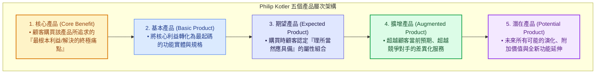
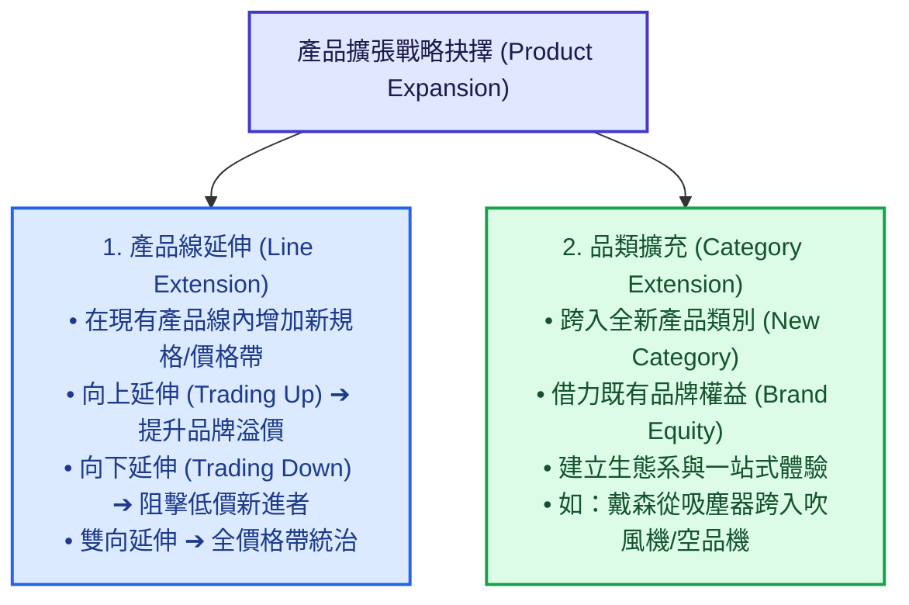
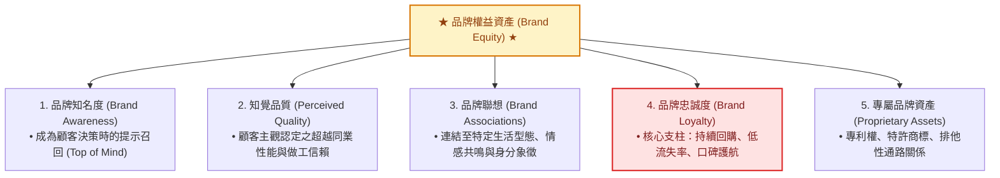

---
{"dg-publish":true,"permalink":"/04/10/02/module-2/m2-2/","tags":["PMBA","產品與服務創新","產品組合","品牌權益","Product-Mix","Brand-Equity","Kotler","PLC","NPD","David-Aaker","白板推導"],"dg-note-properties":{"類別":"課程筆記","課程名稱":"[[創業與企業財務策略]]","模組編號":"Module 2","模組名稱":"產品創新與精實驗證","章節編號":"M2-2","主題":"產品組合策略與品牌權益管理 (Product Mix Strategy & Brand Equity Management)","對應週次":"Week 5 (2026-10-06)","狀態":"🟢 已完成","tags":["PMBA","產品與服務創新","產品組合","品牌權益","Product-Mix","Brand-Equity","Kotler","PLC","NPD","David-Aaker","白板推導"]}}
---


# 📦 M2-2 產品組合策略與品牌權益管理：從價值層次到品牌護城河

> [!abstract] 導讀與對接
> 本筆記為《創業與企業財務策略》第五週（Class 5，2026-10-06）核心模組重點筆記。承接 [[04_主題選修/10_創業與企業財務策略/02_模組筆記/Module_2_產品創新與精實驗證/M2-1_精實產品開發與服務創新驗證\|M2-1]] 之精實驗證與營運資本閉環，本篇聚焦於如何將驗證成功之單一產品擴展為體系化之「產品組合（Product Mix）」與「品牌權益（Brand Equity）」。筆記深入解構 Philip Kotler 五個產品層次模型、消費品與工業品決策心理、課堂白板推導之產品組合寬長深與品類擴充戰略、David Aaker 品牌權益五維架構、產品生命週期（PLC）戰術矩陣及新產品開發（NPD）上市時機抉擇。
> - **上級地圖**：[[04_主題選修/10_創業與企業財務策略/00_課程導航與進度/mindmap_創業與企業財務策略_心智圖導航\|全課程心智圖導航]]
> - **進度看板**：[[04_主題選修/10_創業與企業財務策略/00_課程導航與進度/progress_📊 課程與筆記進度追蹤\|📊 課程與筆記進度追蹤看板]]
> - **前序模組**：[[04_主題選修/10_創業與企業財務策略/02_模組筆記/Module_2_產品創新與精實驗證/M2-1_精實產品開發與服務創新驗證\|M2-1 精實產品開發與服務創新驗證]] ｜ [[04_主題選修/10_創業與企業財務策略/02_模組筆記/Module_1_創新思維與商業模式/M1-9_商業模式畫布架構與價值主張設計\|M1-9 商業模式畫布架構與價值主張設計]]
> - **核心概念庫**：[[98_商業概念庫/Kotler_五個產品層次模型 Five Product Levels\|Kotler 五個產品層次模型]] ｜ [[98_商業概念庫/Product_Mix_產品組合管理 Product Mix\|Product Mix 產品組合管理]] ｜ [[98_商業概念庫/Brand_Equity_品牌權益 David Aaker 模型\|Brand Equity 品牌權益]] ｜ [[98_商業概念庫/PMF_產品市場契合度 Product-Market Fit\|PMF 產品市場契合度]]

---

## 🏛️ 一、 產品本質與 Philip Kotler 五個產品層次模型

### 1.1 Kotler 產品權威定義
現代行銷學之父菲利普·科特勒（Philip Kotler）將產品定義為：**「任何可以提供給市場以引起注意、取得、使用或消費，並滿足某種慾望或需求的實體、服務、理念或體驗。」**

在創業管理中，產品是行銷組合 4P（Product, Price, Place, Promotion）的唯一起始點。若無具備核心價值之產品，其餘價格談判、通路鋪設與推廣促銷皆成無源之水。

---

### 1.2 超越功能：剖析產品五個價值層次 (The Five Product Levels)

科特勒提出經典的「五層同心圓產品模型」，揭示優秀企業如何由內而外為產品注入超額價值與定價溢價：



| 產品層次 | 概念核心定義 | 課堂經典案例拆解 (化妝品 / 洗衣機 / 工業晶片) | 經理人產品創新設計策略 |
| :--- | :--- | :--- | :--- |
| **1. 核心產品<br>(Core Benefit)** | 顧客購買該產品所追求的**最根本利益或想要解決的終極痛點**。 | • 化妝品：追求「美麗、自信與情感認同」，而非化學顏料。<br>• 洗衣機：追求「衣物清潔與省時省力」。<br>• 工業晶片：追求「算力效率與低功耗運算」。 | 緊扣顧客痛點本質，避免將產品外在形式誤當作顧客的核心追求。 |
| **2. 基本產品<br>(Basic Product)** | 將核心利益具體化為最起碼的有形實體結構或功能規格。 | • 洗衣機之旋轉馬達、清洗槽與排水管。<br>• 晶圓封裝由圓形走向面板級（FOPLP）方形載板。 | 滿足產品運作之底線門檻，是進入該產業的必要入場券。 |
| **3. 期望產品<br>(Expected Product)** | 顧客在購買時，習慣上認定「理所當然應具備」的屬性與條件。 | • 洗衣機必須具備低噪音、基本脫水功能與防漏設計。<br>• 飯店客房必須提供乾淨床單、獨立衛浴與 Wi-Fi。 | 若無法達到期望水準將引發極度不滿，但單純滿足此層無法創造差異化。 |
| **4. 擴增產品<br>(Augmented Product)** | 超越顧客預期、能將自身與競爭同業鮮明區隔的額外服務與附加價值。 | • 洗脫烘一體、智慧聯網遠端預約、全機三年免費到府保固。<br>• 蘋果提供 AppleCare+ 意外損壞保障與 Genius Bar 專人支援。 | **創造超額利潤與溢價的核心層次**！教授指出，每往外包裝一層優質體驗，就能向顧客多收取 10%~20% 溢價。 |
| **5. 潛在產品<br>(Potential Product)** | 該產品在未來可能經歷的所有演化、轉型與全新功能延展。 | • 結合 AI 影像辨識衣物材質與髒污程度，自動投放精準洗劑並動態調節水溫；連線智慧家居電網自動在離峰低電價時段運轉。 | 鎖定未來科技趨勢與生活型態變遷，鋪陳企業的第二成長曲線（Second S-Curve）。 |

---

## 🛒 二、 產品譜系與顧客決策心理

### 2.1 消費品四分法：購買涉入度與行銷策略

依據消費者購買行為與涉入程度（Involvement），消費品可精準拆解為四大矩陣：

| 消費品類別 | 消費者決策心理與行為 | 代表性商品 | 通路與行銷策略核心 |
| :--- | :--- | :--- | :--- |
| **1. 便利品<br>(Convenience Goods)** | 頻繁購買、立即決策、極低搜尋與比價精力、對便利性極度敏感。 | 肥皂、飲料、零食、衛生紙、超商鮮食。 | **密集通路（Intensive Distribution）**：隨處可買、貨架佔位、高存貨可用性；強調品牌知名度與即時可得性。 |
| **2. 選購品<br>(Shopping Goods)** | 購買頻率適中，在選購過程中會深入比較品質、價格、功能與風格。 | 家電、服飾、家具、智慧型手機。 | **選擇性通路（Selective Distribution）**：提供充沛之產品資訊、對比展示、銷售人員專業解說與售後服務承諾。 |
| **3. 特殊品<br>(Specialty Goods)** | 具備獨特品牌魅力或專屬特徵，消費者願意付出特殊購買努力與高昂溢價，絕不接受替代品。 | 勞力士手錶、保時捷跑車、愛馬仕柏金包、專業攝影器材。 | **獨家專賣通路（Exclusive Distribution）**：嚴控授權門市、奢華體驗、強調尊榮感與品牌資產保護，嚴禁折價促銷。 |
| **4. 忽略品<br>(Unsought Goods)** | 消費者平時不知曉，或即使知曉也不會主動萌生購買慾望之商品。 | 人身意外壽險、生前契約、百科全書、滅火器。 | **積極人員推銷（Personal Selling）與危機意識喚醒**：強調風險防禦、家庭責任與法規要求。 |

---

### 2.2 工業品三層分類
在 B2B 工業品市場，購買目的係用於進一步製造或維持組織運作，決策具高度理性與集體採購特徵：
1. **資本性產品 (Capital Items)**：廠房、重型機具、先進曝光設備（如 ASML EUV），計入資產負債表固定資產，透過多年折舊分攤成本；
2. **生產性產品 (Materials & Parts)**：原物料、零組件（如台積電晶圓、被動元件 MLCC、PCB 板），直接構成終端產品實體，直接計入銷貨成本（COGS）；
3. **營運性產品 (Supplies & Services)**：潤滑油、辦公耗材、廠房維護與法務會計顧問服務，計入當期營業費用（OPEX）。

---

### 2.3 替代品 vs. 互補品之戰略定價機制
* **互補品（Complementary Goods）**：兩者彼此搭配使用方能釋放完整價值，其**交叉需求彈性為負值**（$E_{xy} < 0$）。
  - **高互補性產品與「刮鬍刀與刀片（Razor-and-Blades）」鎖定模式**：企業以趨近成本之超低價銷售主設備（刮鬍刀架、印表機、遊戲主機 PS5），藉由後續高毛利的專屬耗材/軟體（刀片、墨水匣、獨家遊戲片）創造長期持續性現金流（Lock-in Effect）。
* **替代品（Substitute Goods）**：滿足顧客相同核心功能需求的競品，其**交叉需求彈性為正值**（$E_{xy} > 0$），設定了產業的「價格天花板（Price Ceiling）」。

---

## 📊 三、 課堂白板推導專題：產品組合架構與擴充維度

在 Class 5 白板上，教授特別繪製了企業產品體系架構圖（見白板照片 `LINE_NOTE_261007_2.jpg`），剖析從單一產品跨越至多產品線的戰略邏輯：

```text
                  【企業產品組合整體架構 (Product Mix)】
                  
       ◄──────────────── 產品組合寬度 (Width) ────────────────►
       [產品線 A：手機]      [產品線 B：筆電]      [產品線 C：穿戴裝置]
              │                     │                     │
              ▼                     ▼                     ▼
          iPhone 16             MacBook Air           Apple Watch S10  ▲
              │                     │                     │            │
          iPhone 16 Plus        MacBook Pro 14        Apple Watch Ultra 產品組合
              │                     │                     │            長度
          iPhone 16 Pro         MacBook Pro 16        Apple Watch SE  (Length)
              │                                                        │
          iPhone 16 Pro Max                                            ▼
              │
              ▼
   【深度 (Depth)：容量/顏色/規格】
   (128GB / 256GB / 512GB / 1TB；黑/白/鈦/金)
```

### 3.1 產品組合四大維度（Product Mix Dimensions）
1. **寬度 (Width)**：企業旗下擁有的**不同產品線（Product Lines）數量**。增加寬度有助於分散營運風險，跨入新市場賽道。
2. **長度 (Length)**：企業所有產品線中所包含的**產品項目（Items）總數**。增加長度能更細緻地覆蓋各價格帶與市場區隔。
3. **深度 (Depth)**：單一產品項目所提供的**規格、尺寸、顏色、配方與包裝版本數量**。增加深度能迎合個人化細分偏好。
4. **一致性 (Consistency)**：各產品線在最終用途、生產要求、配銷通路或其他構面上的**關聯密切程度**。一致性高有助於強化規模經濟與品牌認知。

---

### 3.2 白板板書精髓：產品線延伸 vs. 品類擴充



> **白板板書核心洞見**：  
> 企業在擴張時面臨兩條截然不同的路徑：
> * **Line Extension（產品線延伸）**：沿著既有品類上下深耕，主要依賴製造與研發流程的規模經濟；
> * **Category Extension（品類擴充）**：跨入全新需求賽道，主要依賴既有通路綜效與**「品牌權益（Brand Equity）」**的跨界投射！

---

## 💎 四、 品牌權益（Brand Equity）與行銷演進歷程

### 4.1 David Aaker 品牌權益五大支柱模型
品牌大師大衛·艾克（David Aaker）指出，品牌權益是企業最寶貴的無形資產（Intangible Asset），直接決定了產品超越成本結構的「定價特權」：



---

### 4.2 品牌延伸的邊界：光環效應 vs. 品牌稀釋
* **品牌光環效應（Halo Effect）**：強勢品牌能將頂級知覺品質與尊榮聯想，順暢轉移至新品類，大幅降低新產品的市場教育成本與獲客成本（如 Apple 從電腦延伸至手機與耳機）。
* **品牌稀釋風險（Brand Dilution）**：若盲目進行跨界品類擴充，推出品質不相稱或形象衝突之低階產品，將摧毀既有顧客的核心聯想，造成品牌溢價能力瓦解（如奢侈品牌若盲目授權平價生活日用品）。

---

### 4.3 行銷演進與 5A 顧客歷程（Kotler 5.0 / 7.0）
課堂指出，現代行銷已從單向說服演進為社群驅動的生態網絡：
* **理性功能層面**：解決基本痛點與效能訴求（基本產品/期望產品）；
* **感性情感層面**：傳遞生活美學、尊榮身分與社會群體認同（如 **LVMH** 奢侈品帝國）；
* **5A 顧客歷程漏斗**：
  $$\text{認知 (Aware)} \longrightarrow \text{吸引 (Appeal)} \longrightarrow \text{問詢 (Ask)} \longrightarrow \text{行動 (Act)} \longrightarrow \text{擁護 (Advocate)}$$
  終極目標是將普通購買者轉化為誓死捍衛品牌的「鐵桿擁護者（Brand Advocates）」，降低全週期顧客獲取成本（CAC）。

---

## 📈 五、 產品生命週期（PLC）與新產品開發（NPD）戰略

### 5.1 產品生命週期四階段市場特徵與行銷戰術矩陣

```text
  金額 / 銷售量
      ▲
      │                              【成熟期】
      │                             (Maturity)
      │                         . - - - - - - .
      │                      .                   .  【衰退期】
      │                  .                           (Decline)
      │             .                                  .
      │         .  【成長期】                             .
      │       .   (Growth)                                  .
      │     .                                                  ▼ 銷售曲線
      │  . 【導入期】                                            . . . .
      │. (Introduction)─────────────────────────────────────────────► 時間
      │                 利潤曲線 (Profit) . - - .
      │                                .          .
      │ 0 ────────────────────────────.────────────.────────────────
      │  .                         .                .
      ▼   . . . . . . . . . . . . .                  ▼ 利潤由正轉衰
```

| 評估構面 | 導入期 (Introduction) | 成長期 (Growth) | 成熟期 (Maturity) | 衰退期 (Decline) |
| :--- | :--- | :--- | :--- | :--- |
| **銷售量** | 銷售量低，市場增長緩慢 | 銷售量呈現爆發式指數成長 | 銷售量達到頂峰，增速放緩 | 銷售量持續下滑 |
| **生產單位成本** | 極高（缺乏規模經濟） | 快速下降（學習曲線顯現） | 達到全生命週期最低點 | 成本上升（產能利用率暴跌） |
| **利潤結構** | 虧損（巨額研發與行銷投入） | 出現可觀利潤且快速擴大 | 利潤達到頂點後微幅回落 | 利潤大幅萎縮甚至虧損 |
| **目標顧客** | 創新追求者 (Innovators) | 早期採用者 (Early Adopters) | 早期/晚期大眾 (Majority) | 滯後者 (Laggards) |
| **競爭者態勢** | 極少或無直接競爭者 | 競爭同業快速湧入市場 | 競爭對手最多，價格戰白熱化 | 弱勢競爭者陸續退出 |
| **行銷核心目標** | 建立產品知覺，鼓勵目標顧客試用 | 極大化市場佔有率，鞏固通路 | 捍衛既有市占，榨取利潤池 | 收割剩餘價值，縮減支出 |
| **產品策略** | 推出基本型產品 (MVP) | 增加產品形式、功能與保固 | 產品形式最豐富，深度差異化 | 刪減無利可圖的型號品項 |
| **定價策略** | 撇脂定價（高價）或滲透定價 | 隨規模擴大維持穩定或微調 | 面臨激烈價格戰，降至競爭低價 | 降價清倉或維持利基高價 |
| **通路策略** | 選擇性通路，鎖定利基點 | 快速拓展通路成員與經銷網絡 | 最密集通路覆蓋（Intensive） | 刪減不具經濟效益的經銷點 |

---

### 5.2 安索夫成長矩陣 (Ansoff Matrix)

```text
               ┌───────────────────────┬───────────────────────┐
               │    既有產品 (Existing) │     新產品 (New)      │
┌──────────────┼───────────────────────┼───────────────────────┤
│ 既有市場     │  1. 市場滲透 (Market   │  2. 產品開發 (Product │
│ (Existing)   │     Penetration)      │     Development)      │
│              │ • 促銷加量、提升回購  │ • 既有客戶推出新功能  │
├──────────────┼───────────────────────┼───────────────────────┤
│ 新市場       │  3. 市場擴張 (Market   │  4. 多角化 (Diversifi-│
│ (New)        │     Expansion)        │     cation)           │
│              │ • 跨境出海、新客群探索│ • 風險最高之雙重創新  │
└──────────────┴───────────────────────┴───────────────────────┘
```

---

### 5.3 新產品開發（NPD）六階段流程
1. **產品創意生成 (Idea Generation)**：廣納顧客痛點反饋、內部跨部門腦力激盪、技術趨勢洞察；
2. **創意審查篩選 (Idea Screening)**：運用兩階段可行性評估與 VRIO 模型排除不具商機之點子；
3. **商業經營分析 (Business Analysis)**：編製損益預測、預估損益兩平點（BEP）、評估投資回收期；
4. **產品原型開發 (Prototype Development)**：工程試作、小批量打樣，驗證技術可行性與外觀機能；
5. **市場實地測試 (Market Testing)**：在特定區域或封閉社群進行試銷，測量顧客滿意度與真實轉化率；
6. **商品化全面量產 (Commercialization)**：產線全面啟動，配合行銷通路與定價方案正式發布上市。

---

### 5.4 新產品進入市場時機抉擇

| 上市時機策略 | 核心戰略思維 | 核心優勢 (Pros) | 潛在風險與隱患 (Cons) |
| :--- | :--- | :--- | :--- |
| **1. 搶先上市<br>(First Mover)** | 搶先進入市場建立領導地位，鎖定通路與早期忠誠顧客。 | 建立強大品牌認知、鎖定關鍵供應鏈夥伴、享有專利與學習曲線壁壘。 | 承擔龐大市場教育成本；技術過早投入面臨被後發者「跨代顛覆」風險。 |
| **2. 同步上市<br>(Synchronous Mover)** | 與競爭同業在市場成熟前夕同時切入，共同做大市場規模。 | 共享市場教育與宣傳促銷成本；降低單一廠商承擔之市場不確定性。 | 競爭極為劇烈，若缺乏獨特價值主張易陷入同質化殺價競爭。 |
| **3. 延後上市<br>(Follower / Fast Follower)** | 待先行者完成市場教育與需求驗證後，迅速跟進優化並切入。 | 避免先鋒所犯錯誤；精準獲悉市場規模；以更高性價比逆襲奪取市占。 | 先行者已築起高轉換成本與通路排他壁壘，後發者需支付極大獲客代價。 |

---

## 📚 六、 案例對標與跨模組雙向鏈結網絡

### 6.1 課堂逐字稿實證案例對標
1. **統一集團**：事業核心定義在「健康生活」，旗下涵蓋超商零售、食品飲料、星巴克餐飲代理、藥妝生活百貨，展示卓越之產品組合寬度與生活型態品牌延伸。
2. **Apple（蘋果）**：五個產品層次之極致實踐者（從 iPhone 有形手機延伸至 AppleCare+ 保固服務、iCloud 雲端生態系與隱私保護承諾，築起堅實擴增產品溢價）。
3. **LVMH 奢侈品集團**：行銷 7.0 象徵與情感價值之極致體現，透過嚴格限制產量與專賣通路維持神聖品牌權益。

### 6.2 跨模組雙向鏈結網絡
- **前序模組**：[[02_模組筆記/Module_2_產品創新與精實驗證/M2-1_精實產品開發與服務創新驗證|M2-1 精實產品開發與服務創新驗證]] ｜ [[02_模組筆記/Module_1_創新思維與商業模式/M1-5_創業構想發展與兩階段可行性評估|M1-5 創業構想發展]] ｜ [[02_模組筆記/Module_1_創新思維與商業模式/M1-9_商業模式畫布架構與價值主張設計|M1-9 商業模式畫布]]
- **概念庫對接**：[[Kotler_五個產品層次模型 Five Product Levels|Kotler 五個產品層次模型]] ｜ [[Product_Mix_產品組合管理 Product Mix|Product Mix 產品組合管理]] ｜ [[Brand_Equity_品牌權益 David Aaker 模型|Brand Equity 品牌權益]] ｜ [[PMF_產品市場契合度 Product-Market Fit|PMF 產品市場契合度]]
- **進度看板**：[[04_主題選修/10_創業與企業財務策略/00_課程導航與進度/progress_📊 課程與筆記進度追蹤|📊 課程與筆記進度追蹤看板]]