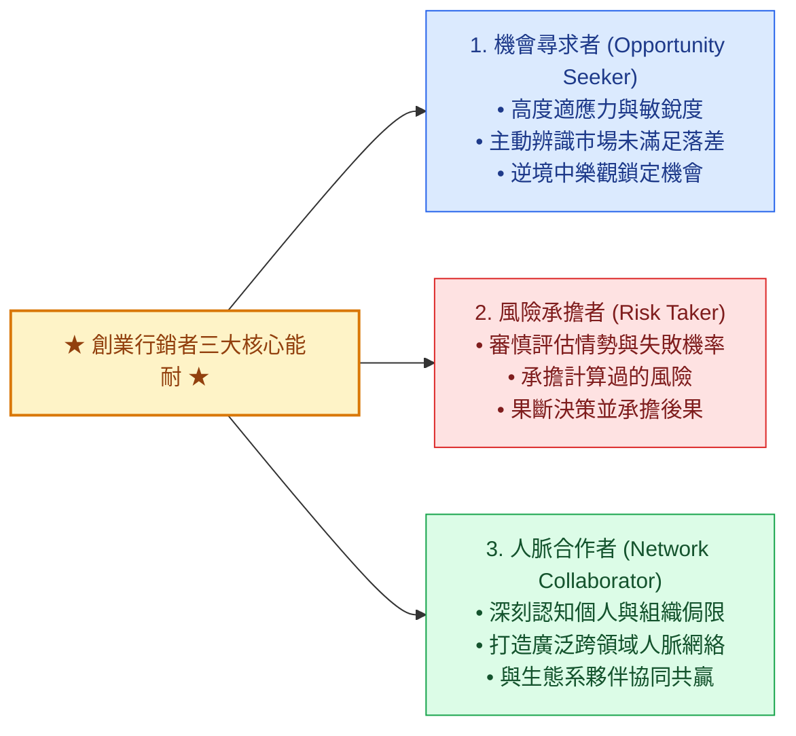
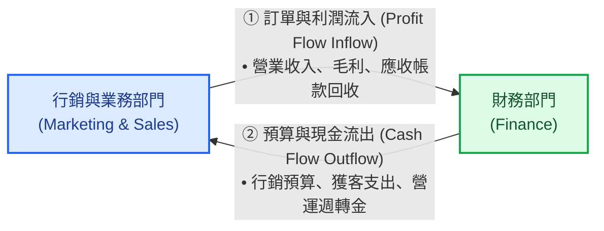

---
{"dg-publish":true,"permalink":"/04/10/02/module-2/m2-3/","tags":["PMBA","創業行銷","全能屋模型","Omnihouse","PDB","CI-EL","PI-PM","創意生產力","行銷與財務閉環","白板推導"],"dg-note-properties":{"類別":"課程筆記","課程名稱":"[[創業與企業財務策略]]","模組編號":"Module 2","模組名稱":"產品創新與精實驗證","章節編號":"M2-3","主題":"創業行銷策略與全能屋模型 (Entrepreneurial Marketing Strategy & Omnihouse Model)","對應週次":"Week 6 (2026-10-13)","狀態":"🟢 已完成","tags":["PMBA","創業行銷","全能屋模型","Omnihouse","PDB","CI-EL","PI-PM","創意生產力","行銷與財務閉環","白板推導"]}}
---


# 🏛️ M2-3 創業行銷策略與全能屋模型：從不確定性突圍到財務價值閉環

> [!abstract] 導讀與對接
> 本筆記為《創業與企業財務策略》第六週（Class 6 / Class 7，2026-10-13）核心模組重點筆記。延續前序產品創新與市場驗證架構，本篇系統化解構現代行銷學之父 Philip Kotler 提出之「全能屋模型（Omnihouse Model）」與「創業行銷（Entrepreneurial Marketing）」理論框架。深入探討在 VUCA 烏卡時代與產品生命週期極速壓縮下，企業如何融合「創業能力（CI-EL）」與「專業能力（PI-PM）」，並以「PDB 競爭力」為核心，建立從外部 5D 動態驅動、4C 場域交互，到「行銷利潤流入 vs. 財務現金流出」的端到端商業閉環。
> - **上級地圖**：[[04_主題選修/10_創業與企業財務策略/00_課程導航與進度/mindmap_創業與企業財務策略_心智圖導航\|全課程心智圖導航]]
> - **進度看板**：[[04_主題選修/10_創業與企業財務策略/00_課程導航與進度/progress_📊 課程與筆記進度追蹤\|📊 課程與筆記進度追蹤看板]]
> - **前序模組**：[[04_主題選修/10_創業與企業財務策略/02_模組筆記/Module_2_產品創新與精實驗證/M2-1_精實產品開發與服務創新驗證\|M2-1 精實產品開發與服務創新驗證]] ｜ [[04_主題選修/10_創業與企業財務策略/02_模組筆記/Module_2_產品創新與精實驗證/M2-2_產品組合策略與品牌權益管理\|M2-2 產品組合策略與品牌權益管理]] ｜ [[04_主題選修/10_創業與企業財務策略/02_模組筆記/Module_1_創新思維與商業模式/M1-2_白板決策鏈與財務價值三角\|M1-2 白板決策鏈與財務價值三角]]
> - **核心概念庫**：[[98_商業概念庫/Omnihouse_全能屋模型 Omnihouse Model\|Omnihouse 全能屋模型]] ｜ [[98_商業概念庫/Entrepreneurial_Marketing_創業行銷\|創業行銷]] ｜ [[98_商業概念庫/Marketing_Creativity_行銷創意生產力\|行銷創意生產力]] ｜ [[98_商業概念庫/PMF_產品市場契合度 Product-Market Fit\|PMF 產品市場契合度]]

---

## 🏛️ 一、 核心理論本質：傳統專業行銷 vs. 創業行銷之範式轉移

### 1.1 傳統專業行銷 (Professional Marketing) 的盲點與侷限
在商管必修課程中，傳統行銷管理著重於**「行銷策略 ➔ 行銷戰術 (4P) ➔ 行銷回饋」**的系統化運作。此架構的前提是企業身處**「相對穩定、不確定性較低、風險可預測」**的成熟商業環境中：
* **核心特徵**：依循標準作業程序（SOP）、細緻的市場區隔（Segmentation）、目標界定（Targeting）與產品定位（Positioning）等流程。
* **管理優勢**：流程紀律嚴謹、跨部門協調順暢、資源分配精準可控、營運風險低。
* **致命盲點**：面臨市場突變時改革步調緩慢、組織惰性滋生、資源重置僵化，凡事被動反應而非主動出擊，難以應對非連續性創新。

---

### 1.2 創業行銷 (Entrepreneurial Marketing) 的本質定義
在創業 0 到 1 階段或成熟企業開拓「第二成長曲線（Second S-Curve）」時，外部市場充滿高度不確定性與資源匱乏。Philip Kotler 指出：**創業行銷是指企業在高度不確定的動態環境中，結合機會敏銳度、風險承擔膽識與跨界資源整合，以非傳統、高彈性的戰術創造新市場價值的行銷範式。**

| 比較維度 | 專業行銷 (Professional Marketing) | 創業行銷 (Entrepreneurial Marketing) |
| :--- | :--- | :--- |
| **適用環境** | 相對成熟、穩定、低不確定性之市場 | 極度動態、高不確定性、資源受限之新興市場 |
| **思維導向** | 流程與制度規範導向（SOP 紀律） | 機會辨識與敏捷決策導向（探索突破） |
| **風險姿態** | 風險趨避，追求可預測的漸進式改善 | 願意承擔**「計算過的風險 (Calculated Risk)」** |
| **資源配置** | 預算制、結構僵固、依既有計畫執行 | 資源調度高度彈性，快速重新配置（Bootstrapping） |
| **競爭策略** | 守成既有市場，透過同質優化搶奪市占 | 透過非對稱創新開闢新賽道，創造全新需求 |

---

### 1.3 創業行銷者三大核心能耐



> **教授課堂金句**：  
> 「創業精神不是只有創業者才需要！你看全世界市值最高公司的領導者（黃仁勳），他每一季、每幾個月都在根據市場挑戰提出全新架構。**即便是一家 30 年的成熟巨頭，處在當前環境中，依然必須維持戰戰兢兢的創業家精神！**」

---

## 🌪️ 二、 總體環境變局：VUCA 烏卡時代與產品生命週期壓縮

### 2.1 VUCA 四大維度解構
現代商業環境已全面進入 **VUCA 時代**：
1. **波動性 (Volatility)**：科技變革與地緣政治使市場波動頻率與幅度遠超以往；
2. **不確定性 (Uncertainty)**：未來發展缺乏線性軌跡，傳統 1~3 年的固定 Roadmap 迅速失效；
3. **複雜性 (Complexity)**：外生系統（供應鏈、國際法規、金融市場）與內生系統交織共振；
4. **模糊性 (Ambiguity)**：因果關係邊界瓦解，商業機會與危機難以清晰界定。

* **灰犀牛 (Gray Rhino) vs. 黑天鵝 (Black Swan)**：
  - **灰犀牛**：機率極大、衝擊極大、眾人皆知但因僥倖心理而忽視的潛在危機（如人口老化、全球流行病大爆發、地緣斷鏈）；
  - **黑天鵝**：無人預料、歷史前所未見的極端突發事件。

---

### 2.2 產品生命週期（PLC）的極速壓縮
教授於課堂指出時代的殘酷對比：
* **1970~1980 年代**：創辦人掌握一項模具或機械加工技術，足以穩定營運 30 年養活一家公司；
* **2000 年代**：大學畢業所學技能，約可維持 10~15 年職場競爭力；
* **當代 AI 時代**：畢業後 **5 年內**，大量的軟硬體工具與程式技術即面臨折舊與顛覆；
* **長壽人生的策略張力**：人類平均壽命延長至 80~90 歲，而企業與產品生命週期卻急劇縮短至數年。這意味著**任何個人與組織在其生命中，都必須經歷數次「再創業」與自我破壞式轉型**！

---

## 🏛️ 三、 Philip Kotler 全能屋模型 (Omnihouse Model) 體系全解構

全能屋模型是一套整合「創業精神（Entrepreneurship）」與「專業管理（Professional Management）」的整體行銷運作體系：

```text
══════════════════════════════════════════════════════════════════════════════
                         【全能屋模型 (Omnihouse Model)】
══════════════════════════════════════════════════════════════════════════════
【左上：動態驅動 (Dynamics)】                      【右上：競爭力核心 (Competitiveness)】
  五大驅動因子 (5D 改變力量)：                       PDB 三大支柱：
  • 科技 (Technology)                               • 定位 (Positioning)：為誰而存在
  • 政治法律 (Political-Legal)                      • 差異化 (Differentiation)：比較優勢
  • 經濟 (Economic)                                 • 品牌 (Branding)：價值承諾
  • 社會文化 (Socio-Cultural)                             │
  • 市場 (Market)                                         ▼ 下接傳統執行職能：
        │ (改變持續衝擊)                            [市場區隔 ➔ 目標界定 ➔ 行銷組合 ➔ 銷售/服務]
        ▼
  形塑 4C 競爭場域：
  [競爭對手 Competitors ｜ 顧客 Customers ｜ 企業 Company ｜ 合作夥伴 Collaborators]
────────────────────────────────────────────────────────────────────────────
                      ┌───────────────────────────────┐
                      │ 內部雙核：創業區塊 vs. 專業區塊 │
                      └───────────────────────────────┘
  【創業區塊 (CI-EL)】                              【專業區塊 (PI-PM)】
  1. 創意 (Creativity)                              1. 生產力 (Productivity)
  2. 創新 (Innovation)                              2. 進步 (Improvement)
  3. 創業精神 (Entrepreneurship)                    3. 專業度 (Professionalism)
  4. 領導力 (Leadership)                            4. 管理 (Management)
────────────────────────────────────────────────────────────────────────────
【左下：過去歷史績效 (B/S & I/S)】                 【右下：未來價值創造 (C/F & M/V)】
  結合 [CI (創意創新) ＋ PI (生產力進步)]             結合 [EL (創業領導) ＋ PM (專業管理)]
  ➔ 資產負債表 (B/S)：資源存量與體質                 ➔ 自由現金流 (C/F)：營運與擴張動能
  ➔ 損益表 (I/S)：期間獲利流量成果                   ➔ 市場價值 (M/V)：投資人對未來成長之評價
══════════════════════════════════════════════════════════════════════════════
```

### 3.1 核心兩大動能區塊對比
1. **創業區塊 (CI-EL)**：探索未知的成長引擎，負責從無到有發掘構想（創意）、轉化為商業方案（創新）、主動承擔風險（創業精神）並凝聚團隊變革（領導力）。
2. **專業區塊 (PI-PM)**：守護既有的效率基石，負責資源產出極大化（生產力）、流程持續優化（進步）、依循規範展現可靠執行力（專業度）並如期如質達成目標（管理）。

---

### 3.2 外部動態 (5D ➔ 4C) 與競爭力核心 (PDB)
* **5D 外部改變力量**：科技、政法、經濟、社會、市場，五大外生變數持續劇烈震盪；
* **4C 競爭場域**：企業（Company）身處於由顧客（Customers）、競爭對手（Competitors）與合作夥伴（Collaborators）構成的生態網絡中；
* **PDB 競爭力三位一體**：
  $$\text{定位 (Positioning)} \Longrightarrow \text{差異化 (Differentiation)} \Longrightarrow \text{品牌 (Branding)}$$
  定位界定心智座標，差異化建立顧客可感知且對手難模仿的壁壘，最終將所有超額價值凝聚為可長可久的品牌權益。

---

## 💰 四、 課堂白板推導專題：行銷與財務的本質閉環與指標對齊

在 Class 7 課堂白板上，教授特別繪製了「行銷與業務（Marketing & Sales）」與「財務（Finance）」之間的雙向現金流閉環：



### 4.1 行銷專屬指標 vs. 財務績效指標映射

| 行銷營運端指標 (Marketing & Customer) | 財務端對應指標 (Financial & Valuation) | 經理人管理意涵與傳導機制 |
| :--- | :--- | :--- |
| **獲客成本 (CAC)** | **營業費用 (OPEX) / 行銷費用率** | CAC 居高不下將直接侵蝕當期營業利益（EBIT）。 |
| **顧客終身價值 (LTV)** | **折現現金流現值 (PV of Future CF)** | LTV 代表單一客戶在生命週期內貢獻之總現金流入。 |
| **單位經濟學比率 (LTV / CAC)** | **投入資本報酬率 (ROIC)** | $\text{LTV} / \text{CAC} \ge 3$ 是確保行銷投資創造經濟附加價值（EVA）的底線。 |
| **顧客流失率 (Churn Rate)** | **永續成長率 ($g$) 之折減因子** | 留存率提高 5%，可為企業帶來 25%~95% 的長期利潤增長。 |
| **淨推薦值 (NPS)** | **品牌權益與無形資產溢價** | 高 NPS 帶來低成本自發口碑拉動，顯著壓低後續年度之 CAC。 |

---

### 4.2 資本 ➔ 資產 ➔ 資源之高階躍遷
教授在課堂白板深刻指出：
$$\text{資本 (Capital)} \longrightarrow \text{資產 (Assets)} \longrightarrow \text{資源 (Resources)}$$
* 初階創業者只盯著「資本（借貸與融資）」；
* 中階經理人著眼於「資產（廠房設備、專利、營運資金）」；
* **頂級商業領袖（如黃仁勳、馬斯克）著眼於「全球生態系資源（Resources）」的整合與調度能耐**！

---

## ⚡ 五、 行銷創意的生產力與雙重挑戰

### 5.1 創意的四大障礙
1. **組織惰性 (Organizational Inertia)**：企業規模愈大，既得利益與官僚流程愈重，創意動能愈弱；
2. **目的不明確 (Lack of Purpose)**：為創新而創新，脫離顧客真實需求與商業回報，造成資源浪費；
3. **創意滿點、執行零分 (Execution Failure)**：缺乏紀律與標準化交付能力，構想始終無法落地；
4. **理想與現實的衝突 (Ideal vs. Reality)**：短期季報獲利壓力扼殺需要時間發酵的長期突破性創新。

---

### 5.2 激發創意的九大要件
1. **強烈的好奇心**：對市場未解之謎保持敏感；
2. **開闊的心胸**：包容多元觀點與外部異見；
3. **尋求合作夥伴**：跨域整合外部專家生態；
4. **突破思考框架**：挑戰產業既成假設；
5. **勇於接受挑戰**：不懼權威與既有規則；
6. **給予自主權**：充分授權第一線探索試錯；
7. **容許失敗**：建立「低成本快速失敗」的容錯文化；
8. **資源適當分配**：確保創新探索專案享有保護性預算；
9. **清晰的策略意圖**：緊扣企業長遠願景與核心定位。

---

### 5.3 創新推動的雙重挑戰與 J 曲線 (J-Curve)
企業在推動行銷創意商業化時，面臨內外部雙重壓力：
* **不耐的顧客**：選擇過多、期望更高、轉換成本低、更難維持品牌忠誠度；
* **高度謹慎的投資人**：要求巨額投資必須具備明確確定性，對高失敗率與無形資產難以估值保持保守態度。

```text
  獲利 / 現金流
      ▲
      │                                                 / 【第二成長曲線爆發期】
      │                                                /
      │                                 轉折點        /
      │ 0 ─────────────────────────────.─────────────/──────────────────► 時間
      │   .                          .              /
      │     .                      .
      │       .                  .
      │         . - - - - - - .  【谷底探索期 (J-Curve Valley)】
      ▼           巨額研發與市場教育投入 (Cash Burn)
```

> **白板利潤矩陣判讀**：  
> 縱軸「差異化程度」 vs. 橫軸「模仿難易度」：
> * **高差異化 ✕ 高模仿難度**：如**台積電**與 **Apple**，享有超額利潤與長期可持續競爭優勢；
> * **低差異化 ✕ 低模仿難度**：淪為同質化紅海殺價，利潤迅速趨零。

---

## 📚 六、 案例對標與跨模組雙向鏈結網絡

### 6.1 課堂逐字稿實證案例深度評析
1. **NVIDIA（輝達）**：創業精神（Entrepreneurship）的極致典範，黃仁勳即便帶領全球最高市值企業，依然維持每季打破架構的敏捷創新姿態。
2. **台積電 (2330)**：高差異化與極高模仿難度的利潤矩陣典範，將技術優勢轉化為結構性獲利能力（8% 研發費用紀律）。
3. **台塑化 (6505)**：原油裂解價差與民生用電需求帶動的週期性營運現金流爆發。

### 6.2 跨模組雙向鏈結網絡
- **前序模組**：[[04_主題選修/10_創業與企業財務策略/02_模組筆記/Module_2_產品創新與精實驗證/M2-1_精實產品開發與服務創新驗證\|M2-1 精實產品開發]] ｜ [[04_主題選修/10_創業與企業財務策略/02_模組筆記/Module_2_產品創新與精實驗證/M2-2_產品組合策略與品牌權益管理\|M2-2 產品組合策略]] ｜ [[04_主題選修/10_創業與企業財務策略/02_模組筆記/Module_1_創新思維與商業模式/M1-2_白板決策鏈與財務價值三角\|M1-2 財務價值三角]]
- **概念庫對接**：[[98_商業概念庫/Omnihouse_全能屋模型 Omnihouse Model\|Omnihouse 全能屋模型]] ｜ [[98_商業概念庫/Entrepreneurial_Marketing_創業行銷\|創業行銷]] ｜ [[98_商業概念庫/Marketing_Creativity_行銷創意生產力\|行銷創意生產力]] ｜ [[98_商業概念庫/EPV_盈餘能力價值模型 Earnings Power Value\|EPV 估值模型]]
- **時事與案例庫**：[[04_主題選修/10_創業與企業財務策略/01_創投總經與個案/macro_資本市場與創投總經時事#2026-10-13\|2026-10-13 總經時事]] ｜ [[04_主題選修/10_創業與企業財務策略/01_創投總經與個案/cases_新創與企業融資案例庫#台塑化\|台塑化]] ｜ [[04_主題選修/10_創業與企業財務策略/01_創投總經與個案/cases_新創與企業融資案例庫#算力逆價差\|AI 算力逆價差]]