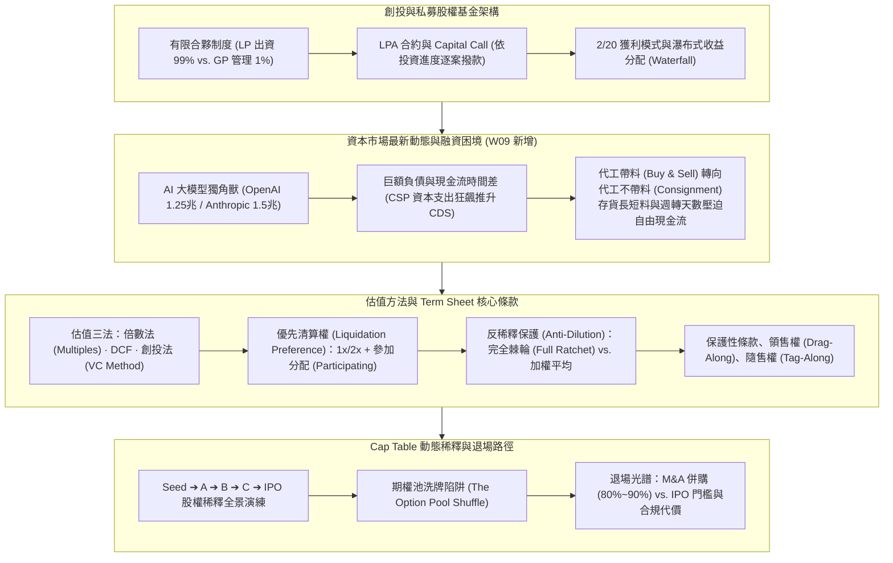

---
{"dg-publish":true,"permalink":"/04/10/02/module-2/m2-5/","tags":["PMBA","創業投資","私募股權","有限合夥","Term_Sheet","清算優先權","反稀釋條款","Cap_Table","估值定價","出場機制","白板推導"],"dg-note-properties":{"類別":"課程筆記","課程名稱":"[[創業與企業財務策略]]","模組編號":"Module 2","模組名稱":"產品創新與精實驗證","章節編號":"M2-5","主題":"創業投資與私募股權運作機制 (Venture Capital, Term Sheet & Cap Table Dynamics)","對應週次":"Week 8 & 9 (2026-10-27 / 2026-11-03 深度重構)","狀態":"🟢 已完成","tags":["PMBA","創業投資","私募股權","有限合夥","Term_Sheet","清算優先權","反稀釋條款","Cap_Table","估值定價","出場機制","白板推導"],"aliases":["M2-5 創業投資與私募股權運作機制","創業投資與私募股權運作機制"]}}
---


# 🏛️ M2-5 創業投資與私募股權運作機制：從合夥架構、Term Sheet 條款到 Cap Table 動態稀釋全景

> [!abstract] 導讀與對接
> 本筆記為《創業與企業財務策略》第八週與第九週（2026-10-27 及 2026-11-03）模組核心重構筆記。本篇完整串聯「創業者股權設計」與「資本市場外部機構投資人（VC / PE）融資博弈」：
> 1. 深入拆解私募股權（PE）與創投（VC）有限合夥制度（LP vs. GP）、Capital Call 逐案撥款、LP Default 違約懲罰與 2/20 收益分配瀑布；
> 2. 深度融入第九週最新課堂講義與逐字稿精華：**AI 大模型獨角獸（OpenAI / Anthropic）融資困境與現金流時間差**、**營收成長與毛利率背離（代工帶料 Buy & Sell 轉向代工不帶料 Consignment）**；
> 3. 數理推導**創投三大估值法（倍數法、DCF、VC Method）**、**投資意向書（Term Sheet）關鍵防線（優先清算權倍數、參加分配特別股）**；
> 4. 全面解析**對抗股權稀釋三大機制（完全棘輪 Full Ratchet、加權平均 Weighted Average、優先認購權 Pro-rata）**與**Cap Table 從種子輪到 IPO 之動態稀釋演化**，破解「期權池洗牌陷阱（Option Pool Shuffle）」，落實「沒有清晰退出機制，新創便毫無投資價值」之資本鐵律。
> - **上級地圖**：[[04_主題選修/10_創業與企業財務策略/_創業與企業財務策略 MOC\|創業與企業財務策略 MOC 全景地圖]]  
> - **進度看板**：[[05_AI選修/10_AiX/00_課程導航與進度/progress_📊 課程與筆記進度追蹤\|課程與筆記進度追蹤看板]]  
> - **核心概念庫**：[[98_商業概念庫/Anti_Dilution_Mechanisms_對抗股權稀釋三大機制\|Anti_Dilution_Mechanisms_對抗股權稀釋三大機制]] · [[98_商業概念庫/Cap_Table_Evolution_資本結構股權表動態演變\|Cap_Table_Evolution_資本結構股權表動態演變]] · [[98_商業概念庫/Liquidation_Preference_Participating_優先清算權與參與分配\|Liquidation_Preference_Participating_優先清算權與參與分配]]

---

## 🎯 本章視覺化知識脈絡圖



---

## 一、 私募股權與創投基金運作架構

### 1. 有限合夥制度（Limited Partnership, LP vs. GP）
- **有限合夥人（Limited Partners, LP）**：出資佔基金總額 99% 以上，通常為主權基金、退休養老基金、大學捐贈基金、壽險金控或家族辦公室。僅承擔出資額為限之有限責任，不參與日常投資決策。
- **普通合夥人（General Partner, GP）**：專業基金經理人，出資約佔 1%，承擔無限連帶責任，全權負責投資審查、投後賦能與退場談判。

### 2. 資本召集（Capital Call / Drawdown）與違約懲罰
- 創投募資並非一次性將數億美元匯入戶頭，而是簽署有限合夥協議（LPA）承諾總額（Committed Capital）；
- **Capital Call（逐案撥款）**：當 GP 找到合適標的時，發出通知要求 LP 在 10 至 14 天內按比例匯入款項。
- **LP Default（違約懲罰條款）**：若 LP 因流動性危機未依約繳款，將面臨極嚴苛懲罰（如沒收已出資部位的 50% 淨值、強制稀釋股權或被低價轉售給其他 LP）。

### 3. 基金收益分配瀑布（Distribution Waterfall）
- 創投的「2/20 法則」：每年收取 2% 管理費（Management Fee），退場時提取超額利潤的 20% 作為業績分紅（Carried Interest, Carry）。
- **美式瀑布（Deal-by-deal）vs. 歐式瀑布（Whole-fund）**：國際主流傾向歐式瀑布，即 GP 必須確保所有 LP 先拿回全部本金及門檻報酬率（Hurdle Rate，通常為 8%），方能開始提取 Carry。

---

## 二、 資本市場最新變局與融資困境（Week 9 課堂深度洞察）

### 1. AI 巨型獨角獸的估值與退場死局
- 郭翠菱教授深入剖析：當前市場 OpenAI 估值達 1.25 兆美元，Anthropic 估值達 1.5 兆美元；
- **現金流時間差危機**：Anthropic 營收翻倍，但營運負債也由 400 億暴增至 800 億美元；
- **退場困局**：體量過大導致全球具備實力併購的科技巨頭屈指可數，且面臨反壟斷法規阻撓，被迫尋求 IPO；但在尚未展現明確自由現金流獲利能力前，上市定價面臨極大下修壓力。

### 2. 雲端 CSP 的三大融資管道與 CDS 利率飆升
- 雲端服務商（CSP）為採購 GPU 興建算力中心，大舉動用三大融資手段：
  1. **發行公司債（Corporate Bonds）**：基數龐大，推升債券殖利率；
  2. **銀行大型聯貸（Bank Loans）**；
  3. **股權現金增資（Equity Financing）**：稀釋股權，引發二級市場賣壓。
- **信用違約交換（CDS）利率上揚**：市場對高槓桿算力融資違約率擔憂加劇，一旦營收轉化不如預期，極易觸發戴維斯雙殺。

### 3. 供應鏈商業模式轉型：Buy & Sell 轉向 Consignment
- 伺服器代工廠出現「營收高但毛利率掉」的反常現象（如 HBM 記憶體與先進載板漲價潮壓縮組裝毛利）；
- **商業模式大變革**：
  - 傳統 **代工帶料（Buy & Sell）**：代工廠自籌營運資金買進昂貴料件，營收規模大但承擔龐大存貨跌價與利息負擔；
  - 現代 **代工不帶料（Consignment 委託代工）**：品牌大廠指定採購並自備關鍵料件，代工廠純收加工費；雖然營收數字縮小，但徹底卸除庫存壓力，毛利率與資產回報率反而顯著改善！

---

## 三、 創投估值方法論與 Term Sheet 核心條款

### 1. 創投三階段估值法（Valuation Methods）
1. **可比公司倍數法（Multiples）**：運用 EV/Sales、EV/EBITDA 或 P/E 進行同行業對標。
2. **現金流折現法（DCF）**：以未來自由現金流折現，但在新創早期缺乏歷史數據時主觀性較高。
3. **創投法（VC Method）**：
   - 估算企業在目標退場年（如第 5 年）的預期市值（$Exit\ Value$）；
   - 依據創投目標報酬率（如 $ROI = 10	imes$ 或 $IRR = 40\%$）逆推當前**投後估值（Post-Money Valuation）**：
     $$	ext{投後估值} = rac{	ext{預期退場價值}}{(1 + 	ext{目標 } IRR)^n}$$
   - 扣除本輪投資額後得出**投前估值（Pre-Money Valuation）**。

### 2. 投資意向書（Term Sheet）關鍵條款剖析

#### (1) [[98_商業概念庫/Liquidation_Preference_Participating_優先清算權與參與分配\|優先清算權（Liquidation Preference）]]
- **清算倍數**：通常約定為 $1	imes$ 本金，但在高風險或下行週期可能要求 $1.5	imes$ 至 $2	imes$。
- **參加分配特別股（Participating Preferred Stock）**：
  - *非參加分配（Non-participating）*：投資人只能二選一（拿回 $1	imes$ 本金 + 累計股利，或按持股比例轉換為普通股分配）；
  - *完全參加分配（Fully Participating）*：**雙重獲利（Double-dipping）**！投資人先拿回 $1	imes$ 清算優先額，剩餘資產再與普通股股東按比例共同瓜分。
- **可累積股利（Cumulative Dividends）**：若公司當年未盈餘分配，約定股息（如 8%）持續累積，於清算時優先補發。

#### (2) [[98_商業概念庫/Anti_Dilution_Mechanisms_對抗股權稀釋三大機制\|對抗股權稀釋條款（Anti-Dilution Provisions）]]
旨在防止新創發生「跌價融資（Down Round）」時早期投資人持股被稀釋：
- **完全棘輪條款（Full Ratchet）**：早期投資人的換股價格強制直接降至新一輪發行的最低價格（對創辦團隊具毀滅性稀釋）。
- **加權平均條款（Weighted Average）**：按新舊發行量與金額加權調整換股價格（國際公認最良性防護機制）。
- **優先認購權（Pro-rata Right）**：有權在後續融資輪次中按比例跟投，維持原持股百分比。

---

## 四、 Cap Table 動態演變與 Option Pool Shuffle 陷阱

### 1. 創投融資經典「期權池洗牌陷阱」（The Option Pool Shuffle）
- 在融資談判中，VC 通常要求預留 10%~15% 的員工期權激勵池（ESOP Pool）；
- **陷阱核心在於「投前設立」**：
  - 若期權池計入「投前估值」，這 15% 股權稀釋**完全由原始創始人 100% 獨立吸收**，VC 分文不擔，等同於變相壓低了實際投前估值；
  - 創辦人應極力爭取「投後設立期權池」或根據實際招聘名額按需設立，避免被過度稀釋。

### 2. 新創融資多輪稀釋演化模擬（Cap Table Evolution）

```text
【新創五階段股權結構演化全景】
創立初期 (Founders 100%)
    ⬇ 加入天使投資人 (Angel: 10%) + 設立期權池 (ESOP: 10%)
種子輪 (Founders: 80% | Angel: 10% | ESOP: 10%)
    ⬇ Series A 融資 ($5M @ $20M Post-money ➔ VC-A 取得 25%)
A 輪後 (Founders: 60% | Angel: 7.5% | ESOP: 7.5% | VC-A: 25%)
    ⬇ Series B 融資 ($15M @ $60M Post-money ➔ VC-B 取得 25%)
B 輪後 (Founders: 45% | Angel: 5.6% | ESOP: 5.6% | VC-A: 18.8% | VC-B: 25%)
    ⬇ 歷經多輪稀釋與擴大期權池，最終至 IPO
IPO 上市 (創辦團隊持股通常稀釋至 15%~25%，但因市值倍增而創造巨大財富)
```

---

## 五、 資本退場機制（Exit Strategy）的全景透視

郭翠菱教授在課堂反覆強調：**「如果沒有退場機制，對於新創而言就沒有投資的價值。」**

| 退場路徑 | 佔比與主流趨勢 | 執行優勢與門檻 | 潛在代價與限制 |
| :--- | :---: | :--- | :--- |
| **併購退場<br>(M&A / Trade Sale)** | **80% ~ 90%**<br>(全美新創最主要退場方式) | • 交易週期相對明確<br>• 現金或可流通股票一次結清<br>• 為大廠補足技術與人才缺口 | 創辦團隊往往喪失獨立經營主導權，面臨組織文化整合風險。 |
| **首次公開發行<br>(IPO)** | **約 5% ~ 10%**<br>(少數指標獨角獸首選) | • 享受最高估值溢價與本益比乘數<br>• 保留企業獨立品牌與社會知名度<br>• 建立多元公開融資管道 | • **高昂上市代價**：承銷手續費（7%~10%）、律師會計師內控輔導費<br>• **閉鎖期（Lock-up Period）**：高管與創投上市後 6 個月內禁止拋售<br>• 資訊全透明與季報業績壓力 |
| **管理層收購 / 次級出售<br>(MBO / Secondary)** | 補充性退場管道 | 創投將所持股權轉售給私募股權（PE）基金或後續輪次投資人，實現流動性。 | 估值往往伴隨折價（Discount）。 |

---

## 💡 經理人管理實務反思與行動指引

1. **融資不僅看估值，更看合約條款**：名義上的高估值若伴隨 $2	imes$ 完全參加分配優先清算權與完全棘輪反稀釋，創辦團隊在下行週期將淪為一無所有的打工人。
2. **警惕期權池洗牌**：在簽署 Term Sheet 時，精確計算期權池對自身股權的實質稀釋百分比，守住控制權底線。
3. **動態管理營運資金**：在景氣逆風與高利率時代，迅速調整代工模式（Buy & Sell ➔ Consignment），保全自由現金流。

---

## 🔗 模組導航與延伸閱讀

- ⬅️ **上一章節**：[[04_主題選修/10_創業與企業財務策略/02_模組筆記/Module_2_產品創新與精實驗證/M2-4_新創財務預測與外部融資需求模型\|M2-4 新創財務預測與外部融資需求模型]]
- ➡️ **下一模組開綱**：[[04_主題選修/10_創業與企業財務策略/02_模組筆記/Module_3_企業生命週期與財務戰略/M3-1_企業財務策略概論與股東價值創造\|Module 3: M3-1 企業財務策略概論與股東價值創造]]
- 💎 **本章關聯概念卡片**：
  - [[98_商業概念庫/Anti_Dilution_Mechanisms_對抗股權稀釋三大機制\|Anti_Dilution_Mechanisms_對抗股權稀釋三大機制]]
  - [[98_商業概念庫/Cap_Table_Evolution_資本結構股權表動態演變\|Cap_Table_Evolution_資本結構股權表動態演變]]
  - [[98_商業概念庫/Liquidation_Preference_Participating_優先清算權與參與分配\|Liquidation_Preference_Participating_優先清算權與參與分配]]