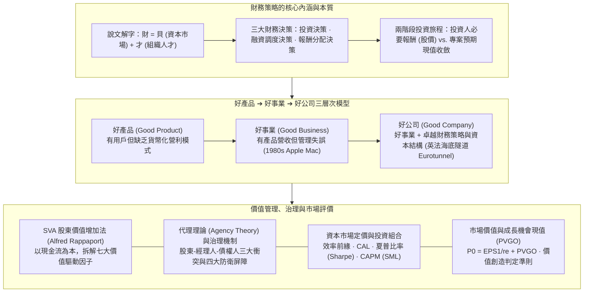
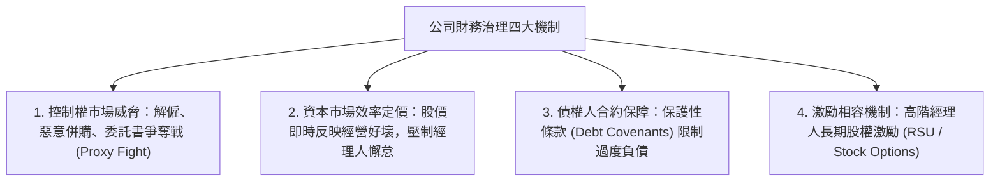

---
{"dg-publish":true,"permalink":"/04/10/02/module-3/m3-1/","tags":["課程筆記","PMBA","主題選修","創業財務","財務策略","股東價值","SVA模型","代理理論","PVGO"],"dg-note-properties":{"類別":"課程筆記","課程名稱":"[[創業與企業財務策略]]","模組編號":"Module 3","模組名稱":"企業生命週期與財務戰略","章節編號":"M3-1","主題":"企業財務策略概論與股東價值創造 (Introduction to Corporate Financial Strategy & Value Creation)","對應週次":"Week 9 (2026-11-03)","狀態":"🟢 已完成","tags":["課程筆記","PMBA","主題選修","創業財務","財務策略","股東價值","SVA模型","代理理論","PVGO"],"aliases":["M3-1 企業財務策略概論與股東價值創造","企業財務策略概論"]}}
---

# 📈 M3-1 企業財務策略概論與股東價值創造

> **導讀與對接**：  
> - **上級地圖**：[[04_主題選修/10_創業與企業財務策略/_創業與企業財務策略 MOC\|創業與企業財務策略 MOC 全景地圖]]  
> - **進度看板**：[[05_AI選修/10_AiX/00_課程導航與進度/progress_📊 課程與筆記進度追蹤\|課程與筆記進度追蹤看板]]  
> - **核心概念庫**：[[98_商業概念庫/Shareholder_Value_Added_SVA_股東價值增加法\|Shareholder_Value_Added_SVA_股東價值增加法]] · [[98_商業概念庫/Good_Product_Business_Company_好產品好事業好公司模型\|Good_Product_Business_Company_好產品好事業好公司模型]] · [[98_商業概念庫/Present_Value_of_Growth_Opportunities_PVGO_成長機會現值\|Present_Value_of_Growth_Opportunities_PVGO_成長機會現值]] · [[98_商業概念庫/Agency_Theory_Corporate_Governance_代理理論與公司治理\|Agency_Theory_Corporate_Governance_代理理論與公司治理]] · [[98_商業概念庫/Investor_vs_Corporate_Value_投資者價值與公司價值\|Investor_vs_Corporate_Value_投資者價值與公司價值]]  
> **授課教師**：國立臺灣大學進修推廣學院 郭翠菱 教授  
> **課堂時間**：2026-11-03 (Week 9 / Class 10)  

---

## 🎯 本章視覺化知識脈絡圖

---

## 一、 財務策略的本質與決策維度

### 1. 什麼是財務策略？
- **核心定位**：財務策略聚焦於公司財務面的戰略決定，是銜接「企業內部競爭優勢」、「股東利益」乃至「外部資本市場」的動態樞紐。
- **三大核心決策維度**：
  1. **投資決策（Investment Decision）**：評估資本預算（Capital Budgeting），決定有限資金在不同業務、研發與擴張專案間的配置優先序（$NPV > 0$、$IRR > WACC$、$PI$）。
  2. **融資與資金調度決策（Financing Decision）**：決定股權與債權的最佳組合（資本結構 Capital Structure），在稅盾利益與破產財務危機成本間取得平衡，極小化加權平均資金成本（WACC）。
  3. **股利與報酬分配決策（Dividend / Payout Decision）**：決定企業盈餘是保留再投資以獲取未來成長，還是透過現金股利或庫藏股回購（Share Repurchase）返還股東。
- **郭氏說文解字教學法**：
  - 「**財**」＝「**貝**」＋「**才**」
  - 「**貝**」：古代以貝殼為貨幣，代表資本市場資金、必要報酬率與財務槓桿；
  - 「**才**」：代表人才（Talent）、專業技術（Skill/Technique）與組織能力；
  - *策略真諦*：將組織人才的創新能耐（才），轉化為資本市場的真金白銀（貝），並為核心利害關係人創造超越風險水準的超額報酬。

### 2. 兩階段投資旅程（Two-Stage Investor Journey）
郭翠菱教授強調，企業價值的極大化來自於兩階段流程的收斂：
- **階段一（投資者選擇公司）**：投資者依據產業前景與風險偏好挑選投資標的。投資者價值反映的是資本市場的**必要報酬（Required Return）**，直接由「股價」來體現。
- **階段二（公司配置運用資金）**：公司管理層將取得的資金投向各項專案。公司價值取決於當前經營方針與未來投資計劃能否創造**「預期現金流量的現值」**。
- **成敗檢驗標準**：若公司投資收益無法達到資本市場的必要報酬，股價將遭遇下修；反之，卓越的財務策略能使公司價值與投資者價值實現良性正向共振。

---

## 二、 企業演進三層次模型：好產品 ➔ 好事業 ➔ 好公司

多數企業經理人常落入「產品本位主義」的思維陷阱。郭教授在課堂中提出深刻的三層次演進模型：

| 發展層次 | 核心特徵與瓶頸 | 經典實證案例 | 財務與策略管理教訓 |
| :--- | :--- | :--- | :--- |
| **1. 好產品 (Good Product)** | 擁有數百萬狂熱用戶、產品廣受歡迎且技術領先，但缺乏清晰的商業模式與貨幣化（Monetization）路徑。 | • 許多未找到盈利模式的早期 AI 工具或社群平台 • 技術極佳但無法變現的新創軟體 | 單純有好產品不能保證企業生存，產品必須能轉化為可持續的現金流入。 |
| **2. 好事業 (Good Business)** | 既有好產品，又具備穩定的客戶群與營收現金流；但高層管理決策失誤、缺乏護城河，導致市場地位被對手蠶食。 | • **1980 年代初期管理失誤的 Apple Mac**（封閉系統與定價過高，痛失 PC 主流標準地位） | 好事業若缺乏敏捷組織與防禦策略，依然會被競爭者顛覆。 |
| **3. 好公司 (Good Company)** | **好事業搭配卓越的財務策略、健全的資本結構與長青的公司治理**，能抵禦景氣循環衝擊，持續創造經濟附加價值。 | • **英法海底隧道（Eurotunnel）**：初期過度舉債導致破產重組，後續透過「債轉股」徹底重構負債結構，化身為現代交通基礎設施好公司。 | 商業組織的最終成就，取決於能否在策略營運與資本結構治理間達成完美動態適配。 |

---

## 三、 管理與衡量股東價值：SVA 模型（Alfred Rappaport）

傳統會計利潤（EPS、淨利）易受折舊年限、存貨計價與一次性收益的人為窗飾操縱。Alfred Rappaport 提出的**股東價值增加法（Shareholder Value Added, SVA）**以純粹現金流為核心。

### 1. SVA 基本數理定義
$$	ext{股東價值增加額 (SVA)} = \Delta 	ext{預期未來營業現金流量現值} - \Delta 	ext{達成該預期所需投入之增額資本}$$

### 2. SVA 七大關鍵價值驅動因子（Value Drivers）
管理者可將抽象的「股東價值」拆解為基層可執行的日常指標：
1. **銷售額成長率（Sales Growth Rate）**：營收規模擴張速度。
2. **營業利潤率（Operating Profit Margin）**：本業獲利與成本管控能耐。
3. **所得稅率（Income Tax Rate）**：合法稅務籌劃與稅盾運用。
4. **營運資金投資增加額（Working Capital Investment）**：應收帳款與存貨佔用資金之壓縮。
5. **固定資產投資增加額（Fixed Capital Investment）**：資本支出（CapEx）的效益與紀律。
6. **加權平均資金成本（WACC）**：最優資本結構所對應的最低折現率。
7. **價值成長期（Value Growth Duration）**：企業競爭優勢能維持超額報酬的持續時間。

---

## 四、 代理理論（Agency Theory）與公司財務治理

### 1. 代理問題與資訊不對稱
- **根源**：所有權與經營權分離（Separation of Ownership and Control），以及喬治·阿克洛夫（George Akerlof）提出的「檸檬市場（Lemon Market）」資訊不對稱。
- **三大經典代理衝突**：
  1. **股東 vs. 專業經理人**：經理人追求個人權力、高薪與企業帝國建造（無效益併購），忽視股東利益。
  2. **內部控股大股東 vs. 外部少數股東**：控制權與現金流權偏離，大股東透過關係人交易「隧道效應（Tunneling）」掏空公司。
  3. **股東 vs. 債權人**：股東享有剩餘索償權，傾向拿債權人的錢進行「資產替代（Asset Substitution）」，押注高風險賭博性專案。

### 2. 公司財務治理四大防禦機制

---

## 五、 資本市場定價與投資組合：CAPM 與夏普比率

### 1. 效率前緣、資本配置線（CAL）與夏普比率
- 投資者透過分散投資消除「個別公司非系統性風險（Idiosyncratic Risk）」，在效率前緣（Efficient Frontier）上配置資產。
- **夏普比率（Sharpe Ratio）**：
  $$	ext{Sharpe Ratio} = rac{E(R_p) - R_f}{\sigma_p} = rac{	ext{超額報酬}}{	ext{總承擔風險}}$$
  資本配置線（Capital Allocation Line, CAL）的斜率即為夏普比率，衡量每承受一單位總風險所能換取的超額補償。

### 2. 資本資產定價模型（CAPM）與證券市場線（SML）
$$E(R_i) = R_f + eta_i [E(R_m) - R_f]$$
- $eta_i$ 衡量資產對市場系統性風險的敏感度；
- 在資本市場均衡下，所有資產均落在證券市場線（Security Market Line, SML）上；若預期報酬落在 SML 上方代表被低估，落在下方代表被高估。

---

## 六、 創造市場價值與成長機會現值（PVGO）

在資本市場中，企業股價由「**零成長靜態現金牛年金**」與「**成長機會動態期權**」兩大維度共同決定：

$$	ext{企業每股股價 } (P_0) = rac{	ext{EPS}_1}{r_e} + 	ext{PVGO}$$

### 1. PVGO 數理拆解與本益比（P/E）乘數分析
- $rac{	ext{EPS}_1}{r_e}$：假設企業將盈餘 100% 發放股利、不再擴張時的永續年金價值。
- $	ext{PVGO}$：企業將保留盈餘再投資於具備經濟利潤之專案時，扣除投入成本後所創造之**未來超額淨現值（NPV）加總**。
- **本益比二元拆解**：
  $$rac{P_0}{	ext{EPS}_1} = rac{1}{r_e} + rac{	ext{PVGO}}{	ext{EPS}_1}$$
  高本益比企業（如 AI 晶片廠、SaaS 巨頭）其股價 60%~80% 均由 PVGO 所支撐。

### 2. 價值創造 vs. 價值毀滅之判讀準則
$$	ext{PVGO} \propto (	ext{ROE} - r_e)$$

| 條件判別 | PVGO 狀態 | 資本配置本質 | 經理人行動指引 |
| :--- | :---: | :--- | :--- |
| **$	ext{ROE} > r_e$** | **$	ext{PVGO} > 0$** | **價值創造 (Value Creation)** | 再投資收益高於資本成本，應擴大資本支出推動高成長。 |
| **$	ext{ROE} = r_e$** | **$	ext{PVGO} = 0$** | **價值中立 (Value Neutral)** | 營收規模放大但無法推升股價，資本支出與發放股利無異。 |
| **$	ext{ROE} < r_e$** | **$	ext{PVGO} < 0$** | **價值毀滅 / 盲目擴張陷阱** | 再投資正在摧毀股東財富！應立即終止擴張，將現金全額透過股利或庫藏股返還股東。 |

### 3. 標竿企業實證：台積電（TSMC）2024-2029 策略性財務目標
郭教授以台積電官方投資人關係（IR）承諾為例，展示了世界級好公司的財務紀律：
- **營業收入**：美元營收年複合成長率（CAGR）接近 **20%**；
- **營業毛利率**：長年維持在 **53% 以上**；
- **股東權益報酬率（ROE）**：平均維持至少 **25%**（遠遠超越其 8%~9% 的股權資金成本 $r_e$，創造出無比龐大的正向 PVGO）。

---

## 💡 經理人管理實務反思與行動指引

1. **辨識企業發展層次**：清醒認知自身企業是處於「好產品」、「好事業」還是「好公司」階段；切忌在缺乏貨幣化路徑與健康資本結構前盲目擴張。
2. **算清 PVGO 價值帳**：只有當預期再投資報酬率（ROE）顯著大於資金成本（$r_e$）時，保留盈餘擴產才具備正當性；若無此利差，大方發放股利才是對股東最負責的決策。
3. **建立多層次利益關係人視角**：在追求股東財富極大化的同時，兼顧債權人安全、員工激勵與供應鏈生態信任，方能維持可持續的長期競爭優勢。

---

## 🔗 模組導航與延伸閱讀

- ⬅️ **前置模組回顧**：[[02_模組筆記/Module_2_產品創新與精實驗證/M2-5_創業投資與私募股權運作機制|M2-5 創業投資與私募股權運作機制]]
- ➡️ **下一章節預覽**：[[M3-2_企業營運資金管理與現金轉換週期|M3-2 企業營運資金管理與現金轉換週期]]
- 💎 **本章關聯概念卡片**：
  - [[Shareholder_Value_Added_SVA_股東價值增加法]]
  - [[Good_Product_Business_Company_好產品好事業好公司模型]]
  - [[Present_Value_of_Growth_Opportunities_PVGO_成長機會現值]]
  - [[Agency_Theory_Corporate_Governance_代理理論與公司治理]]
  - [[Investor_vs_Corporate_Value_投資者價值與公司價值]]