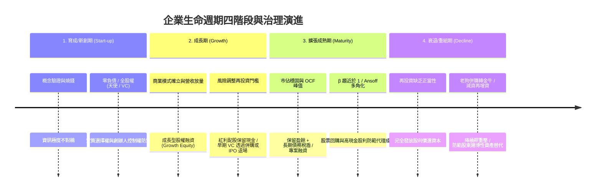

---
{"dg-publish":true,"permalink":"/04/10/02/module-3/m3-3/","tags":["課程筆記","PMBA","主題選修","創業財務","企業生命週期","融資工具階梯","股利政策","代理成本","資本結構","BCG矩陣","債務期限搭配"],"dg-note-properties":{"類別":"課程筆記","課程名稱":"[[創業與企業財務策略]]","模組編號":"Module 3","模組名稱":"企業生命週期與財務戰略","章節編號":"M3-3","主題":"企業生命週期財務策略與資本配置矩陣 (Corporate Lifecycle Financial Strategy & Capital Allocation Matrix)","對應週次":"Week 10 ~ Week 12 (2026-11-10 / 2026-11-17 / 2026-11-24 融會重構)","狀態":"🟢 已完成","tags":["課程筆記","PMBA","主題選修","創業財務","企業生命週期","融資工具階梯","股利政策","代理成本","資本結構","BCG矩陣","債務期限搭配"],"aliases":["M3-3 企業生命週期財務策略與資本配置矩陣","企業生命週期財務策略","資本配置矩陣"]}}
---


# 📈 M3-3 企業生命週期財務策略與資本配置矩陣

> [!abstract] 導讀與對接
> - **上級地圖**：[[04_主題選修/10_創業與企業財務策略/_創業與企業財務策略 MOC\|創業與企業財務策略 MOC 全景地圖]]
> - **進度看板**：[[05_AI選修/10_AiX/00_課程導航與進度/progress_📊 課程與筆記進度追蹤\|課程與筆記進度追蹤看板]]
> - **核心概念庫**：[[Corporate_Lifecycle_Financial_Matrix_企業生命週期財務矩陣\|Corporate_Lifecycle_Financial_Matrix_企業生命週期財務矩陣]] · [[Firm_Growth_Four_Stages_企業成長四階段與代理成本\|Firm_Growth_Four_Stages_企業成長四階段與代理成本]] · [[BCG_Cash_Flow_Matrix_波士頓矩陣現金流重構\|BCG_Cash_Flow_Matrix_波士頓矩陣現金流重構]] · [[Risk_Adjusted_Hurdle_Rate_再投資計畫風險調整門檻\|Risk_Adjusted_Hurdle_Rate_再投資計畫風險調整門檻]] · [[Debt_Maturity_Matching_債務期限搭配與利率週期\|Debt_Maturity_Matching_債務期限搭配與利率週期]] · [[DOL_DFL_DTL_三重槓桿度模型\|DOL_DFL_DTL_三重槓桿度模型]]
> - **授課教師**：國立臺灣大學進修推廣學院 郭翠菱 教授
> - **課堂時間**：2026-11-10、2026-11-17 & 2026-11-24（Week 10 ~ Week 12）

---

## 📌 筆記更新進度（Progress & Versioning）
- **處理進度**：第 10~12 講融會貫通整合完成 / 逐字稿進度 100%
- **更新歷程**：
  - **v3.0 (2026-11-24)**：依據 Week 12（L11_1 & L11_2 逐字稿）與兩張白板板書深度重構，將最新推導全面融會於各章節：
    1. 納入 **TSR 股東總報酬率在四個生命週期的拆解**（資本利得率 $= g_{EPS} + \Delta PER$ vs. 股利殖利率之消長）；
    2. 整合 **Ansoff 矩陣多角化成長之「成長 × 獲利 × 風險」三維度策略配適**；
    3. 補全成長期投資組合 **A/B/C 三專案（18% / 12% / 6% vs. WACC 10%）** 之風險調整門檻實算，以及實質選擇權、紅利配股（盈餘轉增資）、專案融資、減資後再增資等週期性財務工具。
  - **v2.0 (2026-11-17)**：整合 Class 12 教材《企業生命週期的財務策略》、S 曲線四維指標、BCG OCF×ICF 現金流重構、MM 含稅定理與債務期限搭配原則。
  - **v1.0 (2026-11-10)**：初版建立。

---

## 1. 核心精要（Executive Summary）
- **S 曲線與現金流落後效應**：營收在成長期快速攀升、成熟期趨緩、衰退期反轉；利潤與現金流高峰皆落後於營收高峰，且新創期現金流谷底比會計利潤更深（反映龐大固定資產與營運資金投入）。
- **TSR 與估值乘數的生命週期移轉**：股東總報酬 $TSR = \text{股利殖利率} + \text{資本利得率}(g_{EPS} + \Delta PER)$。新創期資本利得率可高達 40%（主要來自敘事與極高本益比 $\Delta PER$），衰退期資本利得率轉負（如 -6%）而由高股利殖利率支撐回報。
- **BCG 矩陣的現金流本質**：以「營業現金流（OCF）」與「投資現金流（ICF）」重新定義波士頓矩陣，企業應以成熟「金牛」的充沛現金流哺育高成長「明星」與「問號」，並在衰退期透過併購同業將「老狗」移動至「金牛」象限。
- **債務結構與風險反向匹配**：經營風險隨生命週期呈現「非常高 ➔ 高 ➔ 中 ➔ 低」下降，財務風險則應逆向配置「非常低 ➔ 低 ➔ 中 ➔ 高」。債務融資須嚴守「以短支短、以長支長」，成熟期引進債務可降低 WACC，但晚期過度舉債引發破產成本反而推升 WACC。
- **動態資本配置與多角化配適**：成長期評估再投資專案須採「風險調整門檻」而非齊頭式 WACC；成熟期外部多角化（Ansoff 矩陣）必須同時校準「成長、獲利與風險」三維度；衰退期則透過完全股利或「減資後再增資」進行資本返還與股權重整。

---

## 2. 生命週期 S 曲線、TSR 動態拆解與 BCG 現金流矩陣

### 2.1 傳統 S 曲線與生命週期四維量化指標
企業生命週期（Corporate Life Cycle, CLC）呈現典型 S 型軌跡，分析生命週期時必須掌握四大關鍵維度：
1. **斜率**：代表市場滲透與成長速度；
2. **高度**：代表市場規模天花板；
3. **平坦度**：代表競爭優勢（ROE / ROIC 護城河）可以維持多久；
4. **長度**：生命週期越長、衰退越慢，企業總體累積價值越高。

### 2.2 股東總報酬（TSR）與估值乘數的週期演變（L12 逐字稿深化）
課堂白板拆解了股東總報酬率（Total Shareholder Return, TSR）在四個階段的內部結構轉移：
$$TSR = \text{股利殖利率 (Dividend Yield)} + \underbrace{(g_{EPS} + \Delta PER)}_{\text{資本利得率 (Capital Gain)}}$$

- **新創期**：零股利（殖利率 0%），但資本利得率極高（課堂例示可達 **40%**）——此時 $g_{EPS}$ 尚未成形，主要來自市場對「未來敘事（Narrative）」與 **極高本益比（$\Delta PER$）** 的估值定價（搭配早期實質選擇權 Real Option 設計吸引創投）。
- **成長期**：盈餘保留率 $b$ 高、股利極少，資本利得率仍高（例示約 **23%**），由高 $g_{EPS}$ 與中高 $PER$ 共同驅動；企業常以**紅利配股（盈餘轉增資）**回饋股東並保留帳上現金。
- **成熟期**：$g_{EPS}$ 與本益比趨於穩定，資本利得率收斂（例示約 **3%**），股利殖利率大幅上升；同時因為營業現金流充沛而資本支出下降，**$ROE$ 推升市淨比（$PBR = PER \times ROE$）** 成為觀察市值高估／低估與比較帳面價值（BVE）的關鍵指標。
- **衰退期**：股價下跌使資本利得率轉負（例示約 **-6%**），股東完全仰賴**高股利殖利率（接近 100% 發放）**實現現金返還，惟前提仍是營業利益為正，否則須變賣資產或舉債配息。

### 2.3 BCG 矩陣的現金流重構（OCF × ICF）
不應只看表象的「市佔率 × 成長率」，波士頓顧問集團（BCG）矩陣的底層邏輯是現金流內部調度：

| BCG 象限 | 營業現金流 (OCF) | 投資現金流 (ICF) | 淨現金流 (OCF - ICF) | 企業實務定位與案例 |
| :--- | :---: | :---: | :---: | :--- |
| **金牛 (Cash Cow)** | 高 | 低 | **巨額正值** | 事業穩定，提供全集團造血核心（如鴻海傳統組裝業務）。 |
| **明星 (Star)** | 中~高 | 極高 | **微正或負值（燒錢）** | 看得到高成長但 CapEx 龐大（如鴻海自駕車事業）。 |
| **問號 (Question Mark)** | 低 | 高 | **大幅負值** | 高度不確定，須依市場驗證決定加碼或停損。 |
| **老狗 (Dog)** | 低 | 低 | **停滯或微負** | 衰退產業中低市佔者；可透過併購市佔低同業躍升為金牛。 |

---

## 3. 企業成長四階段與代理成本演進



### 3.1 四階段資訊不對稱與代理衝突對比表
| 分析維度 | 1. 育成/新創期 (Start-up) | 2. 成長期 (Growth) | 3. 擴張成熟期 (Maturity) | 4. 衰退/重組期 (Decline) |
| :--- | :--- | :--- | :--- | :--- |
| **資訊不對稱性** | **極度嚴重**（無歷史財報，全憑願景與 POC）。 | **中度偏高**（有初期營收但良率與量產波動大）。 | **極低 / 透明**（公開財報、信用評等完備）。 | **高度複雜**（隱藏減損或轉型不明）。 |
| **代理成本核心衝突** | 創辦人 vs. 外部投資人（資金侵占與控制權衝突）。 | 老股東 vs. 新進機構股東（私募稀釋與估值衝突）。 | 股東 vs. 專業經理人（過度擴張與閒置現金浪費）。 | 股東 vs. 債權人（資產替代賭博或債務懸垂）。 |
| **融資與治理工具** | VC Term Sheet、實質選擇權、雙重股權 A/B 股。 | 成長型股權私募、紅利配股、獨董與 Big 4 查核。 | 銀行聯貸、公司債、專案融資、RSU 與庫藏股。 | 債務重組、減資後再增資、LBO、同業整併。 |

---

## 4. 債務結構原則、MM 稅盾、WACC 動態與利率週期操作

### 4.1 企業融資四大核心目的與債務啟動門檻
公司籌資不外乎四大目的：1. 營運週轉金（CCC 現金缺口）、2. 資本支出（維護型 vs. 成長型 CapEx）、3. 回饋股東（現金股利與庫藏股）、4. 償還利息與到期舊債（借新還舊）。
- **債權人授信第一道門檻**：唯有當企業本業自由現金流（FCFF）轉正，方能跨越舉債門檻；在成長期若面臨公募門檻或高資金成本，企業常改采**私募股權**壓低發行成本，但須承受股權稀釋的代價。

### 4.2 MM 含稅定理、WACC 的 U 型轉折與債務侵蝕警戒
$$V_L = V_U + T_c \times Debt \quad ; \quad \text{股權價值 (Equity)} = \text{企業價值 (EV)} - \text{債務市值 (Debt)}$$
- **成熟期壓低 WACC**：在經營風險可控時，適度提高 $D/E$ 比例（因 $K_d$ 低於 $R_e$ 且具利息稅盾 $T_c \times Debt$），可有效壓低 $WACC$，進而提升自由現金流折現後的企業總價值。
- **晚期破產成本推升 WACC**：若成熟晚期或衰退期持續過度舉債，投資人對財務困境與破產成本的疑慮將導致股東要求報酬率 $R_e$ 與債務成本同步飆升，使 $WACC$ 反彈拉高；一旦 $EV < Debt$，股東權益價值將直接歸負。

### 4.3 債務期限搭配鐵律與利率週期操作
- **期限搭配原則**：「**以短支短、以長支長**」，嚴禁「以短支長」。短期營運週轉使用一年期以下工具（如商業本票 CP），長期資本支出配合長期銀行聯貸或公司債。
- **利率週期操作**：升息週期時，發債人應提前鎖定長天期固定利率，投資人則應縮短債券存續期間；降息週期則反之。

---

## 5. 生命週期各階段財務戰略全維度展開

### 5.1 成長期：再投資計畫之風險調整門檻與投資組合實算（Unit 8 & 白板推導）
- **齊頭式標準的謬誤**：企業不可將公司整體資金成本（例如 $WACC = 10\%$）齊頭式套用於所有擴張專案。
- **白板投資組合（Portfolio）實算陷阱**：
  假設企業將 3 億元均分（各 $1/3$）投入三個不同風險等級的專案：
  - **高風險計畫 A**：預期報酬率 **18%**
  - **中風險計畫 B**：預期報酬率 **12%**
  - **低風險計畫 C**：預期報酬率 **6%**
  - 表面上整個投資組合加權平均報酬 $E(R_p) = \frac{1}{3}(18\% + 12\% + 6\%) = \mathbf{12\%} > WACC (10\%)$，看似創造 2% 超額報酬；但若未按各自風險對標風險報酬線，實際上可能誤拒了具備吸引力的低風險專案（計畫 C 若對應風險門檻僅 5% 應接受），或誤納了報酬不足以彌補極高風險的專案（計畫 A 若風險門檻需 20% 應拒絕）。
- **學習曲線與量產良率風險**：成長期需大量投入固定資產（PPE）與營運資金（NWC），且須快速跨越學習曲線壓低單位成本（如先進製程實驗室突破與量產良率落差），因此營運風險依然存在。

### 5.2 成熟期：$g = b \times ROE$ 雙引擎、Ansoff 多角化與專案融資（Unit 9）
$$g = b \times ROE = (1 - d) \times \left(ROA \times \frac{Asset}{Equity}\right)$$
1. **財務槓桿與借錢發股利**：成熟期投資機會減少、股利發放率 $d$ 上升（使 $b$ 下降），企業改藉適度舉債拉高權益乘數（$Asset/Equity$）放大 $ROE$，甚至出現「借錢發股利」（發放率 $> 100\%$）以兼顧股東現金回饋。此時系統性風險 $\beta$ 向 1 收斂，規模與多角化亦有助壓低 $R_e$。
2. **Ansoff 矩陣多角化的三維策略配適（L12 新增）**：成熟期內部成長不易，企業常透過 Ansoff 矩陣尋求外部成長（新產品／新市場，如跨國經營或品牌延伸）。郭教授強調：**多角化決策不可只看成長率，必須將「成長 × 獲利 × 風險」三維度緊密結合**（例如跨國經營雖拉升成長與獲利，但同時推升文化管理與匯率風險）。
3. **專案融資（Project Finance）**：成熟期大型資本支出常採獨立專案融資架構，隔離母公司資產負債表風險。

### 5.3 衰退期：完全股利、老狗併購與「減資後再增資」（Unit 10 & L12 新增）
1. **完全股利償還資本**：$PVGO$ 近乎為零，應將股利發放率推向 100%（搭配庫藏股）將資本返還股東。
2. **「老狗」移動至「金牛」象限**：透過併購市佔率偏低的同業擴大相對市佔率，從 BCG「老狗」躍升為「金牛」。
3. **「減資後再增資」的股權重整手法**：當衰退企業面臨結構性虧損或急需轉型時，市場常見先透過**減資**打消累積虧損（或壓縮舊股東持股），再透過**私募增資**引進具資源的新大股東，藉此徹底重塑股權結構與經營方向。
4. **降槓桿創造價值例外**：若企業過度舉債導致財務困境風險溢酬過高，發行新股降低負債比反而能壓低整體 $WACC$。

---

## 6. 企業生命週期財務策略整合儀表板

| 評估維度 | 1. 新創期 (Start-up) | 2. 成長期 (Growth) | 3. 成熟期 (Maturity) | 4. 衰退期 (Decline) |
| :--- | :--- | :--- | :--- | :--- |
| **經營風險** | 非常高 | 高 | 中等 | 低 |
| **財務風險** | 非常低 | 低 | 中等 | 高 |
| **主要資金來源** | 創投基金（全股權） | 成長型股權（私募/IPO） | 保留盈餘 ＋ 長期債務 / 專案融資 | 債務為主（或減資再增資 / 降槓桿） |
| **股利與回饋工具** | 零股利 (0%) / 實質選擇權 | 極少現金 / 紅利配股（盈餘轉增資） | 高現金股利 ＋ 庫藏股 | 趨近 100% 完全發放 |
| **核心估值指標** | 敘事與極高 PER（EPS < 0） | 高 PER（高 PVGO 溢價） | 中等 PER，轉看 **PBR 與 ROE** | 低 PER、低 PBR（資本利損） |
| **策略核心重點** | PMF 驗證與現金流存活 | 跨越學習曲線與風險調整投資 | Ansoff 多角化（成長/獲利/風險配適） | 資本返還、老狗轉金牛與重整 |

---

## 7. 原子卡片庫（Atomic Notes）
- 📇 [[BCG_Cash_Flow_Matrix_波士頓矩陣現金流重構\|BCG_Cash_Flow_Matrix_波士頓矩陣現金流重構]]
- 📇 [[Risk_Adjusted_Hurdle_Rate_再投資計畫風險調整門檻\|Risk_Adjusted_Hurdle_Rate_再投資計畫風險調整門檻]]
- 📇 [[Debt_Maturity_Matching_債務期限搭配與利率週期\|Debt_Maturity_Matching_債務期限搭配與利率週期]]
- 📇 [[Corporate_Lifecycle_Financial_Matrix_企業生命週期財務矩陣\|Corporate_Lifecycle_Financial_Matrix_企業生命週期財務矩陣]]

---

## 8. 課程架構心智圖（Markmap / XMind 相容）
```markdown
# M3-3 企業生命週期財務策略與資本配置矩陣
## S 曲線、TSR 動態與 BCG 矩陣
### 生命週期四維指標 (斜率/高度/平坦度/長度)
### TSR 拆解：股利殖利率 + (g_EPS + ΔPER)
### BCG 重構：OCF × ICF (金牛哺育明星)
## 債務結構與 WACC 動態
### MM 含稅定理：VL = VU + Tc × Debt；警戒線 EV < Debt
### WACC 的 U 型轉折 (稅盾降 WACC vs 破產成本升 WACC)
### 以短支短、以長支長 (升息鎖長債 vs 降息先短後長)
## 四階段財務戰略展開
### 新創期：實質選擇權、零負債、VC 併購退場
### 成長期：紅利配股保留現金、A/B/C 投資組合風險調整門檻
### 成熟期：g = b × ROE、Ansoff 多角化三維配適、專案融資、PBR 檢視
### 衰退期：完全股利償還、老狗併購轉金牛、減資後再增資
```
