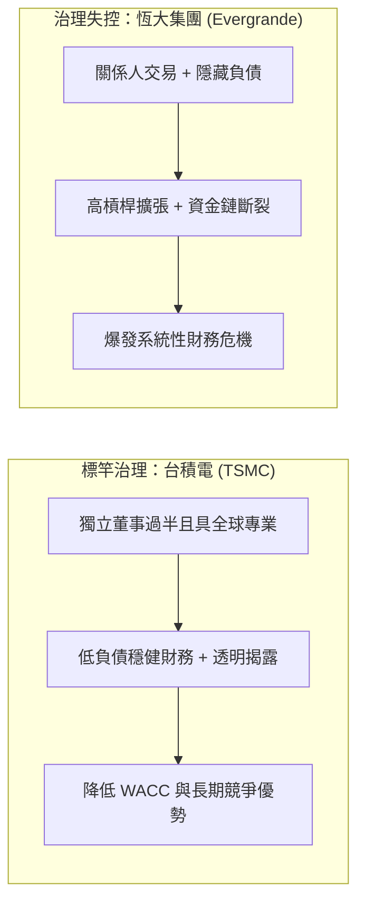

---
{"dg-publish":true,"permalink":"/04/10/02/module-3/m3-5/","tags":["課程筆記","PMBA","主題選修","創業財務","公司治理","代理理論","高階薪酬","掏空風險","關鍵人物風險","利益關係人"],"dg-note-properties":{"類別":"課程筆記","課程名稱":"[[創業與企業財務策略]]","模組編號":"Module 3","模組名稱":"企業生命週期與財務戰略","章節編號":"M3-5","主題":"公司治理生命週期與財務策略整合 (Corporate Governance Lifecycle & Financial Strategy Integration)","對應週次":"Week 12 (2026-11-24)","狀態":"🟢 已完成","tags":["課程筆記","PMBA","主題選修","創業財務","公司治理","代理理論","高階薪酬","掏空風險","關鍵人物風險","利益關係人"],"aliases":["M3-5 公司治理生命週期與財務策略整合","公司治理與財務策略"]}}
---


# 🏛️ M3-5 公司治理生命週期與財務策略整合

> [!abstract] 導讀與對接
> - **上級地圖**：[[04_主題選修/10_創業與企業財務策略/_創業與企業財務策略 MOC\|創業與企業財務策略 MOC 全景地圖]]
> - **進度看板**：[[05_AI選修/10_AiX/00_課程導航與進度/progress_📊 課程與筆記進度追蹤\|課程與筆記進度追蹤看板]]
> - **核心概念庫**：[[98_商業概念庫/corporate-governance_公司治理\|corporate-governance_公司治理]] · [[98_商業概念庫/agency-problem_代理人問題\|agency-problem_代理人問題]] · [[98_商業概念庫/agency-costs_代理成本\|agency-costs_代理成本]] · [[98_商業概念庫/stakeholder-theory_利害關係人理論\|stakeholder-theory_利害關係人理論]] · [[98_商業概念庫/Ownership_Lifecycle_Governance_所有權週期與公司治理演化\|Ownership_Lifecycle_Governance_所有權週期與公司治理演化]] · [[98_商業概念庫/Executive_Remuneration_and_Tunneling_高階薪酬激勵與掏空風險防禦\|Executive_Remuneration_and_Tunneling_高階薪酬激勵與掏空風險防禦]] · [[98_商業概念庫/Key_Man_Risk_and_Governance_Reform_關鍵人物風險與治理改革\|Key_Man_Risk_and_Governance_Reform_關鍵人物風險與治理改革]] · [[Dual_Class_Shares_雙重股權與特別表決權架構\|Dual_Class_Shares_雙重股權與特別表決權架構]]
> - **授課教師**：國立臺灣大學進修推廣學院 郭翠菱 教授
> - **課堂時間**：2026-11-24（Week 12 / Class 13）

---

## 📌 筆記更新進度（Progress & Versioning）
- **處理進度**：Class 13 教材（Unit 1~6）與 L12 逐字稿（關鍵人物風險與輝達治理改革）100% 整合完成
- **更新歷程**：
  - **v1.0 (2026-11-24)**：正式建立。全面梳理所有權生命週期六階段、執行董事薪酬與平價選擇權設計、控制權增強機制與掏空（Tunneling）防禦、主動／被動機構投資人角色、利益關係人與 ESG 降 WACC 效應、台積電 vs. 恆大集團及輝達（NVIDIA）關鍵人物風險實證。

---

## 1. 核心精要（Executive Summary）
- **治理與財務的共生關係**：**公司治理決定財務策略的品質，財務策略則將公司治理轉化為企業價值**。健全的治理能有效抑制過度投資（Overinvestment）與自由現金流浪費，壓低企業資金成本（WACC）並提升評價倍數（P/E、EV/EBITDA）。
- **所有權週期決定治理形式**：企業從獨資、合夥、親友融資走到私募基金與公開發行（IPO），股權日趨分散、資訊不對稱與代理成本急劇升高，治理機制必須由非正式人際信任轉向獨立董事、審計委員會與強制資訊揭露。
- **高階薪酬與財務決策連動**：以市場指標（TSR、SVA）搭配平價（At-the-money）長天期股票選擇權，可將高管利益錨定長期股東價值；惟薪酬委員會必須同步考量股利發放與股票回購對選擇權價值的連動影響。
- **雙重防禦「控制權剝削」與「關鍵人物風險」**：透過獨立董事過半、董總分離、防範控制權與現金流權偏離，可有效降低掏空（Tunneling）與財務危機機率；同時，面對核心創辦人異動衝擊（如輝達黃仁勳事件），企業須建置獨立安全委員會與法遵長等制度化防線，化解關鍵人物風險（Key-man Risk）。

---

## 2. 導論與公司治理的生命週期（Unit 1）

### 2.1 公司治理與財務策略的核心聯結
- **公司治理（Corporate Governance）**：指導與控制企業的一套制度安排，涵蓋董事會結構（獨董、審計／薪酬委員會）、股東權益保護、內稽內控、高管績效薪酬連結與 CSR / ESG 永續治理，核心目標在於**提高透明度與問責性、降低代理問題與道德風險**。
- **財務策略（Financial Strategy）**：達成企業長期目標的資本結構、投資、股利、現金流與風險對沖決策。兩者形成正向閉環：治理確保決策透明合規、風險可控，進而提升長期財務績效與策略執行力。

### 2.2 所有權週期的六個階段與治理演變
隨著企業規模擴張，所有權結構（Ownership Cycle）經歷六個階段演化（詳見 [[98_商業概念庫/Ownership_Lifecycle_Governance_所有權週期與公司治理演化\|Ownership_Lifecycle_Governance_所有權週期與公司治理演化]]）。值得注意的是，**所有權週期不一定與產品或產業生命週期完全線性同步**，若家族企業提前引入機構投資人卻維持非正式文化，極易爆發治理衝突：

| 所有權階段 | 主要控制者 | 資訊不對稱程度 | 核心治理機制與焦點 |
| :--- | :--- | :---: | :--- |
| **1. 獨資** | 創辦人本人 | 極低（自行知情） | 個人承擔無限／完全責任，無需正式治理結構 |
| **2. 合夥** | 少數合夥人 | 低 | 合夥契約約定權責與分潤 |
| **3. 管理者自有股權融資** | 創辦團隊 | 低－中 | 內部共識決策、簡單職務分工 |
| **4. 家人親友股權融資** | 創辦人＋親友股東 | 中 | 基於人際信任的非正式監督 |
| **5. 私募基金融資 (PE/VC)** | 創辦人＋私募機構 | **中－高** | **董事會席次、定期財報要求、里程碑條款** |
| **6. 公開市場募資 (IPO)** | 分散股東＋機構投資人 | **極高** | **獨立董事、審計委員會、強制重大訊息揭露** |

---

## 3. 執行董事薪酬設計、績效衡量與控制權增強機制（Unit 2）

### 3.1 高階主管薪酬結構與績效指標選擇
高階主管薪酬是公司治理中最具爭議的核心議題，目標在於使高管財富與股東長期價值對齊（詳見 [[98_商業概念庫/Executive_Remuneration_and_Tunneling_高階薪酬激勵與掏空風險防禦\|Executive_Remuneration_and_Tunneling_高階薪酬激勵與掏空風險防禦]]）：
- **常見組成**：基本薪資（Base Salary）＋ 會計利潤年度紅利 ＋ 長期股權激勵（股票、選擇權、限制型股票 RSU）。
- **績效指標比較**：
  - **[[98_商業概念庫/Shareholder_Value_Added_SVA_股東價值增加法\|SVA（股東價值增加法）]]**：直接掛勾為股東創造的淨經濟價值，最貼近長期價值創造。
  - **EPS 成長率 vs. TSR（總股東報酬率）**：業界最常採用，但單一 EPS 成長率門檻對高成長企業可能失效（無法反映市場對股價的更高預期），且易誘發會計盈餘操縱。

### 3.2 平價股票選擇權與財務決策的連動
- **平價授予（At-the-money）與到期日效應**：高階主管股票選擇權通常以「平價」形式授予；在履約條件相同下，**距到期日愈遠，選擇權時間價值愈高，激勵吸引力愈強**。
- **與股利及庫藏股政策的連動**：發放高額現金股利會導致除息後股價下調（減損未調整之選擇權價值），而執行股票購回則有助推升每股價值，因此董事會設計薪酬方案時必須與股利及資本配置通盤考量。

### 3.3 控制權增強機制與小股東治理困境
當公司股權高度分散時，個別小股東因搭便車與集體行動成本過高，對公司決策影響力極微；反之，部分企業為防禦外部併購或維持家族／國家主導，常採用以下控制權增強機制：
- **表決權比例上限（Voting Rights Ceilings）**：限制單一股東無論持股多寡，投票權皆設有上限。
- **所有權比例上限（Ownership Ceilings）**：規定持股超過上限部分須強制出售。
- **金股（Golden Shares）**：常見於政府對國防、能源等敏感產業保留的一票否決特別股。
- **金字塔結構、交叉持股與[[Dual_Class_Shares_雙重股權與特別表決權架構\|複數表決權股票（A/B 股）]]**。

---

## 4. 募集資金、掏空風險與機構投資人監督（Unit 3 & Unit 4）

### 4.1 資金管道的治理意涵與掏空風險（Tunneling）
不同資金來源（銀行借款、私募股權、公開發行）不僅是融資成本的選擇，更是治理結構的選擇。當大股東擁有絕對控制權卻缺乏制衡時，極易發生**掏空風險（Tunneling）**——大股東透過不公允關係人交易、高買低賣資產或違規背書保證，將公司資源輸送給私人控制實體，嚴重剝削少數股東。

| 降低少數股東剝削風險之機制 | 增加少數股東剝削風險之情境 |
| :--- | :--- |
| • 健全的獨立董事制度與審計委員會<br>• 強制性、即時性的財務與重大訊息揭露<br>• 股東集體訴訟與低成本司法救濟<br>• 機構投資人積極監督與代理投票（Proxy Voting） | • 股權高度集中於單一家族或集團<br>• **控制權與現金流量請求權顯著偏離**（金字塔／交叉持股）<br>• 法規執行力薄弱、司法救濟成本高昂<br>• 資訊揭露不完整，外部難以監督 |

### 4.2 機構投資人在公司治理的角色（Unit 4）
- **主動型投資人（Active Investors）**：如主動式共同基金、避險基金與激進投資人，具強烈誘因深入研究基本面、出席股東會並發動代理投票或董事會改革，對管理層形成實質外部監督。
- **被動／指數型投資人（Passive Investors）**：雖持有龐大市值比例（如貝萊德、先鋒），但因追蹤指數且持股極度分散、管理費低廉，在傳統個別公司的微觀監督誘因上相對受限，多透過系統性 ESG 準則與統一投票指引發揮影響力。

---

## 5. 利益關係人理論、國內實證與標竿個案（Unit 5 & Unit 6）

### 5.1 利益關係人理論與治理創造股東價值
結合 [[98_商業概念庫/stakeholder-theory_利害關係人理論\|stakeholder-theory_利害關係人理論]]，企業不僅對股東負責，亦須兼顧員工、客戶、供應商與社會環境。良好的公司治理與永續金融（ESG）能透過以下機制轉化為實質財務價值：
1. **降低資金成本（WACC）**：提升資訊透明度與風險控管，降低債權人與股東要求的風險溢酬。
2. **提升評價倍數（P/E、EV/EBITDA）**：市場願意給予治理透明度高的企業「治理溢價」。
3. **抑止自由現金流浪費**：嚴格的 NPV / IRR 投資審查，防範經理人進行摧毀價值的過度投資（Overinvestment）。

### 5.2 標竿企業對比與輝達關鍵人物風險實戰


- **L12 逐字稿時事深度剖析 — 輝達（NVIDIA）關鍵人物風險（Key-man Risk）與治理改革**：
  - **事件背景**：2026 年 11 月黃仁勳短暫離職與復職引發台美半導體劇烈震盪，暴露出單一領袖主導下「**關鍵人物風險（Key-man Risk）**」與依賴個人口頭承諾之「循環融資鏈」的結構性脆弱（參見 [[98_商業概念庫/Key_Man_Risk_and_Governance_Reform_關鍵人物風險與治理改革\|Key_Man_Risk_and_Governance_Reform_關鍵人物風險與治理改革]]）。
  - **董事會附帶復職條件的治理改革**：輝達董事會雖通過復職，但同步推動兩大制度化改革：(1) 設立**全數由獨立董事組成之「國家安全與出口管制委員會」**；(2) 公開遴選新設**法遵長（Chief Compliance Officer）**，將原本高度依賴創辦人個人的政治與出口合規判斷，收編為制度化的董事會監督機制。
  - **對新創 BP 的啟示**：投資人審查新創商業計畫書時，高度警惕「創辦人一旦離開公司即停擺」的關鍵人物風險，創辦團隊必須預先規劃接班備援與制度化治理框架。

### 5.3 台灣資本市場實證研究（《財金論文叢刊》2018 年第 29 期）
國內實證研究揭示公司治理品質與「財務危機發生機率」的六大顯著關聯：
1. **管理者持股比率** ➔ 顯著**負相關**（支持「利益收斂假說」，高管持股越多越不會亂搞）。
2. **控制權與現金流量請求權偏離程度** ➔ 顯著**正相關**（偏離越大，越容易發生掏空與危機）。
3. **董監事持股質押比率** ➔ 顯著**正相關**（質押越高，股價下跌時斷頭壓力與道德風險劇增）。
4. **機構投資人持股比率** ➔ 顯著**負相關**（法人監督有助降低危機）。
5. **董事會規模與獨立董事比率** ➔ 顯著**負相關**；但**董事長兼任總經理（董總兼任）** ➔ 顯著**正相關**（自己監督自己導致風險大增）。
6. **資訊揭露程度** ➔ 顯著**負相關**（透明度越高，財務危機機率越低）。

---

## 6. 經理人治理與財務策略檢核清單
- [ ] **股權與控制權校準**：是否檢視過控股股東的「控制權 vs. 現金流權」偏離幅度，以及董監持股質押比率是否過高？
- [ ] **董總分離與委員會獨立性**：審計、薪酬與關鍵風險委員會是否由獨立董事主導，避免「自己監督自己」？
- [ ] **高管激勵與資本配置連動**：調整股利政策或啟動庫藏股時，是否同步評估對高管選擇權與長期激勵契約的誘因影響？
- [ ] **關鍵人物風險備援**：核心技術、客戶關係或政府合規是否過度集中於單一創辦人，缺乏法遵與接班制度防線？

---

## 7. 課程架構心智圖（Markmap / XMind 相容）
```markdown
# M3-5 公司治理生命週期與財務策略整合
## Unit 1：公司治理的生命週期
### 治理決定財務策略品質，財務策略將治理轉化為企業價值
### 所有權六階段：獨資 ➔ 合夥 ➔ 自有 ➔ 親友 ➔ PE ➔ IPO
### 資訊不對稱升高 ➔ 從人際信任轉向獨董與審計制度化
## Unit 2：執行董事薪酬與控制權
### 績效指標：SVA / TSR / EPS 成長率比較
### 平價股票選擇權 (At-the-money)：到期日愈遠價值愈高，與股利/庫藏股連動
### 控制權增強：表決權上限、金股、金字塔結構、雙重股權
## Unit 3 & 4：募資治理與機構投資人
### 掏空風險 (Tunneling) vs 少數股東四大保護機制
### 主動型投資人 (積極監督) vs 被動/指數型投資人
## Unit 5 & 6：利益關係人、實證與實戰個案
### ESG 與公司治理降低 WACC、提升 P/E 與 EV/EBITDA
### 台積電 (獨董過半/低負債) vs 恆大 (關係人交易/高槓桿)
### 輝達 Key-man Risk 改革：全獨董國安出口管制委員會 + 法遵長
### 台灣實證六大發現 (持股質押正相關、獨董與資訊揭露負相關)
```
