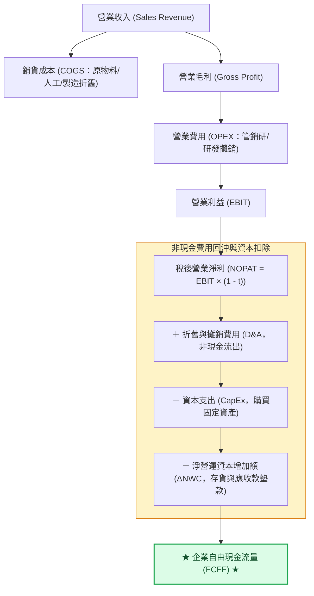

---
{"dg-publish":true,"permalink":"/04/10//m1-2-w05/","tags":["白板決策鏈","財務價值三角","PEST","VRIO","SWOT","杜邦分析","永續成長率","企業價值","折舊回沖","企業生命週期","股利政策","庫藏股","台積電vs鴻海"],"dg-note-properties":{"類別":"課程筆記","課程名稱":"[[創業與企業財務策略]]","模組編號":"Module 1","模組名稱":"創新思維與商業模式","章節編號":"M1-2","主題":"白板決策鏈與財務價值三角 (Decision Chain & Corporate Value Triangle)","對應週次":"Week 1 ~ Week 5 全域深化 (2026-10-06 跨堂重構)","狀態":"🟢 已完成","tags":["白板決策鏈","財務價值三角","PEST","VRIO","SWOT","杜邦分析","永續成長率","企業價值","折舊回沖","企業生命週期","股利政策","庫藏股","台積電vs鴻海"]}}
---


# 📐 M1-2 白板決策鏈與財務價值三角：從總體戰略、折舊回沖到杜邦營運效率矩陣

> [!abstract] 導讀與對接
> 本筆記為《創業與企業財務策略》最核心之跨堂白板推導全域旗艦筆記。貫穿「外部環境分析 ➔ 內部資源檢驗 ➔ 策略交叉矩陣 ➔ 商業決策四階躍遷」，並全面融合 Class 5 最新白板深化推導：**杜邦公式三因子拆解與永續成長率公式 ($g=b\times ROE$)**、**資本支出與折舊回沖現金流機制**、**企業生命週期（CLC）五階段投融資矩陣**、**資產週轉率 vs. NOPAT 獲利矩陣（差異化 vs. 低成本）**，以及**台積電 vs. 鴻海 (2317) 之權益與營收創造效率實算對比**。
> - **上級地圖**：[[04_主題選修/10_創業與企業財務策略/00_課程導航與進度/mindmap_創業與企業財務策略_心智圖導航\|全課程心智圖導航]]
> - **進度看板**：[[04_主題選修/10_創業與企業財務策略/00_課程導航與進度/progress_📊 課程與筆記進度追蹤\|📊 課程與筆記進度追蹤看板]]
> - **關聯模組**：[[04_主題選修/10_創業與企業財務策略/02_模組筆記/Module_1_創新思維與商業模式/M1-1_創業本質與創業家精神\|M1-1 創業本質與創業家精神]] ｜ [[04_主題選修/10_創業與企業財務策略/02_模組筆記/Module_1_創新思維與商業模式/M1-10_七大市場力量與商業戰略價值公式\|M1-10 七大市場力量與商業戰略價值公式]] ｜ [[04_主題選修/10_創業與企業財務策略/02_模組筆記/Module_2_產品創新與精實驗證/M2-1_精實產品開發與服務創新驗證\|M2-1 精實產品開發與服務創新驗證]]
> - **核心概念庫**：[[98_商業概念庫/ROIC_投入資本報酬率 Return on Invested Capital\|ROIC 投入資本報酬率]] ｜ [[98_商業概念庫/NWC_淨營運資本 Net Working Capital\|NWC 淨營運資本]] ｜ [[98_商業概念庫/CCC_現金循環週期 Cash Conversion Cycle\|CCC 現金循環週期]] ｜ [[98_商業概念庫/dcf_現金流量折現法\|DCF 現金流量折現法]]

---

## 🏛️ 一、 核心理論本質：白板戰略決策全景鏈

教授於課堂白板推導出創業家與高階經理人從宏觀環境審視到微觀落地的完整思維鏈條：

```text
[總體超環境] PESTEL 分析 (政治地緣、利率通膨、社會人口、科技變革)
       │
       ▼
[產業環境]   Porter 五力分析 (既有競爭、進入障礙、替代威脅、買賣方議價力)
       │
       ▼
[企業內部]   價值鏈活動 (Value Chain) ──▶ VRIO 核心能耐檢驗 (V-R-I-O)
       │
       ▼
[策略交叉]   SWOT 四象限決策矩陣 (Maxi-Maxi / Maxi-Mini / Mini-Maxi / Mini-Mini)
       │
       ▼
[商業模式]   商業模式畫布 (BMC) ＋ 兩全思維 (Trade-On Thinking)
       │
       ▼
[價值實現]   營業活動 (ROE) ＋ 融資結構 (Debt/Equity) ＋ 投資成長率 (g = b × ROE) ──▶ 企業價值 EV
```

### 商業決策四階段躍遷 (The 4-Stage Leap)
1. **策略規劃 (Strategic Planning)**：透過 PESTEL、五力分析與 SWOT 辨識市場機會與威脅，確立長青願景；
2. **商業模式 (Business Model)**：透過價值主張畫布（VPC）與 BMC 九宮格設計顧客獲利方程式；
3. **戰術執行 (Tactical Operations)**：平衡計分卡（BSC）四構面落地，將策略轉化為領先與落後 KPI；
4. **財務衡量 (Financial Metrics)**：透過自由現金流（FCFF/FCFE）、杜邦分析、ROIC 與永續成長率檢驗最終真實價值。

---

## 🛠️ 二、 課堂白板推導專題一：杜邦公式拆解與永續成長率公式 (Class 5 深度深化)

在 Class 5 現場，教授重回白板深化了創業企業在資產負債表與損益表交界處的數理邏輯：

### 2.1 杜邦三因子拆解 (The DuPont Identity)
$$\text{ROE (股東權益報酬率)} = \frac{\text{淨利 (Net Income)}}{\text{股東權益 (Equity)}} = \underbrace{\frac{\text{淨利}}{\text{營業收入}}}_{\text{營業利益率 (Profitability)}} \times \underbrace{\frac{\text{營業收入}}{\text{總資產}}}_{\text{資產週轉率 (Efficiency)}} \times \underbrace{\frac{\text{總資產}}{\text{股東權益}}}_{\text{權益乘數 (Financial Leverage)}}$$

* **獲利能力維度（營業利益率）**：取決於產品差異化定價權與成本結構控制；
* **營運效率維度（資產週轉率）**：取決於一塊錢資產能夠驅動多少營收，反映產能利用率與存貨管理效率；
* **財務槓桿維度（權益乘數）**：取決於資本結構中負債的佔比，槓桿能放大收益，但亦同向放大破產風險。

---

### 2.2 永續成長率公式數理推導 (Sustainable Growth Rate, SGR)
新創企業在不發行新股稀釋股權、且維持固定財務結構與股利政策的前提下，僅憑**自身盈餘保留轉增資**所能支撐的最高年化營收成長率：

$$g = b \times ROE = (1 - d) \times ROE$$

其中：
* $b = \text{盈餘保留率 (Retention Rate)} = 1 - d$；
* $d = \text{股利發放率 (Dividend Payout Ratio)} = \frac{\text{現金股利}}{\text{稅後淨利}}$。

若進一步將杜邦分析代入：
$$g = (1 - d) \times \left[ \left( \frac{\text{淨利}}{\text{營收}} \right) \times \left( \frac{\text{營收}}{\text{總資產}} \right) \times \left( \frac{\text{總資產}}{\text{股東權益}} \right) \right]$$

---

### 2.3 實務批判：成長的陷阱 (The Growth Trap)
> **教授課堂警示**：  
> 「**成長本身是需要吃資金的！** 許多創辦人誤以為營收成長越快越好，年增率 50%、100% 盲目衝刺，卻發現公司突然黑字倒閉。為什麼？因為實際成長率（Actual Growth）遠超永續成長率（$g$）時，公司營運資金（NWC）將呈幾何級數枯竭！」

* **當 $\text{Actual Growth} > g$**：企業面臨「現金短缺危機（Cash Deficit）」，必須透過借貸、外部股權融資（VC）或壓縮存貨週轉天數應急，否則將發生資金鏈斷裂；
* **當 $\text{Actual Growth} < g$**：企業產生「閒置現金累積（Cash Surplus）」，若無有利可圖的新投資項目，應啟動資本返還（配發股利或買回庫藏股），避免 ROE 遭過多閒置資金稀釋。

---

## 📊 三、 課堂白板推導專題二：資產週轉率 vs. NOPAT 獲利矩陣（台積電 vs. 鴻海實算）

教授在 Class 5 白板上精準勾勒出麥可·波特競爭策略在財務報表上的落點：

```text
  營業利益率 / NOPAT Margin (差異化能耐)
      ▲
      │  【極致差異化象限】
高毛利│  • 台積電 (TSMC)：淨利率 ~40%, ROE ~30%, 技術護城河
      │  • 大立光、聯發科、晶華酒店
      │
中毛利│                【中間防禦型象限】
      │                • 中華電信、葡萄王
      │
低毛利│                                      【低成本規模營運象限】
      │                                      • 鴻海 (Foxconn)：淨利率 ~2-3%, 週轉如飛
      │                                      • 廣達、統一超 (7-Eleven)
      └─────────────────────────────────────────────────────────────►
      低週轉                                 高週轉 (Sales / Total Assets)
```

### 台積電 (2330) vs. 鴻海 (2317) 財務效率實算對標

| 比較構面 | 台積電 (TSMC) | 鴻海 (Foxconn) | 商管戰略意涵判讀 |
| :--- | :--- | :--- | :--- |
| **核心商業定位** | 純晶圓代工（純技術製造服務） | 全球電子製造服務（EMS / ODM 整合） | 上游關鍵組件技術壟斷 vs. 下游龐大組裝規模經濟 |
| **營業毛利率** | **53% ~ 55%**（定價特權） | **6% ~ 7%**（代工薄利多銷） | 台積電享有先進製程不可替代溢價；鴻海靠產能調度賺取微利。 |
| **稅後淨利率** | **~40%** | **~2% - 3%** | 一塊錢營收中，台積電保留 0.4 元淨利，鴻海僅保留 0.02~0.03 元。 |
| **資產週轉率** | **~0.6 - 0.7 次/年** | **~1.8 - 2.2 次/年** | 鴻海資產週轉速度約為台積電的 3 倍，一塊錢資產每年創造 2 元以上營收。 |
| **淨營運資本 NWC** | 充沛現金儲備支撐巨大 CapEx | 嚴控存貨週轉天數與應收帳款帳齡 | 鴻海供應鏈排程稍有差池即面臨巨額資金積壓。 |
| **ROE 驅動核心** | **超高利潤率驅動** | **超高資產週轉率驅動** | 兩種截然不同但皆能成功的極致戰略典範。 |

> **波特陷阱警告**：  
> 最危險的企業是落入**「既無差異化定價權（毛利低），又無供應鏈週轉效率（週轉慢）」**的夾在中間區（Stuck in the Middle），此類企業在升息週期與不景氣時必定優先出清倒閉。

---

## 💰 四、 課堂白板推導專題三：資本支出與折舊回沖現金流機制

### 4.1 現金流創造傳導鏈
在白板右側，教授推導了從損益表營業利益轉化為真實自由現金流的聯動公式：

$$\text{EBITDA} = \text{EBIT (營業利益)} + \text{折舊費用 (Depreciation)} + \text{攤銷費用 (Amortization)}$$
$$\text{FCFF (企業自由現金流)} = \text{NOPAT} + \text{折舊攤銷} - \text{資本支出 (CapEx)} - \Delta\text{NWC (淨營運資本增加額)}$$



* **折舊回沖（Depreciation Add-Back）的本質**：折舊費用在會計上為抵稅項目（Tax Shield），但**當期並無實質現金流出**。前期龐大的 CapEx 投資在後續年份化為每年回沖的強大現金流，支撐企業再投資與研發。

---

## 📈 五、 課堂白板推導專題四：企業生命週期（CLC）投融資矩陣與資本返還

```text
企業規模/利潤
     ▲                                   【成熟期】
     │                                 (ROE 核心)
     │                               . - - - - - .
     │                            .                 .  【衰退期】
     │                         .                       .
     │                      .  【成長期】                 .
     │                   .    (ROIC 核心)                  .
     │                .                                      ▼
     │  【導入期】 .
     │  (現金燒錢)
     └────────────────────────────────────────────────────────► 時間
```

### 資本三階進化：取得 (ROA) ➔ 運用 (ROIC) ➔ 返還 (ROE)

| 生命週期階段 | 核心財務挑戰 | 融資結構 (Financing) | 投資與資本配置 (Investing) | 股利與返還戰略 (Payout) |
| :--- | :--- | :--- | :--- | :--- |
| **1. 導入期<br>(Introduction)** | 現金消耗率極高 (Burn Rate)，淨現金流為負。 | 天使投資、創投 (VC Seed/A輪)、政府補助款。嚴禁銀行借貸。 | 極限壓縮固定資本，投資 MVP 假說驗證與客戶獲取。 | 零股利配發；保留每一分現金保護現金跑道 (Runway)。 |
| **2. 成長期<br>(Growth)** | 營收暴衝導致 NWC 急劇擴張，應收帳款與存貨墊款劇增。 | VC (B/C輪)、成長型股權基金 (PE)、發行可轉債 (CB)。 | 大規模擴產 (CapEx)，鋪設全球通路，鞏固規模經濟與護城河。 | 不配息或微量股票股利；盈餘全數再投資以追求 $g$ 極大化。 |
| **3. 成熟期<br>(Maturity)** | 營收觸碰產業天花板，再投資報酬率開始遞減。 | 公開市場 IPO 掛牌、發行公司債、商業銀行抵押貸款。 | 投資第二成長曲線（CVC 併購新創）、自動化降本增效。 | **啟動大額現金股利與庫藏股回購**，將過剩資本返還股東，維持 ROE。 |
| **4. 衰退期<br>(Decline)** | 產業萎縮，產能過剩，面臨資產減損。 | 嚴控負債，處分閒置資產變現。 | 嚴禁擴產，僅保留必要維護支出；啟動雙軌轉型。 | 收割式分紅、清算退場、併購重組。 |

---

## 📚 六、 案例對標與跨模組雙向鏈結網絡

### 6.1 課堂逐字稿實證案例對標
1. **台積電 (2330)**：高毛利、高 ROE 差異化典範；巨額折舊回沖再投資先進製程，形成資本與技術護城河閉環。
2. **鴻海 (2317)**：極致資產週轉率典範；透過全球供應鏈垂直整合與彈性製造，在低利潤率下創造卓越權益回報。
3. **統一超商 (7-Eleven)**：負 CCC 現金流巨獸；以先收後付創造巨額無息浮存金，轉化為全方位生活通路資產。

### 6.2 跨模組雙向鏈結網絡
- **前序模組**：[[04_主題選修/10_創業與企業財務策略/02_模組筆記/Module_1_創新思維與商業模式/M1-1_創業本質與創業家精神\|M1-1 創業本質與創業家精神]] ｜ [[04_主題選修/10_創業與企業財務策略/02_模組筆記/Module_1_創新思維與商業模式/M1-10_七大市場力量與商業戰略價值公式\|M1-10 七大市場力量]]
- **後續模組**：[[04_主題選修/10_創業與企業財務策略/02_模組筆記/Module_2_產品創新與精實驗證/M2-1_精實產品開發與服務創新驗證\|M2-1 精實產品開發與服務創新驗證]] ｜ [[04_主題選修/10_創業與企業財務策略/02_模組筆記/Module_2_產品創新與精實驗證/M2-2_產品組合策略與品牌權益管理\|M2-2 產品組合策略與品牌權益管理]]
- **概念庫對接**：[[98_商業概念庫/ROIC_投入資本報酬率 Return on Invested Capital\|ROIC 投入資本報酬率]] ｜ [[98_商業概念庫/NWC_淨營運資本 Net Working Capital\|NWC 淨營運資本]] ｜ [[98_商業概念庫/CCC_現金循環週期 Cash Conversion Cycle\|CCC 現金循環週期]] ｜ [[98_商業概念庫/dcf_現金流量折現法\|DCF 現金流量折現法]]