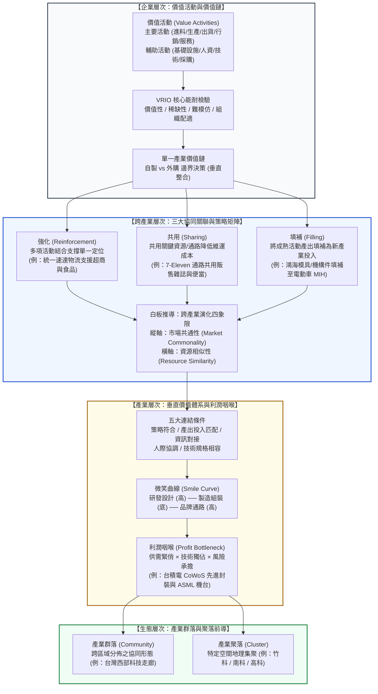

---
{"dg-publish":true,"permalink":"/04/12/02/module-2/m2-1/","tags":["PMBA","產業分析","產業間分析","價值鏈","產業價值體系","跨產業協同","微笑曲線","利潤咽喉","白板推導"],"dg-note-properties":{"類別":"課程筆記","課程名稱":"[[產業分析與投資策略]]","模組編號":"Module 2","模組名稱":"產業間分析","章節編號":"M2-1","主題":"產業垂直價值體系與跨產業協同機制 (Industry Vertical Value System & Cross-Industry Synergies)","對應週次":"Week 6 (2026-10-15)","狀態":"🟢 已完成","tags":["PMBA","產業分析","產業間分析","價值鏈","產業價值體系","跨產業協同","微笑曲線","利潤咽喉","白板推導"]}}
---


# M2-1 產業垂直價值體系與跨產業協同機制

> [!abstract] 導讀與對接
> 本筆記為《[[產業分析與投資策略\|產業分析與投資策略]]》第六週（Class 6，2026-10-15）核心模組重點筆記。在歷經前五週單一產業內的結構解剖（五力分析、SCP、策略群組與商業生態系）後，本篇標誌著全課程正式由「產業內分析（Intra-Industry Analysis）」跨入「產業間分析（Inter-Industry Analysis）」。筆記以麥可·波特（Michael Porter）之企業價值活動為起點，解構從單一產業內部垂直整合向跨產業價值網延伸之傳導路徑；深度剖析跨產業三大協同關聯（強化、共用、填補）與課堂白板推導之「市場共通性 × 資源相似性」四象限演化矩陣；並進一步躍升至產業層次價值體系，揭示施振榮「微笑曲線」利潤流向與「利潤咽喉（Profit Bottleneck）」的戰略掌握，最後對標生物學群落概念，辨析產業群落（Community）與產業聚落（Cluster）之本質差異。
> 
> - **上級地圖**：[[04_主題選修/12_產業分析與投資策略/_產業分析與投資策略 MOC\|_產業分析與投資策略 MOC]] ｜ [[04_主題選修/12_產業分析與投資策略/00_課程導航與進度/mindmap_產業分析與投資策略_心智圖導航\|全課程心智圖導航]]
> - **進度看板**：[[04_主題選修/12_產業分析與投資策略/00_課程導航與進度/progress_📊 課程與筆記進度追蹤\|課程與筆記進度追蹤看板]]
> - **前序模組**：[[04_主題選修/12_產業分析與投資策略/02_模組筆記/Module_1_總論與架構/M1-8_商業生態系與平台網絡\|M1-8_商業生態系與平台網絡]] ｜ [[04_主題選修/12_產業分析與投資策略/02_模組筆記/Module_1_總論與架構/M1-5_波特五力分析與量化架構\|M1-5_波特五力分析與量化架構]] ｜ [[04_主題選修/12_產業分析與投資策略/02_模組筆記/Module_1_總論與架構/M1-7_產業市場空間與策略群組\|M1-7_產業市場空間與策略群組]]
> - **核心概念庫**：[[98_商業概念庫/Value_System_產業價值體系\|Value_System_產業價值體系]] ｜ [[98_商業概念庫/Firm_Value_Chain_企業價值鏈\|Firm_Value_Chain_企業價值鏈]] ｜ [[98_商業概念庫/Cross_Industry_Synergy_跨產業協同機制\|Cross_Industry_Synergy_跨產業協同機制]] ｜ [[98_商業概念庫/Smile_Curve_微笑曲線\|Smile_Curve_微笑曲線]] ｜ [[98_商業概念庫/Industry_Community_產業群落與聚落\|Industry_Community_產業群落與聚落]]

---

## 一、 視覺化知識脈絡圖 (Mermaid Context)



---

## 二、 企業層次價值活動與價值鏈 (Porter's Value Chain)

### 2.1 價值活動的本質與兩大結構分類
麥可·波特（Michael Porter, 1985）指出，企業並非一個單一不可分割的黑盒子，而是由一連串具備特定經濟特性的「價值活動（Value Activities）」有機串聯而成的系統。企業之所以能創造高於競爭對手的顧客效用或享有溢價，本質上取決於每一項價值活動的運作效率與鏈條整合度。

```
┌────────────────────────────────────────────────────────────────────────┐
│                        企業基本設施 (Firm Infrastructure)              │
│ 輔  ─────────────────────────────────────────────────────────────────── │
│ 助  人力資源管理 (Human Resource Management)                           │
│ 活  ─────────────────────────────────────────────────────────────────── │
│ 動  技術發展 (Technology Development)                                   │
│     ─────────────────────────────────────────────────────────────────── │
│     採購 (Procurement)                                                  │
├─────────────┬─────────────┬─────────────┬─────────────┬────────────────┤
│  進料後勤   │  生產作業   │  出貨後勤   │ 行銷與銷售  │    售後服務    │
│  (Inbound   │ (Operations)│  (Outbound  │(Marketing & │    (Service)   │
│  Logistics) │             │  Logistics) │   Sales)    │                │
└─────────────┴─────────────┴─────────────┴─────────────┴────────────────┘
                              主要活動 (Primary Activities)      ▲ 利潤 (Margin)
```

1. **主要活動（Primary Activities）**：直接牽涉產品實體製造、移轉至顧客端及後續售後維護的核心業務流程。
   - **進料後勤（Inbound Logistics）**：原材料、零組件之收貨、倉儲、存貨控管與排程。
   - **生產作業（Operations）**：將投入轉化為最終產品實體的加工、組裝、測試與設備包裝。
   - **出貨後勤（Outbound Logistics）**：成品之倉儲、訂單處理、實體分銷與發貨運送。
   - **行銷與銷售（Marketing & Sales）**：引導顧客認知、誘發購買動機之定價、促銷、通路開拓與廣告戰略。
   - **售後服務（Service）**：維持或提升產品銷售後價值之安裝調試、人員培訓、零件供應與維修保固。
2. **輔助活動（Support Activities）**：跨越各項主要活動，為整個組織提供基礎設施與賦能之制度化職能。
   - **採購（Procurement）**：為各項價值活動取得所需投入資源之供應商篩選、比價與合約談判職能（非原料本身）。
   - **技術發展（Technology Development）**：涵蓋產品設計、製程改進、軟體開發與專利研究等研發活動。
   - **人力資源管理（HRM）**：人才招聘、培訓、薪酬考核與組織文化激勵體系。
   - **企業基本設施（Firm Infrastructure）**：支撐全企業運作的高階領導決策、經營企劃、財務會計、法務治理與品質控管體系。

---

### 2.2 價值活動與 VRIO 核心能耐檢驗
在實務產業分析中，單純列出價值活動並不足以評估競爭力。高階經理人必須將各項活動與[[98_商業概念庫/Firm_Value_Chain_企業價值鏈\|VRIO 模型]]深度對標，檢驗各活動節點是否構成持久性競爭優勢（Sustained Competitive Advantage）：

| 價值活動環節 | 標竿企業實務對標 | 價值性 (Value) | 稀少性 (Rarity) | 難以模仿性 (Inimitability) | 組織配適度 (Organization) | 競爭地位判定 |
| :--- | :--- | :---: | :---: | :---: | :---: | :---: |
| **製程作業 (Operations)** | **台積電**：埃米先進製程良率控制 | 極高：滿足全球頂尖算力晶片物理極限 | 極高：全球唯一能穩定供應下世代製程之晶圓代工廠 | 極高：數十年累積之工程師默會知識（Tacit Knowledge）與專利壁壘 | 極高：極致紀律之全天候輪班調校與研發製造整合體系 | **持久性競爭優勢 (SCA)** |
| **技術研發 (Tech Dev)** | **聯發科**：天璣晶片 APU 架構與全大核設計 | 極高：提供旗艦級高能效 AI 終端運算力 | 高：僅少數一線 IC 設計公司具備同等 IP 整合能耐 | 中高：需龐大研發團隊與 EDA 授權，但競手可挖角追趕 | 高：彈性專案敏捷開發團隊與緊密客戶 Roadmap 協同 | **暫時性/結構性優勢** |
| **出貨後勤 (Logistics)** | **統一超**：全台 7,000 店冷鏈與鮮食每日三配 | 極高：確保全台門市商品高週轉與零缺貨率 | 高：實體門市密度與捷盟物流網絡不可複製 | 高：高昂資本支出與排他性轉運站用地資產專屬性 | 極高：高度數位化之門市 POS 聯網補貨系統 | **持久性競爭優勢 (SCA)** |
| **採購談判 (Procurement)** | **鴻海**：全球被動元件與機構件集中採購 | 極高：大幅壓低採購銷貨成本（COGS） | 中：其他 EMS 代工巨頭亦具備集採規模 | 中：採購權力隨客戶指名料件比例（Consign）而受限 | 高：全球 ERP 與供應鏈風險監控中樞 | **競爭平價至暫時優勢** |

---

### 2.3 單一產業企業價值鏈：垂直整合與自製外購決策
在單一產業中，企業的價值鏈呈現水平線性展開：
$$	ext{供應商價值鏈} \longrightarrow 	ext{企業價值鏈} \longrightarrow 	ext{通路商價值鏈} \longrightarrow 	ext{買方/客戶價值鏈}$$

當企業執行的價值活動種類越多，其**垂直整合程度（Vertical Integration）**越高。企業在決定將某項價值活動「自製（Internalize / In-house）」或「外購（Outsource）」時，需考量四大關鍵準則：
1. **技術能耐與執行效率**：內部執行是否真能達到甚至超越外部專業供應商的生產效率？
2. **交易成本（Transaction Costs）**：外部採購是否存在嚴重的搜尋成本、合約談判成本與履約監督成本？當**資產專屬性（Asset Specificity）**極高時，外購極易遭受供應商「敲竹槓（Hold-up）」。
3. **掌握核心技術與確保品質**：該環節是否為產品差異化之靈魂所在？若外購是否會導致關鍵專利技術外溢或品質失控？
4. **營運彈性（Operational Flexibility）**：垂直整合會帶來沉重的固定資產（CapEx）與組織惰性，當技術典範轉移時，高度垂直整合往往淪為難以脫身的沉沒包袱（如 Intel 過去堅持 IDM 自製，反而在先進製程落後時難以快速轉單）。

> 💡 **課堂前沿案例：科技巨頭跨界自研晶片的垂直整合邏輯**  
> 近年微軟（Maia）、Google（TPU）、AWS（Trainium）及 Meta 紛紛大舉投入數百億美元自研專屬 AI 晶片。其核心戰略動機正是因為在外部採購時，NVIDIA 享有高達 75% 的壟斷性毛利率，形成強烈的供應商利益掠奪；科技巨頭透過向上游「垂直整合」自研晶片，不僅大幅降低算力取得成本、擺脫交期配額配給限制，更能使專屬軟體架構與硬體運算深度配適，奪回系統定價主導權。

---

## 三、 跨產業價值鏈的三大關聯型態與協同機制

當企業將經營範疇擴展至多個不同產業時，其價值活動便交織形成「跨產業價值鏈（Cross-Industry Value Chain）」。波特與策略學者指出，跨產業多角化經營之所以能創造「$1 + 1 > 2$」的綜效，根源於以下三種價值活動的關聯型態：

```
(1) 強化 (Reinforcement)      (2) 共用 (Sharing)             (3) 填補 (Filling)
   ┌───────────┐                ┌───────────┐ ┌───────────┐    ┌───────────┐
   │價值活動 A │                │A 產業製造 │ │B 產業製造 │    │價值活動 A1│
   └─────┬─────┘                └─────┬─────┘ └─────┬─────┘    └─────┬─────┘
         │                            │           │                  │ (關鍵投入)
   ┌─────▼─────┐                      └─────┬─────┘            ┌─────▼─────┐
   │ 策略定位  │                            │                  │價值活動 B2│
   ┌─────▲─────┐                      ┌─────▼─────┐            └───────────┘
         │                            │ 共用通路  │            (跨產業要素移轉)
   ┌─────┴─────┐                      └─────┬─────┘
   │價值活動 B │                      ┌─────▼─────┐
   └───────────┘                      │ 顧客 A/B  │
  (活動協同強化單一定位)               └───────────┘
                                    (資源共用降低成本)
```

### 3.1 關聯型態一：強化 (Reinforcement)
- **概念本質**：將分屬不同產業的多項價值活動有機結合，共同支持並放大某一個核心策略定位。不同產業活動之間彼此呼應、產生正向回饋加乘，使競爭對手難以單點複製。
- **代表案例：統一集團之「民生流通生態強化網」**
  - **跨界佈局**：統一企業（上游食品飲料製造業）＋ 統一超商（中下游零售連鎖通路）＋ 統一速達（物流運輸業）＋ 統一生活康是美（藥妝零售）。
  - **強化機制**：自建的統一速達低溫冷鏈物流（價值活動 A）與高密度門市網絡（價值活動 B），共同強化了統一集團「新鮮、即時、無縫便利生活圈」的單一策略定位。外部競爭對手即使在單一食品製造具備價格優勢，亦因缺乏強大的低溫配送與門市貨架協同，無法撼動其市場統治地位。

### 3.2 關聯型態二：共用 (Sharing)
- **概念本質**：不同產業的事業單位（SBU）共同使用某項關鍵資源或價值活動（如共用製造產線、採購網絡、後勤倉儲或配銷通路），藉由擴大產能利用率分攤固定成本，達成跨產業的**範疇經濟（Economies of Scope）**。
- **代表案例：7-Eleven 通路共用與複合店型創新**
  - **跨界佈局**：便利超商鮮食便利品（高週轉）＋ 雜誌書籍出版品（選購品）＋ 博客來實體取貨服務（電商物流）。
  - **共用機制**：7-Eleven 實體門市的收銀機台、店員人力與實體店面空間（共用活動），同時作為鮮食銷售、天下/商周等出版品販售及電商取件網絡。對於出版業者而言，透過共用超商通路，省去了自建實體書店的龐大租金負擔；對統一超而言，則在邊際成本幾乎為零的情況下，吸引不同客群進店帶動交叉購買。

### 3.3 關聯型態三：填補 (Filling)
- **概念本質**：企業在執行某一成熟產業之價值活動所產出的技術能力、專利資源或營運副產品，能直接作為跨足另一個新興產業時之「關鍵投入要素（Critical Inputs）」，從而填補新事業的進入缺口，大幅降低試錯成本與學習曲線。
- **代表案例：鴻海精密從「3C 代工」填補至「電動車 MIH 平台」**
  - **跨界佈局**：精密模具與電子零組件製造（3C 電腦/手機產業）$\longrightarrow$ 開放式純電動車架構平台（智慧移動與汽車產業）。
  - **填補機制**：電動車本質已轉型為「裝有四個輪子的智慧終端」，其核心構造大量採用輕量化鋁合金衝壓、高速高壓連接器、車用晶片運算板與中央網關控制。鴻海在過去 40 年資通訊製造中千錘百鍊的超精密模具開發能耐、機構件衝壓技術與全球供應鏈組裝管理（活動產出），直接「填補」成為跨足電動車產業時最稀缺的硬體工程關鍵投入，有效壓低新車開發週期自傳統 4 年縮短至 2 年以內。

---

## 四、 課堂白板推導專題：跨產業策略演化四象限矩陣

在 Class 6 課堂白板上，教授深入推導了一套極具商管策略深度的跨產業演化二維架構。該架構將行銷學的「市場面」與資源基礎理論（RBV）的「資源面」完美收斂，指引企業經理人在跨產業擴張時的戰略定位：

```
市場共通性
(Market Commonality)
      ▲
      │
      │ ┌───────────────────────────┬───────────────────────────┐
      │ │   【第三象限：填補 Filling】│   【第二象限：全面整合】  │
      │ │   • 高市場共通性 × 低資源相似性 │   • 高市場共通性 × 高資源相似性 │
      │ │   • 面對相同/相鄰客群需求   │   • 業務範疇重疊度極高        │
  高  │ │   • 自身缺乏特定核心資源     │   • 進行全面垂直/水平整合      │
      │ │   • 策略：將成熟能耐填補跨界 │   • 策略：收購合併、主導生態系│
      │ ├───────────────────────────┼───────────────────────────┤
      │ │   【第四象限：強化 Reinforce】│   【第一象限：共用 Sharing】 │
      │ │   • 低市場共通性 × 低資源相似性 │   • 低市場共通性 × 高資源相似性 │
      │ │   • 單一產業內部深耕防禦     │   • 客群與市場完全不同        │
  低  │ │   • 資源與市場無直接關聯     │   • 核心價值活動具備高通用性  │
      │ │   • 策略：多項活動聚焦單一定位│   • 策略：共用後勤/通路賺範疇財│
      │ └───────────────────────────┴───────────────────────────┘
      │
      └─────────────────────────────────────────────────────────► 資源相似性
                                  低                           高   (Resource Similarity)
```

### 4.1 二維構面核心定義
1. **縱軸：市場共通性（Market Commonality）**：
   - 衡量企業新開闢的目標市場，與既有核心市場在「目標客群（STP Target Customers）、需求痛點、定價敏感度與銷售通路」上的重疊與相似程度。
2. **橫軸：資源相似性（Resource Similarity）**：
   - 衡量不同事業單位在執行價值活動時，所仰賴的「核心技術、實體設備資產、供應商網絡與關鍵人才」之同質性與可遷移程度。

### 4.2 四大象限之策略行動指南
1. **第四象限【低市場共通性 × 低資源相似性】$\Longrightarrow$ 單一產業內部強化（Reinforcement）**
   - **情境分析**：企業處於既有產業賽道，新機會與本業客群不相通、技術資源亦不相關。
   - **經理人行動**：嚴禁盲目跨界！應將資源收斂回本業核心，以多項內部價值活動相互勾稽，極致強化當前的防禦性定位（如特定精密醫療耗材廠專注深耕專利製程與認證）。
2. **第一象限【低市場共通性 × 高資源相似性】$\Longrightarrow$ 跨產業活動共用（Sharing）**
   - **情境分析**：面對截然不同的目標市場與客群，但背後所需的生產製造、物流運籌或採購能力具有極高通用性。
   - **經理人行動**：推動「資產共用中心（Shared Services Center）」，將重疊的製造廠房、物流車隊或 IT 雲端基礎架構開放跨事業共用，極大化固定資產利用率，賺取範疇經濟利益（如台灣精密機械廠將 CNC 加工技術同時共用於航太零組件與高階自行車變速器）。
3. **第三象限【高市場共通性 × 低資源相似性】$\Longrightarrow$ 跨產業要素填補（Filling）**
   - **情境分析**：面對同一批熟悉的目標顧客，但顧客產生了新需求，而企業內部缺乏生產該新產品所需的技術或資源。
   - **經理人行動**：以現有品牌信任與通路為槓桿，將自身特定優勢價值活動填補至新領域，或透過策略聯盟引進外部技術，填補關鍵投入缺口（如傳統燃油車品牌跨足純電車，以既有全球經銷商與售後服務網絡為基礎，填補外部三電系統供應商之產出）。
4. **第二象限【高市場共通性 × 高資源相似性】$\Longrightarrow$ 全面跨產業整合（Integration）**
   - **情境分析**：市場需求與資源基礎高度重疊，產業邊界發生實質「滲透與收斂（Convergence）」。
   - **經理人行動**：果斷進行大規模併購（M&A）或全面垂直一體化，統籌所有研發、製造、行銷與通路，建立端到端（End-to-End）的閉環帝國（如蘋果整合 iOS 軟體、A 系列晶片、硬體組裝與直營店 Apple Store，掌控整個個人智慧終端生態系）。

---

## 五、 產業層次價值體系與利潤咽喉 (Profit Bottleneck)

### 5.1 價值鏈間五大連結條件
當上下游各企業獨立的企業價值鏈在市場中進行垂直對接時，共同構成了宏觀的「產業垂直價值體系（Industry Vertical Value System）」。上下游能否無摩擦協同，取決於五大連結條件的配適度：

```
上游價值鏈 ──────[五大連結條件檢核]──────► 下游價值鏈
 1. 策略符合性 (Strategic Fit)   ：上游產品屬性是否符合下游終端定位？
 2. 產出投入匹配 (Input-Output)  ：上游產能規格是否精準匹配下游生產節奏？
 3. 資訊條件連結 (Information)   ：雙方 ERP / EDI 是否即時聯網消除長鞭效應？
 4. 人際關係協調 (Interpersonal) ：跨組織專案團隊是否具備深層信任與協商機制？
 5. 技術規格相容 (Specs & APIs)  ：介面標準是否標準化、模組化相容？
```

若其中一項條件斷裂，價值鏈間將產生龐大的摩擦成本，誘發供應鏈斷鏈危機。

---

### 5.2 微笑曲線 (Smile Curve) 與利潤池動態分佈
宏碁集團創辦人施振榮先生於 1992 年提出的經典「微笑曲線」，深刻揭示了產業價值體系中利潤分佈的非對稱性：

```
附加價值 / 毛利率
(Value-Added)
      ▲
  高  │   【左端：研發設計】                           【右端：品牌行銷】
      │   • 關鍵智慧財產權 (IP)                       • 全球品牌權益 (Brand)
      │   • 核心專利池 / 演算法                       • 終端通路掌握度
      │   • 產品規格制定權                           • 顧客體驗與售後服務
      │        ╲                                           ╱
      │         ╲                                         ╱
      │          ╲                                       ╱
      │           ╲         【中段：製造組裝】          ╱
      │            ╲        • 代工製造 (OEM/EMS)       ╱
  低  │             ╰─────────────────────────────────╯
      │                     • 資本密集、標準化設備
      │                     • 易招致削價競爭 (毛三到四)
      └─────────────────────────────────────────────────────────► 產業價值鏈環節
            上游 (Upstream)        中游 (Midstream)        下游 (Downstream)
```

1. **微笑曲線的策略意涵**：
   - 處於價值體系兩端的「智財研發」與「品牌通路」具有高度差異化與排他性門檻，享有超額利潤；
   - 居於中段的「製造組裝」通常因設備同質化高、競爭者眾，面臨激烈的成本殺價，毛利率被嚴重壓縮（如傳統 PC 組裝業之「毛三到四」）。
2. **微笑曲線的動態演化與逆轉（打破微笑曲線）**：
   - 施振榮先生提出微笑曲線多年後，高階半導體製造出現了歷史性逆轉：**台積電將晶圓製造推向極致技術寡占**，其毛利率高達近 60%~66%，反而遠超多數下游品牌廠。這證明了「只要在製造環節建立不可替代的物理技術壁壘與資本規模障礙，製造端亦能蛻變為整條產業鏈最高利潤的吸收者」。

---

### 5.3 利潤咽喉 (Profit Bottleneck / Chokepoint) 的形成與掌握
**利潤咽喉（Profit Bottleneck / Chokepoint）**是指整條產業垂直價值體系中，**所有商業交易與產品流動必定會通過、且被極少數關鍵廠商獨家鎖死的核心價值活動**。掌控利潤咽喉的廠商，擁有向整條產業鏈徵收「技術過路費」的特權。

#### (1) 利潤咽喉形成的三大核心要件
$$	ext{利潤咽喉形成指數} = f(	ext{供需緊俏程度}, 	ext{技術取得難易度}, 	ext{不可替代之風險承擔})$$
1. **極度失衡的供需關係**：全產業下游需求呈現指數級爆發，而該節點產能擴張受限於物理或技術瓶頸，形成唯一供給閥門。
2. **極致的技術獨佔與專利壁壘**：全球僅少數甚至唯一企業掌握製造或演算法專利，缺乏替代方案。
3. **承擔巨大不可逆之資本與研發風險**：該節點需要長達數年、數百億美元之持續不可逆投資，潛在進入者望而卻步。

#### (2) 課堂實證個案：AI 算力時代的兩大終極利潤咽喉
- **利潤咽喉一：台積電 CoWoS 先進封裝**
  - 當前全球 AI 算力（NVIDIA H100/B200 等）的需求天花板，不在於晶圓表面蝕刻，而在於將高頻寬記憶體（HBM）與 GPU 晶片整合的「CoWoS 先進封裝」產能。台積電透過掌握 CoWoS 專利技術與產能調配，牢牢卡住全球 AI 晶片出貨的咽喉要道。即使台積電在 L6 課堂法說會上宣布攜手格羅方德（GlobalFoundries）投入 20 億美元外包矽中介層（Silicon Interposer），依然掌控著封裝規格標準與最後測試的絕對利潤裁量權。
- **利潤咽喉二：艾斯摩爾（ASML）極紫外光（EUV）微影設備**
  - 全球先進製程（7nm 以下至埃米級）之晶圓代工，皆必須仰賴 ASML 獨家供應的 High-NA EUV 光刻機。L6 課堂時事指出，ASML 訂單已滿載至 2028~2029 年，甚至已有客戶預約 2030 年產能。ASML 憑藉精密光學系統、極限真空鏡組與龐大專利壁壘，成為全球半導體巨頭無可規避的咽喉巨擘。

---

## 六、 產業群落 (Community) 與產業聚落 (Cluster) 前導辨析

### 6.1 生物界群落映射：共生、寄生與競爭
從生態學角度觀察，產業世界中的企業群體如同自然界棲息地內的生物種群：
1. **共生關係（Symbiosis / Mutualism）**：企業間相互扶持、互利共榮。例如晶圓代工（台積電）與矽智財廠（ARM）、EDA 軟體商（Synopsys）共組 OIP 聯盟，共同將晶片生態圈做大。
2. **寄生關係（Parasitism）**：特定個體依附於宿主生態系汲取資源，卻對宿主生態造成磨損甚至侵蝕。例如山寨盜版軟硬體對品牌原廠智慧財產權之掠奪。
3. **競爭關係（Competition）**：當兩個或多個企業爭奪同一有限的利基資源（如人才、關鍵零組件配額、終端貨架）時，必然引發殘酷的生存競爭與優勝劣汰。

---

### 6.2 空間維度辨析：產業群落 (Community) vs. 產業聚落 (Cluster)
在 L6 課堂中，教授特別強調了兩者在分析層次與空間尺度上的精準定義：

| 比較維度 | 產業群落 (Industry Community) | 產業聚落 (Industry Cluster) | 商管策略意涵 |
| :--- | :--- | :--- | :--- |
| **定義範疇** | **跨區域、廣域分佈**之相同產業形態與生態系協同網絡 | 在**特定緊密地理空間**（如半徑 30~50 公里內）集聚之完整產業鏈 | 空間尺度由「廣域生態網絡」收斂至「微觀地理集群」 |
| **空間邊界** | 區域性或國家級經濟走廊，不強調極端緊密之面對面互動 | 嚴格受限於特定科學園區、工業市鎮或城市經濟圈 | 聚落強調「走路或一小時車程可達」之極限地理外部性 |
| **協同機制** | 依靠標準化合約、產業公協會規範、宏觀物流幹道與供應鏈網絡 | 依靠高頻人員流動、非正式餐敘人際交流、即時研發問題排解 | 聚落具備無法跨區遠距傳遞之**默會知識（Tacit Knowledge）外溢** |
| **典型代表實例** | **台灣西部高科技走廊**（基隆 ➔ 雙北 ➔ 桃竹苗 ➔ 中科 ➔ 南科 ➔ 高雄路竹） | **新竹科學園區（竹科）**、台南科學園區（南科）、美國矽谷 | 經理人設廠選址：追求廣域協同選群落；追求極限供應鏈敏捷選聚落 |

---

## 七、 高階經理人實戰工具箱：價值體系重組五步檢核表

當高階經理人與策略長評估跨產業佈局、併購或供應鏈重組時，應嚴格執行以下五步檢核：

```
┌────────────────────────────────────────────────────────────────────────────┐
│              高階經理人價值體系重組五步評估檢核表 (Value System Checklist)  │
├────────────────────────────────────────────────────────────────────────────┤
│ ☐ Step 1. 繪製價值體系地圖 (Mapping)                                      │
│    • 完整繪製本產業上游、中游、下游及互補品之垂直價值活動拓撲圖。         │
│    • 標註各環節之平均毛利率、ROIC 與市場集中度（CR4 / HHI）。              │
├────────────────────────────────────────────────────────────────────────────┤
│ ☐ Step 2. 辨識當前與潛在利潤咽喉 (Chokepoint Identification)               │
│    • 檢驗整條鏈條中，供需最緊俏、技術替代門檻最高的活動究竟掌握在誰手裡？  │
│    • 自家企業是否處於咽喉位置？若否，是否面臨被敲竹槓（Hold-up）之致命風險？│
├────────────────────────────────────────────────────────────────────────────┤
│ ☐ Step 3. 跨產業協同機制匹配 (Synergy Matching)                            │
│    • 評估新業務跨界屬於「強化（Reinforce）」、「共用（Sharing）」或「填補（Filling）」？│
│    • 對標課堂「市場共通性 × 資源相似性」四象限矩陣，確認策略落於哪一象限。 │
├────────────────────────────────────────────────────────────────────────────┤
│ ☐ Step 4. 檢驗上下游五大連結條件 (Linkage Audit)                           │
│    • 逐項審查：策略符合性、產出投入匹配、資訊聯網、人際協調、技術規格相容。│
│    • 任一連結條件薄弱處，即為供應鏈未來潛在斷裂點，需優先建立冗餘備援。     │
├────────────────────────────────────────────────────────────────────────────┤
│ ☐ Step 5. 跨越微笑曲線底端之升級行動 (Smile Curve Elevation)               │
│    • 若企業不幸深陷中段代工製造紅海，應擬定躍升路徑：                      │
│      方案 A：向左延伸掌控關鍵專利 IP 與專屬演算法；                         │
│      方案 B：向右延伸自建直營通路、數位會員生態與品牌權益；                 │
│      方案 C：如同台積電，將製造推向極致技術與良率寡占，重塑微笑曲線！       │
└────────────────────────────────────────────────────────────────────────────┘
```
