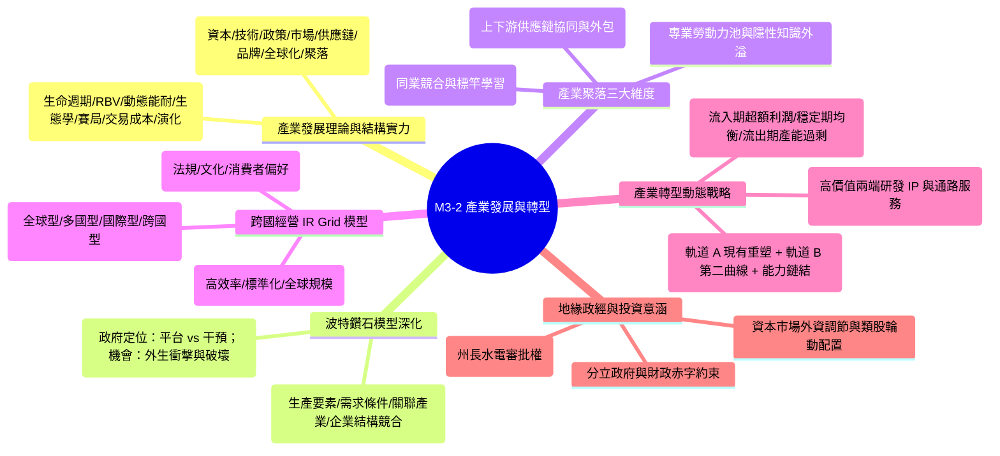
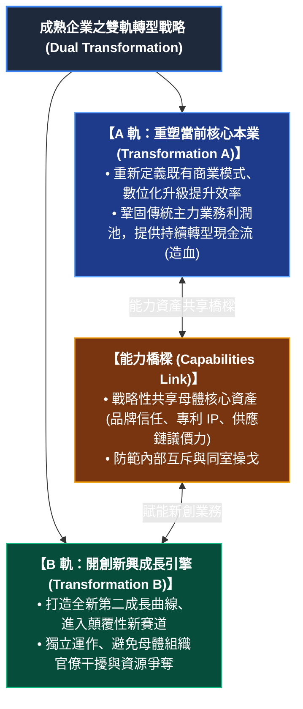

---
{"dg-publish":true,"permalink":"/04/12/02/module-3/m3-2/","tags":["產業分析","投資策略","產業演化","產業轉型","鑽石模型","全球化","IRGrid","產業聚落","分立政府","雙軌轉型","微笑曲線"],"dg-note-properties":{"類別":"課程筆記","課程名稱":"[[產業分析與投資策略]]","模組編號":"Module 3","模組名稱":"產業演化與動態轉型","章節編號":"M3-2","主題":"產業發展轉型戰略與全球化動態 (Industry Development, Transformation & Globalization)","對應週次":"Week 9 (2026-11-05)","狀態":"🟢 已完成","tags":["產業分析","投資策略","產業演化","產業轉型","鑽石模型","全球化","IRGrid","產業聚落","分立政府","雙軌轉型","微笑曲線"]}}
---


# 🌐 M3-2 產業發展轉型戰略與全球化動態：鑽石模型內生化、IR Grid 跨國經營與三階段利潤週期

> [!abstract] 導讀與對接
> 本筆記為《產業分析與投資策略》第九週（Class 9《產業發展與轉型》，2026-11-05）旗艦核心筆記。本章節接續 [[04_主題選修/12_產業分析與投資策略/02_模組筆記/Module_3_產業演化與動態轉型/M3-1_產業生命週期與技術S曲線\|M3-1_產業生命週期與技術S曲線]] 對產業生命週期與技術躍遷的探討，並串聯 [[04_主題選修/12_產業分析與投資策略/99_歷史舊版備份/M2-3_產業價值網與競合分析\|M2-3_產業價值網與競合分析]] 之生態系競合視角，聚焦於**「產業如何從誕生、成長走向結構性轉型」**以及**「跨國企業如何在多變地緣政經環境中建構全球競爭優勢」**。
> 郭育尚教授在課堂中特別強調：傳統靜態的產業分析模型已不足以因應 2026 年後大國博弈、地緣板塊碎裂化與技術範式激變的現實。本篇將完整建構：
> 1. **產業發展理論七大取向**與**產業結構實力八大要素**；
> 2. 麥可·波特（Michael Porter）**「鑽石模型（Diamond Model）」之政府與機會變數動態內生化**；
> 3. 產業聚落（Cluster）之**垂直聚群、水平聚群與勞動力市場池**三大機制；
> 4. 跨國企業經營必備之 **Prahalad & Doz 整合-在地回應模型（IR Grid 四大象限）**；
> 5. 產業轉型動態戰略：**三階段利潤週期（流入、穩定、流出）**、**微笑曲線重構**與成熟企業之**雙軌轉型（Dual Transformation）**；
> 6. 深度結合 2026-11-05 當日總經震撼彈：**美國期中選舉「分立政府（Divided Government）」制衡效應**、美債殖利率變動、次主權地緣風險（德州/俄亥俄州州長水電審批權）及資本市場外資連續賣超下的避險與配置戰略。

---

## 🧭 章節導航與知識架構圖 (Mindmap)



---

## 一、產業發展理論的七大取向與產業結構實力八要素

在理解單一企業轉型前，必須先建立對產業整體演化（Industry Evolution）與發展脈絡的中層視角。郭教授統整了管理學與經濟學界對「產業發展」的七大理論取向，並提煉出衡量產業結構實力的八大關鍵維度。

### 1. 產業發展理論的七大取向 (Seven Theoretical Perspectives)

| 理論取向 | 代表學者 / 核心學派 | 核心邏輯與機制 | 在產業發展中的焦點問題 |
| :--- | :--- | :--- | :--- |
| **1. 生命週期視角 (Life Cycle)** | Vernon, Klepper | 產業歷經導入、成長、成熟、衰退，技術由產品創新轉向製程創新。 | 產業何時達到轉折點？主導設計（Dominant Design）何時確立？ |
| **2. 資源基礎觀 (RBV)** | Barney, Wernerfelt | 產業競爭力取決於產業內核心廠商之 VRIN（價值、稀少、難以模仿、組織化）資源儲備。 | 產業內是否形成難以踰越之資源移動障礙與專利壁壘？ |
| **3. 動態能耐論 (Dynamic Capabilities)** | Teece, Pisano, Shuen | 企業感知（Sensing）、掌握（Seizing）與重組（Transforming）資源以因應環境劇變的能力。 | 在產業典範轉移時，領先廠商能否避免「勝者的詛咒」成功跨越 S 曲線？ |
| **4. 組織生態學 (Organizational Ecology)** | Hannan, Freeman | 利基寬度（Niche Width）、環境承載力（Carrying Capacity）與密度依賴（Density Dependence）。 | 產業何時爆發淘汰洗牌潮（Shakeout）？r-對策者與 K-對策者如何競合？ |
| **5. 網絡與賽局論 (Network & Game)** | Brandenburger, Nalebuff | 價值網絡中參與者之間的競合博弈、附加價值分配與網絡外部性。 | 產業生態系如何做大餅？互補品如何改變市場收益結構？ |
| **6. 交易成本理論 (TCE)** | Coase, Williamson | 資產專屬性（Asset Specificity）、有限理性與機會主義驅動之垂直整合 vs. 市場外包決策。 | 產業架構應走向縱向整合（如特斯拉）還是模組化水平分工（如 PC/Android）？ |
| **7. 演化經濟學 (Evolutionary Economics)** | Nelson, Winter | 慣性常規（Routines）、盲目變異、環境選擇與路徑依賴（Path Dependency）。 | 產業技術軌跡（Technological Trajectories）如何鎖定並塑造長期競爭格局？ |

### 2. 產業結構實力八大要素 (Eight Pillars of Industry Structure Strength)

判斷一個國家或地區在特定產業是否具備持久國際競爭力，郭教授提出「產業結構實力八要素模型」，此框架是衡量中層產業體質的雷達圖：

```
                [1. 資本強度 (Capital)]
                         ^
                         |
  [8. 聚落厚度] <--------+--------> [2. 技術密集度 (R&D)]
        \                |                /
         \               |               /
[7. 全球整合度] <--------+--------> [3. 政策與法規彈性]
          \              |              /
           \             |             /
  [6. 品牌溢價] <--------+--------> [4. 市場規模與成長]
                         |
                         v
               [5. 供應鏈完整度]
```

1. **資本強度 (Capital Intensity)**：產業資本投入門檻與沉沒成本規模（如先進晶圓廠單廠動輒 150~200 億美元，極高門檻阻絕新進者）。
2. **技術與研發密集度 (R&D Intensity)**：研發支出佔營收比重、核心專利壁壘與前瞻技術引領能力。
3. **政策與法規彈性 (Regulatory Flexibility & Policy Support)**：政府法規是前瞻指引還是僵化掣肘？土地、水電、環評等審批效率。
4. **市場規模與成長性 (Market Size & TAM Growth)**：在地基本盤市場規模，以及向全球潛在市場（Total Addressable Market）輻射之成長動能。
5. **供應鏈完整度 (Supply Chain Completeness)**：上下游自給率、關鍵零組件咽喉掌握度與物料採購安全半徑。
6. **品牌與定價溢價能力 (Brand & Pricing Power)**：超越成本加成定價之無形資產溢價能力（如 Apple、Hermès 相對白牌之毛利差）。
7. **全球化整合度 (Global Integration Capability)**：跨國資源調配、地緣風險分散與全球營運網絡構建能力。
8. **產業聚落厚度 (Cluster Density & Talent Depth)**：專業工程與管理人才池厚度、大學/研究機構研發外溢效益。

> 💡 **卡片關聯**：參見 [[Industry_Structure_Strength_產業結構實力八要素]]。

---

## 二、麥可·波特「鑽石模型」深化：政府與機會的動態內生化

麥可·波特（Michael Porter）於《國家競爭優勢》（*The Competitive Advantage of Nations*）提出著名的**鑽石模型（Diamond Model）**，解釋為何某些國家在特定產業具備全球競爭優勢。

```
                    ┌───────────────┐
                    │  【政府角色】 │
                    │ (Government)  │
                    └───────┬───────┘
                            │
            ┌───────────────┴───────────────┐
            │                               │
            ▼                               ▼
    ┌───────────────┐               ┌───────────────┐
    │ 企業策略/結構 │ 競  爭  環  境 │  需求條件     │
    │   與同業競爭  ├───────────────┤ (Demand Cond) │
    └───────┬───────┘               └───────┬───────┘
            │                               │
            │       【機會/外生衝擊】       │
            │          (Chance)             │
            ▼                               ▼
    ┌───────────────┐               ┌───────────────┐
    │  生產要素     │ 互  補  協  同 │ 相關與支援    │
    │ (Factor Cond) ├───────────────┤ 產業 (Cluster)│
    └───────────────┘               └───────────────┘
```

### 1. 傳統鑽石四大核心維度回顧
- **生產要素 (Factor Conditions)**：區分初級要素（天然資源、非技術勞工）與高級要素（高素質研發人力、先進科研基礎建設、專利資本）。高級要素需長期持續投資創造。
- **需求條件 (Demand Conditions)**：國內買方的嚴苛度與前瞻性。挑剔且具品味的本土消費者是迫使產業持續創新的最大原動力。
- **相關與支援產業 (Related & Supporting Industries)**：高效率且具國際競爭力的上游零組件與下游應用產業。
- **企業策略、結構與同業競爭 (Strategy, Structure & Rivalry)**：國內高度激烈的同業競爭是鍛造國際競爭力的熔爐。

### 2. 郭教授的批判性洞察：政府（Government）與機會（Chance）的內生化重構

在波特原始模型中，「政府」與「機會」被視為位於外圍的輔助/外生變數。然而，郭育尚教授在 2026 年課堂中強調：**在地緣政治分裂與大國產業政策回歸的今日，政府與機會已經完全內生化為驅動鑽石轉動的核心引擎！**

#### (1) 政府角色之「為與不為」：平台提供者 vs. 扭曲市場者
- **政府的正面角色：基礎建設與制度平台提供者 (Platform Provider)**
  - 投資高級生產要素：興辦高等工程教育、國家級研究機構（如台灣工研院 ITRI、新竹科學園區之超前水電公用事業規劃）。
  - 制定嚴格的環保、安全與能耗法規，倒逼產業升級。
  - 保護智慧財產權與維護公平競爭秩序。
- **政府的負面角色：過度干預與保護主義的陷阱 (Direct Intervention Failure)**
  - 直接挑選贏家（Picking Winners）往往導致資本錯配；
  - 長期保護與巨額補貼會削弱企業之同業競爭活力，滋生依賴租金之殭屍企業（如中國早期部分新能源、太陽能與面板產業因過度補貼導致嚴重的全球產能過剩）；
  - **制度審批與政治摩擦成本**：政府更迭帶來政策中斷風險。

#### (2) 機會變數 (Chance Events)：外生衝擊與範式轉變
- 機會代表非企業或政府所能掌控之重大外部事件：包括重大技術突破（如生成式 AI、室溫超導）、戰爭與地緣衝突、全球疫情、匯率劇烈波動或國際貿易禁令。
- 機會本質上是**「現有鑽石結構的洗牌者」**。具備高動態能耐的產業體系能將「外生衝擊」轉化為「超常機遇」（例如 COVID-19 疫情重創全球供應鏈，卻讓台灣半導體與伺服器產業之高信賴度與即時交付能力大放異彩）。

> 💡 **卡片關聯**：參見 [[Diamond_Model_Government_Chance_鑽石模型政府與機會變數]]。

---

## 三、產業聚落（Cluster）的立體維度：垂直、水平與勞動力池

波特指出，產業聚落是鑽石模型四要素互動的最高具體化形態。郭教授進一步將產業聚落解構為三大相互交織的立體維度：

```
                      ┌─────────────────────────────────┐
                      │    產業聚落 (Cluster) 三大維度   │
                      └────────────────┬────────────────┘
                                       │
        ┌──────────────────────────────┼──────────────────────────────┐
        ▼                              ▼                              ▼
┌───────────────┐              ┌───────────────┐              ┌───────────────┐
│ 1. 垂直聚群   │              │ 2. 水平聚群   │              │ 3. 勞動力市場 │
│ (Vertical)    │              │ (Horizontal)  │              │ (Labor Pool)  │
├───────────────┤              ├───────────────┤              ├───────────────┤
│• 上下游供應鏈  │              │• 同業競爭互學  │              │• 密集專業人才 │
│• 極速模組外包  │              │• 知識水平外溢  │              │• 隱性知識流動 │
│• 零庫存 JIT   │              │• 共同基建共享  │              │• 創業就業良性 │
└───────────────┘              └───────────────┘              └───────────────┘
| 全球整合壓力 \ 當地回應壓力 | 當地回應壓力：低 (Low) | 當地回應壓力：高 (High) |
| :--- | :--- | :--- |
| **全球整合壓力：高 (High)** | **【全球型戰略 (Global Strategy)】**<br>• 高度集中、全球標準化、極致規模經濟<br>• 代表：半導體晶圓代工 (TSMC)、波音客機、工業原物料 | **【跨國型戰略 (Transnational Strategy)】**<br>• 全球整合與在地回應雙重兼顧<br>• 「全球思考、在地行動」、全球學習與創新網絡<br>• 代表：次世代智慧電動車、蘋果生態系 |
| **全球整合壓力：低 (Low)** | **【國際型戰略 (International Strategy)】**<br>• 將母國成功核心產品與能耐複製外銷<br>• 研發留在母國，海外設組裝銷售據點<br>• 代表：早期機械設備廠、傳統白牌製造外銷 | **【多國型戰略 (Multidomestic Strategy)】**<br>• 高度在地客製化分權、貼近各國文化法規<br>• 各地子公司獨立運作、研發在地化<br>• 代表：個人保養消費品 (P&G)、包裝食品飲料 (雀巢) |
 高 ▲
    │
 全 │  【全球型戰略】 (Global Strategy)        【跨國型戰略】 (Transnational Strategy)
 球 │  • 高度集中、全球標準化、極致規模經濟    • 全球整合與在地回應雙重兼顧
 整 │  • 代表：半導體晶圓代工、波音客機、     • 「全球思考、在地行動」、全球學習網絡
 合 │    大宗商品與工業原物料                 • 代表：次世代智慧電動車、蘋果生態系
 壓 │  ────────────────────────────────────────┼────────────────────────────────────────
 力 │  【國際型戰略】 (International Strategy)   【多國型戰略】 (Multidomestic Strategy)
    │  • 母國核心能力向海外複製                • 高度授權海外子公司獨立營運
    │  • 產品適度修改，海外多為銷售據點        • 迎合在地文化、口味與法規標準
 低 │  • 代表：傳統工具機、特色專利原廠藥      • 代表：包裝食品/飲料(統一/雀巢)、在地零售
    └──────────────────────────────────────────────────────────────────────────►
      低                          在地回應壓力 (Local Responsiveness)                 高
```

### 1. IR Grid 四大戰略維度深度剖析

| 戰略類型 | 全球整合壓力 | 在地回應壓力 | 核心競爭優勢來源 | 組織架構與決策權限 | 典型產業與企業實證 |
| :--- | :---: | :---: | :--- | :--- | :--- |
| **全球型戰略<br>(Global)** | **高** | **低** | 全球規模經濟、全球低成本採購、極致標準化與集中製造。 | 高度中央集權（Centralized Hub），海外分公司多僅為執行與銷售單位。 | • **台積電 (TSMC)**：先進製程高度集中在台灣母廠，全球客戶提供統一 PDK 規範。<br>• **民航機製造 (Boeing/Airbus)**：超高研發成本要求全球統一規格與採購。 |
| **多國型戰略<br>(Multidomestic)** | **低** | **高** | 靈敏迎合在地市場獨特口味、消費習慣、宗教規範與法規政策。 | 聯邦分權制（Decentralized Federation），各國子公司具高度自主經營權。 | • **統一企業 / 雀巢 (Nestlé)**：食品口味高度在地化（如東南亞清真認證、台灣特調茶飲）。<br>• **個人金融與零售銀行**：受各國金融法規嚴格管制。 |
| **國際型戰略<br>(International)** | **低** | **低** | 利用母國研發之核心競爭力或獨家專利，向海外缺乏競爭者的市場擴展。 | 母國核心控制，海外單位承接技術移轉，本土化調整極低。 | • **傳統精密工具機**：依賴母廠精湛製造工藝出口至開發中國家。<br>• **成熟專利原廠藥**：全球同一成分銷售。 |
| **跨國型戰略<br>(Transnational)** | **高** | **高** | **雙元兼顧**：在全球範圍內追求規模經濟與最佳要素配置，同時在各國市場靈活回應在地需求與政治壁壘；具備全球雙向學習網絡。 | 矩陣式整合網絡（Integrated Network），各節點依專長分工，共享全球資源與知識。 | • **次世代智慧電動車 (Tesla / BYD)**：全球共用三電平台與軟體 OTA 系統，但在北美、歐洲、中國設立專屬超級工廠以符合在地補貼、電網法規與車載系統偏好。 |

> 💡 **卡片關聯**：參見 [[IR_Grid_Integration_Responsiveness_全球整合與在地回應模型]]。

---

## 五、產業轉型動態戰略：三階段利潤週期與雙軌轉型

任何具備高獲利的產業，都會歷經生命週期的考驗。企業若想在產業變遷中立於不敗之地，必須掌握**利潤週期的動態遷移規律**與**雙軌轉型機制**。

### 1. 產業轉型三階段利潤週期 (Three-Phase Profit Cycle)

郭教授在課堂上深刻剖析了產業在發展與演化過程中，獲利能力的宏觀遷移路徑：

```
 獲利/利潤率
   ▲
   │         【第二階段：穩定期】
   │           (Stabilization)
   │           產能均衡、競爭規範
   │         ┌─────────────────┐
   │        /                   \
   │       /                     \        【第三階段：流出期】
   │      /                       \         (Outflow Phase)
   │     /                         \        產能嚴重過剩、低價割喉
   │    /                           \────── 資本大量外逃、利潤崩解
   │   / 【第一階段：流入期】                  (如傳統燃油車、成熟製程晶圓)
   │  /    (Inflow Phase)
   │ /     技術紅利、資本狂湧
   │/      超額暴利 (Super Profit)
   └─────────────────────────────────────────────────────────────► 時間
```

#### (1) 第一階段：流入期 (Inflow Phase)
- **特徵**：新興技術商業化初期，市場供給嚴重不足，技術壁壘高築。
- **獲利表現**：享有**超額壟斷利潤（Super-normal Profit）**，毛利率往往高達 50%~70% 以上。
- **資本現象**：熱錢、VC/PE 與跨界巨頭大舉湧入，推升資本支出與產業估值乘數。
- **案例**：2023~2025 年之生成式 AI 算力晶片（NVIDIA Hopper/Blackwell 晶片）。

#### (2) 第二階段：穩定期 (Stabilization Phase)
- **特徵**：主流設計（Dominant Design）確立，供應鏈擴產陸續到位，市場滲透率穩步提升。
- **獲利表現**：供需達到動態平衡，價格戰偶有發生但受寡占默契約束，產業利潤率收斂至可持續之合理水準（如 ROE 15%~25%）。
- **資本現象**：企業由追求極致營收成長轉向優化營運現金流與股利發放。
- **案例**：成熟期之智慧型手機中高階市場、筆記型電腦 ODM。

#### (3) 第三階段：流出期 (Outflow Phase)
- **特徵**：終端市場飽和或遭遇破壞式替代技術；後進國家（如中國）巨額補貼產能全面釋放，引發嚴重的結構性供需失衡。
- **獲利表現**：爆發全面性**破壞性價格戰**，產品跌破現金成本，毛利率暴跌至個位數甚至虧損，利潤自產業中徹底流出。
- **資本現象**：跨國資本大舉撤離，企業展開大規模裁員、整併或關廠停產。
- **案例**：2026 年歐洲傳統汽車製造業（如賓士因中國市場衰退 34%，EBIT YoY 慘崩 50%，營業利益率跌至 2%~3% 之慘烈危機）；台灣太陽能電池與早期 LED/面板產業。

> 💡 **卡片關聯**：參見 [[Industry_Transformation_Profit_Cycle_產業轉型三階段利潤週期]]。

---

### 2. 微笑曲線兩端重構 (Smile Curve Restructuring)

當製造代工環節落入利潤流出期（微笑曲線谷底），企業推動產業轉型的戰略路徑在於向兩端高附加價值節點攀升：

```
  附加價值
    ▲
 高 │   【研發 / 專利 / 核心演算法】               【品牌 / 通路 / 生態系服務】
    │    (Upstream: R&D, IP, Chips)             (Downstream: Brand, Cloud, Data)
    │         \                                     /
    │          \                                   /
    │           \                                 /
    │            \                               /
 低 │             \_____ 【製造與組裝 (谷底)】 ___/
    │                    (Manufacturing & Assembly)
    └─────────────────────────────────────────────────────────────► 價值鏈環節

┌─────────────────────────────────────────────────────────────────┐
│                 雙軌轉型戰略 (Dual Transformation)               │
└────────────────────────────────┬────────────────────────────────┘
                                 │
        ┌────────────────────────┴────────────────────────┐
        ▼                                                 ▼
┌───────────────────────────────┐ ┌───────────────────────────────┐
│   軌道 A：重塑現有核心業務    │ │   軌道 B：開闢全新成長引擎    │
│ (Transformation A: Core Re-inv)│ │(Transformation B: New Growth Eng)│
├───────────────────────────────┤ ├───────────────────────────────┤
│• 引進 AI 與高度自動化降低成本 │ │• 針對未被滿足的利基或新市場  │
│• 優化供應鏈，追求極致現金流   │ │• 建立全新商業模式 (如軟體/服務)│
│• 鞏固既有客戶的高轉換成本     │ │• 容忍早期虧損，敏捷試錯迭代  │
└───────────────┬───────────────┘ └───────────────┬───────────────┘
                │                                 │
                └────────────────┬────────────────┘
                                 ▼
                ┌─────────────────────────────────┐
                │   能力鏈結結合體 (Capabilities Link) │
                ├─────────────────────────────────┤
                │• 專利技術資產共享               │
                │• 雄厚品牌聲譽與信用背書         │
                │• 充足現金流金援 (由 A 哺育 B)   │
                │• 嚴格的組織與文化防火牆隔離     │
                └─────────────────────────────────┘
```

- **軌道 A（Transformation A）**：重塑現有業務。不盲目追求營收高成長，而是透過流程精實化、數位化改造提高資本回報率（ROIC），作為源源不絕的**「現金牛（Cash Cow）」**。
- **軌道 B（Transformation B）**：開闢全新成長領域。開創獨立於傳統業務的新事業部，瞄準第二成長曲線（Second Curve）。
- **能力鏈結結合體（Capabilities Link）**：這是雙軌轉型成敗的最核心樞紐。既要讓軌道 B 借力母公司的獨特資產（供應鏈議價力、專利、客戶關係），又要建立嚴格的**組織防火牆**，避免既有核心業務的僵化官僚文化與短期利潤考核扼殺新創團隊的創新活力。

---

## 六、課堂實證案例與投資決策意涵

### 1. 2026-11-05 總經震撼彈：美國期中選舉「分立政府」效應與殖利率傳導
在課堂一開始，郭教授帶領全班解析了當天清晨剛剛落幕的美國期中選舉（國會改選）最新結果與資本市場劇震：
- **政經格局**：民主黨一舉奪下參議院與眾議院過半席次，形成白宮（執政黨）與國會（反對黨）分立的**「分立政府（Divided Government）」**。
- **傳導機制與市場反應**：
  - 市場原先極度擔憂美國聯邦政府債務突破 40 兆美元後，若單一政黨全面執政（Clean Sweep）將無節制擴大舉債並引發財政深淵；
  - 分立政府形成強大的**「財政預算審查制衡機制」**，預期未來重大赤字擴張法案將面臨嚴格審查與限縮；
  - **金融市場劇震**：美國 10 年期公債殖利率應聲自 4.94% 驟降 6 個基點至 **4.88%**；道瓊工業指數狂飆 **1,500 點**，科技巨頭估值壓力顯著緩解。

> 💡 **卡片關聯**：參見 [[Divided_Government_Effect_分立政府制衡效應與財政政策]]。

### 2. 次主權地緣風險（Subnational Geopolitical Risk）：州長水電審批權的實戰警示
郭教授特別點出跨國投資中的「盲點」：企業往往只盯著華府聯邦政府的關稅與禁令，卻忽視了美國各州層級的**「次主權地緣風險」**！
- **實務背景**：德州與俄亥俄州（美國 AI 資料中心、算力基礎建設與半導體建廠之核心重鎮）在此次期中選舉中，州長（Governor）出現政黨輪替！
- **關鍵權限**：在美國聯邦體制下，**工業用水審批、輸電電網併網權、地方土地開發許可與地方稅收補貼，實權全在州長手裡！**
- **歷史教訓對照**：郭教授以**鴻海（Foxconn）美國威斯康辛州面板廠投資案**為戒——當初郭台銘與共和黨籍州長 Walker 簽署高達數十億美元之稅收補貼與建廠承諾，但隨後州長選舉變天，民主黨新任州長 Evers 上任後立刻啟動嚴格環境複查並重組補貼合約，導致百億投資案規模大幅縮水、進退維谷。
- **產業警訊**：當前赴美投資高耗能、高耗水之 AI 晶圓廠、先進封裝廠與資料中心之台灣供應鏈廠商，必須將「州長換屆與地方議會變天」列為一級地緣政治避險指標。

> 💡 **卡片關聯**：參見 [[Institutional_Approval_Risk_州長水電審批權與地緣投資風險]]。

### 3. 台灣資本市場籌碼與類股輪動分析
- **外資連六日瘋狂提款**：課堂數據顯示，外資在過去六個交易日內累計賣超台股達 **6,166 億新台幣**（平均每日拋售高達 1,000 億），新台幣匯率一度觸及 **33 元**整數大關；
- **費城半導體指數小跌**：外資持續提款成熟製程與傳統景氣循環股（調節聯電 2303、力積電 6770、台玻 1802 等）；
- **逆勢買超焦點**：外資資金並非全面撤離，而是轉向具備抗通膨、高股息與政策避風港特質之防禦性類股：
  - **貨櫃與航空航運**：萬海 (2615)、陽明 (2609)、長榮 (2603)、華航 (2610) 逆勢獲外資買超，受惠於海空運運價支撐與地緣轉單；
  - **太陽能與再生能源**：聯合再生 (3576)、元晶 (6443)、國碩 (2406) 獲避險買盤青睞；
- **資產配置心法**：面對匯率貶破 33 與總經不確定性，教授建議投資人應採行**「美元資產定期定額（DCA）平滑匯率波動」**，並嚴格檢視持股之「自由現金流（FCF）造血能力」與「定價權防禦力」。

---

## 🔗 相關筆記與關聯地圖

- 上層模組 MOC：[[_產業分析與投資策略 MOC]]
- 前置核心筆記：[[M3-1_產業生命週期與技術S曲線]] · [[M2-3_產業價值網與競合分析]]
- 延伸案例追蹤：[[cases_企業與產業案例庫]]（案例 19~21）
- 總經時事聯結：[[macro_總體經濟與課前時事]]（2026-11-05 美國期中選舉與外資調節）
- 核心概念原子卡片：
  - [[Diamond_Model_Government_Chance_鑽石模型政府與機會變數]]
  - [[IR_Grid_Integration_Responsiveness_全球整合與在地回應模型]]
  - [[Divided_Government_Effect_分立政府制衡效應與財政政策]]
  - [[Industry_Transformation_Profit_Cycle_產業轉型三階段利潤週期]]
  - [[Industry_Structure_Strength_產業結構實力八要素]]
  - [[Vertical_Horizontal_Clustering_垂直與水平產業聚落理論]]
  - [[Institutional_Approval_Risk_州長水電審批權與地緣投資風險]]
