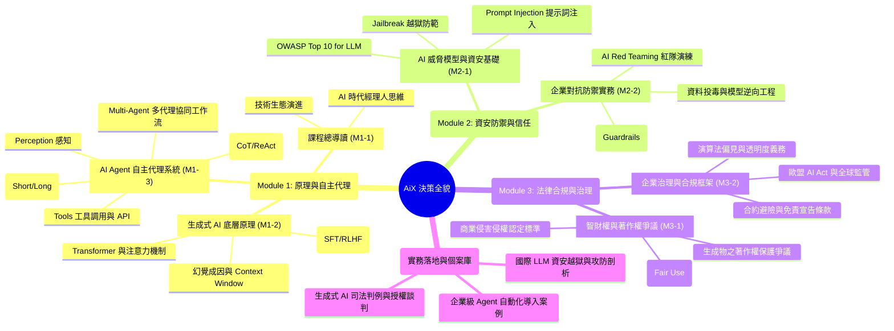

---
{"dg-publish":true,"permalink":"/05-ai/10-ai-x/00/mindmap-ai-x/","tags":["心智圖","全域導航","PMBA"],"dg-note-properties":{"類別":"課程導航","課程名稱":"[[05_AI選修/10_AiX/_AiX MOC|AiX 課程總覽]]","建立日期":"2026-10-22","最後更新":"2026-10-22","狀態":"🟢 已完成","tags":["心智圖","全域導航","PMBA"]}}
---

# 🧠 AiX 全域心智圖導航 (Mindmap Navigation)

> [!abstract] 導讀與對接
> - **上級地圖**：[[05_AI選修/10_AiX/_AiX MOC\|_AiX MOC]]
> - **進度看板**：[[05_AI選修/10_AiX/00_課程導航與進度/progress_📊 課程與筆記進度追蹤\|progress_📊 課程與筆記進度追蹤]]
> - **概念底座**：[[98_商業概念庫\|98_商業概念庫]]

---

