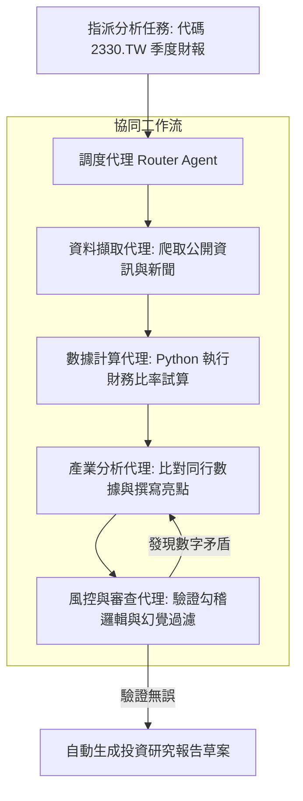

---
{"dg-publish":true,"permalink":"/05-ai/10-ai-x/01-ai/case-agent/","tags":["案例研究","MultiAgent","企業落地","自動化流程"],"dg-note-properties":{"類別":"實務案例","課程名稱":"[[05_AI選修/10_AiX/_AiX MOC|AiX 課程總覽]]","案例編號":"Case-01","主題":"企業級 Multi-Agent 自動化工作流程落地解析 (Enterprise Multi-Agent Workflow Implementation)","對應模組":"Module 1","對應章節":[["2_以 OpenClaw 為例介紹 AI Agent 的運作原理|M1-3_AI Agent自主代理與多代理協作系統"]],"狀態":"🟢 已完成","tags":["案例研究","MultiAgent","企業落地","自動化流程"]}}
---

# Case 1: 企業級 Multi-Agent 自動化工作流程落地解析

> [!abstract] 導讀與對接
> - **上級地圖**：[[05_AI選修/10_AiX/_AiX MOC\|_AiX MOC]]
> - **關聯筆記**：[[05_AI選修/10_AiX/02_模組筆記/Module_02_生成式AI原理與代理架構/2_以 OpenClaw 為例介紹 AI Agent 的運作原理\|M1-3_AI Agent自主代理與多代理協作系統]]
> - **核心概念**：[[98_商業概念庫/ai-agent_自主代理架構與運作機制\|AI_Agent_自主代理架構與運作機制]]、[[98_商業概念庫/Agentic_Workflow_自主代理工作流\|Agentic_Workflow_自主代理工作流]]

---

## 🏢 1. 案例背景與商業痛點

某跨國金融顧問公司需每日處理數百篇上市公司的財報、法說會音檔與行業研報。過去仰賴龐大的分析師初階團隊進行數據謄錄、對比試算與初稿撰寫，面臨：
- **痛點 1**：時效性延宕（平均耗時 3~5 天出具首版報告）。
- **痛點 2**：跨表數字不一致與計算人為錯誤。
- **痛點 3**：初階人力流動率高，專業經驗無法結構化沉澱。

---

## 🛠️ 2. Multi-Agent 系統架構設計

該企業採用了多代理人協同架構 (SOP-driven Multi-Agent System)：

1. **Role Specialization (角色專業化)**：每個 Agent 綁定專屬 System Prompt 與專門工具（如：數據代理僅能呼叫 Python 運算代碼，不允許自由發揮文字）。
2. **Deterministic Guardrails (確定性邊界)**：所有計算由 Python 代碼執行，而非讓 LLM 直接進行心算。
3. **Critic 迴圈 (Reflection)**：審查代理負責反向比對初稿與原始財報 PDF 頁碼，嚴格確保引用忠實度。

---

## 📊 3. 落地成效與商業啟發

- **效率躍升**：報告初稿生成時間由 3 天大幅縮短至 15 分鐘。
- **品質提升**：勾稽驗證錯誤率降低 92%。
- **組織再造**：初階分析師轉型為「報告審查員 (Reviewer)」與「提示詞/流程架構師 (Workflow Architect)」。
