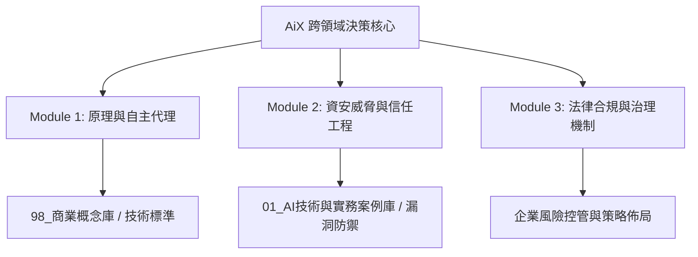

---
{"dg-publish":true,"permalink":"/05-ai/10-ai-x/ai-x-moc/","tags":["MOC","PMBA","AI選修","知識地圖"],"dg-note-properties":{"aliases":["AiX","台大 AiX","人工智慧與商業應用"],"類別":"MOC總覽地圖","課程名稱":"[[05_AI選修/10_AiX/_AiX MOC|AiX 課程總覽]]","建立日期":"2026-10-22","最後更新":"2026-10-22","狀態":"🟢 已完成","tags":["MOC","PMBA","AI選修","知識地圖"]}}
---


# 🗺️ 10_AiX 課程總覽地圖 (Map of Content)

> [!abstract] 導讀與對接中樞
> - **頂層層級**：[[05_AI選修\|05_AI選修]] ➔ **本科總覽**：[[05_AI選修/10_AiX/_AiX MOC\|_AiX MOC]]
> - **學習看板**：[[05_AI選修/10_AiX/00_課程導航與進度/progress_📊 課程與筆記進度追蹤\|進度與狀態看板]] | **心智導航**：[[05_AI選修/10_AiX/00_課程導航與進度/mindmap_AiX_心智圖導航\|全域心智圖]]
> - **概念底座**：[[98_商業概念庫\|98_商業概念庫]] | **案例實務**：[[01_AI技術與實務案例庫\|01_AI技術與實務案例庫]]

---

## 📌 課程定位與學習目標

本課程為台大 PMBA 前沿 AI 選修科目，旨在協助高階經理人與企業領導者建立從**技術底層邏輯**、**AI Agent 應用落地**、**資安防護與信任架構**至**法律合規與治理**的完整閉環思維。



---

## 🗂️ 模組筆記索引矩陣

| 模組編號 | 模組主題 | 核心章節筆記 | 關鍵概念對接 | 狀態 |
| :--- | :--- | :--- | :--- | :---: |
| **Module 01** | **生成式AI原理與代理架構** | • [[M1-1_台大AiX課程總導讀與AI全景]]<br>• [[M1-2_生成式AI技術底層原理與LLM運作機制]]<br>• [[M1-3_AI Agent自主代理與多代理協作系統]] | [[GenAI_生成式人工智慧核心原理]]<br>[[LLM_大型語言模型架構]]<br>[[AI_Agent_自主代理架構與運作機制]]<br>[[Agentic_Workflow_自主代理工作流]] | 🟢 |
| **Module 02** | **AI時代下的資安防禦與信任架構** | • [[M2-1_AI威脅模型與技術快速發展下的資安基礎]]<br>• [[M2-2_大模型對抗攻擊與企業AI防護實務]] | [[Prompt_Injection_提示詞注入與越獄防護]]<br>[[AI_Red_Teaming_AI紅隊演練與安全評估]] | 🟢 |
| **Module 03** | **AI應用之法律、倫理與合規治理** | • [[M3-1_生成式AI智慧財產權與著作權爭議解析]]<br>• [[M3-2_企業AI責任歸屬、資料合規與監管框架]] | [[Copyright_AI_生成式AI著作權與侵權判定]]<br>[[AI_Governance_企業AI治理與風險框架]] | 🟢 |

---

## 💼 01_AI技術與實務案例庫

- [[Case_Agent_自主代理企業級工作流導入實例|Case 1: 企業級 Multi-Agent 自動化工作流程落地解析]]
- [[Case_Security_LLM越獄與提示詞注入攻擊實務|Case 2: 國際大模型資安越獄、資料投毒與防禦實證剖析]]
- [[Case_Legal_生成式AI侵權爭議與商業判例分析|Case 3: 生成式 AI 訓練資料合理使用與著作權商業訴訟判例]]

---

## 🧠 核心原子概念庫快捷對接 (98_商業概念庫)

- [[GenAI_生成式人工智慧核心原理|GenAI 原理]]
- [[LLM_大型語言模型架構|LLM 架構]]
- [[AI_Agent_自主代理架構與運作機制|AI Agent]]
- [[Agentic_Workflow_自主代理工作流|Agentic Workflow]]
- [[Prompt_Injection_提示詞注入與越獄防護|Prompt Injection]]
- [[AI_Red_Teaming_AI紅隊演練與安全評估|AI 紅隊演練]]
- [[Copyright_AI_生成式AI著作權與侵權判定|AI 著作權]]
- [[AI_Governance_企業AI治理與風險框架|AI 企業治理]]

---

## 📊 Dataview 動態追蹤視圖

```dataview
TABLE 模組編號, 章節編號, 主題, 狀態
FROM "PMBA/PMBA_Note/05_AI選修/10_AiX/02_模組筆記"
SORT 章節編號 ASC
```
