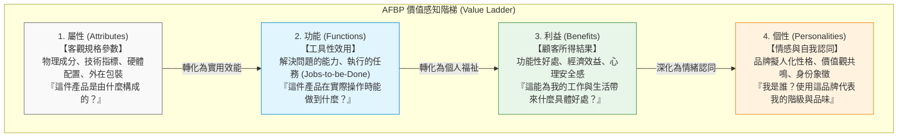

---
{"dg-publish":true,"permalink":"/98/afbp/","tags":["商業概念","行銷策略","品牌管理","創業管理","PMBA"],"dg-note-properties":{"aliases":["AFBP框架","AFBP Model","品牌價值階梯模型","屬性功能利益個性模型"],"tags":["商業概念","行銷策略","品牌管理","創業管理","PMBA"]}}
---


# AFBP框架 (Attributes, Functions, Benefits, Personalities)

> [!NOTE]
> **核心概念精粹**：AFBP 框架是現代品牌策略、產品定位與價值主張設計中的經典階梯模型。它將顧客體驗與認知深化的歷程嚴格劃分為四大由表及裡的連續構面：**屬性（Attributes）**、**功能（Functions）**、**利益（Benefits）**與**個性（Personalities）**。該框架揭示了新創產品從「技術參數規格戰」躍升為「高毛利情緒共鳴護城河」的本質演進路徑。

---

## 一、 學理淵源：從手段目標鏈到品牌心智階梯

AFBP 框架深植於認知心理學與行銷學的**手段目標鏈理論（Means-End Chain Theory, Gutman, 1982）**與凱文·凱勒（Kevin Lane Keller）的**顧客基礎品牌權益模型（CBBE Pyramid）**。

許多技術創辦人與工程師團隊往往深陷於「產品規格與硬體參數」的表層維度，導致行銷溝通淪為難以理解的技術術語，最終陷入殺價紅海。AFBP 框架提供了一條清晰的認知躍遷階梯：



---

## 二、 AFBP 四大構面逐層深度拆解

| 構面層級 | 核心定義與提問 | 內在機制與細分維度 | 典型商業訴求語言 |
| :--- | :--- | :--- | :--- |
| **A. 屬性<br>(Attributes)** | **產品是什麼？**<br>客觀存在的物理特徵與規格。 | - **內在屬性**：直接決定性能的物理成分（如 3 奈米晶片、鈦金屬外殼、抗水抗塵等級）。<br>- **外在屬性**：產品外部附屬元素（如商標設計、包裝工藝、產地標籤）。 | 「搭載 8 核心神經網路引擎、配備 5000mAh 固態電池。」 |
| **F. 功能<br>(Functions)** | **產品能做什麼？**<br>產品在具體情境下展現的工具效用。 | - 執行特定任務（Jobs-to-be-Done）。<br>- 消除操作摩擦、縮短運算時間、提高傳輸速率。<br>- 穩定運作與容錯能力。 | 「在弱光環境下自動降噪，於 0.1 秒內完成人臉辨識對焦。」 |
| **B. 利益<br>(Benefits)** | **對顧客有何好處？**<br>顧客因使用產品而獲得的真實福祉。 | - **功能性利益**：節省 50% 作業時間、減少營運成本。<br>- **心理/情緒利益**：免除系統崩潰的焦慮、獲得安心感。<br>- **社會利益**：在主管與同儕面前展現專業水準。 | 「讓行銷人員提早兩小時下班，徹底告別半夜改稿的疲憊。」 |
| **P. 個性<br>(Personalities)** | **代表什麼樣的靈魂？**<br>將品牌擬人化後的性格與價值觀。 | - **大五品牌個性**：真誠（Sincerity）、刺激（Excitement）、能力（Competence）、精緻（Sophistication）、強韌（Ruggedness）。<br>- 構築社會階層符號與社群歸屬感。 | 「致瘋狂者、不合群者、標新立異者（Think Different）。」 |

---

## 三、 經典企業實戰案例：戴森（Dyson）吹風機的 AFBP 價值躍遷

傳統吹風機在市場上長期被視為 500~1,500 元台幣的低價值小家電，直到戴森推出售價高達 15,000 元台幣的 Supersonic 吹風機，成功將單價拉高十倍以上：

```carousel

<!-- slide -->
### 1. 屬性端 (Attributes)
- 戴森專利的第九代數位馬達（V9），每分鐘轉速高達 11 萬轉；
- 玻璃珠熱敏感知器每秒測溫 20 次；
- 將馬達安置於手柄而非傳統風筒頭部；航太級消音設計。
<!-- slide -->
### 2. 功能端 (Functions)
- 產生受控的高速噴射氣流，不靠極端高溫而純靠高風速吹乾頭髮；
- 智慧溫控防止高溫燙傷頭皮與破壞角蛋白；
- 重心下移，長時間握持手腕不酸痛。
<!-- slide -->
### 3. 利益端 (Benefits)
- **吹髮時間減半**：現代高壓職場女性每天早上能多睡 15 分鐘；
- **髮質光澤柔順**：解決毛躁與分岔，省去每個月昂貴的沙龍深層護髮費用；
- **安靜優雅**：早上吹頭髮不會吵醒熟睡的家人或嬰兒。
<!-- slide -->
### 4. 個性端 (Personalities)
- **「先鋒、極致、科技奢華與生活美學」**；
- 放置在梳妝台上成為彰顯主人精緻生活品味與高收入階層的社交符號，建立極度狂熱的品牌忠誠度與定價權。
```

---

## 四、 經理人 AFBP 價值主張升級檢核表（Executive Decision Checklist）

在進行新產品開發（NPD）、行銷推廣文案審查或商業計畫書撰寫時，高層領導應檢驗下列問題：

- [ ] **脫離工程自嗨陷阱（Escape Spec-Trap）**：
  - 我們的行銷文案與業務簡報，是否高達 70% 以上都在羅列艱澀的參數、演算法架構或規格（A 維度）？我們是否清楚告訴客戶這能幫他做什麼（F 維度）？
- [ ] **利益端直接對接痛點（Benefit-Pain Alignment）**：
  - 我們所強調的「利益（B 維度）」，究竟是客戶迫切需要解決的「核心財務/時間痛點」，還是無關痛癢的錦上添花？
- [ ] **品牌個性的一致性（Personality Consistency）**：
  - 產品的外觀設計、售後客服態度與公關發言，是否共同塑造出鮮明且穩定的品牌人格（P 維度）？顧客在使用我們的產品時，能否感受到強烈的情感共鳴與身份認同？
- [ ] **溢價防禦與反殺價空間（Pricing Power Audit）**：
  - 當競爭同業推出規格更高（A 維度勝出）、價格更低的手法挑戰時，我們的客戶是否會因為對「B 維度效益」與「P 維度情感」的深度黏著，而拒絕跳槽？

---

## 五、 關聯概念與知識網絡

* 核心理論基礎：
  * [[means-end-chain_手段目標鏈|手段目標鏈 (Means-End Chain)]]：屬性、結果與終極價值鏈接
  * [[value-proposition_價值主張|價值主張 (Value Proposition)]]：為目標客戶精準界定核心利益
  * [[Functional_vs_Emotional_Value_功能價值與情緒價值|功能價值與情緒價值]]：從工具理性到情感溢價的維度躍遷
  * [[Added_Value_附加價值與定價權|附加價值與定價權 (Added Value & Pricing Power)]]：超越邊際成本的超額租金來源
* 行銷定位與落地：
  * [[core-benefit_核心利益|核心利益 (Core Benefit)]]：產品心智佔有的本質基石
  * [[mind-share_心智佔有率|心智佔有率 (Mind Share)]]：品牌個性在消費者大腦網絡中的節點強度
  * [[Good_Product_Business_Company_好產品好事業好公司模型|好產品好事業好公司模型]]：從優質產品打造成偉大品牌
  * [[Entrepreneurial_Marketing_創業行銷|創業行銷 (Entrepreneurial Marketing)]]：資源匱乏下的高穿透力溝通戰術
