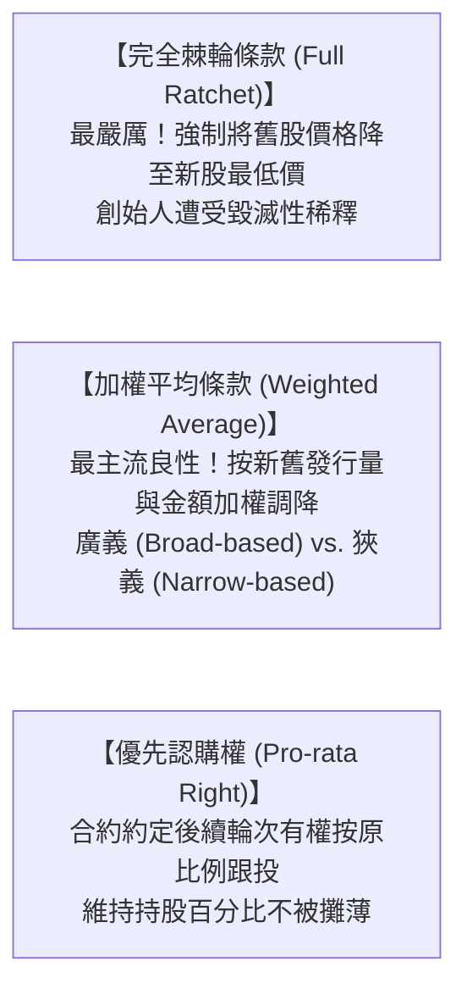

---
{"dg-publish":true,"permalink":"/98/anti-dilution-mechanisms/","tags":["商業概念","創業融資","創投資本","投資條款","PMBA"],"dg-note-properties":{"aliases":["對抗股權稀釋三大機制","反稀釋條款","Anti-Dilution Mechanisms","完全棘輪法","加權平均反稀釋"],"tags":["商業概念","創業融資","創投資本","投資條款","PMBA"]}}
---

# 對抗股權稀釋三大機制 (Anti-Dilution Mechanisms)

## 一、 核心定義與情境
- **觸發情境**：新創企業在後續輪次遭遇「跌價融資（Down Round）」，即新一輪每股價格（PPS）低於前一輪發行價，導致早期投資人權益面臨不公平侵蝕。
- **三大防禦機制光譜**：

## 二、 數理公式：廣義加權平均反稀釋法（國際標準）
$$CP_2 = CP_1 	imes rac{A + B}{A + C}$$
- $CP_2$：調整後新換股價格
- $CP_1$：原特別股購買價格
- $A$：本輪融資前已發行完全稀釋總股數
- $B$：按原換股價格 $CP_1$ 換算本輪新資金可購買之理論股數
- $C$：本輪融資實際發行的新股數量

## 三、 經理人談判要訣
- 創辦人應極力拒絕 Full Ratchet（完全棘輪條款），堅持採用 Broad-based Weighted Average（廣義加權平均條款），以守護團隊長期士氣。

## 四、 關聯模組與概念對接
- 上層模組：[[04_主題選修/10_創業與企業財務策略/_創業與企業財務策略 MOC\|_創業與企業財務策略 MOC]] · [[Module_2_產品創新與精實驗證\|Module_2_產品創新與精實驗證]]
- 課堂章節：[[04_主題選修/10_創業與企業財務策略/02_模組筆記/Module_2_產品創新與精實驗證/M2-5_創業投資與私募股權運作機制\|M2-5_創業投資與私募股權運作機制]]
- 關聯概念：[[98_商業概念庫/Cap_Table_Evolution_資本結構股權表動態演變\|Cap_Table_Evolution_資本結構股權表動態演變]] · [[98_商業概念庫/Liquidation_Preference_Participating_優先清算權與參與分配\|Liquidation_Preference_Participating_優先清算權與參與分配]]