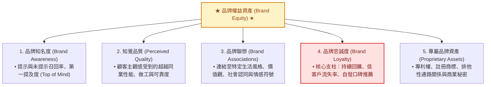

---
{"dg-publish":true,"permalink":"/98/brand-equity-david-aaker/","tags":["商業概念","行銷管理","品牌策略","無形資產","PMBA"],"dg-note-properties":{"aliases":["品牌權益","品牌資產","品牌價值模型","Brand Equity","David Aaker Brand Equity"],"tags":["商業概念","行銷管理","品牌策略","無形資產","PMBA"]}}
---

# 品牌權益 David Aaker 模型 (Brand Equity)

> **商管核心價值**：品牌權益是企業投入資本中最重要的無形資產（Intangibles）。強大的品牌權益為產品帶來超越物理成本的「定價特權」，並在顧客心中築起堅不可摧的情感與認知壁壘。

---

## 一、 核心定義與五大維度

品牌大師大衛·艾克（David Aaker）指出，品牌權益由五大核心資產維度構成：

---

## 二、 品牌延伸之戰略平衡

1. **光環效應 (Halo Effect)**：強勢品牌權益可順暢投射至新產品，大幅降低新客獲取成本（CAC），例如 Apple 品牌權益推動 AirPods 與 Apple Watch 迅速統治市場。
2. **品牌稀釋風險 (Brand Dilution)**：若過度擴充且品類不相容、品質低劣，將反噬主品牌形象與定價權。

---

## 三、 跨模組雙向鏈結與延伸導航

- **課程筆記**：[[04_主題選修/10_創業與企業財務策略/02_模組筆記/Module_2_產品創新與精實驗證/M2-2_產品組合策略與品牌權益管理\|M2-2 產品組合策略與品牌權益管理]] ｜ [[04_主題選修/10_創業與企業財務策略/02_模組筆記/Module_1_創新思維與商業模式/M1-10_七大市場力量與商業戰略價值公式\|M1-10 七大市場力量 (品牌力量 Branding)]]
- **關聯概念**：[[98_商業概念庫/Kotler_五個產品層次模型 Five Product Levels\|Kotler 五個產品層次模型]] ｜ [[98_商業概念庫/Product_Mix_產品組合管理 Product Mix\|Product Mix 產品組合管理]]
- **案例對標**：[[04_主題選修/10_創業與企業財務策略/01_創投總經與個案/cases_新創與企業融資案例庫#統一超商\|統一超商 品牌權益與生活型態服務]]