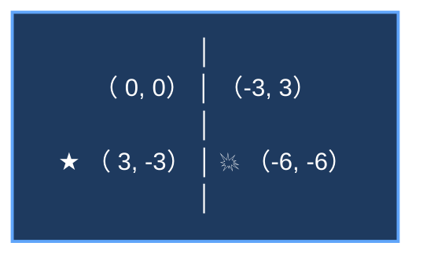

---
{"dg-publish":true,"permalink":"/98/chicken-game/","tags":["商業概念","賽局理論","進入障礙","產能競爭","PMBA"],"dg-note-properties":{"aliases":["膽小鬼賽局","獵鷹賽局","鬥雞賽局","Chicken Game"],"tags":["商業概念","賽局理論","進入障礙","產能競爭","PMBA"]}}
---

# 膽小鬼賽局 (Chicken Game)

## 一、 核心定義與本質
- **膽小鬼賽局（Chicken Game，又稱鬥雞博弈）**描述兩名駕駛開車相向疾駛，誰先轉彎煞車誰就是「膽小鬼（Chicken）」，直衝者獲勝；但若雙方皆堅持直衝，將發生毀滅性對撞。
- **產業本質**：
  經常用於分析寡占產業中的**「產能擴張大戰」**與**「既有巨頭嚇阻潛在進入者」**。其核心不在於優勢策略，而在於**「誰能建立不可動搖的可信承諾（Credible Commitment）」**，迫使對方退讓。

---

## 二、 報酬矩陣與均衡特徵

**【新進者嚇阻對決矩陣 (既有廠商 A, 潛在進入者 B)】**

- **兩個納許均衡**：$(3, -3)$ 與 $(-3, 3)$；
- **勝負關鍵**：
  若廠商 A 能讓進入者 B 確信「我一定會直衝反擊到底」，B 的理性最佳選擇即是「煞車退讓」。

---

## 三、 承諾裝置（Commitment Device）與可信威脅
1. **預先投入巨額專屬資產（Sunk Investments）**：
   - 率先擴建遠超當前市場需求的超額產能，向對手傳遞「我固定成本已投入，後續邊際成本極低，必殺價到底」的訊號；
2. **破釜沉舟（Burning the Bridges）**：
   - 刻意斬斷自身的退路（如公開簽訂毀約賠償合約），使對手明知你已無法退縮；
3. **溝通誤判風險**：
   - 若雙方皆誤判對方會退讓，同時採取直衝策略，將爆發產能嚴重過剩與同歸於盡的毀滅性崩盤。

---

## 四、 關聯筆記與概念地圖
- **核心關聯模組**：[[04_主題選修/12_產業分析與投資策略/99_歷史舊版備份/M2-3_產業價值網與競合分析\|M2-3_產業價值網與競合分析]] ｜ [[04_主題選修/12_產業分析與投資策略/99_歷史舊版備份/M1-5_波特五力分析與量化架構\|M1-5_波特五力分析與量化架構]]
- **概念地圖對接**：[[98_商業概念庫/Prisoners_Dilemma_囚犯困境賽局\|Prisoners_Dilemma_囚犯困境賽局]] ｜ [[98_商業概念庫/PARTS_賽局變革架構 PARTS Framework\|PARTS_賽局變革架構 PARTS Framework]] ｜ [[98_商業概念庫/industry-alliance_同業合作三大動機\|Industry_Alliance_同業合作三大動機]]
