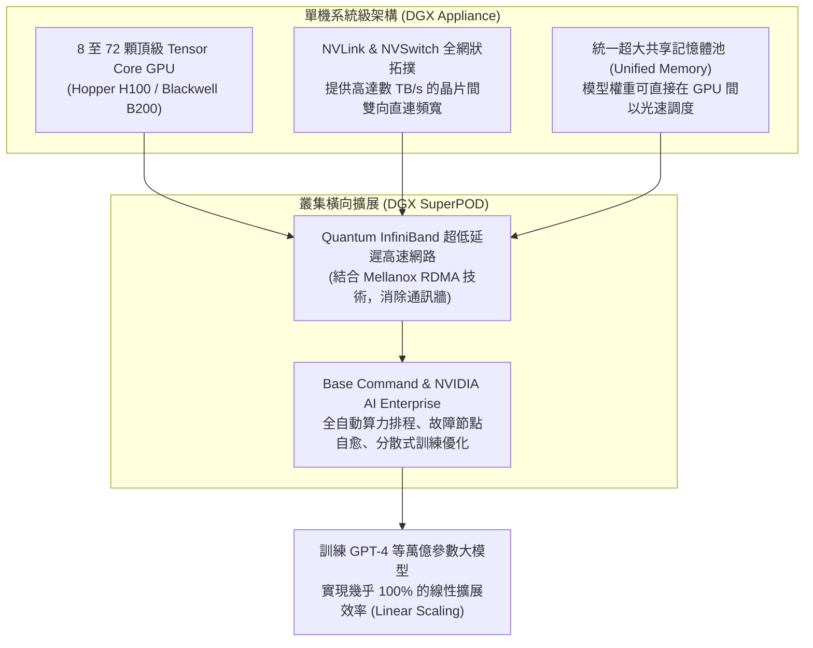

---
{"dg-publish":true,"permalink":"/98/dgx/","tags":["商業概念","人工智慧","運算架構","產品策略","PMBA"],"dg-note-properties":{"aliases":["DGX","NVIDIA DGX","DGX超級電腦","DGX SuperPOD","DGX系統"],"tags":["商業概念","人工智慧","運算架構","產品策略","PMBA"]}}
---


# DGX (NVIDIA DGX AI 超級運算系統)

> [!NOTE]
> **核心概念精粹**：NVIDIA DGX 是輝達專為深度學習、大語言模型訓練與高階科學運算量身打造的**「開箱即用型 AI 超級電腦（AI Supercomputer-in-a-Box）」**旗艦系統架構。它徹底顛覆了傳統企業必須耗費數月自行採購零組件、拼裝伺服器與調試驅動程式的低效模式，將多顆頂級 GPU、Grace CPU、NVSwitch 高速互聯與液冷架構深度整合為單一運算節點，並透過 InfiniBand 網路線性擴展為擁有數萬顆 GPU 的 **DGX SuperPOD** 倉儲級算力叢集，成為當代生成式 AI 軍備競賽的黃金運算基準。

---

## 一、 學理定位與歷史轉折：從組裝伺服器到系統級超級電腦

在 DGX 問世之前，企業與學術界試圖進行深度學習時，面臨極端痛苦的硬體瓶頸：PCIe 匯流排頻寬狹窄、散熱功耗爆表、驅動程式衝突。

2016 年，黃仁勳做出歷史性突破——親自向 OpenAI 交付全球首台搭載 8 顆 Pascal 架構 GPU 的 **DGX-1**。這標誌著輝達從單純的「晶片供應商」正式躍升為**「整機超級運算系統整合架構商」**：



---

## 二、 輝達 DGX 歷代架構與關鍵演進矩陣

| 系統世代 | 推出年份 | 核心 GPU 架構 | 浮點運算峰值算力 | 關鍵架構突破與產業里程碑 |
| :--- | :--- | :--- | :--- | :--- |
| **DGX-1** | 2016 | 8 × Pascal P100 / Volta V100 | 170 TFLOPS (FP16) | 全球首台專屬深度學習超級電腦；黃仁勳親手交付 OpenAI 啟動大模型時代。 |
| **DGX-2** | 2018 | 16 × Volta V100 | 2 PFLOPS | 首度導入 NVSwitch 晶片，實現 16 顆 GPU 之間 2.4 TB/s 的全對稱無阻塞互聯。 |
| **DGX A100** | 2020 | 8 × Ampere A100 | 5 PFLOPS | 引入多實例 GPU（MIG）技術，單機可切分為 56 個獨立運算單元；訓練推論合一。 |
| **DGX H100** | 2022 | 8 × Hopper H100 | 32 PFLOPS (FP8) | 搭載專屬 Transformer 引擎，針對大語言模型（LLM）訓練速度較前代暴增 6 倍。 |
| **DGX B200 / NVL72** | 2024 | 72 × Blackwell B200 | 1.4 ExaFLOPS (FP4) | 採用機架級全液冷（Liquid Cooled）架構，將 72 顆 GPU 虛擬化為單一超巨型 GPU。 |

---

## 三、 經典企業實戰案例：OpenAI 與跨國藥廠的研發加速度

```carousel

<!-- slide -->
### 1. OpenAI 大模型訓練的算力基石
- **傳統困境**：在 2016 年之前，OpenAI 只能用一般雲端伺服器進行實驗，訓練一個中型模型需耗時數月，研究進度緩慢；
- **DGX 介入**：接收黃仁勳贈送的全球首台 DGX-1 後，OpenAI 算力密度瞬間提升數十倍，將原本需運算數週的模型壓縮至幾天內完成；
- **歷史回響**：隨後微軟 Azure 採購上萬台 DGX 與 HGX 構建專屬超級叢集，才成功訓練出 GPT-3、GPT-4 與 ChatGPT，徹底改寫人類科技史。
<!-- slide -->
### 2. 跨國藥廠輝瑞（Pfizer）的 AI 藥物靶點篩選
- **業務痛點**：傳統新藥研發需歷時 10~15 年、耗資數十億美元，傳統化合物分子篩選效率極低；
- **部署架構**：輝瑞引入 DGX SuperPOD 超級叢集，結合生醫專用 BioNeMo 平台；
- **商業成效**：將百萬級分子結構對接模擬時間從數月縮短至數小時，在新冠口服抗病毒藥 Paxlovid 研發中實現創紀錄的研發提速。
```

---

## 四、 經理人 DGX 算力資本預算審計檢核表（Executive Decision Checklist）

在面對昂貴的 AI 算力基礎設施採購決策時，企業技術長與財務長應依序檢驗：

- [ ] **自建 DGX 叢集 vs 租用公有雲算力（Build vs Cloud TCO）**：
  - 我們是否有長年穩定的高強度大模型訓練需求？如果算力利用率（Utilization Rate）能維持在 70% 以上，自建 DGX SuperPOD 的 3 年總持有成本（TCO）是否顯著低於向雲端廠商（AWS/Azure）租用的租金？
- [ ] **通訊牆與互聯頻寬檢驗（Networking Bottleneck Audit）**：
  - 我們的採購預算是否只配置給 GPU 本身，而忽略了高速網路交換機（如 InfiniBand）與光纖模組？若網路頻寬不足，昂貴的 GPU 晶片將有超過 50% 的時間處於空轉等待狀態。
- [ ] **資料中心水電與液冷準備（Power & Cooling Readiness）**：
  - 機房的單一機櫃電力密度是否能支撐 40kW 至 120kW 的極限負載？機房是否具備水冷散熱改裝條件？如果電力容量受限，DGX 系統將根本無法開機運作。
- [ ] **演算法與框架生態適配（CUDA Optimization Pipeline）**：
  - 我們的內部資料科學家團隊，是否具備熟練調度 PyTorch、DeepSpeed 與 Megatron-LM 分散式訓練框架的能力？能否將硬體峰值算力發揮出 60% 以上的 MFU（Model Flops Utilization）？

---

## 五、 關聯概念與知識網絡

* 輝達全端運算生態：
  * [[nvidia_輝達|輝達 (NVIDIA)]]：DGX 所屬之加速運算與全端平台母體
  * [[jensen-huang_黃仁勳|黃仁勳 (Jensen Huang)]]：親手打造並引領 DGX 演進之企業領袖
  * [[Omniverse|Omniverse 數位孿生]]：依託 DGX 算力叢集運作之實體模擬平台
  * [[tsmc_台積電|台積電 (TSMC)]]：為 DGX 提供最先進製程晶片與 CoWoS 封裝之製造支柱
* 資本配置與營運戰略：
  * [[capital-budgeting_資本預算|資本預算 (Capital Budgeting)]]：高達數千萬美元 DGX SuperPOD 採購之動態回收期測算
  * [[economies-of-scale_規模經濟|規模經濟 (Economies of Scale)]]：大型算力叢集分攤大模型訓練單位成本之效益
  * [[viable-business_好事業|好事業 (Viable Business)]]：高毛利與高進入壁壘之硬體護城河典範
  * [[core-competence_核心能力|核心能力 (Core Competence)]]：系統級軟硬一體化垂直整合優勢
