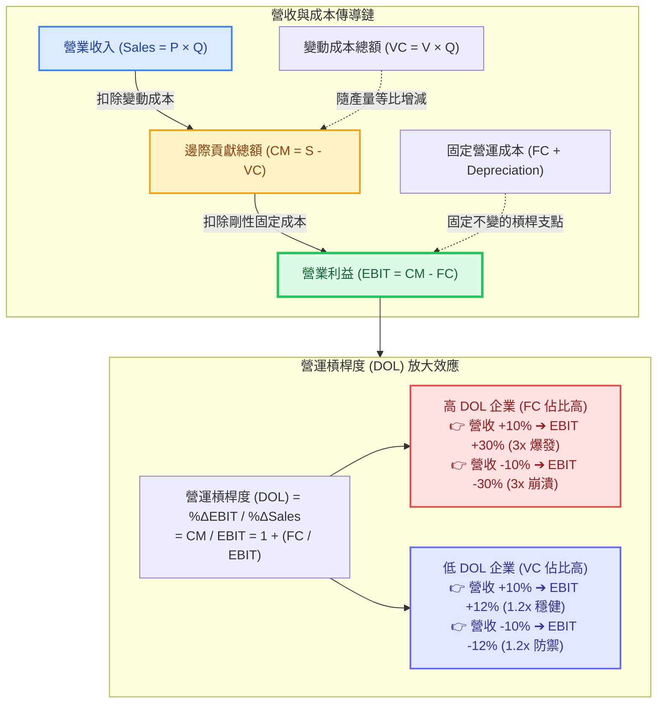

---
{"dg-publish":true,"permalink":"/98/dol/","tags":["商業概念","財務管理","成本結構","營運風險","公司理財","創業財務","PMBA"],"dg-note-properties":{"aliases":["DOL","DOL_營運槓桿","營運槓桿","營運槓桿度","營業槓桿","營業槓桿度","Degree of Operating Leverage","Operating Leverage","operating-leverage","operating-leverage_營運槓桿"],"tags":["商業概念","財務管理","成本結構","營運風險","公司理財","創業財務","PMBA"]}}
---


# 營運槓桿度 (Degree of Operating Leverage, DOL)

> 💡 **導航與索引**：本篇為評估成本結構敏感度與本業營運風險之核心指標，亦可參閱產銷規模底線 [[98_商業概念庫/BEP_三大損益兩平點分析 Breakeven Analysis\|三大損益兩平點 (BEP)]]、融資結構放大器 [[98_商業概念庫/financial-leverage_財務槓桿\|財務槓桿度 (DFL)]]、獲利效率拆解 [[98_商業概念庫/dupont-analysis_杜邦分析法\|杜邦分析法 (DuPont)]]、估值共振效應 [[98_商業概念庫/davis-double-whammy_戴維斯雙殺效應\|戴維斯雙殺與雙擊效應]]，以及資本定價基準 [[98_商業概念庫/wacc_加權平均資本成本\|加權平均資本成本 (WACC)]]。

## 一、 核心定義與財務學本質

- **營運槓桿度 (Degree of Operating Leverage, DOL)** 係指在企業既定的成本結構下，**營業利益（EBIT）相對於營業收入（Sales / Q）變動之彈性係數（Elasticity）**。它衡量了固定營運成本（Fixed Operating Costs，如廠房機台折舊、無形資產攤銷、研發租金與專職薪資）在企業營收擴張或收縮時，對本業息稅前利潤所產生的倍數放大（或縮小）效應。
- **經營風險（Business Risk）的核心驅動源**：
  企業面臨的總體營運風險由「**銷售量不確定性（市場需求/定價風險）**」與「**營運槓桿（內部固定成本剛性）**」共同決定。固定營運成本佔比越高，企業跨越損益兩平門檻所需之銷售規模越大，獲利對營收微幅波動的敏感度亦呈指數級放大。
- **雙刃劍效應（Two-Sided Sword）**：
  - **🚀 景氣擴張順風（正向營運槓桿爆發）**：
    當產銷量成功越過會計損益兩平點（Accounting BEP）後，所有固定成本均已被既有營收完全吸收。此時每多賣出 1 單位產品，扣除邊際變動成本後的每一塊錢邊際貢獻（Contribution Margin），將 **$100\%$ 直通營業利益底線**，帶動利潤以數倍於營收的增速飆升（如半導體先進製程產能利用率突破 85%～90%、SaaS 軟體新增用戶邊際成本趨近於零）。
  - **💥 景氣衰退逆風（反向營運槓桿反噬）**：
    當市場需求萎縮、營收下滑時，剛性固定成本（如龐大折舊攤提、工廠折舊與高額固定薪資）一毛不減，此時營業利益將以倍數幅度崩跌，甚至迅速擊穿零軸陷入巨額虧損（如傳統重資產車廠、面板廠在供過於求時的產能減損風暴，引發[[98_商業概念庫/davis-double-whammy_戴維斯雙殺效應\|戴維斯雙殺]]）。

---

## 二、 數理公式推導與三大計算視角



### 1. 變動率定義式（彈性視角）
$$\text{DOL} = \frac{\% \Delta \text{EBIT}}{\% \Delta Q} = \frac{\Delta \text{EBIT} / \text{EBIT}}{\Delta Q / Q} = \frac{\Delta \text{EBIT}}{\Delta S} \times \frac{S}{\text{EBIT}}$$
- **經濟意義**：當銷售量或營收變動 $1\%$ 時，營業利益（EBIT）預期變動的百分比。

### 2. 成本結構拆解式（點位靜態視角）
設產品單價為 $P$、單位變動成本為 $V$（單位邊際貢獻 $cm = P - V$）、產銷量為 $Q$、總固定營運成本（含現金固定成本與折舊）為 $FC$：
$$\text{EBIT} = Q(P - V) - FC$$
$$\Delta \text{EBIT} = \Delta Q(P - V)$$
代入定義式推導可得：
$$\text{DOL}_Q = \frac{\Delta Q(P - V)}{Q(P - V) - FC} \div \frac{\Delta Q}{Q} = \frac{Q(P - V)}{Q(P - V) - FC}$$
$$\text{DOL} = \frac{\text{邊際貢獻總額 (Contribution Margin)}}{\text{息稅前營業利益 (EBIT)}} = \frac{S - VC}{S - VC - FC} = 1 + \frac{FC}{\text{EBIT}}$$

- **數理核心定理**：
  1. 若企業為純勞務或純撮合（**無任何固定營運成本，$FC = 0$**），則 $\text{DOL} = 1$。營收增加 10%，EBIT 嚴格等比例增加 10%，無槓桿效應。
  2. 只要存在固定營運成本（$FC > 0$）且企業盈利（$\text{EBIT} > 0$），必有 **$\text{DOL} > 1$**。
  3. **固定成本 $FC$ 佔比越高，$\text{DOL}$ 越大**，利潤對營收變動的敏感度越高。

### 3. 與三大損益兩平點 (BEP) 的幾何聯立
結合課堂白板推導之會計損益兩平點（Accounting BEP: $Q_{\text{acct}}^* = \frac{FC}{P - V}$）：
$$\text{DOL} = \frac{Q(P - V)}{Q(P - V) - FC} = \frac{Q}{Q - Q_{\text{acct}}^*}$$

| 產銷規模位置 | DOL 數值表現 | 營運與財務意涵 |
| :--- | :---: | :--- |
| **$Q \to Q_{\text{acct}}^*$ (逼近兩平點)** | **$\text{DOL} \to \infty$** | **極度敏感危險區**：利潤極薄或在零軸邊緣，營收微幅增長 1% 利潤可翻倍，營收微跌 1% 立即墜入巨虧。 |
| **$Q < Q_{\text{acct}}^*$ (處於虧損區)** | **$\text{DOL} < 0$** | 營收每增加 1%，每單位邊際貢獻都在縮小虧損（負數之收斂）。 |
| **$Q \gg Q_{\text{acct}}^*$ (遠超兩平點)** | **$\text{DOL} \to 1^+$** | **規模平穩高原區**：固定成本佔總營收比重已被極度稀釋，利潤增長率逐漸收斂貼近營收增長率。 |

---

## 三、 總槓桿度 (DCL) 乘數效應：DOL 與 DFL 的聯立博弈

企業面臨的總風險（Total Risk）由經營風險（本業）與財務風險（融資）相乘決定：
$$\text{總槓桿度 ([[degree-of-total-leverage-dtl_總槓桿|DTL / DCL]])} = \text{DOL} \times \text{DFL}$$
$$\text{DCL} = \underbrace{\frac{\% \Delta \text{EBIT}}{\% \Delta Q}}_{\text{DOL (營運槓桿)}} \times \underbrace{\frac{\% \Delta \text{EPS}}{\% \Delta \text{EBIT}}}_{\text{DFL (財務槓桿)}} = \frac{\% \Delta \text{EPS}}{\% \Delta Q}$$
$$\text{DCL} = \frac{Q(P - V)}{Q(P - V) - FC - I - \frac{D_p}{1 - T_c}} = \frac{\text{邊際貢獻總額 (CM)}}{\text{稅前利潤 (EBT)}}$$
*其中 $I$ 為利息費用，$D_p$ 為特別股股利，$T_c$ 為企業所得稅率。*

### 資本結構配置鐵律（槓桿配對矩陣）

```text
                  【營運槓桿度 (DOL，經營風險)】
                   低 (輕資產 / 低 FC)         高 (重資產 / 高 FC)
          ┌───────────────────────────┬───────────────────────────┐
       高 │ 【高風險平衡型】          │ 【💥 破產高危模式 (自殺組合)】
【財務 │ 零售通路、低資產服務業    │ 算力中心發行高息債 (CoreWeave)、
 槓桿  │ 可承受較高負債利息 (I)   │ 高槓桿房企；營收微跌即擊穿利保倍數
 (DFL)】│ 藉由舉債放大股東 ROE      │ 遭遇戴維斯雙殺引發債務違約
          ├───────────────────────────┼───────────────────────────┤
       低 │ 【極度防禦保守型】        │ 【🚀 重科技先進製造模式】  │
          │ 零負債純撮合平台          │ 台積電 (2330)、ASML、航太軍工；
          │ 獲利穩健但缺乏爆發力      │ 本業高 DOL 創造暴利，嚴格壓低負債
          │ 資金配置保守              │ 維持極低 DFL 確保景氣寒冬生存能耐
          └───────────────────────────┴───────────────────────────┘
```

---

## 四、 產業四象限矩陣與商業模式對標

結合「固定成本佔比（資本密集度）」與「邊際變動成本（規模延展性）」，可將全球商業模式劃分為四大經典維度：

| 象限分類 | 成本結構特徵 | DOL 特性 | 產能利用率敏感度 | 代表企業與課堂個案 |
| :--- | :--- | :---: | :---: | :--- |
| **Ⅰ. 極致高 DOL 軟體/雲端型** | 前期研發/架構高 $FC$，新增用戶邊際成本 $VC \approx 0$ | **極高**<br>($\text{DOL} \gg 3$) | 極高（邊際貢獻率高達 80%~90%） | **微軟 (Microsoft)、Google、SaaS 巨頭**：規模跨越兩平點後，營益率衝上 40% 以上。 |
| **Ⅱ. 高 DOL 重資產製造/基礎設施型** | 廠房設備巨額折舊高 $FC$，物料與能源變動成本高 | **高**<br>($\text{DOL} \approx 2 \sim 3$) | 極高（80% 為景氣生死線） | **台積電 (2330)、友達/群創 (面板)、德國福斯 (車廠)**：產能滿載暴利，產能閒置巨虧。 |
| **Ⅲ. 低 DOL 高彈性運營代工型** | 廠房租賃或輕資產，成本多隨訂單變動（外包、計件料工） | **中低**<br>($\text{DOL} \approx 1.2 \sim 1.5$) | 中度（獲利靠週轉率帶動） | **鴻海 (2317)**：淨利率僅 2%~3%，但固定折舊低，靠極致週轉率與彈性產能維持穩健 ROE。 |
| **Ⅳ. 極低 DOL 平台撮合/服務型** | 資產輕量化，固定資本投資轉嫁予供給端承擔 | **極低**<br>($\text{DOL} \to 1^+$) | 低（隨產值線性分潤） | **Airbnb、Uber**：不自持有房產與車隊，營收波動對利潤衝擊平緩，抗下檔韌性極強。 |

---

## 五、 高階經理人實戰決策三大軍規

### 1. 產能利用率（Capacity Utilization Rate）之生死線監控
- 在高 DOL 的製造業與半導體產業中，**產能利用率（UT rate）是決定營運獲利的單一最關鍵指標**。
- 例如晶圓代工廠損益兩平產能利用率若為 $75\%$：
  - 當利用率由 $75\%$ 上升至 $90\%$（增長 20%），營業利益往往暴增 **$100\%$ 以上**；
  - 反之，當利用率由 $80\%$ 跌至 $65\%$，利潤並非衰退 18%，而是**直接跌穿損益兩平點轉為巨額虧損**！經理人審批高 CapEx 擴產時，必須嚴格評估未來三年訂單能見度。

### 2. 價格戰決策：邊際貢獻大於零的經濟理性邊界
- 高 DOL 企業遭遇市場需求萎縮時，常出現「降價搶單」的殺價競爭：
  - **短期降價理性**：只要單價 $P > V$（單位邊際貢獻為正），每多接一張單都能貢獻現金流用以分攤固定成本（減少虧損）；
  - **停產冷爐紅線**：一旦市價跌破單位變動成本（$P < V$），生產越多虧損越慘，經理人必須果斷停機、關閉產線停損。

### 3. 雲端化革命：將「固定成本變動化」（CapEx 轉 OpEx）
- 傳統企業自建伺服器機房與資料中心，產生龐大前期固定資產支出（CapEx）與剛性折舊，大幅墊高初期 DOL，新創容易夭折於會計損益兩平點前。
- **現代精實創業策略**：全面採用公有雲租賃（AWS / Azure / GCP）、SaaS 訂閱制工具與第三方代工物流，將大筆固定支出轉化為「隨用隨付（Pay-as-you-go）」的變動營業費用（OpEx），**實質調降企業初期 DOL**，使現金與會計 BEP 大幅前移，顯著提升企業在 VUCA 環境下的存活率。

---

## 六、 關聯主題與模組網絡

- 🧭 **課程核心模組對接**：
  - [[04_主題選修/10_創業與企業財務策略/02_模組筆記/Module_1_創新思維與商業模式/M1-2_白板決策鏈與財務價值三角|M1-2 白板決策鏈與財務價值三角]]（三大損益兩平點推導、DOL 與 DFL 雙槓桿乘數效應 DCL）
  - [[04_主題選修/10_創業與企業財務策略/02_模組筆記/Module_2_產品創新與精實驗證/M2-4_新創財務預測與外部融資需求模型|M2-4 新創財務預測與外部融資需求模型]]（新創敏感度分析、變動成本率與固定成本分攤規劃）
  - [[04_主題選修/12_產業分析與投資策略/02_模組筆記/Module_1_總論與架構/M1-2_三大景氣循環與資本評價邏輯|M1-2 三大景氣循環與資本評價邏輯]]（基欽/朱格拉產能週期、高 DOL 資本密集產業景氣反轉分析）
  - [[02_核心必修/01_財務管理/L01_財務管理導論|L01 財務管理導論]]（營運槓桿與財務槓桿之企業風險構建）
  - [[01_基礎先修/01_財務報表分析/Ch07_獲利能力分析|Ch07 獲利能力分析]]（成本習性分類、固定成本稀釋與獲利彈性分析）
- 🔗 **核心概念原子卡片**：
  - [[BEP_三大損益兩平點分析 Breakeven Analysis|三大損益兩平點分析 (BEP)]]
  - [[financial-leverage_財務槓桿|財務槓桿度 (DFL)]] ｜ [[degree-of-total-leverage-dtl_總槓桿|總槓桿度 (DTL / DCL)]]
  - [[davis-double-whammy_戴維斯雙殺效應|戴維斯雙殺與雙擊效應 (Davis Double Whammy)]]
  - [[dupont-analysis_杜邦分析法|杜邦分析法 (DuPont Analysis)]]
  - [[return-on-invested-capital_資本投入報酬率|資本投入報酬率 (ROIC)]]
  - [[wacc_加權平均資本成本|加權平均資本成本 (WACC)]]
  - [[operating-income_營業利益|營業利益 (EBIT)]]
  - [[AFN_外部融資需求模型 Additional Funds Needed|外部融資需求模型 (AFN)]]
