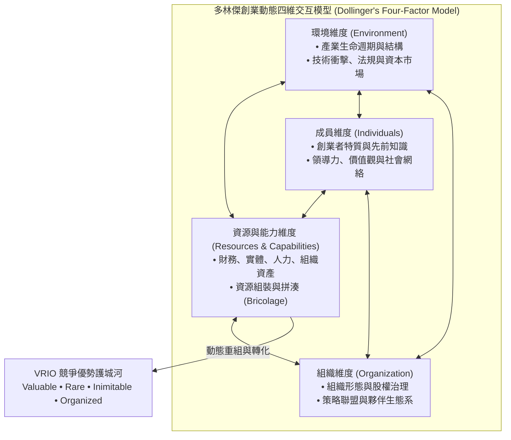
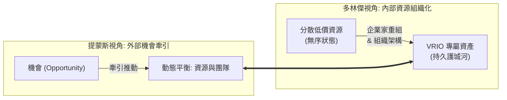

---
{"dg-publish":true,"permalink":"/98/dollinger/","tags":["商業概念","創業管理","資源基礎理論","PMBA"],"dg-note-properties":{"aliases":["Dollinger","多林傑","Marc J. Dollinger","多林傑創業模型"],"tags":["商業概念","創業管理","資源基礎理論","PMBA"]}}
---

# 多林傑 (Marc J. Dollinger)

> [!NOTE]
> **核心概念精粹**：馬克·J·多林傑（Marc J. Dollinger）是將**資源基礎理論（Resource-Based View, RBV）**系統性導入創業學的開拓學者。在其經典著作《Entrepreneurship: Strategies and Resources》中，多林傑將創業定義為：「在高度風險與不確定性的環境下，為追求市場機會，將分散且異質的內外部資源進行**動態重組並組織化為經濟實體（Dynamic Resource Assembly & New Venture Creation）**的歷程」。

---

## 一、 學理淵源：RBV 視角下的創業本質

在傳統策略管理中，巴尼（Jay Barney）的資源基礎觀點多聚焦於「成熟大企業如何維持既有競爭優勢」。多林傑則敏銳指出：新創企業一開始根本不具備豐富的專屬資源，往往處於極端匱乏狀態。因此，創業研究的核心不應只是靜態檢視資源儲備，而應研究**「創業者如何獲取、配置、槓桿並重組分散的異質資源，最終培育出具備 VRIO 屬性之組織能力」**。

---

## 二、 多林傑資源分類與動態整合體系

多林傑將創業者必須駕馭的資源體系劃分為六大形態，並闡明其動態轉化邏輯：

| 資源形態 | 資源內涵與新創初期挑戰 | 創業動態整合策略 |
| :--- | :--- | :--- |
| **1. 財務資源 (Financial)** | 現金儲備、信用額度、股權融資管道。新創初期面臨嚴峻的[[Burn Rate|資金消耗率]]壓力。 | 運用階段性融資（Staged Financing）、預售收款與應付帳款槓桿，極大化資金跑道。 |
| **2. 實體資源 (Physical)** | 廠房設備、研發硬體、地理區位。重資產往往成為早期流動性負擔。 | 採用輕資產模式、共享工作空間、公有雲計算（AWS / GCP）與代工外包。 |
| **3. 人力資源 (Human)** | 創辦團隊技術專長、產業經驗、默會知識（Tacit Knowledge）。 | 以股權激勵、共同願景吸引頂尖複合型人才，彌補早期現金薪酬不足。 |
| **4. 組織資源 (Organizational)** | 內部溝通流程、敏捷開發常規、企業文化、品質管制體系。 | 建立扁平化決策機制、每日站會（Scrum）與快速試錯驗證的反饋循環。 |
| **5. 社會資本 (Social)** | 創業者與導師、客戶、供應商、監管機構之間的信任關係網絡。 | 槓桿弱連結（Weak Ties）跨界獲取關鍵非對稱資訊，建立產業專家顧問團。 |
| **6. 聲譽資產 (Reputational)** | 品牌形象、客戶忠誠度、行業公信力。新創初期面臨嚴重的「新進者劣勢（Liability of Newness）」。 | 透過天使投資人背書、權威媒體報導與標竿客戶成功案例快速建立信任。 |

---

## 三、 多林傑模型與提蒙斯模型之學術互補

在 NTU PMBA 創業管理體系中，多林傑模型與提蒙斯（Timmons）模型形成了完美的互補：

- **提蒙斯模型（Timmons Model）**：以**「機會（Opportunity）」**為引擎牽引團隊與資源，強調動態平衡與適配。
- **多林傑模型（Dollinger Model）**：深植於**「資源基礎論（RBV）」**底層，聚焦於創業者如何將無序、分散、低價的資源元素，透過獨特的配方（Organization Design & Resource Assembly）煉成具備防禦性壁壘的商業實體。

---

## 四、 實戰個案剖析：聯發科的「資源組裝」與白牌手機奇蹟

- **背景與資源起點**：2000 年代初期，台灣聯發科（MediaTek）只是一家從聯電分拆出來的中型晶片設計公司，在手機領域毫無品牌聲譽，亦無諾基亞、摩托羅拉等巨頭擁有的龐大專利庫與電信商關係。
- **多林傑式動態資源重組**：
  - 蔡明介團隊沒有正面硬碰 IDM 巨頭的重資產研發，而是精準整合自身在光碟機晶片累積的「軟硬體高度集成技術（人力資源）」；
  - 將基頻晶片、電源管理、射頻元件與底層多媒體軟體打包成**「Turnkey 解決方案（組織化能力）」**；
  - 深度鏈接華強北數千家外殼、模具、電池小型製造商（社會資本與生態系組織）。
- **成果**：聯發科將原本分散混亂的供應鏈資源高度組織化，把製造手機的技術門檻降為零，創造了席捲全球新興市場的白牌手機傳奇，成功躋身全球頂級無晶圓半導體設計巨頭。

---

## 五、 經理人多林傑資源配置審計清單（Executive Decision Checklist）

企業在啟動新創事業或內部組織重組時，高階管理團隊應依序評估下列項目：

- [ ] **資源異質性檢驗（Heterogeneity Audit）**：
  - 我們所投入的資源是否隨處可在公開市場輕易採購？若所有要素均可隨意買到，我們如何透過獨特的「組合架構」創造對手無法複製的加乘綜效？
- [ ] **新進者劣勢消解（Overcoming Liability of Newness）**：
  - 新創團隊在聲譽與社會資本上的嚴重赤字，是否能透過知名戰略夥伴結盟、指標性客戶試點或權威背書迅速補足？
- [ ] **資源拼湊能力評估（Bricolage Capability）**：
  - 當關鍵資源（如昂貴設備或資深演算法專家）因資金限制無法直接引進時，團隊是否具備利用手邊現有替代工具、開源技術或外包生態解決問題的拼湊彈性？
- [ ] **VRIO 轉化路徑規劃（VRIO Roadmap）**：
  - 目前看似普通的資源組合，預計在幾個月內轉化為具備「難以模仿性（Inimitable）」的核心資產？我們是否正在構建專利阻絕、網絡效應或專有數據閉環？

---

## 六、 關聯概念與知識網絡

* 核心理論基礎：
  * [[resource-based-view-rbv_資源基礎理論|資源基礎理論 (RBV)]]：企業內部專有資產與持續競爭優勢
  * [[VRIO架構|VRIO 架構 (VRIO Framework)]]：價值、稀缺、難以模仿與組織化檢驗
  * [[timmons-model_提蒙斯創業模型|提蒙斯創業模型 (Timmons Model)]]：機會牽引下資源與團隊的動態平衡
  * [[Venkataraman|范卡塔拉曼 (Sankaran Venkataraman)]]：個人—機會雙構面理論
* 資源整合與行動工具：
  * [[resource-bricolage_資源拼湊|資源拼湊 (Resource Bricolage)]]：資源匱乏環境下的即興創造策略
  * [[resource-allocation_資源配置|資源配置 (Resource Allocation)]]：策略性資源在核心與探索業務間之配置
  * [[core-competence_核心能力|核心能力 (Core Competence)]]：難以被競爭對手替代之底層能力
  * [[viable-business_好事業|好事業 (Viable Business)]]：具備自我造血能力的商業實體
