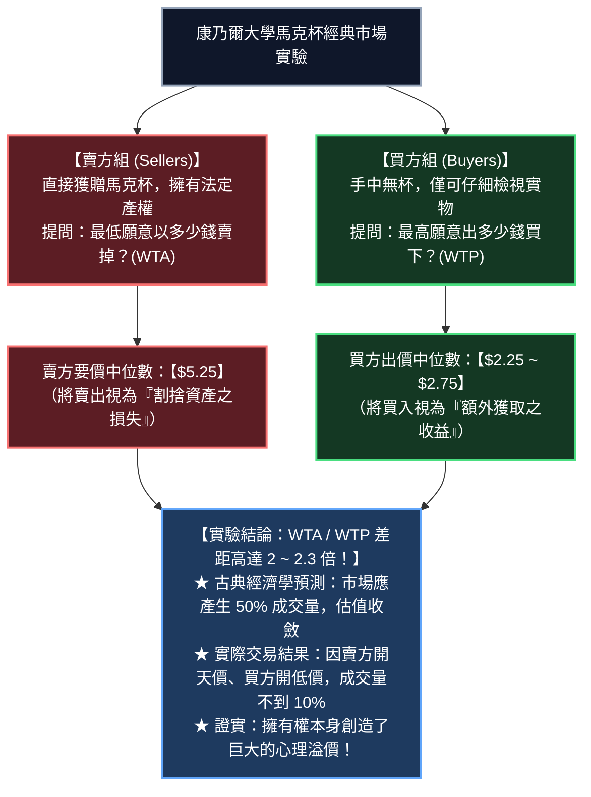
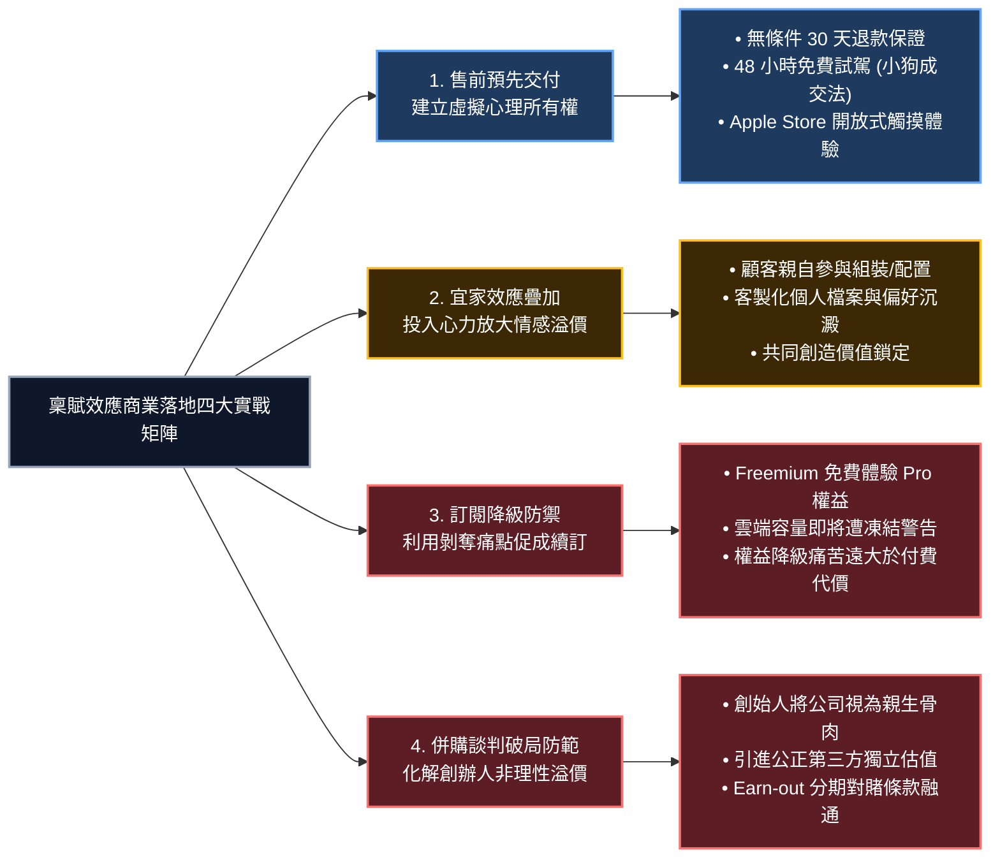

---
{"dg-publish":true,"permalink":"/98/endowment-effect/","tags":["商業概念","行為經濟學","決策科學","消費者心理學","定價策略","行銷策略","產品設計","PMBA"],"dg-note-properties":{"aliases":["稟賦效應","賦予效應","原賦效應","Endowment Effect","Endowment Effect 稟賦效應","WTA-WTP Gap","願售與願付差距","心理所有權效應"],"tags":["商業概念","行為經濟學","決策科學","消費者心理學","定價策略","行銷策略","產品設計","PMBA"]}}
---


# 稟賦效應 (Endowment Effect / 賦予效應)

> **商管核心價值**：  
> 「在理性經濟學的世界裡，一樣東西的價值取決於它的客觀效用；但在真實的人性世界中，一樣東西一旦被我們『擁有』，它的身價便在我們心中暴增兩倍以上。放棄擁有的痛苦，遠大於獲得同等物品的快樂。稟賦效應揭示了人類對『擁有物』不可自拔的情感溢價與損失厭惡；卓越的企業家與產品經理，懂得在成交之前先將『心理所有權』預先交付給顧客，讓客戶因為害怕『失去』而主動買單。」——理查·塞勒（Richard H. Thaler）與丹尼爾·康納曼（Daniel Kahneman）  
> 
> 在現代行為經濟學、行銷策略與產品體驗設計中，**稟賦效應（Endowment Effect）** 指出：**當個人一旦擁有某項物品或權益，他對該物品的價值評估會顯著高於未擁有時的評估**。表現在市場交易中，即「**願售價格（Willingness to Accept, WTA）**」通常是「**願付價格（Willingness to Pay, WTP）**」的 2 到 2.5 倍。該理論徹底推翻了古典經濟學關於偏好穩定且對稱的假設，成為免費試用（Free Trial）、體驗式行銷、訂閱制降級防禦、客戶留存與資產併購談判的核心決策模型。

---

## 一、 理論淵源與經典實驗

### 1.1 學術奠基與諾貝爾獎傳承
- **提出學者**：2017 年諾貝爾經濟學獎得主 **理查·塞勒（Richard H. Thaler）**。
- **奠基文獻**：1980 年發表於《Journal of Economic Behavior & Organization》的劃時代論文 **《Toward a Positive Theory of Consumer Choice》（邁向消費者選擇的實證理論）**，首次正式命名並系統論述 **Endowment Effect**。
- **實驗證偽**：1990 年，塞勒攜手行為經濟學泰斗 **丹尼爾·康納曼（Daniel Kahneman）** 與 **傑克·奈奇（Jack Knetsch）** 於頂級期刊《Journal of Political Economy》發表經典馬克杯實驗，對古典經濟學的市場出清假說進行了毀滅性實證證偽。

---

### 1.2 經典實驗：康乃爾大學馬克杯實驗 (The Coffee Mug Experiment)

研究人員在康乃爾大學課堂中，將受試學生隨機均分為兩組，每個人面對完全相同的印有校徽之精美馬克杯（市價約 6 美元）：



---

## 二、 認知心理學與行為經濟學底層機制

```
             主觀價值 V(x) (Psychological Value)
                      ▲
                      │               【買入商品：屬於獲得 (Gain)】
                      │               • 感受的是『獲得效用』
                      │               • 邊際效用平緩
                      │               • 決定【最高願付價格 WTP】
                      │                  ╭──────
                      │             .·´
                      │         .·´
                      │     .·´
 ─────────────────────┼─────────────────────► 物品擁有狀態 (ΔX)
        失去 (Loss)   │ 心理參考點 (Reference Point：以擁有為現狀)
               │      │
               │      │
          ·    │      │
         :     │      │
        /      │      │
       /       │      │
      /        │      │               【賣出商品：屬於失去 (Loss)】
     /         │      │               • 承受的是『割捨之痛』
     ▼         │      │               • 曲線斜率陡峭 (λ ≈ 2.25)
  【最低願售   │      │               • 決定【最低願售價格 WTA】
   價格 WTA】  │      │               • 導致 WTA ≈ 2.25 × WTP
```

### 2.1 損失厭惡：稟賦效應的核心數學引擎
- **理論映射**：稟賦效應是 **[[prospect-theory_展望理論\|展望理論（Prospect Theory）]]** 中「損失厭惡（Loss Aversion）」在所有權領域的直接展現。
- **參考點位移（Shift of Reference Point）**：
  一旦物品進入個人的物理或心理空間，大腦的參考點立刻更新為「**我已擁有該物品**」。
  - **賣方心理**：賣掉物品被解讀為**損失（Loss）**，大腦承受斜率陡峭的痛苦感受；
  - **買方心理**：買進物品被解讀為**獲益（Gain）**，大腦僅產生斜率平緩的快樂感受；
- **數理關係式**：
  $$\text{WTA} \approx \lambda \times \text{WTP} \quad (\lambda \approx 2.0 \sim 2.5)$$
  這意味著，要彌補放棄某樣東西所帶來的心理劇痛，買方必須支付超過兩倍的代價，否則賣方寧可保留現狀。

---

### 2.2 心理所有權與自我延伸（Psychological Ownership & Extended Self）
- **自我延伸理論（Russell Belk, 1988）**：
  人類天生具有將外部物品「納入自我概念（Extended Self）」的認知傾向。當我們擁有一輛車、一本書、一套軟體或一家公司時，這些物品便成為個人身份、心血與尊嚴的象徵。
- **割捨之痛即自我威脅**：
  要求一個人賣掉或放棄自己的物品，在潛意識中被解讀為「對自我的殘割與否定（Identity Threat）」，因此產生強烈的情感防衛與價值膨脹。

---

### 2.3 神經經濟學實證：賣出物品觸發大腦「肉體疼痛」
- **fMRI 腦神經研究（Knutson et al., 2008）**：
  史丹佛大學神經科學團隊透過功能性磁振造影觀察受試者大腦：
  - 當受試者考慮**買入**商品時，大腦掌管獎勵預期的**伏隔核（Nucleus Accumbens）**被激活；
  - 當受試者被要求**賣出**手中已擁有的物品時，大腦的**島葉（Insula）**劇烈放電——而島葉正是人類大腦中**處理身體肉體疼痛、聞到腐臭味以及面對極度反感情緒時的核心神經中樞**！
  - **科學結論**：賣掉自己的東西，在大腦神經層面上與「被針扎一下的肉體痛苦」具有相同的生理反應機制！

---

## 三、 稟賦效應的邊界條件與特例

並非所有物品都會引發稟賦效應，管理實務中必須辨識以下三大邊界條件：

| 邊界維度 | 稟賦效應表現 | 實證機理與管理意涵 | 代表案例 |
| :--- | :--- | :--- | :--- |
| **1. 交易媒介 vs. 消費使用品** | **純交易品無稟賦效應**<br>使用品具備強烈效應 | 天生為了轉手交易或交換而持有的物品（如貨幣、黃金、經銷商貨架上的庫存），大腦不會將其納入自我概念，WTA 與 WTP 幾乎無差距。 | 超商收銀員不會對找給客人的 100 元鈔票產生割捨之痛；但對自己的私人物品極度在乎。 |
| **2. 所有權感知的速成性**<br>(Instant Endowment) | **無需法定產權，秒級生效** | 甚至無需法律產權交割，**只要物理觸碰（Touch）、試穿、試駕、或在腦海中想像使用情境**，大腦在數分鐘內即可建立虛擬心理所有權（Virtual Ownership）。 | 服飾店試衣間試穿；車行 48 小時免費試駕；Apple Store 觸碰展示機。 |
| **3. 專業交易經驗**<br>(Market Experience) | **隨交易熟練度遞減** | John List (2003) 實證：職業收藏家與資深卡牌交易商，因長期處於高頻買賣情境，大腦將物品視為流動資產，其 WTA-WTP 溢價顯著低於菜鳥新手。 | 職業華爾街操盤手止損果決；散戶投資人抱著套牢股票死不放手。 |

---

## 四、 商業策略、產品設計與行銷實戰



### 4.1 售前「預先交付所有權」：免費試用與小狗成交法
- **小狗成交法（The Puppy Dog Close）**：
  寵物店經典銷售術——銷售員對猶豫不決的顧客說：「不用現在決定，把這隻小狗帶回家過週末，週一若不喜歡隨時送回來。」結果幾乎沒有人會在週一退狗。因為兩天之內，全家人的心理參考點已徹底轉移，小狗成了家庭成員，退還小狗等同於拋棄家人。
- **無條件退款保證（30-Day Money-Back Guarantee）**：
  許多經理人擔心無條件退款會引發大量惡意退貨；但統計顯示，**寬鬆退款政策的退貨率通常低於 5%，而整體銷售額卻能暴增 30%~50%**。因為商品一旦擺進顧客客廳，稟賦效應便將「退貨」定義為「失去個人資產」，顧客不願承受損失痛苦，最終選擇保留。
- **Apple Store 觸摸哲學**：
  Apple 直營店所有筆電螢幕均固定微調至 76 度角——這個角度既能看清螢幕，又會迫使路過顧客伸手去調整角度。一旦手指肌膚接觸到鋁合金機身超過 30 秒，大腦的神經鏡像系統立刻觸發微型稟賦效應，使顧客的願付價格（WTP）大幅提升。

---

### 4.2 疊加「宜家效應 (IKEA Effect)」：讓顧客投入心力
- **機制**：當顧客在產品中投入了個人的時間、體力、思考或個人偏好設定時，稟賦效應會產生指數級放大（即 Norton et al. 提出的 **IKEA Effect**）。
- **實務應用**：
  - **Spotify / Apple Music**：精心整理的個人播放歌單、按讚的演算法推薦模型；
  - **Notion / Obsidian**：耗費數月精心構建的個人知識庫體系；
  - 顧客投入的心力沉澱為無法轉移的「專屬心理資產」，構築起極為恐怖的**高轉換成本（Switching Costs）護城河**。

---

### 4.3 SaaS 訂閱制：權益降級的極致痛苦（Degradation Aversion）
- **操作範式**：新用戶註冊時，主動贈送 30 天最高階「企業 Pro 版」所有進階功能（無限雲端空間、AI 自動摘要、4K 超清無浮水印匯出）。
- **關鍵反轉**：試用期滿時，不急於硬性催繳，而是發送提示：「**您的帳戶即將被降級為免費版，您創建的 10 個專案將被凍結為唯讀狀態**」。
- **心理動力學**：使用者對「失去已享受一個月的特權」產生極端反感與剝奪感，此時續訂付費不再被視為「購買新服務」，而是被視為「**花錢消災、買回自己應有的權益**」，轉換率飆升。

---

### 4.4 資本市場與 M&A 實務：創辦人估值偏誤陷阱 (Founder's Bias)
- **創業者心結（Founder's Overvaluation Trap）**：
  創始人將企業視為自己十月懷胎生下的「親骨肉（My Baby）」，注入了無數個通宵加班的情感沉沒成本。在融資或收購談判中，創始人的最低願售估值（WTA）通常是專業投資人依據 DCF 與倍數模型計算出之理性公允估值（WTP）的 **2 到 3 倍**。
- **破解對策**：
  1. **引進獨立財務顧問（IFA）做客觀冷卻**；
  2. **設計 Earn-out（績效分期對賭機制）**：以未來業績里程碑實現高估值，滿足創辦人的心理稟賦，同時防範買方的即期收購風險。

---

## 五、 經理人「反稟賦效應」決策審計工具箱

為防止管理層對內部既有業務、老舊產線或失敗專案產生「稟賦執念」而拒絕止損，策略委員會應定期執行以下五步審計：

```markdown
### 🛡️ 企業策略反稟賦效應去偏見檢核表 (De-biasing Checklist)

- [ ] 1. 【乾淨白紙測試 (Clean Slate / Zero-Base Audit)】：
         假定公司今天**完全不擁有**這項產品、這條產線或這家虧損子公司，以目前的市場條件與現金儲備，我們會主動出資將它買下來嗎？
         （若答案為「否」，則目前的保留決定純屬稟賦偏見，應啟動剝離程序）
- [ ] 2. 【局外人換位思考 (The Outsider Test)】：
         問管理團隊：「如果董事會明天解雇我們，換了一位全新、毫無包袱的空降 CEO，你認為他上任第一天會怎麼處置這項資產？」
         （安迪·葛洛夫正是靠此自問，毅然決然帶領英特爾砍掉記憶體業務，全力轉向微處理器）
- [ ] 3. 【機會成本顯性化 (Make Opportunity Costs Explicit)】：
         強制在財務報表中標註：「維持此資產所佔用的 5 億資本，若投入當前最火熱的 AI 新業務，每年將產生多少潛在超額回報？」
- [ ] 4. 【分權決策隔離 (Separation of Sunk Capital)】：
         主導資產剝離與處置審查的委員會成員，必須全部由**未曾參與該資產最初投資決策的獨立主管**組成。
- [ ] 5. 【預設日落條款 (Pre-committed Sunset Clauses)】：
         任何新專案在立項時，必須白紙黑字簽訂「日落觸發條件」：若兩年內未達成關鍵里程碑，專案自動清算關閉，免除後續情感拉鋸。
```

---

## 六、 PMBA 模組講義與知識網絡鏈結

### 6.1 官方課程與模組雙向反向鏈結
- [[04_主題選修/10_創業與企業財務策略/02_模組筆記/Module_1_創新思維與商業模式/M1-9_商業模式畫布架構與價值主張設計\|M1-9 商業模式畫布架構與價值主張設計]]：
  - 價值主張設計中，透過「免費試用」與「快速原型體驗」預先建立客戶的心理所有權，將顧客的願付價格（WTP）推升至極致。
- [[04_主題選修/10_創業與企業財務策略/02_模組筆記/Module_1_創新思維與商業模式/M1-10_七大市場力量與商業戰略價值公式\|M1-10 七大市場力量與商業戰略價值公式]]：
  - 七大市場力量之「轉換成本（Switching Costs）」：用戶在平台投入心力所形成的心理所有權，是鎖定用戶、防止流失的最深層護城河。
- [[04_主題選修/12_產業分析與投資策略/02_模組筆記/Module_1_總論與架構/M1-3_產業獲利結構差異與十大經典理論\|M1-3 產業獲利結構差異與十大經典理論]]：
  - 行為經濟學對理性預期假設的修正，揭示了資產重組與產業整併中估值博弈的深層心理障礙。

### 6.2 商業概念庫相關卡片
- [[loss-aversion_損失厭惡\|loss-aversion_損失厭惡]]（稟賦效應的核心心理學發動機）
- [[prospect-theory_展望理論\|prospect-theory_展望理論]]（S 型價值函數之數學理論母體）
- [[98_商業概念庫/framing-effect_框架效應\|framing-effect_框架效應]]（透過「擁有權框架」操控決策者的心理參考點）
- [[mental-accounting_心智帳戶\|mental-accounting_心智帳戶]]（不同心智帳戶對資產價值的非理性分類與評估）
- [[98_商業概念庫/vpc-value-price-cost_價值價格成本分析\|vpc-value-price-cost_價值價格成本分析]]（心理所有權如何放大顧客感知價值 $V$，拉大 $V - P$ 剩餘）
- [[98_商業概念庫/tce-transaction-cost-economics_交易成本理論\|tce-transaction-cost-economics_交易成本理論]]（資產專屬性與準租金沉沒所引發的敲竹槓與持有執念）
