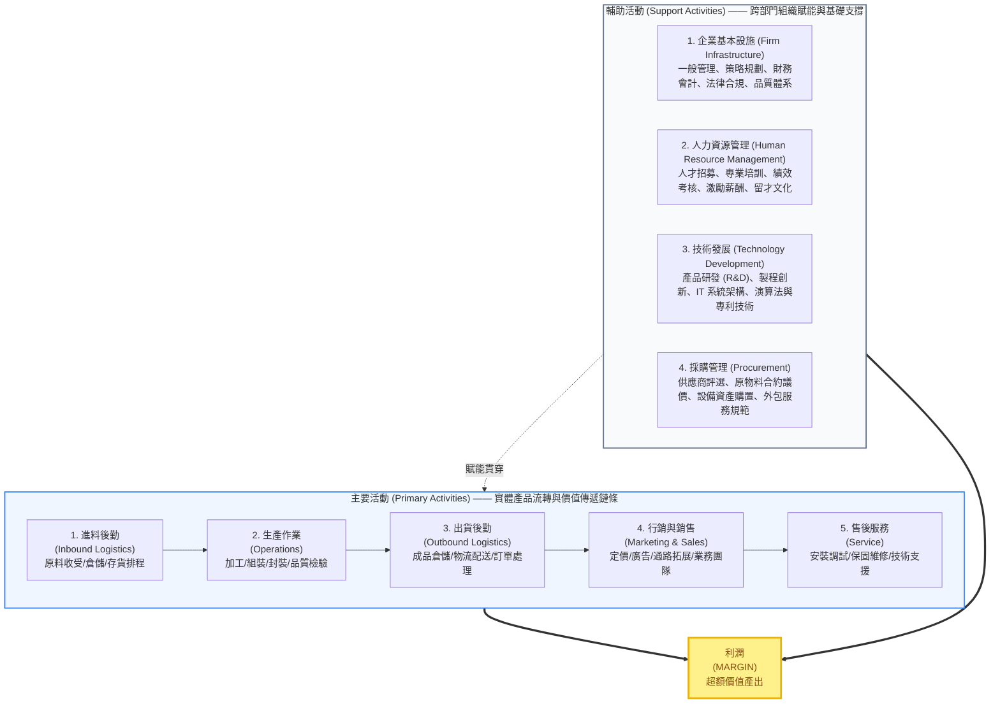
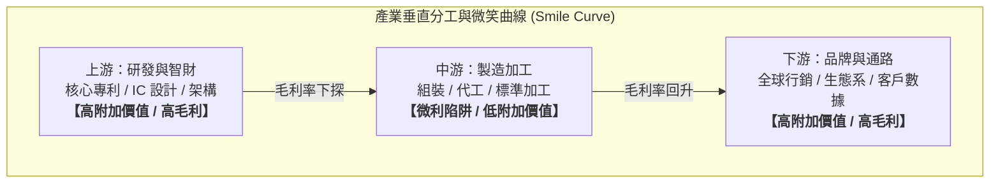
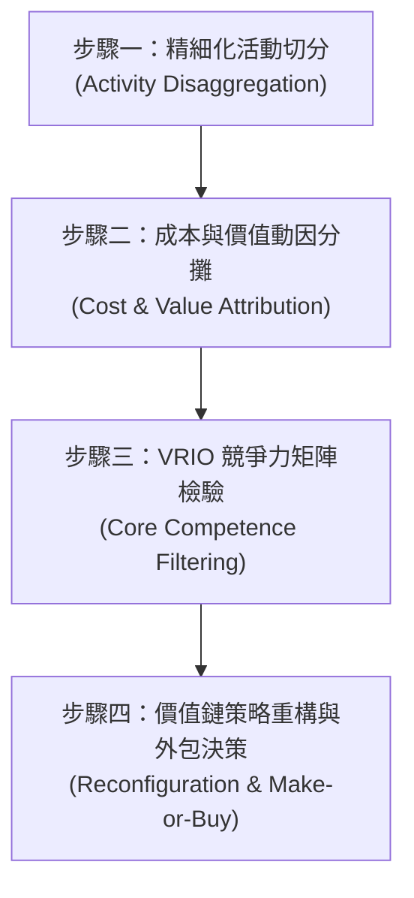

---
{"dg-publish":true,"permalink":"/98/firm-value-chain/","tags":["商業概念","策略管理","價值活動","競爭優勢","成本驅動","差異化驅動","PMBA"],"dg-note-properties":{"aliases":["企業價值鏈","價值鏈","價值鏈佈局","Value Chain","Porter Value Chain","Firm Value Chain","價值鏈分析","波特價值鏈"],"tags":["商業概念","策略管理","價值活動","競爭優勢","成本驅動","差異化驅動","PMBA"],"類別":"商業概念庫"}}
---

# 企業價值鏈 (Porter's Value Chain Analysis)

> **核心名言**：「競爭優勢無法透過檢視整體企業來理解，它源自於企業在設計、生產、行銷、交付與支援產品過程中所執行的眾多離散活動。」  
> —— 麥可·波特（Michael E. Porter, *Competitive Advantage*, 1985）

---

## 一、 核心定義與經濟學本質

- **企業價值鏈（Firm Value Chain）** 由哈佛商學院競爭策略大師麥可·波特於 1985 年提出。波特主張，企業本質上是一個由多項離散但互相關聯之**「價值活動（Value Activities）」**所構成的有機系統。
- **利潤（Margin）的經濟本質**：
  $$\text{利潤 (Margin)} = \text{買方願意支付的總價值 (Total Value)} - \text{執行所有價值活動的累積成本 (Total Cost)}$$
  - **買方願意支付的價值（Buyer Value）**：體現在企業產品或服務所能收取的價格，以及由此帶來的銷售總營收。
  - **創造超額利潤的前提**：企業所創造並傳遞給顧客的知覺價值，必須實質超越整合執行這些活動所需的總資源代價。
- **競爭優勢的微觀源頭**：
  波特明確指出，企業的兩大基本競爭優勢——**成本領導（Cost Leadership）**與**差異化（Differentiation）**，並非憑空產生，而是取決於企業在價值鏈各個具體環節的執行效率與創新能力：
  1. **成本優勢**：以比競爭同業更低的累積成本執行整套價值活動。
  2. **差異化優勢**：以市場獨一無二的方式執行特定價值活動，為買方創造不可替代的獨特價值與溢價空間（Price Premium）。

---

## 二、 價值鏈經典九大活動架構

波特將企業的價值創造活動嚴謹解構為兩大維度：**五大主要活動（Primary Activities）** 與 **四大輔助活動（Support Activities）**：

### 1. 主要活動（Primary Activities）—— 貫穿實體價值流
| 活動名稱 | 核心內涵與職能範疇 | 關鍵成本與價值驅動點 |
| :--- | :--- | :--- |
| **進料後勤 (Inbound Logistics)** | 原物料與零組件的接收、檢驗、倉儲、存貨控管、廠內搬運與供應商送貨排程。 | 即時進料（JIT）效率、倉儲損耗率、進料檢驗良率。 |
| **生產作業 (Operations)** | 將各項原物料、零組件與數據投入，轉化為最終產品或服務（機械加工、組裝、封測、設備運維）。 | 製程良率、產能利用率（Capacity Utilization）、自動化水平。 |
| **出貨後勤 (Outbound Logistics)** | 成品的入庫倉儲、實體搬運、包裝發貨、物流車隊排程、經銷商配銷與訂單履約。 | 訂單履約週期（OTIF）、配銷網絡密度、逆物流成本。 |
| **行銷與銷售 (Marketing & Sales)** | 誘導買方購買產品並促成交易之各項活動，包含品牌傳播、通路布局、定價策略、銷售團隊管理與商業報價。 | 顧客獲取成本（CAC）、品牌心智佔有率、通路毛利折讓。 |
| **售後服務 (Service)** | 產品銷售後維持或提升其使用價值的活動，如到府安裝、教育訓練、零件供應、定期巡檢與軟體 OTA 升級。 | 顧客滿意度（CSAT）、第一時間修復率、維保合約續約率。 |

### 2. 輔助活動（Support Activities）—— 組織底層基石
| 活動名稱 | 核心內涵與職能範疇 | 現代管理升級視角 |
| :--- | :--- | :--- |
| **採購管理 (Procurement)** | 購買價值鏈各活動所需之投入品（包含原物料、辦公耗材、IT 軟硬體、外部顧問與律師服務）。 | 戰略採購、供應鏈韌性、雙重供應商策略（Dual-sourcing）、採購透明度。 |
| **技術發展 (Technology)** | 支援價值鏈每一項活動的技術知識、研發實驗、製程創新、數位工具與軟體演算法。 | 自主專利壁壘、數位孿生（Digital Twin）、生成式 AI 流程自動化。 |
| **人力資源管理 (HRM)** | 組織人才之招募、甄選、培訓、薪酬設計、績效考核與組織文化塑造。 | 人才密度（Talent Density）、組織心理安全感、股權激勵（ESOP）。 |
| **企業基本設施 (Infrastructure)** | 涵蓋高階管理層領導、策略規劃、法律與監管合規、財務會計、公共關係與資安治理。 | 敏捷組織決策架構、ESG 永續治理、數據資安風控體系。 |

---

## 三、 價值鏈的兩大深層戰略邏輯：內部聯結與外部價值系統

> [!IMPORTANT]
> 價值鏈絕非孤立積木的簡單拼湊。競爭優勢的最高境界，來自於**「活動之間的協調與權衡（Trade-offs）」**，以及**「與外部產業生態系統的無縫對接」**。

### 1. 價值鏈內部聯結（Internal Linkages）
- **活動間的替代與權衡（Trade-offs）**：
  企業常可透過在某一活動中「投入更高成本或更嚴格標準」，換取其他活動「成本大幅下降」或「整體差異化顯著躍升」。
  - *實務範例*：在產品設計（技術發展）階段投入昂貴成本進行「易拆解、模組化」設計，雖然增加了研發支出，卻大幅降低了後續組裝（生產作業）的時間與到府維修（售後服務）的零件成本。
  - *實務範例*：嚴格的採購規格與進料檢驗（進料後勤），能使產線機器故障率（生產作業）與客戶退貨率（行銷服務）降至最低。
- **資訊串聯與流程最佳化**：
  建立跨部門 ERP、CRM 或供應鏈數位聯網，消除部門壁壘（Silos），實現端到端（End-to-End）實時數據流動。

### 2. 垂直價值系統（The Vertical Value System）
企業並非孤立存在於真空中，個別企業的價值鏈僅是更宏觀的**「產業價值系統」**中的一個節點：

$$\text{供應商價值鏈} \xrightarrow{\text{上游投入}} \text{企業自身價值鏈} \xrightarrow{\text{中游創造}} \text{通路商價值鏈} \xrightarrow{\text{下游配銷}} \text{終端買方價值鏈}$$

- **跨組織界面鏈接（Vertical Linkages）**：
  企業的成本優勢與差異化，高度取決於如何管理與上下游夥伴的界面。例如沃爾瑪（Walmart）直接將 POS 銷售數據與寶僑（P&G）等供應商的生產排程系統直接對接（VMI 供應商管理庫存），徹底消除了中間多層倉儲與物流等待浪費。
- **利潤池（Profit Pool）競爭**：
  在產業價值系統中，利潤在各節點的分布通常極不均勻。卓越企業會動態審視整個垂直鏈條，將資源配置在利潤率最高、護城河最深的戰略咽喉點（Choke Point）。

---

## 四、 成本驅動因子與差異化驅動因子（Drivers）

波特強調，若想系統性改變價值鏈的成本與價值結構，經理人必須精確診斷各項活動背後的**「結構性驅動因子（Structural Drivers）」**：

### 1. 成本驅動因子（Cost Drivers）
1. **規模經濟（Economies of Scale）**：活動規模擴大帶來的固定成本攤提（如晶圓代工廠高額資本支出折舊分攤）。
2. **學習與經驗曲線（Learning Curve）**：累積作業經驗帶來的良率提升、動線優化與浪費降低。
3. **產能利用率模式（Capacity Utilization）**：淡旺季產能調節對固定成本負擔的決定性影響。
4. **活動間聯結（Linkages）**：跨活動協同帶來的綜效。
5. **垂直整合度（Interrelationships & Vertical Integration）**：選擇自製或外包對交易成本與供應鏈掌控力的取捨。
6. **進入時機（Timing）**：先行者優勢（早期搶佔稀缺資源）或後發者優勢（吸取前人研發試錯教訓）。
7. **地理位置（Location）**：土地租金、低廉勞動力、稅收優惠或鄰近產業聚落（如竹科、矽谷）。
8. **制度與合約因素（Institutional Factors）**：政府監管、環保法規、工會要求及補貼政策。

### 2. 差異化驅動因子（Uniqueness Drivers）
1. **政策與功能選擇（Policy Choices）**：產品獨特規格、超越同業的保固期、高品質原物料承諾。
2. **技術領先性（Technological Sophistication）**：獨家專利製程、獨特演算法、極致工藝。
3. **服務響應速度（Responsiveness）**：24 小時快速出貨、專屬客戶經理、即時遠程診斷。
4. **品牌聲譽與信任資產（Reputation）**：歷史積澱的品質信任感與社會認同感。
5. **配套產品整合性（Bundling & System Solution）**：提供跨品類的完整解決方案，而非單一零組件。

---

## 五、 現代數位經濟下的價值鏈重構：垂直解構與微笑曲線

傳統波特價值鏈假定企業在單一實體內整合多數活動（典型如 1980 年代 IBM、通用汽車之整合型 IDM 模式）。進入資訊與全球化時代後，價值鏈發生了深刻的**範式轉移（Paradigm Shift）**：

### 1. 垂直解構（Value Chain Disarticulation）與模組化
- **專業分工興起**：交易成本下降與標準化通訊協定普及，使得價值鏈得以被「拆解（Unbundled）」。企業不再需要包辦所有主要活動，轉而聚焦於最具核心能耐的單一節點，其餘環節透過全球化外包生態圈完成。
- **代表典範**：全球半導體產業由傳統 IDM（如 Intel）解構為「無廠半導體設計（Fabless，如高通、輝達） ➔ 專業晶圓代工（Pure-play Foundry，如台積電） ➔ 封測（OSAT，如日月光）」。

### 2. 微笑曲線（Smile Curve）的價值轉移
宏碁創辦人施振榮先生提出的「微笑曲線」精闢指出了價值鏈各節點附加價值的非對稱性：
- **兩端高附加價值**：處於價值鏈最上游的**技術研發、核心零組件與專利**，以及最下游的**品牌營銷、全球通路與客戶關係**，享有極高毛利率。
- **中游微利壓力**：單純的**製造作業與標準化組裝**，因進入障礙較低且同質競爭激烈，陷入「毛三到四」的薄利空間。
- **策略啟發**：製造代工企業若想擺脫價值鏈底部陷阱，必須向上延伸建立關鍵技術能耐（如台積電以先進製程建立壟斷地位），或向下延伸建立品牌與終端解決方案（ODM / OBM）。

---

## 六、 經理人決策工具箱：價值鏈策略分析四步法

在進行企業策略診斷、併購評估或業務流程再造（BPR）時，經理人可遵循以下標準化作業流程：

1. **步驟一：精細化活動切分（Activity Disaggregation）**
   - 避免粗糙的部門劃分，依照「經濟特性不同」、「成本佔比顯著」或「對差異化具有潛在重大影響」為原則，將研發、採購、運營、行銷等職能細切為具體的活動模組。
2. **步驟二：成本與價值動因分攤（Cost & Value Attribution）**
   - 引入作業基礎成本制（Activity-Based Costing, ABC），將資產投資、營業費用與工時精確分攤至各價值活動，計算每一活動的真實利潤貢獻度（Value-added vs. Non-value-added）。
3. **步驟三：VRIO 競爭力矩陣檢驗**
   - 針對關鍵價值活動逐一評估其**價值性（Value）、稀少性（Rarity）、難以模仿性（Inimitability）與組織配適度（Organization）**，確認哪些活動是企業不可動搖的核心護城河。
4. **步驟四：價值鏈策略重構與外包決策（Make-or-Buy）**
   - **非核心且無差異化之活動**：大膽外包（Outsource）給外部專業供應商，降低固定成本並轉化為變動成本。
   - **核心優勢活動**：加碼重金投資，拉開技術差距，並透過重構活動流程（如取消多層批發商改為 D2C 直銷）重塑產業競爭規則。

---

## 七、 經典商業實務案例對比剖析

### 案例 1：台積電（TSMC）—— 專注重構全球半導體價值系統
- **價值鏈重構策略**：1987 年張忠謀董事長創立台積電，開創「純晶圓代工（Pure-play Foundry）」模式。台積電放棄了自身品牌與 IC 設計環節，向全世界承諾「不與客戶競爭」。
- **活動深度聚焦**：
  - 將全部資源極致投注於主要活動中的**「生產作業（極致良率、大規模彈性製造）」**與輔助活動中的**「技術發展（先進製程微縮研發、CoWoS 先進封裝專利）」**。
  - 這一舉措彻底重構了全球半導體的產業價值系統，催生了龐大的 Fabless 晶片設計產業，並使台積電躍居產業鏈利潤最高、掌控話語權的絕對[[value-chokepoint_價值咽喉|戰略咽喉]]。

### 案例 2：Zara (Inditex) —— 端到端敏捷閉環價值鏈
- **傳統服裝業痛點**：按季預測生產、大量外包至低成本發展中國家，導致訂單交期長達 6~9 個月，面臨沉重庫存跌價與促銷折讓風險。
- **Zara 的價值活動內部高度協同**：
  - **行銷與銷售 ➔ 技術發展**：店鋪經理每日透過 POS 與手持設備實時回傳終端顧客偏好數據，總部設計師團隊隨時調校款式。
  - **採購與生產作業**：將超過 50% 的產品保留在西班牙、葡萄牙等周邊短鏈工廠自行生產，犧牲部分人工成本換取極致柔性生產。
  - **出貨後勤**：建立高度自動化的全球中央物流樞紐，歐洲門市 24~36 小時、全球門市 48 小時內空運鋪貨到位。
- **競爭成效**：將「從設計到上架」壓縮至不可思議的 15 天，實現極低庫存積壓、高全價售出率與業界最高庫存周轉率。

### 案例 3：Apple（蘋果）—— 軟硬體垂直整合與價值鏈兩端壟斷
- **價值鏈配置佈局**：
  - **上游掌握技術與生態**：自研 M 系列與 A 系列晶片架構、iOS 作業系統閉環，構築無法模仿的技術差異化。
  - **中游極致外包**：組裝與加工活動全數外包予鴻海、和碩等供應鏈夥伴，自身維持零製造工廠的輕資產高 ROIC 架構；同時派遣工程師深度進駐產線，牢牢掌控製程設備所有權。
  - **下游掌握品牌與通路**：全球 Apple Store 直營店打造頂級奢華體驗，直接掌握終端定價權與第一手顧客關係。
- **競爭成效**：以全球約 20% 的智慧型手機出貨量份額，攫取了全球智慧型手機產業超過 85% 的利潤總額。

---

## 🔗 關聯主題與知識網絡

- **產業中層與策略分析**：
  - [[value-system_產業價值體系|Value_System_產業價值體系]] · 產業垂直分工網絡與連結條件
  - [[value-chokepoint_價值咽喉|Value_Chokepoint_價值咽喉]] · 垂直價值體系中的利潤咽喉與定價特權
  - [[M2-1_產業垂直價值體系]] · 產業垂直分工、微笑曲線演進與價值鏈解構
  - [[M1-6_產業分析模式與九大分析工具矩陣]] · 策略工具矩陣橫向對比
  - [[Porter's Five Forces Analysis_波特五力分析]] · 外在產業獲利天花板與五力結構
  - [[SWOT分析]] · 內外部優勢劣勢與價值活動配適
- **資源與核心能耐**：
  - [[competitive-advantage_競爭優勢]] · 成本領導與差異化策略
  - [[economic-moat_經濟護城河]] · 價值鏈鏈接衍生之結構性競爭壁壘
  - [[resource-based-view-rbv_資源基礎理論|資源基礎觀]] · VRIO 能耐檢驗矩陣
- **商業模式與演進**：
  - [[business-model_商業模式]] · 價值主張、價值交付與營利公式
  - [[value-net_價值網]] · 競合戰略與非線性多邊生態系
