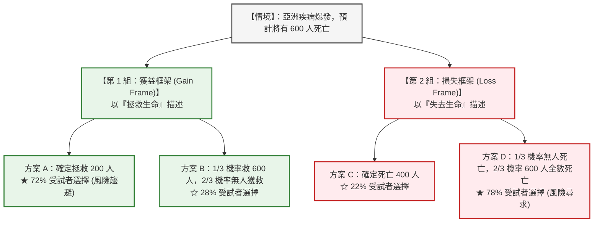
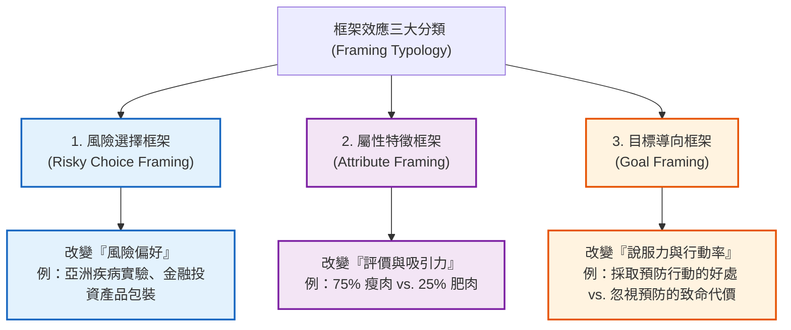
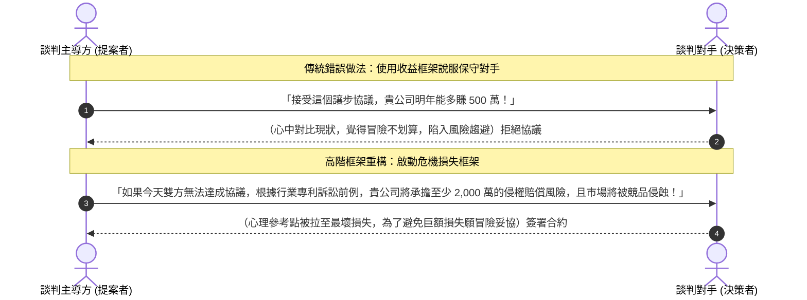

---
{"dg-publish":true,"permalink":"/98/framing-effect/","tags":["商業概念","行為經濟學","決策科學","消費者心理學","定價策略","談判策略","領導與變革","PMBA"],"dg-note-properties":{"aliases":["框架效應","框架效應 Framing Effect","Framing Effect","框架理論","決策框架","框架偏差","Framing Bias"],"tags":["商業概念","行為經濟學","決策科學","消費者心理學","定價策略","談判策略","領導與變革","PMBA"]}}
---


# 框架效應 (Framing Effect / 決策框架效應)

> **商管核心價值**：  
> 「在現實商業決策中，客觀事實往往不如『事實被呈現的方式』更具決定性。同一個商業方案，描述為『能保留 80% 的市占利潤』與描述為『將損失 20% 的市占利潤』，將誘發管理層截然相反的風險偏好。框架效應揭示了人類大腦對參考點的依賴與損失厭惡本能；卓越的戰略領導者與產品經理，不僅要是價值創造者，更必須是精通心智框架的架構師。」——丹尼爾·康納曼（Daniel Kahneman）與阿莫斯·特沃斯基（Amos Tversky）  
> 
> 在現代行為經濟學與策略管理中，**框架效應（Framing Effect）** 指出：**決策者對客觀等價之不同選項的偏好，會隨著該資訊被呈現為『獲益（Gain）』或『損失（Loss）』的語境框架而產生劇烈逆轉（Preference Reversal）**。該理論打破了傳統古典經濟學將人類視為理性自利、具備偏好不變性（Invariance Principle）的「理性人（Homo Economicus）」假設，成為定價架構、商業談判、變革推動與行為推力（Nudge）的核心科學底層。

---

## 一、 理論淵源與經典實驗

### 1.1 學術奠基
- **提出學者**：行為經濟學先驅、諾貝爾經濟學獎得主 **阿莫斯·特沃斯基（Amos Tversky）** 與 **丹尼爾·康納曼（Daniel Kahneman）**。
- **奠基著作**：1981 年發表於頂級期刊《Science》的劃時代論文 **《The Framing of Decisions and the Psychology of Choice》（決策的框架與選擇心理學）**。
- **底層支柱**：框架效應直接植根於兩位學者於 1979 年創立的 **[[prospect-theory_展望理論\|展望理論（Prospect Theory）]]**，證實人類在面對「潛在獲益」時偏好確定性（風險趨避），而在面對「潛在損失」時偏好賭一把（風險尋求）。

---

### 1.2 經典實驗：亞洲疾病問題 (The Asian Disease Problem)

特沃斯基與康納曼設計了行為科學史上最著名的思想實驗，將受試者隨機分成兩組，面對一場預計導致 600 人死亡的罕見疾病爆發：



#### 數理本質與偏好逆轉（Preference Reversal）：
- **客觀數理期望值完全一致**：
  - 方案 A 與方案 C 實質完全相等：$\mathbb{E}(\text{存活}) = 200$，$\mathbb{E}(\text{死亡}) = 400$。
  - 方案 B 與方案 D 實質完全相等：$\mathbb{E}(\text{存活}) = \frac{1}{3} \times 600 + \frac{2}{3} \times 0 = 200$。
- **實驗結果**：
  僅僅是語言框架從「**拯救（獲益）**」替換為「**死亡（損失）**」，絕大多數人的選擇就從保守的「方案 A（72%）」戲劇性反轉為冒險的「方案 D（78%）」。
- **理論結論**：人類決策違反了古典決策論的公理——**描述不變性（Descriptive Invariance）**。

---

## 二、 行為經濟學與認知神經機制

```
             主觀價值 V(x) (Psychological Value)
                      ▲
                      │               【獲益區間 (Gains)】
                      │               • 凹函數 (Concave)
                      │               • 邊際效用遞減
                      │               • 驅動【風險趨避】
                      │                  ╭──────
                      │             .·´
                      │         .·´
                      │     .·´
 ─────────────────────┼─────────────────────► 客觀損益 ΔW
        損失 (Losses)  │ 心理參考點 (Reference Point)
               │      │
               │      │
          ·    │      │
         :     │      │
        /      │      │
       /       │      │
      /        │      │               【損失區間 (Losses)】
     /         │      │               • 凸函數 (Convex)
    /          │      │               • 邊際痛苦遞減
   ▼           │      │               • 損失斜率更陡峭 (λ ≈ 2.25)
               │      │               • 驅動【風險尋求】
```

### 2.1 展望理論價值函數的三大數學特性
1. **參考點依賴（Reference Point Dependence）**：
   人類大腦不具備衡量絕對財富狀態（Absolute States of Wealth）的通用標尺，只能感知相對於「心理參考點（Reference Point, $R$）」的變化量 $\Delta W = W - R$。框架效應的本質，就是**透過語言暗示重塑對方的心理參考點**。
2. **損失厭惡（Loss Aversion）**：
   價值函數的損失曲線斜率顯著大於獲益曲線。實證模型中：
   $$v(x) = \begin{cases} x^\alpha & \text{if } x \ge 0 \\ -\lambda (-x)^\beta & \text{if } x < 0 \end{cases}$$
   其中 $\lambda \approx 2.0 \sim 2.5$ 為損失厭惡係數。這意味著「失去 100 萬的痛苦，需要獲得 225 萬的快樂才能抹平」。
3. **邊際敏感度遞減（Diminishing Sensitivity）**：
   - 獲益區間為凹函數（$\alpha < 1$）：在確定能拿 200 萬時，不願為了多拿 100 萬去冒失去一切的風險。
   - 損失區間為凸函數（$\beta < 1$）：在確定要賠 400 萬的劇痛面前，哪怕只有 1/3 的機會徹底免除損失，人們也願意孤注一擲。

---

### 2.2 認知心理學雙系統運作（Dual-Process Architecture）
- **系統一（System 1 / 快思直覺）**：
  大腦杏仁核（Amygdala）主導的情緒反射網絡，會在毫秒級時間內對「死亡、損失、危險」等詞彙做出強烈負面情緒標記（Emotional Tagging），直接觸發迴避或孤注一擲的生理衝動。
- **系統二（System 2 / 慢想理性）**：
  前額葉皮質（Prefrontal Cortex）主導的邏輯分析網絡。由於認知資源有限，系統二是「認知吝嗇鬼（Cognitive Miser）」。除非經過嚴密數學訓練或被強制要求重構問題，否則系統二會直接採納系統一被框架綁架的預設答案。

---

## 三、 框架效應的三大分類學體系

學者 Levin, Schneider & Gaeth (1998) 提出了當代行為科學公認的「框架效應三大分類模型」：



### 3.1 三種框架機制深度橫向對比

| 框架類別 | 操控之核心自變項 | 核心心理機制 | 經典實驗案例 | 商業與管理應用 |
| :--- | :--- | :--- | :--- | :--- |
| **1. 風險選擇框架**<br>(Risky Choice) | 方案的損益情境（獲益 vs. 損失） | 價值函數之凹凸性、風險趨避 vs. 風險尋求轉換 | 亞洲疾病問題、投資組合止損決策 | 商業談判破局風險包裝、危機轉型宣導 |
| **2. 屬性特徵框架**<br>(Attribute) | 物件單一特徵的正面 vs. 負面描述 | 正負向情緒聯想、語義聯想激活（Semantic Priming） | 牛肉標示「**75% 瘦肉**」評價遠優於「**25% 肥肉**」 | 產品功能規格包裝、服務品質滿意度呈現 |
| **3. 目標導向框架**<br>(Goal) | 採取行動的激勵語境（獲得好處 vs. 避免壞處） | 損失厭惡之驅動力大於獲益驅動力 | 乳房攝影篩檢宣傳（強調「不做會延誤癌症治療」比「做了能維持健康」更有效） | 行銷轉換率優化、B2B 銷售痛點喚醒、合規宣導 |

---

## 四、 商業策略與管理實務應用

### 4.1 定價策略與促銷架構設計 (Pricing & Promotion)

#### ① 手續費 vs. 現金折扣（Surcharge vs. Cash Discount）
- **反面教材（附加費框架 / 損失）**：
  若店家標示「刷卡需加收 2% 手續費」，消費者立刻將刷卡視為「額外被剝削的損失」，引發強烈不滿與抗議投訴。
- **卓越實務（折扣框架 / 獲益）**：
  將商品定價直接定為含手續費價格，並標示「付現享有 2% 折扣優惠」。此時，刷卡被視為基準價格（未受罰），而付現成為「意外的獲益」，顧客滿意度大幅提升。

#### ② 每天一杯拿鐵成本（Pence-a-day Framing / 微額框架）
- 面對年費 NT\$ 12,000 的企業 SaaS 或訂閱服務，客戶會將其視為一筆可觀的單次資本支出（損失厭惡）；
- 將框架重構為：「**每天只需 33 元，不到半杯咖啡的價格，即可享有全套 AI 賦能**」。將龐大的確定性損失，稀釋至低於感知閾值的日常無感支出。

#### ③ 贈品折扣 vs. 現金降價（Bonus Pack vs. Price Discount）
- 「加量 25% 不加價」在心理上被歸類為「獲益（Gain）」；
- 「售價打 8 折」在心理上往往會稀釋品牌高級感，甚至誘發消費者懷疑「品質是否縮水」。

---

### 4.2 商業談判與合約博弈 (Negotiation Architecture)



- **談判原則**：
  - **讓步時分批給予（Segregate Gains）**：每次讓步一點點，讓對方多次體驗獲益帶來的欣喜（利用收益凹函數特性）。
  - **要求代價時一次打包（Integrate Losses）**：將所有痛苦條件一次性打包提出，避免對手多次承受邊際損失的折磨（利用損失凸函數特性）。

---

### 4.3 組織變革與領導力 (Change Management & Leadership)

#### 打造「燃燒的平台（Burning Platform Framing）」
- **痛點**：很多傳統企業推動數位轉型或組織重組時，高管演講充斥著「轉型能讓我們增加 15% 營收」，基層員工卻無動於衷（現狀偏誤 Status Quo Bias，寧可維持安逸）。
- **框架策略**：
  成功推動重大變革的領導者（如郭士納改造 IBM、貝佐斯的 Day 1 哲學），往往採用**損失與生存危機框架**：
  > 「我們不是在選擇是否要轉型，我們是在選擇活下去還是慢慢死掉。若不擁抱雲端與 AI，三年內我們現有的核心業務將被徹底粉碎，大家手裡的股票將淪為廢紙。」
- **機制**：將員工從「安逸的獲益區間」拉入「確定性淘汰的損失區間」，從而激活團隊為了絕地求生而勇於承擔未知風險的鬥志。

---

### 4.4 產品設計、行為推力與使用者體驗 (UX & Nudge)

#### 預設選項之極致威力（Default Option / Opt-in vs. Opt-out）
- **歐洲器官捐贈實證研究（Johnson & Goldstein, 2003）**：
  - **Opt-in 框架（需主動勾選才同意）**：德國、丹麥的登記同意率僅為 **12% ~ 15%**；
  - **Opt-out 框架（預設同意，需主動勾選才退出）**：法國、奧地利、瑞典的登記同意率高達 **98% ~ 100%**。
- **心理機制**：退出的行為被大腦框架為「**主動放棄一項崇高公民義務（損失）**」，因此極少有人主動退出。

---

## 五、 決策審計：領導者的「去框架化 (De-framing)」工具箱

為防止管理層在重大策略投資與 M&A 中被內部提案者的框架所誤導，應建立系統化的去框架審計程序：

```markdown
### 🛡️ 企業策略去框架審計檢核表 (Strategic De-framing Checklist)

- [ ] 1. 【雙向重構測試 (Bilateral Reframing)】：
         將所有提案報告中的詞彙做鏡像反轉。若提案寫「此投資成功率達 80%」，立即要求團隊改寫為「此投資有 20% 機率血本無歸」，重新評估風控承受力。
- [ ] 2. 【絕對數值還原 (Absolute Anchor Check)】：
         將所有「百分比描述」還原為「客觀絕對值」。例如將「年減 30% 事故」換算為「從 10 起減少至 7 起，耗費預算 5,000 萬元」，檢視邊際投資回報率。
- [ ] 3. 【心理參考點重設 (Reset Baseline)】：
         問自己：「如果今天我們從零開始，不擁有任何現有產線/合約（沉沒成本歸零），我們還會主動簽署這份協議嗎？」
- [ ] 4. 【紅隊演練 (Red Teaming / Pre-mortem)】：
         指定獨立審計小組擔任「紅軍」，強制從「最壞損失與災難情境」重新包裝方案，檢驗系統一是否受到過度樂觀框架的操縱。
- [ ] 5. 【匿名框架盲測 (Blind Review)】：
         去除提案部門主管的個人影響力與情緒性修飾詞，只審查結構化的關鍵假設、資本支出（CapEx）與現金流敏感度模型。
```

---

## 六、 知識網絡與關聯模組鏈結

### 6.1 PMBA 核心模組雙向鏈結
- [[04_主題選修/10_創業與企業財務策略/02_模組筆記/Module_1_創新思維與商業模式/M1-9_商業模式畫布架構與價值主張設計\|M1-9 商業模式畫布架構與價值主張設計]]：價值主張設計中「痛點緩解（Pain Relievers）」的目標框架包裝，其心理轉化效能顯著高於單純的「獲益創造（Gain Creators）」。
- [[04_主題選修/10_創業與企業財務策略/02_模組筆記/Module_1_創新思維與商業模式/M1-10_七大市場力量與商業戰略價值公式\|M1-10 七大市場力量與商業戰略價值公式]]：轉換成本（Switching Costs）的形成不僅源於技術與合約，更深層來自消費者對「放棄現有熟悉產品之不確定損失」的心理防禦。
- [[04_主題選修/12_產業分析與投資策略/02_模組筆記/Module_1_總論與架構/M1-3_產業獲利結構差異與十大經典理論\|M1-3 產業獲利結構差異與十大經典理論]]：行為經濟學對古典賽局理論的修正，揭示了理性決策者的認知偏差邊界。
- [[04_主題選修/12_產業分析與投資策略/02_模組筆記/Module_1_總論與架構/M1-6_產業分析模式與九大分析工具矩陣\|M1-6 產業分析模式與九大分析工具矩陣]]：高階策略團隊在產業轉折點判讀時，需防範因管理層內部框架僵化導致的戰略短視。

### 6.2 商業概念庫相關卡片
- [[prospect-theory_展望理論\|prospect-theory_展望理論]]（框架效應的數學與理論母體）
- [[loss-aversion_損失厭惡\|loss-aversion_損失厭惡]]（框架效應產生強大非對稱影響力的底層發動機）
- [[98_商業概念庫/anchoring-effect_錨定效應\|anchoring-effect_錨定效應]]（數值維度的框架鎖定機制）
- [[mental-accounting_心智帳戶\|mental-accounting_心智帳戶]]（金錢在不同心理框架下的非理性分流）
- [[98_商業概念庫/two-factor-theory_雙因素理論\|two-factor-theory_雙因素理論]]（管理溝通中保健維度的痛點消除與激勵維度的願景塑造）
- [[98_商業概念庫/vpc-value-price-cost_價值價格成本分析\|vpc-value-price-cost_價值價格成本分析]]（透過屬性框架提升顧客願付價格 WTP）
