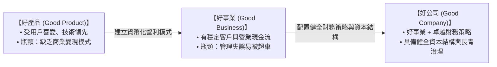

---
{"dg-publish":true,"permalink":"/98/good-product-business-company/","tags":["商業概念","創業財務","策略管理","商業模式","資本結構","PMBA"],"dg-note-properties":{"aliases":["好產品好事業好公司模型","企業演進三層次模型","Good Product, Good Business, Good Company","商業模式與財務結構進化"],"tags":["商業概念","創業財務","策略管理","商業模式","資本結構","PMBA"]}}
---

# 好產品、好事業、好公司模型 (Good Product, Business, Company)

## 一、 核心概念與三層次演進架構
企業從初創到長青，必須跨越產品、營運與財務結構的三重門檻：

## 二、 經典案例深度對照
1. **好產品未成好事業**：
   - 許多初期爆紅的社群軟體或免費 AI 工具，坐擁數百萬活躍用戶，卻因找不到獲利模式最終耗盡資金黯然關閉。
2. **好事業毀於管理失誤**：
   - **1980 年代的 Apple Mac**：擁有革命性的圖形介面與滑鼠體驗，但由於賈伯斯堅持封閉系統與超高定價，加上內部管理混亂，痛失被 IBM PC 兼容機陣營圍剿的主流市場地位。
3. **好事業因財務重構晉身好公司**：
   - **英法海底隧道（Eurotunnel）**：擁有世界級工程價值與獨占交通流量（好事業），但初期過度舉債導致每年營收無法支付巨額利息而宣告破產；後續透過**大規模債轉股（Debt-for-Equity Swap）**重整資本結構，卸除債務負擔後成功轉型為穩定獲利的基礎設施好公司。

## 三、 經理人管理意涵
- 技術與產品是起點，但決定企業能否穿越景氣循環終成好公司的，是精準的定價權、資本結構配置與財務避險策略。

## 四、 關聯模組與概念對接
- 上層模組：[[04_主題選修/10_創業與企業財務策略/_創業與企業財務策略 MOC\|_創業與企業財務策略 MOC]] · [[Module_3_企業生命週期與財務戰略\|Module_3_企業生命週期與財務戰略]]
- 課堂章節：[[04_主題選修/10_創業與企業財務策略/02_模組筆記/Module_3_企業生命週期與財務戰略/M3-1_企業財務策略概論與股東價值創造\|M3-1_企業財務策略概論與股東價值創造]]
- 關聯概念：[[98_商業概念庫/Shareholder_Value_Added_SVA_股東價值增加法\|Shareholder_Value_Added_SVA_股東價值增加法]] · [[98_商業概念庫/Investor_vs_Corporate_Value_投資者價值與公司價值\|Investor_vs_Corporate_Value_投資者價值與公司價值]]