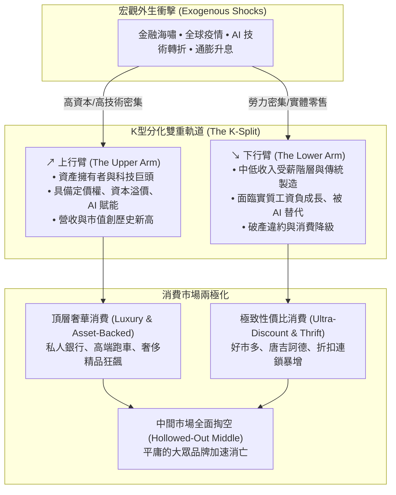

---
{"dg-publish":true,"permalink":"/98/k/","tags":["商業概念","總體經濟學","策略管理","市場趨勢","PMBA"],"dg-note-properties":{"aliases":["K型經濟","K-Shaped Economy","K型復甦","K-Shaped Recovery"],"tags":["商業概念","總體經濟學","策略管理","市場趨勢","PMBA"]}}
---


# K型經濟 (K-Shaped Economy)

> [!NOTE]
> **核心概念精粹**：K型經濟（K-Shaped Economy）是指在外部重大衝擊（如全球疫情、量化寬鬆、能源危機或生成式 AI 技術革命）之後，不同產業、資產階層與企業規模之間的復甦與增長軌跡呈現**「兩極分化（Divergence）」**的總體經濟形態。一端如「K」字的上行臂，享受資本利得、技術紅利與超額溢價；另一端如「K」字的下行臂，深陷收入停滯、技術替代與通膨侵蝕的泥淖。它徹底摧毀了中間市場，迫使企業必須在高階奢華與極致性價比之間做出戰略抉擇。

---

## 一、 學理淵源與分化動力學

在傳統總體經濟學中，經濟危機後的復甦路徑多被歸納為 V 型（快速反彈）、U 型（平底緩慢修復）或 L 型（長期停滯）。2020 年新冠疫情爆發後，全球央行前所未見的無限量化寬鬆（QE）與隨後的供應鏈重組，催生了著名的「K 型分化」：



### 1. 上行臂的加速引擎：資產膨脹與資本利差
- **坎蒂隆效應（Cantillon Effect）**：貨幣寬鬆政策所注入的新增流動性，並非均勻撒向每個人，而是優先流向大型金融機構、高資產階層與核心科技巨擘。
- **技術偏向型技術進步（Skill-Biased Technological Change, SBTC）**：具備高認知技能與資本配置能力的人才，能夠槓桿 AI 實現產能指數級放大；而常規可編碼的白領與藍領工作則面臨邊際價值衰退。

### 2. 下行臂的困境：通膨侵蝕與邊際淘汰
- 能源與食品等生活必需品價格的黏性通膨，對低收入家戶造成懲罰性打擊（恩格爾係數飆升，自由支配所得趨近於零）。
- 傳統中小企業缺乏議價能力與規模經濟，無法向終端客戶轉嫁暴漲的原物料與融資成本，導致大量實體店面面臨倒閉潮。

---

## 二、 產業與企業端的 K 型分化矩陣

在同一產業內部，K 型分化正在以殘酷的速度洗牌：

| 產業板塊 | 上行臂贏家（The Winners） | 下行臂輸家（The Losers） | 驅動分化的核心變數 |
| :--- | :--- | :--- | :--- |
| **半導體與運算** | 輝達（NVIDIA）、台積電（先進製程與 CoWoS 封裝）。 | 成熟製程晶圓廠、傳統 PC 週邊驅動 IC 廠商。 | AI 算力資本支出獨佔全球科技預算。 |
| **零售與電商** | 亞馬遜、好市多（Costco）、拼多多（Temu）。 | 傳統區域型連鎖百貨公司、二線實體超市。 | 極致供應鏈效率、高週轉率與全方位性價比。 |
| **餐飲與旅宿** | 頂級米其林私廚、奢華連鎖度假飯店（四季、麗思卡爾頓）。 | 平庸中價位合菜餐廳、二星級商務連鎖旅館。 | 消費者「要麼追求極致體驗，要麼追求極致省錢」。 |
| **金融與財富管理** | 頂級投行私人財富管理、對沖基金。 | 依賴傳統房貸利差的中小型社區銀行。 | 利率倒掛與高淨值客戶全球避險配置需求。 |

---

## 三、 經典企業實戰案例：奢侈品巨頭 LVMH vs 快時尚的兩極繁榮

```carousel

<!-- slide -->
### 1. 上行臂的暴利神話：LVMH 的定價權奇蹟
- **背景**：在後疫情通膨飆升時期，全球多數企業面臨需求疲軟，但奢侈品龍頭 LVMH 集團旗下路易威登（Louis Vuitton）與迪奧（Dior）卻連續多次調漲售價，年漲幅高達 10%~20%。
- **策略邏輯**：高淨值資產階層的財富受到股市與房地產增值保護，精品消費具備強烈的「韋伯倫效應（Veblen Effect）」——越貴越顯身份象徵，毛利率突破 65%，市值一度成為歐洲第一。
<!-- slide -->
### 2. 下行臂的效率狂瀾：拼多多（Temu）與 Shein 的全球席捲
- **背景**：面臨通膨壓力的歐美中產與年輕工薪階層，實質購買力受到嚴重壓縮。
- **策略邏輯**：拼多多旗下 Temu 以全託管模式砍掉所有海外中間商，將中國極致產能直連海外消費者，以 2 美元的 T 恤、5 美元的耳機橫掃歐美下載榜首。
- **啟示**：在 K 型經濟中，同時迎合上行臂（極致情緒價值）與下行臂（極致性價比）的企業大獲全勝，而卡在中間的中價位大眾品牌（如 Gap、J.Crew）則面臨毀滅性閉店潮。
```

---

## 四、 經理人 K 型戰略定位檢核表（Executive Decision Checklist）

面對不可逆的 K 型經濟結構，企業決策層嚴禁採取「中間妥協策略」，必須完成下列戰略審計：

- [ ] **中間地帶清空警警（Escape the Middle Test）**：
  - 我們的產品是否落入「品質不如高端奢華、價格又打不過極致折扣」的平庸泥淖（Caught in the Middle）？如果客戶有 50% 轉向省錢、50% 追求頂級，我們是否會被徹底拋棄？
- [ ] **上行臂價值躍遷路徑（Upward Premium Trajectory）**：
  - 如果我們定位中高端，我們是否具備持續漲價的[[Added_Value_附加價值與定價權|定價權（Pricing Power）]]？我們能為高淨值客戶提供不可替代的情緒價值、專屬感與尊榮體驗嗎？
- [ ] **下行臂極致效率工程（Downward Cost Engineering）**：
  - 如果我們定位平價大眾，我們的供應鏈成本結構是否達到極致？是否能承受競爭對手發動毀滅性的價格戰？我們是否擁有先進的自動化與極致的[[profitability_獲利能力|資產週轉率]]？
- [ ] **資產負債表脆弱性壓力測試（Balance Sheet Stress Test）**：
  - 我們的客戶群在未來兩年如果面臨實質購買力萎縮 20%，本公司的應收帳款違約率與流動性是否會爆發危機？

---

## 五、 關聯概念與知識網絡

* 宏觀經濟與結構轉型：
  * [[silver-economy_銀髮經濟|銀髮經濟 (Silver Economy)]]：高齡化資產集中與銀髮消費結構
  * [[single-economy_單身經濟|單身經濟 (Single Economy)]]：家戶縮小與原子化個人消費崛起
  * [[stay-at-home-economy_宅經濟|宅經濟 (Stay-at-Home Economy)]]：隨選經濟與居家生活常態化
  * [[fat-tail-theory_肥尾理論|肥尾理論 (Fat-Tail Theory)]]：極端外部衝擊誘發結構性兩極分化
* 策略與商業模式：
  * [[Added_Value_附加價值與定價權|附加價值與定價權 (Added Value & Pricing Power)]]：上行臂企業的超額租金來源
  * [[Functional_vs_Emotional_Value_功能價值與情緒價值|功能價值與情緒價值]]：頂層奢華情感共鳴與底層工具性性價比
  * [[cost-leadership-strategy_成本領導策略|成本領導策略 (Cost Leadership Strategy)]]：下行臂極致效率與規模經濟防禦
  * [[viable-business_好事業|好事業 (Viable Business)]]：跨越景氣週期的自我造血機制
