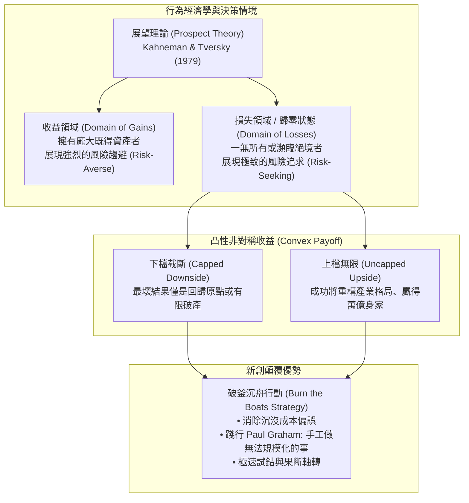

---
{"dg-publish":true,"permalink":"/98/nothing-to-lose/","tags":["商業概念","創業管理","決策科學","心理學","PMBA"],"dg-note-properties":{"aliases":["Nothing to Lose","背水一戰心態","無物可失策略","不對稱冒險決策"],"tags":["商業概念","創業管理","決策科學","心理學","PMBA"]}}
---


# Nothing to Lose (背水一戰與無物可失思維)

> [!NOTE]
> **核心概念精粹**：在創業學與策略決策中，「Nothing to Lose（無物可失／背水一戰）」並非魯莽盲動的絕望賭博，而是一種**深刻釋放認知包袱、打破既得利益束縛，並利用非對稱凸性收益結構（Asymmetric Convex Payoffs）進行極限突破的戰略思維**。當個體或新創團隊處於「下檔無可再失、上檔爆發無限」的情境時，其決策邏輯會展現出極致的敏捷性、反脆弱性與對既有市場巨頭的毀滅性顛覆力。

---

## 一、 學理淵源：展望理論與不對稱回報結構

「Nothing to Lose」思維的威力，可在當代行為經濟學與決策科學中找到堅實的理論根基：



### 1. 展望理論的風險偏好逆轉
- 丹尼爾·康納曼與阿莫斯·特沃斯基（Kahneman & Tversky, 1979）證實：人類在面對潛在損失時，為了避免確認損失，會變得極具冒險精神。
- 當創業者已經處於「谷底（Zero Baseline）」時，任何邊際損失的心理痛苦都大幅減弱；相反地，潛在的重大突破成為唯一值得追求的目標。這種心理狀態徹底消除了在官僚組織中常見的「多做多錯、少做少錯」的避險防禦心理。

### 2. 塔勒布的「反脆弱與凸性偏好」（Antifragility & Convexity）
- 納西姆·塔勒布（Nassim Nicholas Taleb）在《反脆弱》中指出：如果一個系統在面臨波動與未知時，**潛在的下檔損失是有限且已知的，而潛在的上檔獲利是非線性無窮大的**，該系統就具備「凸性（Convexity）」。
- 新創團隊的本質就是凸性結構：初期沒有高昂的既有營收需要保衛、沒有股票市場的季度財報壓力、沒有工會抗爭；他們每一次大膽嘗試的成本僅限於少數工時與伺服器費用，而一旦擊中市場痛點，回報則是成千上萬倍的爆發。

---

## 二、 赤腳不怕穿鞋：新創在 Nothing to Lose 狀態下的三大不對稱競爭優勢

| 競爭維度 | 既有產業巨頭（穿鞋者：有太多可失去） | 絕境新創團隊（赤腳者：Nothing to Lose） |
| :--- | :--- | :--- |
| **沉沒成本包袱** | 守護既有高利潤業務（Cash Cow），深陷[[disruptive-innovation_破壞式創新|創新者的兩難]]。 | 毫無歷史包袱，沉沒成本為零，隨時可以徹底推翻原有技術架構。 |
| **試錯與溝通成本** | 決策需跨越層層法務、合規、公關與董事會審批，曠日持久。 | 創辦人拍板即可當日上線，甚至直接在第一線親自接聽客訴、連夜修復。 |
| **做無法規模化的事** | 流程過度標準化，拒絕服務客製化、毛利微薄的邊緣小客群。 | **踐行保羅·葛倫漢原則（Do things that don't scale）**：不計代價手工伺候前 100 位客戶。 |
| **失敗承受極限** | 害怕失敗損及品牌聲譽與股價，採取保守漸進式改良。 | 坦然擁抱失敗，將失敗視為淘汰錯誤假設的正常運作過程。 |

---

## 三、 經典企業實戰案例：背水一戰引爆的奇蹟

```carousel

<!-- slide -->
### 1. 賈伯斯回歸蘋果的「斷尾求生」（1997 年）
- **背景**：1997 年蘋果公司距離破產倒閉僅剩 90 天現金儲備。董事會束手無策，請回被驅逐十二年的賈伯斯。
- **無所失去的極限減法**：
  - 由於公司已經處於實質崩潰邊緣，賈伯斯擁有「完全無物可失」的最高授權。他絲毫不顧各部門利益集團的反對，一刀砍掉了包括 Newton PDA、印表機在內的 70% 繁雜產品線；
  - 將全公司資源集中在一個簡單的四象限矩陣（專業級 vs 消費級；桌上型 vs 可攜式）。正是這場「反正最壞不過倒閉」的背水一戰，孕育了隨後誕生 iMac、iPod 與 iPhone 的黃金復興。
<!-- slide -->
### 2. Airbnb 創辦人賣麥片自救（2008 年）
- **背景**：2008 年金融海嘯期間，Airbnb 創立一年多仍毫無起色，所有矽谷頂級 VC 全數拒絕投資，創辦人刷爆了數十張信用卡，負債累累。
- **極致草根行動**：
  - 在繳不出房租且「反正不可能更糟」的心態下，創辦人趁著美國總統大選熱潮，手工組裝了「歐巴馬麥片（Obama O's）」與「麥肯麥片（Cap'n McCain's）」在街頭叫賣；
  - 依靠賣麥片奇蹟般賺進了 3 萬美元現金流，讓公司苟延殘喘活了下來；這段「在絕境中做無法規模化的事」的超強求生意志，深深打動了 Y Combinator 創辦人保羅·葛倫漢，獲得關鍵孵化投資。
```

---

## 四、 經理人「無物可失」決策心法檢核表（Executive Decision Checklist）

成熟大企業內部創新往往死於「包袱過重與避險官僚」。高階領導層應在關鍵專案中人為構建「Nothing to Lose」的戰鬥情境：

- [ ] **獨立戰鬥單位隔離（Quarantine from Core Bureaucracy）**：
  - 創新專案是否被完全隔離於母公司的常規 KPI 與合規審批體系之外？團隊是否被賦予「即便搞砸也不追究母職位」的免死金牌？
- [ ] **沉沒成本歸零思考（Zero-Base Mindset Test）**：
  - 「如果我們今天剛剛接手這家公司，且在此之前完全沒有投入任何一毛錢，我們今天還會啟動這個專案嗎？」如果答案是「不會」，請立即中止並清算沉沒資產。
- [ ] **凸性非對稱回報檢視（Convexity Check）**：
  - 這項激進決策的最壞結果是什麼？我們能否完全承擔？如果最壞結果可承受，而潛在回報能帶領公司跨越至下一個十年，為何不立即採取行動？
- [ ] **手工貼身服務驗證（Do Things That Don't Scale）**：
  - 在早期階段，團隊是否親自下場直接服務客戶？是否願意為了驗證關鍵假設而採取看似不符合經濟效益的笨方法？

---

## 五、 關聯概念與知識網絡

* 核心理論基礎：
  * [[risk-taking_風險承擔|風險承擔 (Entrepreneurial Risk-Taking)]]：計算過的風險與奈特不確定性駕馭
  * [[Prospect_Theory_Executive_Risk_展望理論與高管風險決策|展望理論與高管風險決策 (Prospect Theory)]]：損失領域下的極限冒險心理學
  * [[Tolerance_of_Ambiguity_不確定性容忍度與控制感|不確定性容忍度與控制感 (Tolerance of Ambiguity)]]：模糊環境下的心智韌性
  * [[Venkataraman|范卡塔拉曼 (Sankaran Venkataraman)]]：低機會成本驅動的創業利用決策
* 策略與實踐工具：
  * [[lean-startup_精實創業|精實創業 (Lean Startup)]]：以極低成本驗證核心假設的敏捷循環
  * [[disruptive-innovation_破壞式創新|破壞式創新 (Disruptive Innovation)]]：邊緣入侵者對既有巨頭的低端顛覆
  * [[resource-bricolage_資源拼湊|資源拼湊 (Resource Bricolage)]]：一無所有情境下的資源極限利用
  * [[business-model-pivot_商業模式軸轉|商業模式軸轉 (Pivot)]]：毫無包袱地迅速轉變戰略航道
