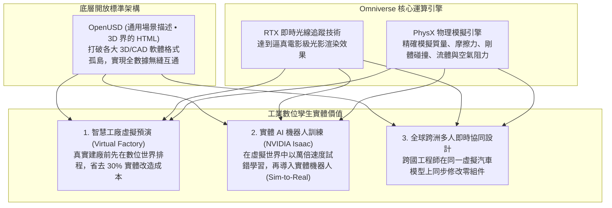

---
{"dg-publish":true,"permalink":"/98/omniverse/","tags":["商業概念","人工智慧","智慧製造","數位孿生","PMBA"],"dg-note-properties":{"aliases":["Omniverse","NVIDIA Omniverse","工業數位孿生平台","實體AI平台","OpenUSD模擬平台"],"tags":["商業概念","人工智慧","智慧製造","數位孿生","PMBA"]}}
---


# Omniverse (NVIDIA Omniverse 工業數位孿生平台)

> [!NOTE]
> **核心概念精粹**：NVIDIA Omniverse 是輝達基於皮克斯（Pixar）開源的**通用場景描述（OpenUSD）**所打造的**即時物理級 3D 模擬與工業數位孿生（Industrial Digital Twin）軟體平台**。它不僅能讓不同軟體工具（如 AutoCAD、Siemens、Blender）的使用者在同一個虛擬世界中進行毫秒級多人即時協同，更能透過精確遵循萬有引力、光學折射與流體力學的物理引擎，**在數位虛擬世界中完整「預演」工廠生產線、機器人作業與自動駕駛**，被黃仁勳確立為引領下一波「實體人工智慧（Physical AI）」的作業系統。

---

## 一、 學理定位：從娛樂元宇宙邁向「工業數位孿生」

當消費級元宇宙（如 Meta Horizon）因缺乏剛性商業價值而陷入沉寂時，輝達將重心錨定於具備兆美元經濟價值的「工業與製造業」：



---

## 二、 傳統工業設計 vs Omniverse 數位孿生的運作矩陣

| 評估維度 | 傳統工業設計與產線規劃 | NVIDIA Omniverse 工業數位孿生 |
| :--- | :--- | :--- |
| **軟體工具格式** | 格式壁壘森嚴；AutoCAD 與 Siemens NX 檔案無法相容，轉換過程大量遺失幾何細節。 | 基於 OpenUSD 標準，各軟體直接透過 Connectors 雙向同步，零轉換損耗。 |
| **渲染與模擬時間** | 靜態非即時；渲染一幀高畫質畫面需花費數小時甚至數天，無法即時互動。 | **即時光線追蹤（Real-time Ray Tracing）**，以 60 FPS 流暢導航龐大廠房。 |
| **物理定律保真度** | 純視覺幾何外觀呈現，物體彼此穿模，缺乏真實重力與摩擦力約束。 | **嚴格遵循真實世界物理法則**，機器人手臂抓取滑落的機率與現實完全一致。 |
| **試錯與調試代價** | 實體產線停工數週進行設備改裝，停產虧損動輒數百萬美元。 | **完全在數位空間免費試錯**；調試最佳化後再一鍵下發給實體自動化設備。 |

---

## 三、 經典企業實戰案例：BMW 全虛擬工廠與西門子智慧製造

```carousel

<!-- slide -->
### 1. BMW 匈牙利德布勒森「全虛擬工廠」
- **歷史創舉**：BMW 在匈牙利興建下一代電動車（Neue Klasse）工廠時，在實體工廠動工前兩年，先在 Omniverse 中完整建造了一座一模一樣的「數位孿生虛擬工廠」；
- **全要素模擬**：數千名全球工程師在虛擬工廠中模擬人體工學裝配、機器人物流自走車（AGV）防撞路線與噴漆機器人手臂節奏；
- **成果**：在實體工廠正式投產時，**產線規劃變更成本降低了 30%**，大幅縮短了六個月的量產爬坡時間。
<!-- slide -->
### 2. 西門子（Siemens）工業自動化軟體深度互聯
- **強強聯手**：工業自動化龍頭西門子將其領先的 Xcelerator 工業軟體平台與 Omniverse 深度串接；
- **實體 AI 賦能**：讓全球製造業客戶能夠將複雜的工廠 PLC 控制邏輯，直接接入 Omniverse 進行即時數位模擬；
- **價值變現**：徹底打破了傳統 IT（資訊科技）與 OT（營運技術）之間的鴻溝，成為全球工業 4.0 智慧製造的最強組合。
```

---

## 四、 經理人 Omniverse 導入價值檢核表（Executive Decision Checklist）

製造業執行長與營運長在評估數位孿生投資時，應依序檢驗下列問題：

- [ ] **高昂實體試錯成本審計（Physical Trial-and-Error Cost）**：
  - 我們的工廠在推出新車型或新產品時，每年因「停工改模、產線死鎖碰撞、人體工學調整」造成了多少實體停產虧損？若虧損超過千萬美元，導入數位孿生具備極高 ROI。
- [ ] **OpenUSD 數據管線打通（OpenUSD Pipeline Readiness）**：
  - 企業內部的 CAD、PLM、ERP 與 IoT 感測器數據，是否具備向 OpenUSD 格式聚合的基礎架構？還是依然停留在彼此隔離的資訊孤島？
- [ ] **Sim-to-Real 虛實遷移閉環（Sim-to-Real Transferability）**：
  - 我們是否建立了「虛擬環境模擬 $\to$ 實體產線部署 $\to$ 實體傳感器數據回傳 $\to$ 虛擬模型校準」的雙向數據反饋閉環？
- [ ] **邊緣運算與算力預算匹配（Compute Infrastructure Fit）**：
  - 我們的工程團隊是否配備了足夠強大的 RTX 工作站或 GPU 雲端伺服器？是否清楚工業級物理模擬對底層算力的高密度要求？

---

## 五、 關聯概念與知識網絡

* 核心技術與軟硬體體系：
  * [[nvidia_輝達|輝達 (NVIDIA)]]：Omniverse 平台之發明者與底層算力提供者
  * [[DGX|DGX 超級電腦]]：驅動 Omniverse 複雜物理模擬與大模型生成之硬體中樞
  * [[jensen-huang_黃仁勳|黃仁勳 (Jensen Huang)]]：將 Omniverse 確立為實體 AI 願景核心之領袖思考
  * [[system-2_開放系統|開放系統 (Open Systems)]]：OpenUSD 打破格式壁壘、促進工業數據流動之系統論體現
* 智慧製造與策略競爭：
  * [[economies-of-scale_規模經濟|規模經濟 (Economies of Scale)]]：數位孿生大幅降低大規模量產前之沉沒成本
  * [[core-competence_核心能力|核心能力 (Core Competence)]]：結合專屬製造經驗構建之數位孿生專利壁壘
  * [[disruptive-innovation_破壞式創新|破壞式創新 (Disruptive Innovation)]]：虛擬預演對傳統試產模具業之顛覆
  * [[great-company_好公司|好公司 (Great Company)]]：以先進科技賦能實體製造基業長青之典範
