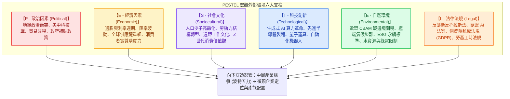

---
{"dg-publish":true,"permalink":"/98/pestel/","tags":["商業概念","策略管理","產業分析","總體環境","PMBA"],"dg-note-properties":{"aliases":["PESTEL分析","PESTEL","PESTLE分析","PESTLE","PEST分析","大環境分析","總體環境分析"],"tags":["商業概念","策略管理","產業分析","總體環境","PMBA"]}}
---


# PESTEL 分析 (PESTEL Analysis Framework)

> 💡 **導航與索引**：本篇為企業評估宏觀外部大環境（Macro-environment）趨勢與非市場風險之最經典策略分析工具。探討企業如何從六大維度監控外部衝擊，並向下穿透至中層產業競爭結構 [[98_商業概念庫/Porter's Five Forces Analysis_波特五力分析\|波特五力分析 (Porter's Five Forces)]]、市場空間界定 [[98_商業概念庫/TAM\|總體潛在市場 (TAM)]]、宏觀總經時事庫 [[04_主題選修/12_產業分析與投資策略/01_總體與個案/macro_總體經濟與課前時事\|總體經濟與課前時事]]，以及微觀企業策略矩陣 [[98_商業概念庫/SWOT分析\|SWOT 分析]]。

---

## 一、 核心定義與架構演進

### 1. 核心定義
- **PESTEL 分析（又稱 PESTLE 模型）** 係指經理人在制定長期發展戰略、進入新市場或進行重大跨國投資時，用以系統性掃描企業所處外部總體環境的六大宏觀維度：
  $$\text{PESTEL} = \mathbf{P} (\text{政治}) + \mathbf{E} (\text{經濟}) + \mathbf{S} (\text{社會}) + \mathbf{T} (\text{科技}) + \mathbf{E} (\text{環境}) + \mathbf{L} (\text{法律})$$
- **外生性與不可控性特質**：
  PESTEL 所涵蓋的因子屬於**「外生不可控變數（Exogenous Variables）」**。個別企業通常無法單憑一己之力改變宏觀環境，經理人的核心任務是**「前瞻預警（Anticipation）、動態適應（Adaptation）與建立策略韌性（Resilience）」**。

### 2. 從 PEST 邁向 PESTEL 的時代必然性
傳統 1960~1980 年代的 PEST 模型僅包含政治、經濟、社會與科技四大構面。進入 21 世紀後，隨著全球氣候變遷危機、淨零碳排政策與跨國反壟斷/資料保護法規的崛起，管理學界正式將**環境（Environmental）與法律（Legal）獨立為一級關鍵維度**：



---

## 二、 PESTEL 六大維度微觀解構與產業對標

| 維度指標 | 核心關注變數與驅動因子 | 典型產業衝擊案例（台大 PMBA 個案） |
| :--- | :--- | :--- |
| **P 政治 (Political)** | • 地緣政治脫鉤（Decoupling）、美中科技晶片法案<br>• 貿易保護主義關稅、進出口禁令<br>• 政府產業補貼（如台版晶片法案、美國 CHIPS Act） | 台灣半導體與高科技製造業面臨「China+1」、「Taiwan+1」戰略壓力，被迫前往美、日、德分散設廠以規避地緣政治斷鏈風險。 |
| **E 經濟 (Economic)** | • 各國央行基準利率（升息/降息循環）<br>• 匯率波動（新台幣對美元/日圓走勢）<br>• 通膨壓力（Core PCE）與原料大宗商品週期 | 高利率環境壓抑資本支出，終端消費電子需求疲軟；低利率時期則引爆乘數擴張，推升估值泡泡。 |
| **S 社會 (Sociocultural)** | • 人口少子化與超高齡社會（勞動力嚴重短缺）<br>• 財富分配兩極化（K 型經濟財富效應）<br>• 健康意識抬頭與高齡照護需求爆發 | 傳統製造業與連鎖餐飲遭遇大缺工潮，倒逼企業全面加速自動化與協作機器人導入；生技醫藥與樂齡長照市場空間（TAM）高速擴張。 |
| **T 科技 (Technological)** | • 生成式 AI、大型語言模型（LLM）突破<br>• 先進封裝（CoWoS、FOPLP）與 2nm 以下製程<br>• 雲端原生架構與邊緣算力革命 | 算力成為新型戰略能源，驅動散熱、伺服器組裝、高頻寬記憶體（HBM）產業鏈迎來數倍爆發式需求。 |
| **E 環境 (Environmental)** | • 淨零排放路徑（Net Zero 2050）<br>• 歐盟碳邊境調整機制（CBAM）碳關稅<br>• 水資源耗竭、乾旱缺水、綠電憑證採購難度 | 鋼鐵、水泥、石化等高碳排傳統產業面臨碳關稅重擊；綠電採購成為台積電等跨國龍頭爭奪國際訂單之核心門檻。 |
| **L 法律 (Legal)** | • 歐盟《人工智慧法案 (EU AI Act)》分級監管<br>• 跨國反壟斷調查（科技巨頭拆分威脅）<br>• 營業秘密保護法、專利智財侵權訴訟 | 企業開發 AI 應用面臨資料版權侵權風險；跨國併購（M&A）頻繁遭到各國反壟斷機構否決（如輝達收購 ARM 案告吹）。 |

---

## 三、 三層戰略分析漏斗：PESTEL ➔ 五力分析 ➔ SWOT 整合

在策略規劃中，經理人切忌將 PESTEL 作為孤立的清單條列，而必須將其置入**「宏觀 ➔ 中層 ➔ 微觀」的三層分析漏斗**中：

```text
【宏觀到微觀：三大策略分析工具閉環】

  ┌────────────────────────────────────────────────────────┐
  │ 【宏觀層：PESTEL 分析】                                │
  │ 掃描政治、經濟、社會、科技、環境、法律六大外生趨勢     │
  └───────────────────────────┬────────────────────────────┘
                              │
                              ▼ (決定中層產業獲利天花板)
  ┌────────────────────────────────────────────────────────┐
  │ 【中層：波特五力分析 (Porter's Five Forces)】          │
  │ 檢驗供應商/買方議價力、新進入者、替代品與同儕競爭強度   │
  └───────────────────────────┬────────────────────────────┘
                              │
                              ▼ (轉化為企業內部優劣勢對接)
  ┌────────────────────────────────────────────────────────┐
  │ 【微觀：SWOT 矩陣分析】                                │
  │ 宏觀 PESTEL 與中層五力轉化為外部「機會 (O) 與威脅 (T)」│
  │ 與企業內部「優勢 (S) 與劣勢 (W)」交叉制定 SO/ST 策略   │
  └────────────────────────────────────────────────────────┘
```

1. **宏觀 PESTEL 是中層五力的深層驅動源頭**：
   例如：科技（T）成熟大幅降低研發門檻 $\implies$ 導致五力中的「新進入者威脅」暴增；
2. **PESTEL 直接提供 SWOT 矩陣的外部輸入項**：
   外部大環境的變化，對企業而言非「機會（Opportunities）」即「威脅（Threats）」，絕不能脫離 PESTEL 憑空編造 SWOT。

---

## 四、 企業高階經理人實戰三大軍規

### 1. 拒絕「靜態資料庫堆砌」，聚焦「非連續性轉折點（Inflection Points）」
* 平庸經理人做 PESTEL 只是在報告中複製貼上總經數據；
* 卓越經理人只關注**「即將打破既有產業平衡的重大轉折點」**（例如：某項關鍵專利到期、某項法規生效的精確生效日、利率由升轉降的臨界點）。

### 2. 建立「情境規劃（Scenario Planning）」而非單一線性預測
* 面對地緣政治與全球貿易政策，單一預測必然失效。經理人應運用 PESTEL 構建「最樂觀、基準、最悲觀」三套動態情境，並為每種情境預先準備應急計畫（Contingency Plan）。

### 3. 主動將環境威脅轉化為「法規護城河（Regulatory Moat）」
* 嚴苛的環保與資安法規（如歐盟 CSRD、GDPR、CBAM）雖然增加營運成本，但若企業能率先達成合規，高昂的遵循成本將轉化為**阻擋中小型潛在競爭者的天然進入障礙**。

---

## 五、 關聯主題與模組網絡

- 🧭 **課程核心模組對接**：
  - [[04_主題選修/12_產業分析與投資策略/02_模組筆記/Module_1_產業框架與動態競爭/M1-1_產業分析本質與中層定位\|M1-1 產業分析本質與中層定位]]（巨觀環境 Macro ➔ 中層產業 Meso ➔ 微觀企業 Micro 樞紐定位）
  - [[04_主題選修/12_產業分析與投資策略/01_總體與個案/macro_總體經濟與課前時事\|總體經濟與課前時事庫]]（Fed 利率政策、歐盟 CBAM 碳關稅、美債殖利率實證）
  - [[04_主題選修/12_產業分析與投資策略/02_模組筆記/Module_1_產業框架與動態競爭/M1-6_產業分析模式與九大分析工具矩陣\|M1-6 產業分析模式與九大分析工具矩陣]]（九大分析矩陣完整映射）
  - [[04_主題選修/10_創業與企業財務策略/02_模組筆記/Module_1_創新思維與商業模式/M1-5_創業構想發展與兩階段可行性評估\|M1-5 創業構想發展與兩階段可行性評估]]（兩階段可行性中之大環境趨勢檢驗）
- 🔗 **核心概念原子卡片雙向互聯**：
  - [[98_商業概念庫/Porter's Five Forces Analysis_波特五力分析\|波特五力分析 (Porter's Five Forces)]]（中層產業結構分析互補模型）
  - [[98_商業概念庫/TAM\|總體潛在市場 (TAM)]]（PESTEL 趨勢決定 TAM 之理論擴張或萎縮）
  - [[98_商業概念庫/SWOT分析\|SWOT 分析]]（外部機會 O 與威脅 T 之直接來源）
  - [[98_商業概念庫/business-ecosystem_商業生態系\|商業生態系 (Business Ecosystem)]]（外部環境衝擊對生態共生者之連帶影響）
