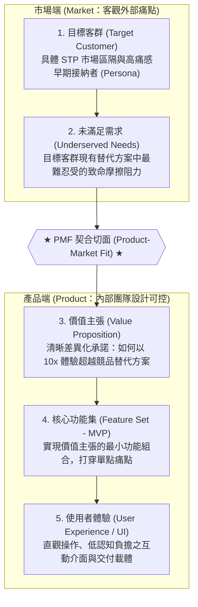
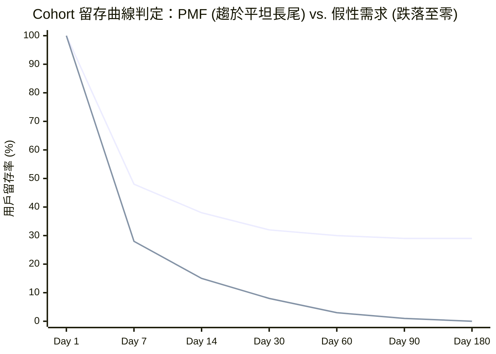

---
{"dg-publish":true,"permalink":"/98/pmf-product-market-fit/","tags":["商業概念","精實創業","產品管理","創業評估","單位經濟學","PMBA"],"dg-note-properties":{"aliases":["產品市場契合度","產品市場適配","產品與市場匹配","Product-Market Fit","PMF","PMF產品市場適配"],"tags":["商業概念","精實創業","產品管理","創業評估","單位經濟學","PMBA"]}}
---

# 產品市場契合度 (Product-Market Fit, PMF)

> **商管核心價值**：新創企業從 0 到 1 最關鍵的生死分水嶺。矽谷創投教父 Marc Andreessen 曾斷言：「在跨越 PMF 之前，過多的產品微調與過早的行銷投放都是徒勞的；新創團隊在初期只有唯一一項核心任務——那就是達成 PMF。」

---

## 一、 核心定義與商業本質

### 1. 核心定義
- **產品市場契合度（Product-Market Fit, PMF）** 是指企業處在一個具備足夠規模與強烈需求的良好市場中，且其所打造的產品能夠**完全、適恰且具備經濟效益地滿足該市場的未解劇痛**，進而引發顧客自發性回流、持續付費並主動向外口碑推薦。
- 它是新創事業從「**求生存（探索與假說驗證期）**」邁向「**求成長（效率複製與規模擴張期）**」的關鍵轉折點。

### 2. 商業本質與「正好滿足」的戰略節奏哲學
- **最佳設計師是顧客**：新創初期最致命的盲點往往非技術不足，而是內部工程師「過度工程化（Over-engineering）」，閉門造車開發出市場根本不需要的複雜功能。
- **「正好滿足（Fit Perfectly）」的節奏控制**：
  - PMF 絕非將所有前沿技術一次傾囊倒出，而是講求**配合市場認知、產業生態系與客戶吸收節奏的精準平衡**。
  - **產業標竿實證（NVIDIA 輝達的世代推出哲學）**：
    - 輝達雖然早已研發出超越當前世代數年的 GPU 算力架構（從 Blackwell 到 Rubin、Rubin Ultra 至 2028 年新架構），但黃仁勳嚴格控制推出步調。
    - **若 $P \gg M$（產品技術遠超市場生態）**：過早推出將面臨下游雲端巨頭（CSP）資料中心散熱、電網供電、光模組傳輸等基礎設施未成熟，且生產成本過高而叫好不叫座，甚至過早暴露技術路線讓對手模仿；
    - **精準 PMF 節奏**：緊扣台積電先進封裝（CoWoS）產能爬坡與 CSP 資本支出（CapEx）進程，每年推出「正好滿足並微幅領先」市場需求的產品，既確立壟斷定價特權，又極大化商業毛利率。

---

## 二、 Dan Olsen PMF 金字塔模型 (The Lean Product Pyramid)

Dan Olsen 在《精實產品手冊》中提出系統化的 PMF 金字塔模型，指出市場適配並非憑空降臨的運氣，而是一套**由下而上、層層對齊的五層結構工程**：

### PMF 金字塔五大層級與檢驗維度

| 層級維度 | 核心層次名稱 | 歸屬領域 | 核心任務與經理人提問 | 實踐關鍵與陷阱防範 |
| :---: | :--- | :---: | :--- | :--- |
| **頂層 5** | **使用者體驗 (UX / UI)** | **產品端 (Product)** *(團隊內部完全可控)* | 顧客如何感知並操作這項產品？能否在 3 秒內理解價值？ | 介面應追求摩擦力極小化，避免將複雜功能藏在深層選單。 |
| **第 4 層** | **核心功能集 (Feature Set)** | **產品端 (Product)** | 哪些最小功能是解決痛點不可或缺的（[[98_商業概念庫/MVP最小可行產品\|最簡可行產品 MVP]]）？ | **嚴禁鍍金（Gold-plating）**！初期專注打造 1 個殺手級功能，勝過 10 個平庸功能。 |
| **第 3 層** | **價值主張 (Value Proposition)** | **產品端 (Product)** | 我們如何比競爭對手或現狀更優雅、更便宜或更快速地解決問題？ | 必須能以一句話明確說出「為誰提供何種獨特價值」，確立定位。 |
| **【切面】**| **★ PMF 契合切面 ★** | **適配點 (Fit)** | **產品端之價值主張與功能集，能否無縫扣合市場端之真實痛點？** | **契合點發生處**：當客戶因痛點被解決而主動掏錢且不願離去時，PMF 正式宣告達成。 |
| **第 2 層** | **未滿足需求 (Underserved Needs)**| **市場端 (Market)** *(客觀存在，不依意志轉移)* | 目標族群目前採用的替代方案中，存在哪些非解決不可的痛點？ | 深入現場訪談，區分「維他命（可有可無的需求）」與「止痛藥（非買不可的劇痛）」。 |
| **底層 1** | **目標客群 (Target Customer)** | **市場端 (Market)** | 誰是最迫切需要這項解方的「早期接納者（Early Adopters）」？ | 畫像越精準越好，切忌妄想初期就討好所有大眾市場。 |

---

## 三、 PMF 三大科學量化檢驗標準

在精實創業實務中，判定是否達成 PMF 不能依賴創辦人的主觀熱情，必須透過嚴謹的量化指標交叉驗證：

### 1. Sean Ellis 40% 檢驗指標 (The 40% Disappointment Rule)
成長駭客之父 Sean Ellis 提出，針對使用過該產品的活躍用戶進行問卷調查：
> **核心提問**：「如果明天起這項產品停止營運，您無法再使用它，您的感受會是如何？」

$$\text{Sean Ellis 指標} = \frac{\text{回答「非常失望 (Very Disappointed)」的使用者數}}{\text{有效受訪活躍使用者總數}} \ge 40\%$$

| 檢驗數值區間 | PMF 狀態判定 | 經理人戰略決策與資源配置方針 |
| :---: | :---: | :--- |
| **$< 40\%$** | **尚未達成 PMF (Pre-PMF)** | **🚨 嚴禁大規模投放行銷預算！** 此時注資推廣形同「往破桶裡倒水」。團隊應維持小規模編制，深度回訪「非常失望」的核心客群，加速產品功能優化或啟動策略軸轉（Pivot）。 |
| **$\ge 40\%$** | **成功跨越 PMF (Post-PMF)** | **🟢 綠燈啟動規模化擴張 (Scale)！** 產品已展現強大市場拉力（Market Pull），應大舉注資建立行銷漏斗、擴張業務與客戶成功團隊，建立防禦護城河。 |

---

### 2. Cohort 同梯次用戶留存曲線平坦化 (Retention Curve Flattening)
追蹤同時間註冊的使用者族群（Cohort），觀察其在第 1 天、第 7 天、第 30 天、第 90 天及長期的留存率變化軌跡：

- **未達 PMF（紅色軌跡）**：留存曲線持續下探直至逼近 0%。代表產品雖然能透過行銷獲取新用戶，但無法留住顧客，用戶流失率過高。
- **達成 PMF（藍色軌跡）**：曲線在歷經初期的自然滑落後，能在某個特定水平位置**「趨於水平並形成穩定的長尾（Flattened Long Tail）」**。這代表產品擁有不可替代的核心價值，存在一群忠實的黏著用戶。

---

### 3. 單位經濟學黃金律與回本週期 (Unit Economics & Payback Period)
單有用戶喜愛尚不足以構成健全商業模式，PMF 必須伴隨可持續的單位經濟效益：

$$\frac{\text{LTV (顧客終身價值)}}{\text{CAC (獲客成本)}} \ge 3 \qquad \text{且} \qquad \text{CAC 回本期 (Payback Period)} \le 12 \text{ 個月}$$

- **$\text{LTV} / \text{CAC} \ge 3$**：企業投入 1 元獲客能創造 3 元以上的毛利貢獻，確保擴張具備實質獲利厚度。
- **回本期 $\le 12$ 個月**：在 1 年內回收獲客現金流，避免在規模擴張期因淨營運資金墊款過鉅而引發流動性危機。

---

## 四、 達成 PMF 前後的組織與戰略轉向矩陣

依據課堂講義與實務管理典範，新創在達成 PMF 前後，其組織編制、評估指標與核心目標必須發生系統性範式轉移：

| 戰略維度 | PMF 之前 (Pre-PMF)：探索與驗證階段 | PMF 之後 (Post-PMF)：效率與規模化階段 |
| :--- | :--- | :--- |
| **核心戰略目標** | **尋找「值得規模化」的產品方向與真實痛點** | **在維持品質與滿意度的前提下「加速規模擴張」** |
| **團隊組織重心** | 產品經理與研發工程師為主，創辦人親自訪談顧客 | 建立標準化業務銷售、數位行銷與客戶成功（CSM）團隊 |
| **研究與決策依據** | **質化研究為主**（深入訪談、易用性測試、現場觀察） | **量化數據驅動**（轉化漏斗、留存曲線、LTV / CAC、淨推薦值 NPS） |
| **行銷預算方針** | **極致克制**，僅投入極小預算於概念驗證與 MVP 測試 | **全力注資**，打通規模化獲客通路，建立品牌與通路壁壘 |
| **商業模式靈活性** | 保持高敏捷度，容許定位、功能與定價隨時[[98_商業概念庫/_待改寫草稿庫/lean-startup_精實創業\|軸轉 (Pivot)]] | 商業模式趨於標準化穩定，聚焦於作業流程優化與利潤率提升 |
| **現金流指標監控** | 嚴格監控**現金跑道（Runway）與每月淨燒錢率（Burn Rate）** | 監控**[[98_商業概念庫/net-working-capital_淨營運資金\|net-working-capital_淨營運資金]]、[[98_商業概念庫/cycle_淨營業循環週期\|現金循環週期 (CCC)]]與自由現金流 (FCF)** |

---

## 五、 產業界經典案例深度復盤

### 1. NVIDIA（輝達）：算力架構與生態系的精準節奏掌控
- **情境**：在 AI 革命浪潮中，NVIDIA 手握前沿架構，但若在 2023 年即強推 2026 年世代算力，會因資料中心水冷散熱與高壓供電未到位而挫敗。
- **啟示**：黃仁勳每年以微幅領先的步調發布新品，配合雲端服務商（CSP）的折舊攤提與台積電先進封裝產能，使每代晶片都成為當期市場「正好滿足且無可替代」的極致 PMF 範例。

### 2. 藍河科技 (Blue River Technology)：農田現場的驚天軸轉
- **情境**：史丹佛團隊原先研發草坪自動除草機器人，雖然技術頂尖但草坪維護公司不願為此買單。
- **軸轉實證**：創辦人走出辦公室，走訪數十家加州生菜與棉花農田，發現農民真正痛不欲生的是「除草劑濫用與人工間苗成本極高」。團隊立即將技術軸轉為「精準農業噴藥拖拉機」，現場實證節省 90% 除草劑，旋即達成暴發性 PMF，最終以 3.05 億美元被 John Deere 溢價收購。

### 3. Superhuman：利用 Sean Ellis 40% 指標進行逆向工程
- **情境**：電子郵件客戶端軟體 Superhuman 早期指標僅 22%，未達門檻。
- **精準調研**：團隊未盲目全面修改，而是細分出回答「非常失望」的核心使用者輪廓（高階經理人、創投投資人），深入挖掘他們最看重的功能（純鍵盤快捷鍵、離線速度）。針對核心群體痛點集中迭代後，Sean Ellis 分數飆升至 58%，成功開啟付費訂閱爆發式成長。

---

## 六、 跨模組雙向鏈結與延伸導航

### 核心課程與模組筆記
* [[04_主題選修/10_創業與企業財務策略/02_模組筆記/Module_2_產品創新與精實驗證/M2-1_精實產品開發與服務創新驗證\|M2-1 核心模組筆記：精實產品開發與服務創新驗證]]
* [[04_主題選修/10_創業與企業財務策略/02_模組筆記/Module_1_創新思維與商業模式/M1-3_數位新經濟與精實創業方法論\|M1-3 模組筆記：數位新經濟與精實創業方法論]]
* [[04_主題選修/10_創業與企業財務策略/02_模組筆記/Module_1_創新思維與商業模式/M1-9_商業模式畫布架構與價值主張設計\|M1-9 模組筆記：商業模式畫布與價值主張設計]]

### 商業概念庫關聯卡片
* [[98_商業概念庫/_待改寫草稿庫/lean-startup_精實創業\|lean-startup_精實創業]]
* [[98_商業概念庫/MVP最小可行產品\|最簡可行產品 (MVP)]]
* [[98_商業概念庫/unit-economics-model_單位經濟模型\|單位經濟模型]]
* [[98_商業概念庫/clv-customer-lifetime-value_顧客終身價值\|顧客終身價值 (CLV / LTV)]]
* [[98_商業概念庫/Kotler_五個產品層次模型 Five Product Levels\|Kotler 五個產品層次模型]]
* [[98_商業概念庫/product-mix_產品組合管理\|Product Mix 產品組合管理]]
* [[98_商業概念庫/cycle_淨營業循環週期\|現金循環週期 (CCC)]]
* [[98_商業概念庫/net-working-capital_淨營運資金\|淨營運資金 (NWC)]]

### 經典實證個案對標
* [[04_主題選修/10_創業與企業財務策略/_歷史版本封存/cases_新創與企業融資案例庫#^Airbnb\|Airbnb 早期氣墊床與門面型 MVP 驗證 PMF]]
* [[04_主題選修/10_創業與企業財務策略/_歷史版本封存/cases_新創與企業融資案例庫#^藍河科技\|藍河科技 農田除草機 PMF 軸轉案例深度解析]]
