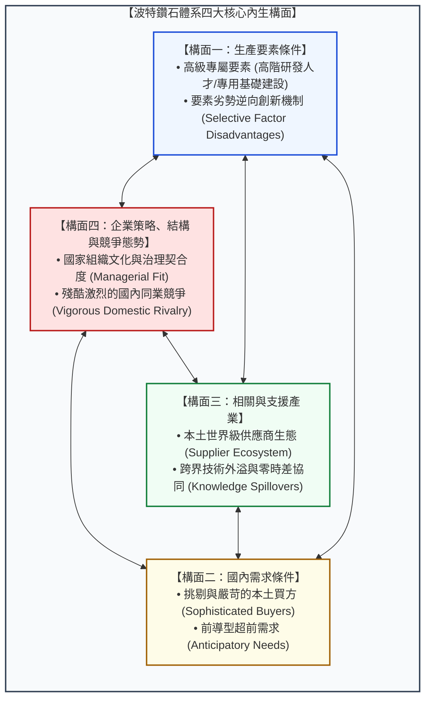
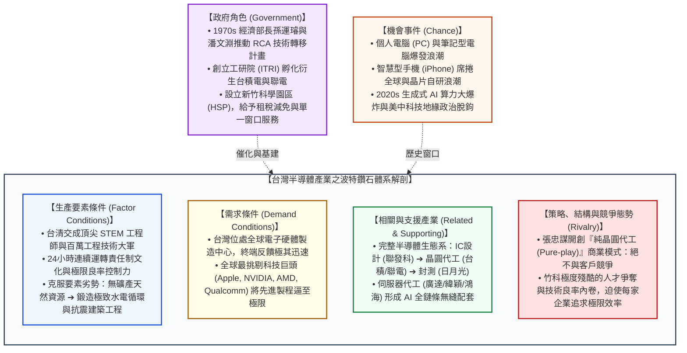

---
{"dg-publish":true,"permalink":"/98/porter-s-diamond-model/","tags":["商業概念","策略管理","產業分析","國家競爭優勢","產業聚落","鑽石模型","地理生態","PMBA"],"dg-note-properties":{"aliases":["波特鑽石模型","鑽石模型","鑽石體系","國家競爭優勢理論","Porter's Diamond Model","Porter Diamond Model","Diamond Model","The Diamond Framework","Diamond Framework","鑽石結構模式","Porter_Diamond_Model","波特鑽石體系","The_Diamond_Framework_鑽石體系"],"tags":["商業概念","策略管理","產業分析","國家競爭優勢","產業聚落","鑽石模型","地理生態","PMBA"],"類別":"商業概念庫"}}
---


# 波特鑽石模型 (Porter's Diamond Model / 鑽石體系)

> **核心名言**：  
> 「國家的競爭優勢並非繼承而來，而是由後天創造出來的。一個國家的競爭力，取決於其特定產業在持續創新與升級上的能力。企業能否贏得國際競爭，關鍵在於其國內基地（Home Base）是否具備能對企業施加持續創新壓力的『鑽石體系』環境。」  
> —— 麥可·波特（Michael E. Porter, *The Competitive Advantage of Nations*, 1990）  
>  
> 「在知識經濟時代，全球化並未抹平地理界線；相反地，持久的競爭優勢愈來愈根植於高度在地化的知識、人際關係、激勵機制以及產業聚落之中。」  
> —— 麥可·波特（Michael E. Porter, *Clusters and the New Economics of Competition*, 1998）

---

## 一、 核心定義與理論淵源

### 1.1 麥可·波特「國家競爭優勢理論」之核心命題
- **波特鑽石模型（Porter's Diamond Model）**，在學界亦被稱為**「鑽石體系（The Diamond Framework）」**或**「國家競爭優勢理論（Theory of National Competitive Advantage）」**，由哈佛商學院競爭策略大師麥可·波特（Michael E. Porter）於 1990 年在經典巨著《國家競爭優勢》（*The Competitive Advantage of Nations*）中正式提出。
- **波特的核心提問（Core Research Question）**：
  > *「為什麼特定國家（或特定區域/城市）能夠成為某些特定產業中稱霸全球的國際競爭龍頭大本營（Home Base）？」*
  - 為什麼全球高檔豪華轎車與特用化學品集中於德國？
  - 為什麼精密手錶、私人銀行與跨國生技製藥集中於瑞士？
  - 為什麼頂級時尚服飾、精品皮件與磁磚機械集中於義大利北部？
  - 為什麼全球個人電腦、晶圓代工與先進半導體封裝會壓倒性地集中於台灣西海岸？
- **古典貿易理論的典範轉移（Paradigm Shift）**：
  波特的研究徹底顛覆了兩百多年來主流經濟學的國際貿易理論：
  1. **亞當·斯密（Adam Smith）之「絕對利益論」** 與 **大衛·李嘉圖（David Ricardo）之「比較利益論（Comparative Advantage）」**；
  2. **赫克雪爾-俄林（Heckscher-Ohlin）之「要素稟賦理論（Factor Proportions Theory）」**。
  
  古典理論主張：國家的競爭優勢源自「先天的稟賦資源」，擁有廉價勞工的國家就該專精於勞力密集製造，擁有肥沃土地的國家就該出口農產品。  
  **波特反駁**：單純仰賴廉價勞工、豐富自然資源或匯率貶值所維繫的優勢極度脆弱且不可持久。在現代知識經濟與高科技產業中，**「繁榮是創造出來的，而非繼承而來的（Prosperity is created, not inherited）」**。唯有建立起驅動企業「持續創新與生產力升級」的在地化生態系統，才能孕育永續的國際競爭力。

---

### 1.2 鑽石體系的系統性本質 (Systemic Nature)
波特指出，一國特定產業的競爭力，是由**四大相互關聯的內生構面（Determinants）**以及**兩大外部環境變數（Exogenous Variables）**共同交織構成的動態網絡：

```
                           ┌─────────────────────────┐
                           │      機會事件 (Chance)   │
                           └────────────┬────────────┘
                                        │ (外部衝擊)
                                        ▼
                           ┌─────────────────────────┐
                           │ 企業策略、結構與競爭態勢 │
                           │  (Firm Strategy & Rivalry)│
                           └──────▲───────────▲──────┘
                                  │           │
                 ┌────────────────┴─┐       ┌─┴────────────────┐
                 │ 生產要素條件      │ ◄───► │ 國內需求條件     │
                 │(Factor Conditions)│       │(Demand Conditions│
                 └────────────────┬─┘       └─┬────────────────┘
                                  │           │
                                  ▼           ▼
                           ┌─────────────────────────┐
                           │ 相關與支援產業          │
                           │(Related & Supporting)   │
                           └────────────▲────────────┘
                                        │ (催化與法規)
                           ┌────────────┴────────────┐
                           │      政府角色 (Govt)    │
                           └─────────────────────────┘
```

> **鑽石體系的系統性本質**：  
> 鑽石並不是四個獨立指標的清單打勾表，而是一個**「自我增強的動態生態系統（Self-reinforcing Dynamic System）」**。任一構面的優勢會溢出並強化其他構面；反之，若某一關鍵構面長期缺損，將導致整顆鑽石失去運轉張力，進而侵蝕整體的國際競爭優勢。

---

## 二、 鑽石體系的四大核心內生構面 (The Four Determinants)



---

### 2.1 構面一：生產要素條件 (Factor Conditions)
生產要素指一國在特定產業中進行競爭時所擁有的生產投入（如人力資源、天然資源、資本資源、技術基建）。波特將要素劃分為兩大維度進行精準解構：

```
【生產要素的二維矩陣】

                     初級要素 (Basic Factors)          高級要素 (Advanced Factors)
              ┌───────────────────────────────┬───────────────────────────────┐
              │ • 氣候條件、天然礦產、港灣地理位置│ • 頂尖研究型大學與國家實驗室   │
 通用要素     │ • 非技術勞動力、初級無擔保外債   │ • 現代化數位光纖網、超高壓穩定電網│
(Generalized) │ ── 進入門檻極低，極易被全球複製 │ ── 需持續公共投資，具跨產業效益│
              ├───────────────────────────────┼───────────────────────────────┤
              │ • 專用農業土壤、特定原始礦脈   │ • 光電物理與半導體製程博士人才庫│
 專屬要素     │                               │ • 特用半導體化學品保稅冷鏈物流 │
 (Specialized)│ ── 容易耗竭，無法支撐長期轉型 │ ── ★ 最具戰略價值，鑄造持久壁壘│
              └───────────────────────────────┴───────────────────────────────┘
```

1. **高級專屬要素（Advanced & Specialized Factors）是競爭力的核心**：
   - 國家競爭力絕非仰賴廉價勞工或天然石油（初級通用要素）；只有具備**高度專屬性、需要長年高額研發與專業教育積累的高級要素**，才能轉化為難以跨國轉移的持久競爭優勢。
2. **「要素劣勢」的逆向創新驅動力（Selective Factor Disadvantages）**：
   - 波特提出極具反直覺洞見的假說：**在某些基礎要素上的嚴重匱乏或劣勢，反而能成為倒逼企業進行顛覆性創新的強大觸媒！**
   - *實證典範*：
     - **日本**：面臨極度狹窄的居住空間與昂貴土地，倒逼出全球領先的家電小型化技術（Miniaturization）與豐田精益生產（JIT 即時零庫存管理）；面臨勞動力嚴重高齡化，倒逼出領先全球的工業機器人產業（Fanuc, Yaskawa）。
     - **荷蘭**：國土狹小且氣候寒冷，勞動成本高昂，倒逼荷蘭農民發明世界最先進的封閉型智慧溫室與自動化無土水耕系統，使荷蘭一躍成為全球第二大農產品出口國。
     - **台灣**：缺乏石油與金屬礦產、天然地震頻繁，倒逼科技製造業將材料耗損降至極限，磨練出全球最極致的晶圓製程良率與防震工程能耐。

---

### 2.2 構面二：國內需求條件 (Demand Conditions)
波特指出，許多人誤以為「國內市場規模愈大，競爭力愈強」，但實證研究表明：**國內買方的「質（Sophistication）」遠比「量（Size）」重要得多！**

1. **挑剔與嚴苛的本土買方（Demanding and Sophisticated Buyers）**：
   - 本土買方若具備全球最嚴苛的品質挑剔度與刁鑽品味，將扮演企業最佳的**「創新磨刀石（Training Ground）」**。
   - 企業在本土市場為了滿足嚴厲顧客所經歷的痛苦打磨，會迫使其在產品可靠度、功能設計與服務細緻度上遠遠甩開外國對手。
   - *案例*：德國駕駛對在無限速高速公路（Autobahn）上以時速 200 公里奔馳的極致操控感與機械安全性的偏執追求，鍛造出保時捷、BMW、賓士稱霸全球的底盤工程與煞車系統。
2. **前導型超前需求（Anticipatory Buyer Needs）**：
   - 若本土市場的需求結構早於全球其他國家 3~5 年出現（先行者市場 Lead Market），本土企業就能提前研發因應，並在全球趨勢爆發時直接將成熟方案推向全球。
   - *案例*：北歐國家在 1980 年代即因地廣人稀而產生對行動無線通訊的強烈前導需求，直接孕育出 Nokia 與 Ericsson 在 2G/GSM 時代統治全球的行動帝國。

---

### 2.3 構面三：相關與支援產業 (Related and Supporting Industries)
競爭優勢絕非單一孤立企業所能支撐，必須根植於**「世界級本土供應鏈與互補產業網絡」**。

1. **零時差協同與快速原型打樣（Rapid Prototyping & Co-innovation）**：
   - 當全球頂尖的零組件供應商與核心製造商處於同一地理區域內，面對突發工程問題時，跨組織研發團隊可在 30 分鐘內面對面會商，進行即時反饋與迭代設計。
   - 這種即時溝通效率是遠距跨國採購永遠無法比擬的。
2. **跨界知識外溢與綜效（Knowledge Spillovers）**：
   - 相關產業間的技術共用。例如義大利在金屬加工機械上的優勢，跨界支援了其在全球陶瓷衛浴瓷磚機械、頂級包裝機械與超級跑車引擎製造上的統治地位。
3. **消除供應鏈敲竹槓風險**：
   - 本土存在多家優質配套廠商，焦點企業既能獲得客製化技術支援，又不必承受海外斷鏈與地緣政治封鎖風險。

---

### 2.4 構面四：企業策略、結構與競爭態勢 (Firm Strategy, Structure, and Rivalry)

1. **管理治理模式與國家文化特質的契合（Managerial Fit）**：
   - 不同的國家制度與文化，孕育出不同的組織結構：
     - *德國*：重視層級秩序、精密工程與學徒制技職體系，適合結構高度複雜、產品週期長、講求精密度的高階機械工程產業。
     - *義大利*：以家族中小企業為核心，具備非凡的設計品味與靈活彈性，適合流行時尚、奢華皮件與客製化利基傢俱。
     - *美國*：高流動性勞動市場、矽谷冒險創投機制、股權激勵文化，適合高風險高報酬的網際網路軟體與前沿人工智慧。
     - *台灣*：中小企業創業精神、老闆身先士卒、極度注重執行力與成本控制、工程師敬業責任制，完美契合講求 24 小時連續生產與良率爬坡的專業晶圓代工與組裝代工。
2. **「殘酷且激烈的國內同業競爭（Vigorous Domestic Rivalry）」—— 波特最具震撼力的洞見**：
   - 傳統重商主義與保護主義政策總認為：應該由政府整合出一家國家級壟斷旗艦企業（National Champion），保護其免受國內競爭，集中力量一致對外。
   - **波特斷言：國家冠軍政策是一場災難！** 缺乏國內競爭對手激勵的企業，必然陷入官僚腐化、技術惰性與成本失控。
   - **實證表明，全球最具競爭力的產業，無一例外都在本國內部經歷過血腥殘酷的同業廝殺！**
     - 日本車廠（豐田、本田、日產、三菱、馬自達、速霸陸、鈴木）在國內瘋狂廝殺，活下來後橫掃全球市場；
     - 台灣 IC 設計業（聯發科、聯詠、瑞昱、奇景、立錡）在竹科幾公里範圍內展開極限人才與價格爭奪，鍛造出無與倫比的性價比優勢。
   - 國內競爭是**情緒性的、直接性的、無處可逃的**（同儕壓力 Peer Pressure），它徹底杜絕了企業安於現狀的藉口，迫使企業必須持續走向海外擴張。

---

## 三、 兩大外部環境變數：政府與機會事件 (Government & Chance)

波特強調，政府與機會事件**並非**鑽石體系的第五與第六個構面，因為它們本身無法直接創造競爭優勢；它們是作為**「外生影響變數（Exogenous Variables）」**，透過催化或扭曲四大內生構面來間接發揮作用。

```text
【兩大外部變數對鑽石體系的傳導路徑】

    ┌─────────────────────────────────────────────────────────────┐
    │                      外生變數：機會事件 (Chance)             │
    │   • 重大技術突破 (AI / 網際網路)    • 全球地緣政治與戰爭斷鏈 │
    │   • 原物料價格暴漲 / 金融危機       • 突發性全球傳染病大流行 │
    └──────────────────────────────┬──────────────────────────────┘
                                   │ (劇烈重組市場邊界)
                                   ▼
                   ┌───────────────────────────────┐
                   │    鑽石體系四大核心內生構面   │
                   └───────────────────────────────┘
                                   ▲
                                   │ (催化、激勵或扭曲)
    ┌──────────────────────────────┴─────────────────────────────┐
    │                      外生變數：政府角色 (Government)        │
    │   • 建立嚴格環保與安全法規 (逼升)   • 採購前瞻技術規格 (拉動)│
    │   • 投資高階基礎建設與專門人才培育   • 嚴格執行反壟斷法 (保競爭)│
    └─────────────────────────────────────────────────────────────┘
```

### 3.1 政府的正確認知定位：催化者與挑戰者 (Catalyst & Challenger)
波特對政府在產業政策中的角色提出了極為嚴格且犀利的界定：
- **政府應當做什麼（Proactive Catalyst）**：
  1. **投資高級專屬要素**：資助國家級研究實驗室（如工研院 ITRI）、建設現代化科學園區、推動高等工程教育與獎學金。
  2. **扮演挑剔買方與推行嚴格法規**：制定高標準的環保、安全與產品品質法規（如歐盟嚴格排碳法規倒逼歐洲車廠研發先進綠能技術），強迫本土企業升級。
  3. **嚴格維護國內競爭環境**：堅決執行反壟斷法規，拆解托拉斯，嚴禁價格勾結與政府直接保底紓困，確保國內競爭之火永不熄滅。
  4. **提供穩定的宏觀法治環境**：嚴密保護智慧財產權（IPR）、維持健全透明的資本市場與穩健的總體經濟政策。
- **政府絕對不應當做什麼（Government Failures / Traps）**：
  - ❌ **直接挑選贏家（Picking Winners）**：政府官員絕不具備預測新興技術商業可行性的能力。
  - ❌ **長期給予直接產業補貼或關稅壁壘**：補貼就像鴉片，只會削弱企業面對全球殘酷競爭的免疫力。
  - ❌ **人為壓低匯率或壓制工資**：短期的匯率補貼會剝奪企業追求生產力升級的內在動機，鎖死國家於低薪泥淖。

### 3.2 機會事件的歷史機遇窗口 (Chance & Discontinuous Shocks)
機會事件指超出個別企業與政府控制範疇的重大非連續性衝擊：
- **功能**：打破既有產業結構僵局，重洗全球競爭籌碼，使既有霸主喪失優勢，為後進國家創造跨越式前進的**「機會之窗（Window of Opportunity）」**。
- *實證*：
  - 1970 年代兩次石油危機（機會事件）使得油價暴漲，瞬間瓦解了美國底特律巨頭大排氣量吃油怪獸的市場地位，讓早已在國內磨練出超高燃油效率的日本豐田、本田轎車一夕稱霸全球；
  - 2022 年 OpenAI 發布 ChatGPT 引發生成式 AI 算力軍備競賽（機會事件），直接讓佈局先進製程與 CoWoS 封裝數十年的台積電登上全球科技之巔。

---

## 四、 鑽石體系的動態反饋機制與產業聚落演化 (Clusters & Evolution)

### 4.1 鑽石體系與產業聚落 (Industrial Clusters) 的內在共生
當鑽石體系的四大構面在特定地理區域高度咬合運轉時，必然催生出著名的**「產業聚落（Industrial Cluster）」**：
- **產業聚落定義**：在特定地理空間集聚、在特定產業領域中互相關聯的企業群、專業供應商、服務提供者、相關產業廠商以及相關機構（如大學、認證標準機構、公協會）。
- **聚落如何放大鑽石體系的競爭優勢**：
  1. **馬歇爾外部經濟（Marshallian Externalities）**：專業化勞動力市場集中、中間投入品規模化供應、知識外溢。
  2. **面對面溝通（Face-to-Face Interaction）與隱性知識（Tacit Knowledge）傳遞**：關鍵製程訣竅往往無法被編纂成手冊，只能透過工程師在聚落咖啡廳、技術研討會中的非正式社交與跳槽互動進行高密度擴散。
  3. **降低交易成本（TCE）**：地理鄰近與人際社會資本建立了高度信任機制，大幅降低合約談判、履約稽核與法律訴訟成本。

---

### 4.2 國家競爭力發展的四階段演化模型
波特在《國家競爭優勢》中提出，一個國家或區域的產業經濟體，其鑽石體系的成熟度通常依序歷經四大發展階段：

```text
【國家競爭力升級之四階段演化路徑】

  1. 要素導向階段 ──────► 2. 投資導向階段 ──────► 3. 創新導向階段 ──────► 4. 財富導向階段
   (Factor-Driven)         (Investment-Driven)      (Innovation-Driven)       (Wealth-Driven)
   • 依賴天然資源           • 依靠國家大規模基建      • 鑽石體系全構面成熟      • 失去創新動能
   • 依賴廉價勞工           • 引進外資組裝代工        • 自主技術全球領先        • 避險、保守主義
   • 技術全靠外購           • 資本密集重化工業        • 全球標準制定者          • 依靠既有財富過活
   • 競爭力極脆弱           • 台灣 1970~1980s 時代    • 台灣當後半導體聚落      • 英國 20 世紀中葉困境
```

1. **要素導向（Factor-Driven）**：經濟完全受制於基本要素（天然資源、非技術農業勞工）。對外貿易全憑價格競爭，極易隨匯率波動或要素枯竭而崩潰。
2. **投資導向（Investment-Driven）**：政府主導大規模基礎建設、引進現代化外資技術，發展鋼鐵、石化、造船、代工裝配等大型資本密集型產業。
3. **創新導向（Innovation-Driven）—— 鑽石體系的完全體**：
   企業不再只是引進技術，而是具備創造全球前沿技術的自主研發能力。國內鑽石體系完整咬合，各環節世界級供應鏈齊備，買方挑剔成熟，同業激戰激發源源不絕的專利壁壘。
4. **財富導向（Wealth-Driven）—— 體系老化的黃昏陷阱**：
   社會由「追求創造財富」轉向「如何分配與保全財富」。企業規避風險、停止激進研發、著迷於財務工程併購、勞資對立加劇，鑽石體系逐步鈍化失去活力。

---

## 五、 全球化時代的理論修正：雙鑽石模型 (Generalized Double Diamond Model)

波特原始鑽石模型的最大限制在於：其研究基於美國、日本、德國等**大型內需經濟體**，假設企業的競爭優勢主要根植於「單一本國基地（Single Home Base）」。

1990 年代，國際商學學者魯格曼（Alan Rugman）、達克魯茲（Joseph D'Cruz）以及文輝（Hwy-Chang Moon）等人針對**小型開放經濟體（Small Open Economies，如加拿大、南韓、台灣、新加坡）**提出了**「雙鑽石模型（Generalized Double Diamond Model）」**：

```text
【全球化雙鑽石模型架構】

            [本國鑽石 (Domestic Diamond)]              [國際鑽石 (International Diamond)]
                     (有限內需規模)                               (全球廣大腹地)
                           │                                            │
                           │                                            │
                           └───► 跨國企業全球配置與跨境策略連結 ◄───────┘
                                 • 善用海外全球人才庫 (矽谷研發)
                                 • 對接全球最嚴苛顧客 (Apple / 微軟)
                                 • 整合跨國頂尖供應鏈 (荷蘭 ASML / 日本特化)
                                 • 參與全球超大規模競爭 (Global Rivalry)
```

- **核心論點**：
  小型開放經濟體由於本土人口與市場規模有限，其企業的全球競爭優勢，是由**「本國鑽石」**與**「國際/全球鑽石」**共同驅動的：
  - 台灣 IC 設計業不能只看台灣島內需求，必須直接對接美國矽谷與中國大陸消費市場的前導型需求；
  - 台灣半導體製造業不能只依賴台灣本土設備，必須將荷蘭 ASML、美國 Applied Materials、日本信越化學的技術納入其國際支援產業體系之中。

---

## 六、 旗艦實證案例解構：台灣半導體與高科技「矽盾」鑽石體系

台灣半導體產業群落（以新竹科學園區為核心、沿西部高鐵走廊延伸至南科與高科）在全球商業史上建立了無可匹敵的國家級鑽石競爭力，完美演繹了波特理論：



### 6.1 鑽石體系六大維度在台灣半導體的具體印證
1. **要素條件（高級專屬要素與要素劣勢逆轉）**：
   - 台灣每年培養出數萬名高品質理工畢業生，投入半導體現場研發；高鐵串聯的「西部科技走廊」實現工程師一日生活圈；
   - 台灣天然資源匱乏、缺乏內需市場，迫使企業一開始就抱持「不走向全球就只能等死」的危機意識，將極致良率推升至 99.9% 的物理極限。
2. **需求條件（直面全球最高規格要求）**：
   - 雖然台灣本土內需小，但透過全球開放市場，台積電直接面對全世界最嚴格的客戶（如蘋果要求 0 瑕疵交付、輝達要求極限算力密度）。正是這些頂級買方的嚴苛考驗，倒逼台積電年年突破摩爾定律。
3. **相關與支援產業（全球密度最高矽島生態）**：
   - 在新竹與台南園區半徑 50 公里內，聚集了從矽晶圓（環球晶）、光罩、特用化學品、IC 載板（欣興）、設備清洗到後段測試封裝（日月光）的完整供應鏈。任何新製程開發所需的原物料調配，皆可在一小時內送達產線。
4. **企業策略與同業競爭（商業模式創新與聚落競爭）**：
   - 張忠謀創立台積電時確立的「純代工、不自製品牌」定位，徹底贏得全球客戶信任；
   - 竹科內部早期聯電（五虎將）與台積電的激烈龍爭虎鬥，直接激發了兩大巨頭在製程技術、擴產速度與專利布局上的生死較量。
5. **政府角色（前瞻技術引進與專用基建）**：
   - 1974 年政府高層拍板推動 RCA 計畫引進 CMOS 技術；工研院（ITRI）承擔高風險試產並將團隊與技術衍生為台積電與聯電；竹科園區提供單一窗口行政效率、保稅通關與水電土地保障。政府在關鍵時刻扮演了合格的「催化者」，並在成熟後將主導權交還市場機制。
6. **機會事件（時代紅利與歷史轉折）**：
   - 從 1990 年代 PC 革命、2000 年代網際網路泡沫後之專業代工風潮、2010 年代行動通訊智慧手機、到 2020 年代美中科技冷戰與生成式 AI 爆發，每一次重大全球外部事件，都進一步鞏固了台灣作為全球半導體無可替代基地的「矽盾（Silicon Shield）」地位。

---

## 七、 高階經理人決策工具箱：全球佈局與聚落診斷檢核表 (Executive Playbook)

對於跨國企業領導者、策略長（CSO）以及正在進行海外擴張設廠評估的高階經理人，可依照下列波特鑽石檢核表進行策略診斷：

```
┌────────────────────────────────────────────────────────────────────────────┐
│              高階經理人「鑽石體系與海外選址」決策評估檢核表                  │
├────────────────────────────────────────────────────────────────────────────┤
│ ☐ Step 1. 檢驗目標市場的「高級專屬要素」(Advanced Factor Audit)             │
│    • 當地是否具備特定產業所需的專業頂尖人才庫與科研機構？                   │
│    • 基礎設施（水、電、綠能、數位專線、清關物流）是否能確保零斷鏈？         │
├────────────────────────────────────────────────────────────────────────────┤
│ ☐ Step 2. 評估當地「買方挑剔度與市場前導性」(Demand Sophistication Audit)   │
│    • 當地顧客是否足夠挑剔？能否迫使我方團隊在產品功能與品質上更上一層樓？   │
│    • 該市場是否代表全球未來 3～5 年的法規或消費演化趨勢？                   │
├────────────────────────────────────────────────────────────────────────────┤
│ ☐ Step 3. 掃描當地「供應鏈與支援產業完整度」(Supply Ecosystem Audit)         │
│    • 車程 1 小時範圍內是否有充足的世界級零組件、模具與後勤維修配套？        │
│    • 若核心零組件仍需仰賴遠距跨國進口，是否有緩衝庫存或備援方案？           │
├────────────────────────────────────────────────────────────────────────────┤
│ ☐ Step 4. 審視當地「同業競爭態勢與組織適配性」(Rivalry & Culture Audit)      │
│    • 當地是否存在具備活力的本地競爭對手促使團隊持續創新，而非依賴壟斷獲利？ │
│    • 企業母國管理體制與目標國當地的勞動文化、法規制度是否具備高度相容性？   │
├────────────────────────────────────────────────────────────────────────────┤
│ ☐ Step 5. 辨識政府角色是「催化賦能」還是「行政勒索」(Government Lens)       │
│    • 政府是否提供穩定透明的法治環境與智慧財產權保護？                       │
│    • 政府補貼是否附帶過多不合理的政治指導或強迫技術轉移條款？               │
└────────────────────────────────────────────────────────────────────────────┘
```

---

## 八、 知識圖譜關聯與雙向鏈結 (Bidirectional Knowledge Links)

### 8.1 課程模組筆記導航
- **對應模組精讀**：
  - [[M1-3_產業獲利結構差異與十大經典理論]] · 十大經典理論地圖之第 10 號理論：鑽石結構模式
  - [[M2-2_產業聚落與地理生態]] · 產業聚落生態學、竹科聚落外部經濟與地理集聚機制
  - [[M1-4_台灣產業發展歷程與決策工具箱]] · 台灣戰後七大升級浪潮、科學園區政策與代工轉型
  - [[M1-5_波特五力分析與量化架構]] · 波特微觀產業五力分析與鑽石宏觀國家體系之互補
  - [[M2-1_產業垂直價值體系]] · 產業價值體系、五大連結條件與利潤池位移
- **課程總覽地圖**：
  - [[_產業分析與投資策略 MOC]] · 全課導航總地圖與 16 週進度中樞
  - [[mindmap_產業分析與投資策略_心智圖導航]] · 產業分析心智圖動態導航

### 8.2 核心商業概念底座
- [[Porter's Five Forces Analysis_波特五力分析]] · 波特產業微觀競爭結構分析
- [[Firm_Value_Chain_企業價值鏈]] · 企業內部微觀價值活動配置與競爭優勢來源
- [[value-system_產業價值體系|Value_System_產業價值體系]] · 產業垂直分工網絡、五大連結條件與價值咽喉
- [[industry-community_產業群落與聚落]] · 生物學群落概念對標地理集聚聚落
- [[double-diamond-model_雙鑽石模型]] · 小型開放經濟體之國際雙鑽石理論模型
- [[cases_企業與產業案例庫]] · 台積電矽盾、德國高階車廠與竹科高科技聚落實證分析

### 8.3 知識回流主控台
- [[home]] · 全球 PMBA 知識庫總導航主頁面
